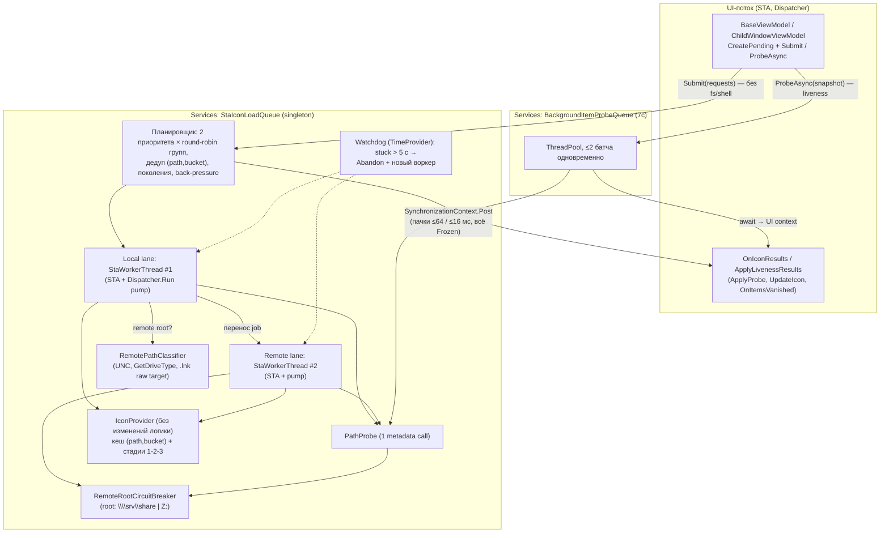
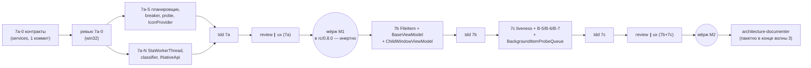

# План: фоновая загрузка иконок (бэклог 1.x, пункт 7)

> **Статус: реализовано, 2026-09-30.** Все три волны (7a/7b/7c) закрыты, три раунда ревью пройдены,
> смёржено в `rc/0.8.0` (`a83d430`). Архитектурные решения зафиксированы в
> [ADR-046](../../adr/ADR-046-background-icon-loading.md) (amends ADR-039, ADR-012 Решение 3, ADR-008).
> План ниже — исторический артефакт планирования, детали реализации могли уточниться в ревью (см. ADR-046
> «Известные ограничения» и правки D-3/C-4 по итогам review iteration 2).

> **Источник:** [backlog-1x-master-plan.md §7](backlog-1x-master-plan.md) (рамки 7a/7b/7c, их не
> пересматриваем, только детализируем), ROADMAP «Загрузка иконок на UI-потоке: большой портал или сетевые
> ярлыки замораживают интерфейс при старте», ADR-039 «Known follow-up», ADR-012 Решение 3, ADR-008 §2 и
> отклонённая альтернатива A.
> **Ветка:** `feature/background-icon-loading` в отдельном git worktree от `rc/0.8.0` (см. §9).
> **Планировщик:** `fences-feature-planner`, 2026-09-29. **Scope: XL**: 7a — L (Services + натив),
> 7b — L (Core + UI), 7c — M/L (UI + Services).
> **ADR:** новый **ADR-046 «Background STA icon loading»** (номер предварительный, по правилу G-7) +
> amendments **ADR-039** (follow-up закрыт), **ADR-012** (Freeze несёт межпоточную нагрузку),
> **ADR-008** (альтернатива A принята, но только для read-only извлечения иконок).

---

## 0. Ограничения (обязательны для каждого исполнителя)

| # | Правило |
|---|---|
| C-1 | **Persistence заморожен.** Не трогать `StateEnvelope`/DTO/миграции/`IAppSettings`/`user.config`/`Settings.settings`, не добавлять ключей. Все константы очереди (таймауты, лимиты) — `internal` константы/options-record, **не настройки**. Если исполнителю «нужна» настройка — `CLARIFICATION_NEEDED`. |
| C-2 | **Кеш `(path, bucket)`, трёхстадийный фолбэк и UNC/offline-скип ADR-039 не меняются.** Тело `IconProvider.GetIcon(string,int)` (порядок стадий, условия кеширования, `ShouldSkipItemStages`) остаётся байт-в-байт, кроме комментария о потоке. Разрешены только: (а) потокобезопасность (`_placeholderIcon`, static-плейсхолдер `IconFactory`); (б) **аддитивные** члены из §3.2: peek в существующий кеш без изменения его семантики и отдельный кеш type-иконок (стадия 3). |
| C-3 | P/Invoke только за `INativeApi`. На UI-потоке в путях добавления, переименования, смены размера и liveness **не должно остаться** ни одного вызова shell, P/Invoke или `File`/`Directory`-метаданных (исключения перечислены в §7.4). |
| C-4 | Каждый `ImageSource`, пересекающий границу потоков, заморожен. Проверка **явная, в рантайме** (`!icon.IsFrozen` → `Outcome = Failed` + событие лога), **не `Debug.Assert`**: в .NET 8 сработавший `Debug.Assert` без отладчика валит test host так же, как в кейсе из `sta-test-conventions.md`. |
| C-5 | Фон → UI только неблокирующим `SynchronizationContext.Post` (эквивалент `UiDispatch.TryBeginInvoke`). Ни одного `Send`/`Invoke`/`Wait` с воркера на UI. Любой колбэк на воркере или в пуле обёрнут в try/catch: исключение там убивает процесс. |
| C-6 | 0 errors / 0 warnings (CS/CA/SA/nullable/ruleset) в `dotnet build` и `dotnet test`. Без `#pragma`/`[SuppressMessage]`/`<NoWarn>`. |
| C-7 | Тесты без wall-clock (правило «Wall-clock тесты» из `docs/Refactoring/Testing/sta-test-conventions.md`): таймауты и время идут через инжектируемый `TimeProvider` (свой `ManualTimeProvider` в `tests/Helpers`, **без нового NuGet**), ожидание — через сигналы с бюджетом 10 с. STA-тесты — через `StaTestRunner`. |
| C-8 | RESX не добавляется (пользовательских текстов нет). Диагностика — только closed-set поля, **без путей и имён шар/серверов** (privacy-инвариант ADR-027). |

---

## 1. Что блокирует UI сегодня (сверено с кодом 2026-09-29)

| # | Место | Блокирующая работа на UI-потоке |
|---|---|---|
| B-1 | `BaseViewModel.AddFilesCore` | `IIconProvider.GetIcon` для каждого пути: `File.Exists`/`Directory.Exists`, freshness `GetLastWriteTimeUtc`, стадии 1–2 (`IShellItemImageFactory`, `SHGetFileInfo` без `USEFILEATTRIBUTES`) |
| B-2 | `FileItem` ctor | `ComputeExists` (`File.Exists` + `Directory.Exists`) и `Directory.Exists` для `IsDirectory`: до 3 metadata round-trip на элемент |
| B-3 | `BaseViewModel.RefreshItemsLiveness` (тик 3 с через `RefreshExistence` → `UiDispatch.TryBeginInvoke`) | `FileItem.Refresh()` для **каждого** элемента плюс синхронные `GetIcon` при missing→present и в `RetryPlaceholderIcon` |
| B-4 | `TryRenameItem`, `RefreshAllItemIcons` (смена размера или DPI), `RetryPlaceholderIcon` | синхронный `GetIcon`; `FileItem.Relocate` ещё и делает fs-проверки |
| B-5 | `ChildWindowViewModel.ResolveManagedReplacements` (`LoadFromModel`) | `File.Exists`/`Directory.Exists` для **каждого** пути панели до `ReplaceAll`. Для `Z:\…` и UNC это тот же сетевой стопор. *В мастер-плане не упомянут, найден при планировании.* |
| B-6 | `WindowManager.ResolveStalePanelPaths` (`LoadWindowsState`, старт) | то же для **всех** путей **всех** панелей до создания окон. *Найден при планировании.* |
| B-7 | `ChildWindowViewModel.ReconcileAfterShellCommand` | `PathExists` для **каждого** элемента панели после любой shell-команды, хотя reconcile действует только на managed-элементы. *Найден при планировании.* |
| B-8 | `ProcessPendingVanishedManagedItems`, `ProcessPendingSiblingAdoption` | `PathExists` только по managed-путям, то есть по локальному `%LOCALAPPDATA%`. **Оставляем** (см. §7.4). |

Вне scope, фиксируется как follow-up в ADR-046: перечисление сетевого портала (`GetSourceFiles`/
`GetSafeEntries`, `Directory.Exists(SourceFolderPath)`, R7-6 мастер-плана), `MovedOutVerifier` (жест
пользователя, локальные пути), `AddDroppedFiles`/`MoveIn` (жест пользователя), `SystemIconsPanel` (ADR-007,
десяток системных иконок по PIDL).

---

## 2. Архитектура

### 2.1. Схема



### 2.2. Ключевые решения (ADR-046, кратко)

| # | Решение | Отклонённые альтернативы и почему |
|---|---|---|
| D-1 | **Выделенные STA-потоки с message pump.** Каждый воркер — `Thread(ApartmentState.STA, IsBackground = true)` с `Dispatcher.Run()` внутри; задания приходят `Dispatcher.BeginInvoke` на собственный диспетчер воркера. Pump нужен сторонним shell-extension (скрытые окна, таймеры, исходящие COM-вызовы в STA). | (а) `Task.Run`/MTA: shell COM вне STA не определён (ADR-008 §2), часть icon-handler'ов STA-only. (б) Ручной цикл на `WaitHandle.WaitOne`: CLR-ожидание на STA прокачивает только COM/`SendMessage`, posted-сообщения handler'ов не обработаются. Если `win32-interop-specialist` по ревью выберет (б), контракт `IStaWorker` не меняется. |
| D-2 | **Две «полосы» (lanes), по одному воркеру в каждой:** Local и Remote. Задание сначала попадает в Local; на старте исполнения классификатор проверяет, сетевой ли корень у пути (UNC; буква с `DRIVE_REMOTE`) и, для `.lnk`, у **сырой цели ярлыка** (`IShellLink::GetPath(SLGP_RAWPATH)` без `Resolve`, без сети). Сетевое задание переносится в Remote. | **Один воркер + только watchdog** (как в мастер-плане) не выполняет метрику: 20 ярлыков на недоступную шару × 5 с таймаута = 100 с заблокированной очереди и 20 брошенных потоков. **N одинаковых воркеров** не спасает: все застрянут на той же шаре. Константа `MaxStaWorkersPerLane = 1`; переход на 2 в Local — однострочная правка по замеру M-7.5. |
| D-3 | **Circuit breaker по сетевому корню.** Вызов на корень дольше `SlowThreshold = 2 с` или зависание по watchdog открывают корень на `RootQuarantine = 60 с`: все задания и пробы этого корня завершаются сразу (`Unavailable`). Через 60 с корень полуоткрыт, пропускается одно задание. Пока один вызов на корень висит дольше порога, параллельные вызовы на тот же корень считают его открытым. **Ревью it.2 (UX-CRITICAL):** такой short-circuit никогда не трогал файловую систему, поэтому несёт `Exists = null, IsDirectory = null` (неизвестно) — как и любой другой `Unavailable`, а не `Exists = false`: иначе `BaseViewModel.OnIconResults` применял бы `ApplyProbe(false, false)` к **собственному локальному пути самого элемента** (например, `.lnk` с недоступной сетевой целью), и ярлык на секунды сереет как «отсутствующий», хотя сам файл `.lnk` никуда не делся. Тот же принцип для `PathProbe.Probe`'а короткого замыкания (см. D-11/§5.1 п.5) — и для 7c-пайплайна liveness (`BaseViewModel.RunSingleLivenessPassAsync`): `PathProbeResult.IsKnown = false` тоже должен оставлять элемент нетронутым (`continue` до `ApplyProbe`), а не как «подтверждённое отсутствие» — иначе элемент на карантинном корне сереет и уходит в `OnItemsVanished` тем же способом, что и в исходной находке ревью it.2 (закрыто малой итерацией 3, N-2). | Скип только UNC (ADR-039) не ловит `Z:\` и `.lnk` → шара; без breaker'а каждая проба снова ждёт SMB-таймаут. |
| D-4 | **Watchdog.** Периодический таймер (`TimeProvider`, `WatchdogPeriod = 500 мс`, взводится только когда что-то исполняется). Задание дольше `StuckJobTimeout = 5 с` → все ожидающие получают `Unavailable`; `IStaWorker.Abandon()` (поток не убиваем: `Thread.Abort` в .NET 8 нет; если вызов когда-нибудь вернётся, поток сам выключит свой диспетчер и завершится, результат выбрасывается); создаётся новый воркер, очередь полосы продолжается. Local: путь уходит в карантин `PathQuarantine = 5 мин`. Remote: `breaker.ReportStuck(root)`. Не больше `MaxAbandonedWorkersPerLane = 2` одновременно висящих брошенных потоков; при превышении полоса **отключается** до конца сессии (её задания → `Unavailable`, событие `IconLaneDisabled`); когда брошенный поток возвращается, счётчик уменьшается. | Бесконечно пересоздавать воркеры нельзя: это утечка потоков. |
| D-5 | **Сначала плейсхолдер, потом type-иконка (Interim), потом реальная.** Элемент создаётся сразу: иконка = `TryPeekCachedIcon(path, size)` ?? `TryPeekTypeIcon(ext, dirHeuristic)` ?? `PlaceholderIcon` (универсальный, `IsPlaceholder == true`). В Local-полосе задания type-иконок (стадия 3 по расширению, кеш `(ext \| <dir>)`) исполняются **раньше** всех остальных и рассылаются как `Interim` всем ещё ожидающим запросам этого типа. Серые квадраты живут 1–2 кадра, а не секунды. На UI-потоке shell не вызывается никогда: peek — это чтение словаря под lock. | Type-иконку на UI через `SHGetFileInfo(USEFILEATTRIBUTES)`: всё равно shell-вызов на UI, первый вызов на расширение грузит image list. `null` вместо плейсхолдера: пустые слоты без индикации, а вызывающий явно требует generic-плейсхолдер. |
| D-6 | **Приоритеты: группы.** Панель — это `IIconLoadGroup`. Уровни `Visible` (окно панели видимо, то есть текущая страница) и `Background`. Внутри уровня — **round-robin по группам** (портал на 1000 файлов не морит маленькую панель), внутри группы FIFO в порядке сабмита. VM сабмитит сначала видимую проекцию `FileItems`, затем отфильтрованные `AllItems`. Смена страницы → `group.Priority` меняется, ожидающие задания переезжают. Приоритет по вьюпорту скролла — follow-up. | Приоритет на уровне отдельного запроса: VM не знает вьюпорт, а переприоритизация при смене страницы стала бы O(n). |
| D-7 | **Дедуп `(path OrdinalIgnoreCase, Snap(size))`**: один fetch, много ожидающих (группа + поколение). Отмена одного ожидающего не отменяет fetch, если остались другие. | — |
| D-8 | **Отмена через поколения.** `CancelPending()` увеличивает `Generation` группы, снимает её ожидающих со всех заданий (задание без ожидающих лениво выбрасывается при dequeue). Результаты несут поколение сабмита; `Post`-колбэк сверяет его с текущим и молча отбрасывает устаревшие. `Dispose()` группы = `CancelPending` + флаг, после которого `Post` ничего не доставляет. | `CancellationToken` на каждый запрос дороже (1000 регистраций) и не решает гонку «результат уже в очереди диспетчера». |
| D-9 | **Доставка пачками.** Буфер результатов группы сбрасывается одним `Post`, когда набралось `DeliveryBatchSize = 64` результата, прошло `DeliveryFlushInterval = 16 мс` с первого результата в буфере или полоса опустела. Это и есть митигация мигания R7-4. | `Post` на каждый результат: 1000 операций диспетчера и 1000 layout-проходов. |
| D-10 | **Back-pressure.** `MaxPendingJobs = 20 000`. При переполнении выбрасываются **самые старые `Background`**-задания (`Dropped`); VM повторит их по политике повторов (§5.4). | Блокировать `Submit`: это UI-поток. |
| D-11 | **Проба существования** — одна metadata-операция (`File.GetAttributes`: отсутствие → missing, `Directory`-флаг → `IsDirectory`) вместо 2–3 `Exists`. Семантика прежняя: любая ошибка → `Exists = false`, как у `File.Exists`. В icon-задании проба выполняется на воркере перед `GetIcon`. Внутри `GetIcon` своя `File.Exists` остаётся (C-2), это известный двойной round-trip **вне UI**, оптимизация — follow-up. | Отдать `exists` из `IconProvider` через internal-перегрузку: меняет `GetIcon`, нарушает C-2. |
| D-12 | **Liveness (7c) — отдельная очередь проб на пуле потоков**, не на STA-воркерах: fs без COM. Не больше `MaxConcurrentProbeBatches = 2` батчей одновременно (`SemaphoreSlim.WaitAsync`, пул не блокируется ожиданием); один батч на панель за раз (single-flight в VM); breaker D-3 общий с иконками. | Liveness через STA-очередь: зависшая `Exists` на шаре останавливала бы загрузку иконок. |
| D-13 | **Fallback для тестов и headless.** Если `IIconLoadQueue`/`IItemProbeQueue` не переданы (старые тесты, `new ChildWindowViewModel(...)` без DI) или на UI-потоке нет `SynchronizationContext`, VM использует `SynchronousIconLoadQueue`/`SynchronousItemProbeQueue` (UI/Services). Они выполняют прежнюю синхронную логику inline и доставляют результат в том же вызове. **Существующие тесты не переписываются.** В проде DI всегда отдаёт настоящие очереди. | Сделать параметр обязательным: правка ~10 тестовых файлов с `new ChildWindowViewModel(…)` без пользы. |
| D-14 | **Жизненный цикл.** Очередь — DI-singleton, `IDisposable`; воркеры стартуют **лениво** при первом `Submit` (резолв в тестах и DI-валидация потоков не плодят). `Dispose` (из `_serviceProvider.Dispose()` в конце `ShutdownSequence`): флаг, отмена всех групп, остановка watchdog, `InvokeShutdown` диспетчеров воркеров, `Join(1 с)` на каждый; брошенные потоки не ждём (они background). После `Dispose` ни одного `Post`. | — |

### 2.3. Политика повторов (связь с ADR-039/M3)

- Missing-путь по-прежнему не кешируется (ADR-039), переход missing→present по liveness → новый запрос
  иконки (как сейчас, только асинхронно).
- Ограниченный M3-retry (`MaxPlaceholderRetryAttempts = 3`, backoff 1 и 2 тика) расширяется: он
  срабатывает, если элемент `Exists` **и** (иконка `IsPlaceholder` **или** последний исход
  `Unavailable`/`Failed`/`Dropped`) **и** запрос для элемента сейчас не в полёте. Попытка = `Submit`.
- Карантин пути (Local, 5 мин) и корня (Remote, 60 с) живёт в очереди. Запрос в карантине получает
  `Unavailable` без обращения к shell. Счётчик попыток M3 при этом тратится, так что зависший путь
  перестаёт дёргаться после трёх тиков.

---

## 3. Контракты (сигнатуры) — шаг 7a-0, замораживаются до параллельной работы

Шаг **7a-0** выполняет `dotnet-services-engineer` **первым и отдельным коммитом**: только интерфейсы,
records, enum'ы, заглушки `throw new NotImplementedException()` там, где нужен компилируемый DI, и
`SynchronousIconLoadQueue`/`SynchronousItemProbeQueue`. `win32-interop-specialist` ревьюит 7a-0
(STA-часть контракта) **до** старта 7a-S ∥ 7a-N. После этого сигнатуры меняются только по взаимному
согласию через оркестратора.

### 3.1. `DesktopOrganizer.Services.Abstractions` (публичные)

Файлы: `src/DesktopOrganizer.Services.Abstractions/IconLoading/{IconLoadPriority,IconLoadOutcome,IconLoadRequest,IconLoadResult,PathProbeResult}.cs`,
`src/DesktopOrganizer.Services.Abstractions/Interfaces/{IIconLoadQueue,IIconLoadGroup,IItemProbeQueue}.cs`.
Namespace — `DesktopOrganizer.Services.Abstractions`, как у `IconPixelSize`.

```csharp
public enum IconLoadPriority
{
    Visible = 0,     // panel window visible (current page) — always dequeued first
    Background = 1,  // hidden page
}

public enum IconLoadOutcome
{
    Loaded,       // final icon from IIconProvider.GetIcon (may be the provider's placeholder — check IsPlaceholder)
    Interim,      // provisional type icon (stage 3 by extension); a final result for the same request follows
    Unavailable,  // not fetched: remote root open / watchdog timeout / path quarantined / lane disabled. Icon == null
    Failed,       // unexpected worker failure (exception, unfrozen result). Icon == null
    Dropped,      // evicted by back-pressure before execution. Icon == null
}

/// <param name="Path">Item path as tracked by the caller (matched back OrdinalIgnoreCase).</param>
/// <param name="PixelSize">Requested physical pixel size; the queue snaps it (IconPixelSize.Snap).</param>
public sealed record IconLoadRequest(string Path, int PixelSize);

/// <param name="PixelSize">Snapped size the icon was fetched for.</param>
/// <param name="Generation">The group's Generation at Submit time.</param>
/// <param name="Icon">Frozen; non-null only for Loaded/Interim.</param>
/// <param name="Exists">null = unknown (Interim, watchdog, Failed, Dropped).</param>
/// <param name="IsDirectory">null = unknown.</param>
public readonly record struct IconLoadResult(
    string Path, int PixelSize, int Generation, IconLoadOutcome Outcome,
    ImageSource? Icon, bool? Exists, bool? IsDirectory);

/// <param name="IsKnown">false when the probe was short-circuited (open remote root) or failed; Exists is then false (legacy File.Exists semantics).</param>
public readonly record struct PathProbeResult(string Path, bool Exists, bool IsDirectory, bool IsKnown);

/// <summary>One panel's slice of the icon queue. UI-thread API; every member is non-blocking.</summary>
public interface IIconLoadGroup : IDisposable
{
    IconLoadPriority Priority { get; set; }  // re-prioritizes pending jobs of this group
    int Generation { get; }
    void Submit(IReadOnlyList<IconLoadRequest> requests);  // never touches fs/shell; order = FIFO within the group
    void CancelPending();                                   // Generation++; pending/in-flight results for older generations are never delivered
}

public interface IIconLoadQueue : IDisposable
{
    /// <param name="deliveryContext">Context results are Posted to (the UI thread's). Captured by the caller, never Send.</param>
    /// <param name="onResults">Invoked on deliveryContext with a batch (≤ DeliveryBatchSize) of results of the current generation.</param>
    IIconLoadGroup CreateGroup(
        IconLoadPriority priority,
        SynchronizationContext deliveryContext,
        Action<IReadOnlyList<IconLoadResult>> onResults);
}

public interface IItemProbeQueue
{
    /// Runs off the calling thread; never faults except OperationCanceledException on cancellation.
    /// Result order == paths order. Continuation resumes on the caller's context (await).
    Task<IReadOnlyList<PathProbeResult>> ProbeAsync(IReadOnlyList<string> paths, CancellationToken cancellationToken);
}
```

### 3.2. `IIconProvider` — аддитивные члены (C-2)

Файл: `src/DesktopOrganizer.Services.Abstractions/Interfaces/IIconProvider.cs`. Существующие члены не
меняются (в remarks `GetIcon(string,int)` «UI-thread (STA) call» заменяется на «any STA thread; in
production the icon-load worker»).

```csharp
/// Provider's own generic placeholder: created once (thread-safe), frozen. First access must be on an STA thread.
ImageSource PlaceholderIcon { get; }

/// Cache-only lookup in the existing (path, Snap(size)) cache: no fs, no shell, NO freshness check
/// (the queued GetIcon re-validates). Any thread. Does not change LRU order semantics beyond a normal hit.
bool TryPeekCachedIcon(string filePath, int pixelSize, [NotNullWhen(true)] out ImageSource? icon);

/// Cache-only lookup of a type icon previously produced by GetTypeIcon. No fs, no shell. Any thread.
ImageSource? TryPeekTypeIcon(string filePath, bool isDirectory);

/// Stage 3 ONLY (SHGFI_USEFILEATTRIBUTES | SHGFI_SHELLICONSIZE by extension/attribute), cached per
/// (lower-case extension | "<dir>") in a SEPARATE cache; never touches the file system. Shell call →
/// worker thread only. Placeholder on failure (not cached).
ImageSource GetTypeIcon(string filePath, bool isDirectory);
```

В реализации (`IconProvider`, 7a-S): `_placeholderIcon` становится потокобезопасной ленивой
инициализацией (`LazyInitializer.EnsureInitialized` с lock-объектом), `IsPlaceholder` читает поле через
`Volatile.Read`. У `IconFactory` static `_placeholderIcon` публикуется через
`Interlocked.CompareExchange`. Type-кеш — `ConcurrentDictionary<string, ImageSource>`, ключ
`ext.ToLowerInvariant()` или `"<dir>"`.

### 3.3. Services — internal (7a-0 объявляет, реализуют владельцы из §4)

Файлы: `src/DesktopOrganizer.Services/Interfaces/{IStaWorker,IStaWorkerFactory,IRemotePathClassifier,IRemoteRootCircuitBreaker,IPathProbe}.cs`,
`src/DesktopOrganizer.Services/Enums/DriveKind.cs`.

```csharp
internal interface IStaWorker : IDisposable
{
    int ManagedThreadId { get; }
    bool IsAbandoned { get; }
    /// Queues work to run INSIDE the worker's message pump. Never blocks. false if stopping/abandoned.
    /// The worker runs at most one queued item at a time: a nested pump (COM re-entrancy) must not start
    /// the next item on the same stack — non-reentrant guard is part of this contract.
    bool TryPost(Action work);
    /// Detach from a worker stuck in a native call: accepts no more work; if the current call ever
    /// returns, the thread shuts its own Dispatcher down and exits. Never blocks the caller.
    void Abandon();
    // Dispose: InvokeShutdown on the worker's Dispatcher + Join(joinTimeout); never throws.
}

internal interface IStaWorkerFactory
{
    IStaWorker Create(string name);   // thread name e.g. "DO.IconWorker.Local#2"; STA; IsBackground = true
}

internal interface IRemotePathClassifier
{
    /// "\\srv\share" for UNC (incl. \\?\UNC\), "Z:" for a DRIVE_REMOTE letter, else null.
    /// Pure string + cached GetDriveType per letter (TTL 60 s); no network I/O. Any thread.
    string? GetOwnRemoteRoot(string path);

    /// For a .lnk: the RAW stored target (IShellLinkW::GetPath SLGP_RAWPATH after IPersistFile::Load
    /// STGM_READ, env vars expanded, NO Resolve) → GetOwnRemoteRoot(target). null for local/unknown/PIDL-only.
    /// COM → icon worker (STA) thread only.
    string? GetShortcutTargetRemoteRoot(string shortcutPath);
}

internal interface IRemoteRootCircuitBreaker
{
    bool IsOpen(string rootKey);                                // open, or an in-flight call on it is older than SlowThreshold
    IDisposable BeginCall(string rootKey);                      // in-flight tracking; Dispose = ReportCompleted(elapsed)
    void ReportStuck(string rootKey);                           // watchdog → open for RootQuarantine
}

internal interface IPathProbe
{
    /// One metadata call. Own remote root open → (Exists=false, IsKnown=false) without I/O.
    /// Never throws; any failure → Exists=false (legacy File.Exists semantics).
    PathProbeResult Probe(string path);
}

internal enum DriveKind { Unknown, NoRootDirectory, Removable, Fixed, Remote, CdRom, RamDisk }
```

### 3.4. `INativeApi` — новые члены (реализует `win32-interop-specialist`)

```csharp
/// IShellLinkW + IPersistFile::Load(STGM_READ) + GetPath(SLGP_RAWPATH). No Resolve(), no network.
/// RCWs released deterministically (Marshal.ReleaseComObject in finally) on the calling STA thread.
bool TryGetShortcutRawTarget(string shortcutPath, [NotNullWhen(true)] out string? targetPath);

/// GetDriveTypeW(rootPath) mapped to DriveKind. rootPath like "Z:\".
DriveKind GetDriveKind(string rootPath);
```

### 3.5. Реализации Services (7a-S / 7a-N / 7c)

```csharp
internal sealed class StaIconLoadQueue : IIconLoadQueue            // 7a-S
{
    public StaIconLoadQueue(IIconProvider iconProvider, IPathProbe pathProbe, IRemotePathClassifier classifier,
        IRemoteRootCircuitBreaker breaker, IStaWorkerFactory workerFactory, IDiagnosticsLog diagnosticsLog);
    internal StaIconLoadQueue(/* same */, IconLoadQueueOptions options, TimeProvider timeProvider);
    internal void RunWatchdogPass();      // test seam (the timer calls it)
    internal int PendingJobCount { get; } // test seam
}

internal sealed record IconLoadQueueOptions(                       // 7a-S
    TimeSpan StuckJobTimeout,        // 5 s
    TimeSpan WatchdogPeriod,         // 500 ms
    int DeliveryBatchSize,           // 64
    TimeSpan DeliveryFlushInterval,  // 16 ms
    TimeSpan PathQuarantine,         // 5 min
    int MaxAbandonedWorkersPerLane,  // 2
    int MaxPendingJobs)              // 20 000
{
    public static IconLoadQueueOptions Default { get; }
}

internal sealed class RemoteRootCircuitBreaker : IRemoteRootCircuitBreaker   // 7a-S
{
    public RemoteRootCircuitBreaker();                                           // SlowThreshold 2 s, RootQuarantine 60 s, TimeProvider.System
    internal RemoteRootCircuitBreaker(TimeSpan slowThreshold, TimeSpan rootQuarantine, TimeProvider timeProvider);
}

internal sealed class PathProbe(IRemotePathClassifier classifier, IRemoteRootCircuitBreaker breaker) : IPathProbe;   // 7a-S
internal sealed class StaWorkerThread : IStaWorker;                              // 7a-N
internal sealed class StaWorkerFactory : IStaWorkerFactory;                      // 7a-N
internal sealed class RemotePathClassifier(INativeApi nativeApi) : IRemotePathClassifier;  // 7a-N

internal sealed class BackgroundItemProbeQueue : IItemProbeQueue                  // 7c
{
    public BackgroundItemProbeQueue(IPathProbe pathProbe, IDiagnosticsLog diagnosticsLog);   // MaxConcurrentProbeBatches = 2
    internal BackgroundItemProbeQueue(IPathProbe pathProbe, IDiagnosticsLog diagnosticsLog, int maxConcurrentBatches);
}
```

DI (`src/DesktopOrganizer.Services/Configuration/DiConfig.cs`, одна правка в 7a-S и одна строка в 7c):
singleton'ы `IRemoteRootCircuitBreaker`, `IRemotePathClassifier`, `IPathProbe`, `IStaWorkerFactory`,
`IIconLoadQueue → StaIconLoadQueue`, `IItemProbeQueue → BackgroundItemProbeQueue` (7c). MS DI выбирает
публичный ctor, internal-ctor для тестов ему не мешает (прецедент — `IconProvider`).

### 3.6. Core — `FileItem` (7b)

Файл: `src/DesktopOrganizer.Core/Models/FileItem.cs`. Существующие ctor, `Refresh()` и
`Relocate(string, ImageSource?)` остаются (тесты, совместимость); в XML-doc пометка «fs on the calling
thread — not for UI-thread production paths since ADR-046».

```csharp
/// No file-system access. Exists = true (optimistic, no grey flash); IsDirectory = isDirectoryHint ??
/// (extension is empty) — the same heuristic IconProvider uses for a missing path; IsProbePending = true.
public static FileItem CreatePending(string path, ImageSource? icon, string? displayName = null, bool? isDirectoryHint = null);

/// True until the first ApplyProbe. Not bindable (no INPC) — view-model bookkeeping only.
public bool IsProbePending { get; }

/// Applies an off-thread existence probe; raises PropertyChanged only for values that flipped; clears IsProbePending.
/// <returns>true when IsDirectory changed (the caller may need to re-filter/re-sort).</returns>
public bool ApplyProbe(bool exists, bool isDirectory);

/// Relocate without fs: after a successful rename the item exists and its directory-ness cannot change.
/// Same INPC set as Relocate; Exists := true; IsDirectory unchanged; clears the displayName override.
public void RelocateInPlace(string newPath, ImageSource? icon);
```

### 3.7. UI — `BaseViewModel` (7b + 7c)

Файл: `src/DesktopOrganizer.UI/ViewModels/BaseViewModel.cs`.

```csharp
public abstract class BaseViewModel(
    IIconProvider iconProvider,
    IIconLoadQueue? iconLoadQueue = null,      // null → SynchronousIconLoadQueue (D-13)
    IItemProbeQueue? itemProbeQueue = null)    // null → SynchronousItemProbeQueue (D-13)
    : INotifyPropertyChanged
{
    // ── 7b ──
    protected internal IconLoadPriority IconLoadPriority { get; set; }  // forwards to the lazily created group
    internal int ItemsGeneration { get; }                               // ++ on ReplaceAll (test seam + liveness guard)
    internal bool HasPendingIconLoads { get; }                          // test seam
    internal void TryRenameItem(FileItem item, string newPath);         // RelocateInPlace(newPath, peek ?? item.Icon) + Submit
    protected internal void RefreshAllItemIcons();                      // CancelPending + resubmit all at current size; current icons stay until replaced
    protected void DisposeIconLoading();                                // group.Dispose + liveness CTS cancel; subclasses call from Dispose
    protected virtual void OnProbeResultsApplied(bool directoryFlagsChanged); // default: if changed → OnSourceChanged()

    // ── 7c ──
    internal Task RefreshItemsLivenessAsync();   // snapshot → ProbeAsync → apply on UI; completes after apply OR drop; never faults
    internal void RefreshItemsLiveness();        // => _ = RefreshItemsLivenessAsync(); (existing callers/tests unchanged)
    protected virtual bool CanApplyLivenessResults => true;   // ChildWindowViewModel: !_disposed && _shellOperationDepth == 0

    // private: AddFilesCore(IReadOnlyList<string>) → CreatePending + one Submit per call;
    //          OnIconResults(IReadOnlyList<IconLoadResult>); ApplyLivenessResults(LivenessSnapshot, IReadOnlyList<PathProbeResult>);
    //          RetryPlaceholderIcon → Submit-based; _allItemPaths HashSet → Dictionary<string, FileItem> _itemsByPath (OrdinalIgnoreCase);
    //          per-item icon state: ConditionalWeakTable<FileItem, ItemIconState> { InFlightPath, InFlightSize, LastOutcome }.
}
```

### 3.8. UI — `ChildWindowViewModel`, `ChildWindow`, fallback-очереди

- `ChildWindowViewModel` ctor: **в конец** добавляются `IIconLoadQueue? iconLoadQueue = null,
  IItemProbeQueue? itemProbeQueue = null` и передаются в `base(...)`. DI (transient) резолвит их как
  зарегистрированные опциональные параметры, а тестовые `new ChildWindowViewModel(8–9 args)` компилируются
  без правок.
- `internal void SetIconLoadVisibility(bool isVisible)` → `IconLoadPriority`.
- `LoadFromModel`: `IconLoadPriority = model.IsVisible ? Visible : Background` **до** `ReplaceAll`.
- `Dispose`: `DisposeIconLoading()`.
- `OnProbeResultsApplied` override: debounce 100 мс (`ProbeRefilterDebounceWindow`) через лениво
  создаваемый `DispatcherDebounceTimer`, по образцу `ResolveDefaultIconResizeDebounceTimer`, без нового
  ctor-параметра; без `Application.Current` — немедленно.
- `src/DesktopOrganizer.UI/Views/ChildWindow.xaml.cs`: `IsVisibleChanged` → `ViewModel.SetIconLoadVisibility((bool)e.NewValue)`
  (одна подписка и отписка в существующих местах подписки и очистки). `ChildWindowModel.IsVisible` **не**
  становится INPC: это модель, которую мапит замороженный `PanelStateMapper`.
- `src/DesktopOrganizer.UI/Services/SynchronousIconLoadQueue.cs`, `SynchronousItemProbeQueue.cs` (internal):
  синхронная легаси-логика (`GetIcon` + `File.Exists`/`Directory.Exists`), доставка inline.

---

## 4. Владение файлами (минимальное пересечение)

| Файл | 7a-0 | 7a-S (`dotnet-services-engineer`) | 7a-N (`win32-interop-specialist`) | 7b (`dotnet-services-engineer`) | 7c (`dotnet-services-engineer`) |
|---|---|---|---|---|---|
| `Services.Abstractions/IconLoading/*.cs`, `Interfaces/IIconLoadQueue.cs`, `IIconLoadGroup.cs`, `IItemProbeQueue.cs` | **создаёт** | — | ревью | — | — |
| `Services.Abstractions/Interfaces/IIconProvider.cs` | **члены §3.2** | — | — | — | — |
| `Services/Interfaces/IStaWorker*.cs`, `IRemote*.cs`, `IPathProbe.cs`, `Enums/DriveKind.cs` | **создаёт** | — | ревью | — | — |
| `Services/Interfaces/INativeApi.cs`, `Tools/NativeApi.cs`, `NativeMethods`/`IconNativeMethods` | сигнатуры §3.4 (заглушки в `NativeApi`) | — | **✎** | — | — |
| `Services/Tools/IconLoading/StaWorkerThread.cs`, `StaWorkerFactory.cs`, `RemotePathClassifier.cs` | — | — | **✎ (новые)** | — | — |
| `Services/Tools/IconLoading/StaIconLoadQueue.cs`, `IconLoadQueueOptions.cs`, `IconLoadJob.cs`, `IconLoadLane.cs`, `RemoteRootCircuitBreaker.cs`, `PathProbe.cs` | — | **✎ (новые)** | ревью STA-части | — | — |
| `Services/Providers/IconProvider.cs`, `Services/Tools/IconFactory.cs` | — | **✎** (C-2) | ревью | — | — |
| `Services/Diagnostics/IconDiagnostics.cs` + `docs/Refactoring/Testing/diagnostics-log-events.md` | — | **✎** (события обеих частей; 7a-N передаёт имена) | — | — | ✎ (liveness-события) |
| `Services/Configuration/DiConfig.cs` | заглушечные регистрации | **✎** | — | — | ✎ (1 строка) |
| `Services/Tools/IconLoading/BackgroundItemProbeQueue.cs` | — | — | — | — | **✎ (новый)** |
| `Core/Models/FileItem.cs` | — | — | — | **✎** | — |
| `UI/ViewModels/BaseViewModel.cs` | — | — | — | **✎** | **✎** |
| `UI/ViewModels/ChildWindowViewModel.cs` | — | — | — | **✎** (ctor, группа, приоритет, refilter) | **✎** (`RefreshExistence`, pending-vanished, B-5, B-7) |
| `UI/Views/ChildWindow.xaml.cs` | — | — | — | **✎** (`IsVisibleChanged`) | — |
| `UI/Services/SynchronousIconLoadQueue.cs`, `SynchronousItemProbeQueue.cs` | **создаёт** | — | — | — | — |
| `UI/Services/WindowManager.cs` (только `ResolveStalePanelPaths`, B-6) | — | — | — | — | **✎** (горячий файл, §9.3) |

`win32-interop-specialist` не правит ничего вне своих файлов. Его события в `IconDiagnostics` добавляет
services-инженер (один владелец горячего файла). Тестовые файлы — в §8, владелец —
`tdd-test-engineer`; реализующие агенты пишут минимальные тесты на свою часть в своих новых тест-файлах.

---

## 5. 7a — очередь (Services)

### 5.1. 7a-S: планировщик (`dotnet-services-engineer`)

1. **Структуры.** Один `lock (_gate)`, который никогда не держится во время исполнения задания или
   доставки. На каждую полосу: два кольца групп (`Visible`, `Background`), у группы `Queue<IconLoadJob>`.
   Глобальный `Dictionary<JobKey, IconLoadJob>` для дедупа. Отдельная очередь type-заданий Local-полосы,
   она обслуживается первой. `IconLoadJob { Key, Waiters: List<(Group, Generation)>, Lane, RemoteRoot?, StartedAt? }`.
2. **Submit** (UI-поток, O(n), без fs/shell): snap размера, дедуп (новый ожидающий добавляется к
   существующему заданию; если задание в группе с более низким приоритетом, оно не переезжает, а
   ожидающий получит результат), вычисление type-ключа (`ext` / пустое расширение → `<dir>`) и постановка
   type-задания, если `TryPeekTypeIcon` промахнулся. Back-pressure D-10. Ленивый старт воркера полосы.
3. **Dequeue** (на воркере через `TryPost(RunNext)`): type-задания → `Visible`-кольцо round-robin →
   `Background`-кольцо. Задания без живых ожидающих пропускаются.
4. **Исполнение, Local.** Карантин пути → `Unavailable`. `classifier.GetOwnRemoteRoot(path)` ??
   (`.lnk` ? `GetShortcutTargetRemoteRoot`) → если корень есть, задание переезжает в Remote-полосу (в
   конец её кольца той же группы). Иначе `pathProbe.Probe` → `iconProvider.GetIcon(path, size)` → проверка
   `IsFrozen` (C-4) → результат `Loaded`.
5. **Исполнение, Remote.** `breaker.IsOpen(root)` → `Unavailable` (**ревью it.2, UX-CRITICAL:** `Exists =
   null, IsDirectory = null` — короткое замыкание не трогало файловую систему, `Exists = false` заставлял
   `BaseViewModel.OnIconResults` красить сам локальный `.lnk` серым как «отсутствующий»). Иначе
   `using breaker.BeginCall(root)` → проба **через `pathProbe.ProbeWithinCall(path)`, не `Probe`** (ревью
   it.2, M-4: вызов уже зарегистрирован в брейкере, в т.ч. как half-open trial — повторный `Probe` увидел
   бы этот же вызов через `IsOpen` и закоротил бы сам себя) → `GetIcon` → `Loaded`.
6. **Type-задание:** `GetTypeIcon(path, isDir)` → `Interim` для **всех** ожидающих запросов этого
   type-ключа, у которых ещё нет финального результата (фан-аут по индексу type-ключ → задания).
7. **Watchdog** D-4 (`RunWatchdogPass`) и **доставка** D-9 (буфер на группу, таймер `TimeProvider`,
   `deliveryContext.Post` в try/catch; колбэк проверяет `!group.IsDisposed && result.Generation ==
   group.Generation` и вызывает `onResults` в try/catch → событие `IconQueueSinkThrew` (errorType)).
   **Исключение в `onResults` не должно дойти до `DispatcherUnhandledException`**, иначе
   `CrashCoordinator` завершит процесс.
8. **Любое исключение** в заданиях → `Failed`, воркер жив (try/catch вокруг каждого задания).
9. **`IconProvider`/`IconFactory`:** потокобезопасность и члены §3.2. Тело `GetIcon` по C-2 не меняется.
   `IconDiagnostics.SafeExtension` делает `Directory.Exists`, поэтому вызывается **только на воркере**.
10. **Диагностика** (категория `icon`, closed-set, без путей): `IconQueueStarted {lane}`,
    `IconQueueDrained {lane, jobs, elapsedMs}`, `IconJobTimedOut {lane, extension}`,
    `IconWorkerAbandoned {lane, abandoned}`, `IconLaneDisabled {lane}`,
    `RemoteRootQuarantined {rootKind: unc|mappedDrive|shortcutTarget}`,
    `IconQueueBackpressureDropped {count}`, `IconQueueSinkThrew {errorType}`,
    `IconResultNotFrozen {stage}`.

### 5.2. 7a-N: STA-воркер и натив (`win32-interop-specialist`)

1. `StaWorkerThread`: `new Thread(Run) { IsBackground = true, Name = … }` +
   `SetApartmentState(ApartmentState.STA)`. В `Run`: захват `Dispatcher.CurrentDispatcher`, сигнал
   «готов» (ctor ждёт его с таймаутом, без блокировки UI дольше единиц мс; альтернатива — асинхронный
   старт с буферизацией `TryPost`, на выбор исполнителя), `Dispatcher.Run()`; в `finally` — выход.
   COM-апартамент инициализирует CLR (STA при старте потока). `OleInitialize` не нужен, если ни один
   вызов не требует OLE (drag/clipboard); это подтверждается ревью.
2. **Нереентерабельность:** флаг `_executing`. Если вложенный pump (исходящий COM-вызов handler'а)
   достанет следующий `RunNext`, тот перепостится в конец (`BeginInvoke` с
   `DispatcherPriority.Background`), а не исполнится на том же стеке.
3. `Abandon()`: флаг и отказ в `TryPost`. Сам поток после возврата текущего вызова делает
   `Dispatcher.CurrentDispatcher.InvokeShutdown()` и выходит. `Dispose()`:
   `Dispatcher.BeginInvokeShutdown(DispatcherPriority.Send)` + `Join(1 с)`, никогда не бросает.
   Диспетчер воркера **не** `Application.Current.Dispatcher` (правило 1 `sta-test-conventions.md`
   относится к владельцу, воркер — «non-owner, should shut down»).
4. `RemotePathClassifier`: UNC (переиспользовать `IconProvider.IsUncPath`; сделать его
   `internal static` в общем helper'е, без изменения логики), буква диска → `GetDriveKind` с кешем на
   60 с, `.lnk` → `TryGetShortcutRawTarget` (`CLSID_ShellLink`, `IPersistFile::Load(STGM_READ)`,
   `GetPath(SLGP_RAWPATH)`, `Environment.ExpandEnvironmentVariables`, детерминированный
   `ReleaseComObject`).
5. **Аудит существующих native-путей иконок вне UI-потока:** `GetShellItemImage`
   (`SHCreateItemFromParsingName` + `IShellItemImageFactory`), `GetFileInfo`, `GetSystemImageListIcon`
   (`SHGetImageList`/`IImageList`), `TryReadBitmapPixels`/`DeleteBitmap`/`DestroyIcon`. RCW должны
   освобождаться на **том же** воркере (иначе финализатор полезет в мёртвый STA). Если аудит найдёт
   нарушение, правка остаётся в `NativeApi.cs` (владелец — 7a-N).
6. Ревью 7a-S: всё, что создаёт WPF-объекты на воркере (`BitmapSource.Create`, `TransformedBitmap`,
   `CreateBitmapSourceFromHIcon`, `RenderTargetBitmap` плейсхолдера), замораживается до выхода с воркера.
   После `Freeze` объект отвязан от диспетчера воркера и переживает его shutdown.

### 5.3. DoD 7a

1. `IIconLoadQueue` зарегистрирован, **не используется** VM (инертный мёрж M1 безопасен).
2. Тесты §8.1 зелёные; 0 warnings.
3. `IconProvider`: дифф = потокобезопасность + §3.2 (ревьюер сверяет, что тело `GetIcon` не изменилось).
4. Watchdog, breaker, дедуп, приоритет, отмена, back-pressure, доставка пачками покрыты тестами без
   wall-clock.

### 5.4. Политика повторов — реализуется в 7b (см. §2.3)

---

## 6. 7b — интеграция (Core + UI)

1. **`FileItem`** — §3.6.
2. **`AddFilesCore`**: для каждого нового пути начальная иконка по D-5 (peek → type-peek →
   `PlaceholderIcon`), затем `FileItem.CreatePending(path, icon, ResolveDisplayName(path))`,
   `_itemsByPath[path] = item`. В конце **один** `Submit`: сначала пути, попадающие в текущую `FileItems`
   (их видно), затем остальные. `ResolveDisplayName` → `IsManaged` — чистые строки, fs нет.
3. **`OnIconResults`** (UI) для каждого результата:
   - элемент по `_itemsByPath[result.Path]`; нет элемента → пропуск;
   - `Generation` уже проверен очередью, VM дополнительно сверяет `ItemsGeneration` сабмита, если
     хранит его в `ItemIconState`;
   - `Interim` → `UpdateIcon` только если текущая иконка `IsPlaceholder`;
   - `Loaded` → `UpdateIcon`, если `result.PixelSize == RequestedIconPixelSize` **или** текущая иконка —
     плейсхолдер или type-иконка (лучше иконка старого размера, чем квадрат; свежий размер придёт
     следующим результатом);
   - `Exists`/`IsDirectory` не null → `ApplyProbe`, флаг «dir changed» копится по пачке;
   - `Unavailable`/`Failed`/`Dropped` → `ItemIconState.LastOutcome`, иконка не трогается (остаётся
     type-иконка или плейсхолдер);
   - после пачки: `OnProbeResultsApplied(dirChanged)` не больше **одного** раза. `ChildWindowViewModel`
     дебаунсит 100 мс, выделение сохраняется через `ReplaceFileItems` (ADR-012/013).
4. **`TryRenameItem`** → `RelocateInPlace(newPath, peek(newPath) ?? item.Icon)` + `Submit([newPath])`.
   Результат для старого пути отбрасывается сам: элемента по старому пути в `_itemsByPath` уже нет.
5. **`RefreshAllItemIcons`** → `CancelPending` + `Submit(all)`. Иконки не сбрасываются в плейсхолдер:
   нет вспышки при смене размера или DPI (ручная проверка ADR-039 сохраняется).
6. **`RetryPlaceholderIcon`** → `Submit`. Условие ретрая по §2.3; счётчики M3 не меняются.
7. **`ReplaceAll`** → `CancelPending`, `ItemsGeneration++`, затем прежняя логика.
8. **Приоритет:** `LoadFromModel` и `ChildWindow.IsVisibleChanged` (§3.8).
9. **Опционально (рекомендуется, если укладывается в шаг):** портал отдаёт `isDirectoryHint` из
   `DirectoryInfo.EnumerateFileSystemInfos()` (атрибуты приходят вместе с перечислением, без лишнего
   round-trip), чтобы у 1000 элементов не было пересортировки после пробы. Нужна перегрузка
   `AddFilesCore(IReadOnlyList<(string Path, bool? IsDirectoryHint)>)`, а `GetSafeEntries`/
   `GetSourceFiles` должны возвращать подсказки. Если это раздувает дифф, оставить follow-up.
10. **Диагностика тайминга UI** (для M-7.1): `IGestureDiagnostics.PanelItemsBuilt(Guid panelId, int count,
    long elapsedMicroseconds)` — `Stopwatch` вокруг `AddFilesCore` + `OnSourceChanged` в `LoadFromModel`/
    `ReplaceAll`. Пишется только при `IsEnabled`, без путей.

**DoD 7b:** при переданной очереди `AddFiles`/`ReplaceAll`/`TryRenameItem`/`RefreshAllItemIcons`/retry
не вызывают `GetIcon`/`GetTypeIcon` и не делают fs на UI-потоке (строгий мок, §8.2); иконки подменяются
через `UpdateIcon` по доставке; удалённые, переименованные и перестроенные элементы не получают чужих
результатов; `IsDirectory`-смена → ровно один refilter на пачку (debounce); старые тесты зелёные без
правок (D-13); 0 warnings.

---

## 7. 7c — liveness вне UI-потока

### 7.1. Пайплайн тика (`ChildWindowViewModel.RefreshExistence`)

Таймер пула (3 с) → single-flight `_existenceRefreshPending` (0→1) → `UiDispatch.TryBeginInvoke` → на UI:

1. `if (_disposed || _shellOperationDepth > 0)` → сброс флага, выход (как сейчас).
2. `ProcessPendingVanishedManagedItems()` — синхронно (managed = локальный `%LOCALAPPDATA%`, B-8).
3. `await RefreshItemsLivenessAsync()`:
   - **снимок** `(FileItem item, string path, bool wasMissing, bool wasPending)` по `_allItems` + текущий
     `ItemsGeneration`;
   - `ProbeAsync(paths, _livenessCts.Token)` с верхней границей `LivenessPassTimeout = 10 с` (через
     `TimeProvider`/`Task.WhenAny`). По таймауту проход **выбрасывается целиком** (не применяется
     частично), зависший поток пула доработает вхолостую, breaker закроет корень;
   - применение на UI **только если** `CanApplyLivenessResults` и `ItemsGeneration` не менялся. Иначе
     проход выбрасывается целиком: частичное применение потеряло бы переходы (переход сообщается один
     раз — инвариант M-A);
   - для каждой записи: элемент всё ещё `_itemsByPath[path]` (ReferenceEquals) и `item.Path == path`,
     иначе пропуск (гонка с rename/delete). Затем та же логика, что сейчас: `ApplyProbe`;
     present→missing → `vanished` (**только если `!wasPending`**: оптимистичный `Exists = true`
     pending-элемента — не наблюдение); missing→present → `Submit` иконки + сброс retry; иначе
     retry по §2.3; иначе сброс retry-состояния;
   - после цикла `OnItemsVanished(vanished)`, затем `OnProbeResultsApplied(dirChanged)`.
4. `ProcessPendingSiblingAdoption()` — после применения (порядок прежний).
5. `finally` → сброс single-flight флага **после** завершения асинхронного прохода, а не после
   постановки. Иначе на медленной шаре тики наслаивались бы.

`RefreshItemsLiveness()` (синхронное имя) = fire-and-forget того же прохода. Для
`ReconcileAfterShellCommand`/`DeleteManagedItem` действует правило: если проход уже в полёте, ставится
`_livenessRerunRequested`, и после завершения выполняется ещё один проход.

### 7.2. Инвариант M-C под асинхронностью

`_pendingVanishedManagedItems` становится `Dictionary<FileItem, long observedAtTimestamp>` (время
**снимка**, в котором элемент впервые увиден missing). `ProcessPendingVanishedManagedItems` рассматривает
только записи с `now - observedAt >= ExistenceCheckIntervalMs` (через `TimeProvider`). Без этого
асинхронное применение (например, на 2,9 с) и следующий тик (3,0 с) сократили бы окно подтверждения
«missing на целый тик позже» до 0,1 с, и M-C (editor save-by-recreate) сломался бы.

### 7.3. Прочие fs-стопоры (B-5, B-6, B-7)

- **B-5 `ResolveManagedReplacements`** и **B-6 `WindowManager.ResolveStalePanelPaths`**: переставить
  проверки. Сначала `TryFindManagedPath`/`FindManagedCandidates` (кеш манифеста в памяти +
  `Exists` только по **локальным** managed-кандидатам), и лишь при ровно одном кандидате — `Exists`
  исходного пути. Результат для любого входа тот же (remap ⇔ исходный отсутствует **и** кандидат
  единственный): пересечение двух условий не зависит от порядка их проверки. Сетевой путь без
  managed-кандидата больше не трогает сеть. Отдельный тест пинит эквивалентность.
- **B-7 `ReconcileAfterShellCommand`**: перед `PathExists(item.Path)` вставить
  `if (!_itemStorage.IsManaged(item.Path)) continue;` (чистая строка). `Reconcile` для не-managed
  возвращает `Unchanged` (`TryGetPerItemLayout` = false, сверено с `PanelItemStorageService.Reconcile`),
  так что семантика прежняя. Тест пинит `Unchanged` для не-managed. Хвостовой `RefreshItemsLiveness()`
  становится асинхронным по §7.1.

### 7.4. Что остаётся синхронным на UI (осознанно, фиксируется в ADR-046)

`PathExists` по managed-путям (B-8), `GetSourceFiles`/`GetSafeEntries` (перечисление портала, R7-6),
`AddDroppedFiles`/`MoveIn`, `MovedOutVerifier`, `ShowShellContextMenu` (ADR-008/040: меню обязано быть на
UI-потоке), `SystemIconsPanel` (ADR-007).

**DoD 7c:** в проде тик liveness не делает fs на UI для не-managed путей; проход с зависшей пробой не
блокирует UI и не наслаивается; переходы missing↔present и `OnItemsVanished` сохраняют прежнюю семантику
(существующие тесты зелёные через синхронный fallback, новые — через фейковую очередь); M-C сохранён
(тест с `ManualTimeProvider`); B-5/B-6/B-7 закрыты; 0 warnings.

---

## 8. Тесты (владелец — `tdd-test-engineer`; мок `IIconProvider`/`INativeApi`)

Новые helper'ы в `tests/DesktopOrganizer.Tests/Helpers/`: `ManualTimeProvider : TimeProvider`
(`Advance`, ручные таймеры), `ManualStaWorker : IStaWorker` (задания копятся, тест исполняет
`RunNext()` на своём потоке; `SimulateStuck()`), `CollectingSynchronizationContext` (копит `Post`, тест
вызывает `Pump()`), `FakeIconLoadQueue`/`FakeIconLoadGroup` (записывает `Submit`, ручной `Deliver(...)`),
`FakeItemProbeQueue` (`TaskCompletionSource` на каждый вызов).

### 8.1. 7a — `Unit/Services/IconLoading/*`

`StaIconLoadQueueTests` (с `ManualStaWorker` + `CollectingSynchronizationContext`):
- порядок: FIFO внутри группы; `Visible` обгоняет `Background`; round-robin между двумя `Visible`-группами
  (маленькая группа не ждёт хвоста большой); смена `Priority` переносит ожидающие;
- type-задания исполняются первыми и рассылают `Interim` всем ожидающим того же типа; финальный `Loaded`
  приходит после;
- дедуп: два сабмита одного `(path, size)` → 1 вызов `GetIcon`, 2 результата; `(path, другой bucket)` →
  2 вызова; регистр пути игнорируется;
- отмена: `CancelPending` до старта → нет вызова и нет результата; во время исполнения → результат не
  доставлен; `Dispose` группы → после него ни одного `onResults`; результат старого поколения,
  застрявший в контексте, при `Pump()` отбрасывается;
- лимит и back-pressure: `MaxPendingJobs = 3` в options → `Dropped` у самых старых `Background`;
- доставка пачками: 100 результатов → ≤ `ceil(100/64)` + 1 `Post`; флеш по `ManualTimeProvider.Advance(16 мс)`;
- исключение в `GetIcon` → `Failed`, следующее задание исполняется; исключение в `onResults` → лог
  `IconQueueSinkThrew`, очередь жива, исключение **не** вылетает из `Pump()`;
- незамороженный `ImageSource` от мок-провайдера → `Failed` + `IconResultNotFrozen`, иконка не доставлена
  (проверено и для `ExecuteIconFetch`, и для `ExecuteTypeJob`'а type-иконки — ревью it.2, M-5);
- watchdog: `ManualStaWorker.SimulateStuck()` + `Advance(5 с)` + `RunWatchdogPass()` → ожидающие получают
  `Unavailable`, `Abandon()` вызван, фабрика создала новый воркер, следующее задание полосы исполняется;
  путь в карантине → повторный сабмит сразу `Unavailable` без `GetIcon`; по `Advance(5 мин)` карантин
  снят; третье зависание при `MaxAbandonedWorkersPerLane = 2` → `IconLaneDisabled`, все задания полосы →
  `Unavailable`;
- Remote: классификатор вернул корень → задание в Remote-полосе; `breaker.IsOpen` → `Unavailable` с
  `Exists = null` (**ревью it.2, UX-CRITICAL** — было `Exists = false`, см. D-3) без `GetIcon`; зависание на
  Remote → `ReportStuck(root)`, остальные задания того же корня → `Unavailable` мгновенно, Local-задания не
  задеты; Remote-фетч пробует через `ProbeWithinCall`, не `Probe` (ревью it.2, M-4); half-open trial у
  `RemoteRootCircuitBreaker`, чей собственный `BeginCall` не закорачивает `ProbeWithinCall`, вызванный из
  того же вызова (`PathProbeTests`);
- `Dispose` очереди: воркеры `Dispose`-нуты, после `Dispose` ни одного `Post`, повторный `Dispose` — no-op.

`StaIconLoadQueueThreadingTests` (**реальный** `StaWorkerThread`, мок провайдера, сигналы, бюджет 10 с):
- `GetIcon` вызывается не на потоке теста и на потоке с `ApartmentState.STA`;
- результат доставлен через переданный контекст (`CollectingSynchronizationContext` на потоке теста);
- **метрика без Windows-UI:** мок блокирует `GetIcon` для пути A на `ManualResetEventSlim`, пока тест
  его не отпустит. `Submit` возвращается сразу (проверка сигналом, а не временем); результат для пути B
  в **той же** группе при `ManualTimeProvider` + `RunWatchdogPass` приходит после зависания A, а путь C
  в Remote-полосе приходит вообще без ожидания A;
- `Dispose` завершает поток (`Join` в пределах бюджета), брошенный поток после отпускания мока сам
  выходит (сигнал из `finally` воркера);
- результат `IsFrozen` (реальный `IconFactory` на STA-воркере с HICON из `SystemIcons`/мок-пикселей).

`StaWorkerThreadTests` (7a-N): STA-апартамент; `TryPost` после `Abandon` → false; нереентерабельность
(задание, которое внутри делает `Dispatcher.PushFrame`, не запускает следующее на том же стеке);
`Dispose` без зависаний.
`RemotePathClassifierTests`: UNC и `\\?\UNC\` → корень; `\\?\C:\` → null; `DriveKind.Remote` (мок
`INativeApi`) → `"Z:"`; кеш буквы (1 вызов `GetDriveKind` на 2 пути, повтор после 60 с);
`.lnk` → `TryGetShortcutRawTarget` → UNC-цель → корень; PIDL-only `.lnk` → null.
`RemoteRootCircuitBreakerTests`: порог 2 с открывает, 60 с полуоткрывает, успешный вызов закрывает;
долгий in-flight вызов открывает корень для параллельных (всё через `ManualTimeProvider`).
`PathProbeTests`: файл, каталог, отсутствующий путь, открытый корень → `IsKnown = false` без I/O
(мок breaker'а, путь на несуществующей букве).
`IconProviderTests` (дополнить): параллельные `GetIcon` с 2 потоков не ломают LRU (capacity 4, 1000
итераций, инвариант `count ≤ capacity`, нет исключений); `PlaceholderIcon` с двух потоков → один
экземпляр; `TryPeekCachedIcon` — hit после `GetIcon`, miss для другого bucket, **не** вызывает fs/shell
(мок-хендлер `Times.Never`); `GetTypeIcon` кеширует по расширению (регистр игнорируется), `<dir>` отдельно,
провал → плейсхолдер без кеширования; **регрессия C-2**: существующие тесты стадий, freshness и
missing-path не меняются и зелёные.

### 8.2. 7b — `Unit/ViewModels/BaseViewModelBackgroundIconTests.cs`, `FileItemTests`

- **Ключевой тест метрики:** строгий мок `IIconProvider`. `GetIcon`/`GetTypeIcon` бросают, если вызваны
  на потоке теста; `PlaceholderIcon`/`TryPeek*`/`IsPlaceholder` разрешены. `AddFiles(1000)` с
  `FakeIconLoadQueue` проходит, `GetIcon` — `Times.Never`, все 1000 путей в **одном** `Submit`, пути
  видимой проекции идут первыми. Пути лежат на несуществующем диске (`Q:\nope\…`): отсутствие fs
  подтверждается тем, что вызов не бросает и элементы `Exists = true`, `IsProbePending = true`;
- после `Deliver(Loaded…)` иконки подменены через `UpdateIcon` (`PropertyChanged(Icon)`); `Interim` не
  перетирает уже реальную иконку; `Loaded` старого размера применяется только поверх плейсхолдера или
  type-иконки;
- элемент удалён до доставки → результат не применён, исключения нет; `ReplaceAll` до доставки →
  `CancelPending` вызван, результаты старого поколения не применены к новым элементам с тем же путём;
- rename до доставки → результат для старого пути игнорирован, для нового применён;
- `IsDirectory` сменился у 50 элементов в одной пачке → `OnProbeResultsApplied(true)` ровно один раз;
  в `ChildWindowViewModel` — один `ApplyFilterAndSort` после debounce (фейковый таймер), выделение
  сохранено;
- `RefreshAllItemIcons` → `CancelPending` + сабмит всех, иконки до доставки не сброшены;
- retry: `Unavailable` + `Exists` → повторный сабмит на тике по backoff 1 и 2, максимум 3 попытки;
  элемент с запросом в полёте не ретраится;
- приоритет: `LoadFromModel` скрытой панели → группа `Background`; `SetIconLoadVisibility(true)` →
  `Visible`; `Dispose` VM → группа `Dispose`-нута;
- `FileItemTests`: `CreatePending` на несуществующем диске не бросает, `Exists = true`, эвристика
  `IsDirectory` (без расширения → true; `isDirectoryHint` приоритетнее); `ApplyProbe` поднимает INPC
  только для изменившихся свойств и возвращает флаг смены каталога; `RelocateInPlace` — тот же набор INPC,
  что `Relocate`, без fs (путь на несуществующем диске → `Exists = true`);
- **D-13:** весь существующий набор `BaseViewModelCollectionTests`/`ChildWindowViewModel*Tests`/
  `ContentFilterTests` зелёный **без правок**.

### 8.3. 7c — `ChildWindowViewModelLivenessAsyncTests`, `BackgroundItemProbeQueueTests`

- тик с `FakeItemProbeQueue`: снимок уходит в `ProbeAsync`, на UI до завершения ничего не применено;
  повторный тик, пока проход в полёте, не ставит второй (single-flight держится до применения);
- переходы: present→missing → `OnItemsVanished` один раз; missing→present → сабмит иконки; pending-элемент
  с пробой `Exists = false` → **не** `OnItemsVanished`;
- гонки: удаление, rename, `ReplaceAll` между снимком и применением → записи пропущены или проход
  выброшен; `_shellOperationDepth > 0` в момент применения → проход выброшен, на следующем тике
  переход **всё ещё** сообщается (инвариант M-A);
- M-C: элемент, увиденный missing в снимке T, не свипается до `T + 3 с` (`ManualTimeProvider`), даже если
  тик пришёл раньше;
- таймаут прохода (`LivenessPassTimeout`) → проход выброшен, флаг сброшен, следующий тик работает;
- `Dispose` VM во время прохода → применения нет, CTS отменён;
- `BackgroundItemProbeQueueTests`: порядок результатов = порядок путей; отмена между путями →
  `OperationCanceledException`; не больше 2 батчей одновременно (третий ждёт семафор; проверка сигналами);
  исключение в пробе → `Exists = false, IsKnown = false`, задача не фолтится;
- B-5/B-6: таблица эквивалентности (существует / отсутствует × 0/1/2 кандидата × кандидат занят):
  результат совпадает со старой реализацией, и `Exists` исходного пути не вызывается, если кандидатов
  нет (мок хранилища со счётчиком вызовов, путь на несуществующей букве);
- B-7: `ReconcileExternalChange` не вызывается для не-managed; для не-managed реальный
  `PanelItemStorageService` возвращает `Unchanged` (пин).

### 8.4. Метрика «не дольше одного кадра» — что проверяется где

| Часть метрики | Как проверяется | Где |
|---|---|---|
| На UI-пути добавления, переименования, смены размера и liveness нет shell- и fs-вызовов | строгие моки, проверка потока вызова (§8.2, §8.3) | CI, детерминированно |
| Зависший shell-handler или сетевой корень не блокирует `Submit` и остальные иконки | реальный STA-воркер + блокирующий мок + сигналы (§8.1 Threading) | CI, детерминированно |
| UI-время `AddFilesCore` + фильтр/сортировка для 1000 элементов ≤ 16 мс | событие `PanelItemsBuilt` (§6 п.10) в `--diag`-логе | **manual verify M-7.1** |
| Время до всех иконок, отсутствие многосекундных стопоров | `IconQueueDrained`, `RemoteRootQuarantined` в логе, ощущение | **manual verify M-7.1/M-7.2** |

**Честная оговорка (R7-8):** панели **не виртуализированы** (`AdaptiveIconGridPanel`, ADR-018; в UI нет
`Virtualizing*`). Реализация 1000 контейнеров `ListBoxItem` + layout — это отдельная от иконок
стоимость UI-потока, и почти наверняка она больше 16 мс. Этот план убирает **всю работу с иконками и
файловой системой** из UI-потока. Если M-7.1 покажет, что остаток — генерация контейнеров,
виртуализация панели оформляется отдельным follow-up (ADR-046 «Known follow-up»), а не расширением этого
пункта. Wall-clock бенчмарк в CI не добавляется (правило C-7): он был бы флаки и мерил бы не то.

---

## 9. Шаги, worktree, порядок

### 9.1. Последовательность



### 9.2. Worktree

- **Один worktree** на весь пункт: `C:\Workspace\0.csharp\0.Desktop\DesktopOrganizer-wt-icons`, ветка
  `feature/background-icon-loading` от `rc/0.8.0`. Создавать **после** коммита пункта 3 WP-1/WP-2: оба
  правят Services `DiConfig.cs` (регистрация `V5ToV6`), а так конфликта не будет.
- **Волна 2:** 7a-0 → (7a-S ∥ 7a-N) в этом worktree. Файлы не пересекаются (§4), это 2 реализующих
  агента на дерево, что укладывается в лимит мастер-плана; финальные `dotnet build/test` оркестратор
  запускает последовательно. Параллельно в основном дереве идут пункты 2/5/8c: RESX и `WindowManager`
  7a не трогает.
- **Мёрж M1** (после ревью 7a): очередь зарегистрирована, но не используется. Поведение не меняется,
  риск мёржа минимальный.
- **Волна 3:** rebase worktree на `rc/0.8.0` **после** мёржа 8b (оба правят `WindowManager.cs`). Затем
  7b → 7c последовательно: у обоих шагов общие `BaseViewModel.cs`/`ChildWindowViewModel.cs`, поэтому
  параллелить нельзя. Допустим промежуточный мёрж после 7b (иконки уже фоновые, liveness ещё синхронный —
  консистентное состояние), но рекомендуется один мёрж M2 после 7c.

### 9.3. Горячие файлы вне worktree

`WindowManager.cs` (B-6): правка в одном методе `ResolveStalePanelPaths`, в регионе, который пункты 1
(`StartMainWindow`) и 8b (`ClonePanelToPage`) не трогают. Исполнитель перечитывает файл непосредственно
перед правкой. Если 8b ещё не смёржен к началу 7c, B-6 делается последним коммитом 7c.
`IconDiagnostics.cs`/`diagnostics-log-events.md` — единственный владелец в каждом шаге (services-инженер).

---

## 10. Риски

| # | Риск | Натив / вне CI | Митигация |
|---|---|---|---|
| R7-1 | Сторонние shell-extension ведут себя иначе вне UI-STA (падения, зависания, требуют pump) | **натив, вне CI** | STA + `Dispatcher.Run` pump (D-1); try/catch на задание; watchdog (D-4); M-7.4 с архиватором и облачным клиентом |
| R7-2 | Зависший handler блокирует полосу | **натив** | Раздельные Local/Remote-полосы (D-2), watchdog + abandon + новый воркер, карантин пути и корня, лимит брошенных потоков с отключением полосы |
| R7-3 | `IconProvider`/`IconFactory` не потокобезопасны в мелочах (ленивый плейсхолдер, static) | нет | §3.2 + стресс-тест LRU; `IDiagnosticsLog` уже потокобезопасен (`JsonLinesDiagnosticsLog`: фоновый writer) |
| R7-4 | Мигание плейсхолдер → иконка у 1000 элементов | визуально | Peek кеша (повторные загрузки мгновенные), `Interim` type-иконки за 1–2 кадра, доставка пачками ≤64/16 мс |
| R7-5 | Неверный `IsDirectory` до пробы → временно неверный фильтр FoldersOnly и сортировка «папки первыми» | нет | Эвристика по расширению, `isDirectoryHint` у порталов (§6 п.9), один debounced refilter на пачку с сохранением выделения |
| R7-6 | Перечисление сетевого портала — отдельный стопор | натив/сеть | **Вне scope**, follow-up в ADR-046 |
| R7-7 | **COM-апартаменты:** RCW, созданные на воркере, освобождаются финализатором не на том потоке; объекты, живущие после `Abandon` | **натив** | Аудит 7a-N п.5: детерминированный `ReleaseComObject` в `finally` на том же потоке (уже так в `GetShellItemImage`/`GetSystemImageListIcon`, проверить все пути) |
| R7-8 | Метрика «1 кадр» для 1000 элементов недостижима из-за невиртуализированной панели | вне CI | Разделение метрики (§8.4); follow-up виртуализации; явная строка в отчёте |
| R7-9 | **Shutdown UI-диспетчера:** `Post` после `InvokeShutdown` | нет | `DispatcherSynchronizationContext.Post` = `BeginInvoke`: на мёртвом диспетчере тихо отбрасывается (таблица правила 2); try/catch; после `queue.Dispose` `Post` не выполняется |
| R7-10 | **Порядок обновлений при быстрой перестройке** (`ReplaceAll` × N, rename, смена размера) | нет | Поколения группы + `ItemsGeneration` + сверка `ReferenceEquals` и пути при применении; тесты §8.2/§8.3 |
| R7-11 | **Память при тысячах заданий** | нет | Задание ~64 B (20 000 ≈ 1,3 MB), back-pressure D-10, дедуп, буферы доставки ограничены пачкой; LRU иконок и downscale ADR-039 без изменений |
| R7-12 | Диспетчер воркера не выключен → утечка скрытого HWND и очереди сообщений | натив | `Dispose`/`Abandon` → `InvokeShutdown`; тест завершения потока |
| R7-13 | Реентерабельность: вложенный pump в handler'е запускает следующее задание на том же стеке | **натив** | Нереентерабельный guard в `IStaWorker` (контракт §3.3) + тест `PushFrame` |
| R7-14 | `GetDriveType` для отключённой подключённой буквы может сходить в сеть | **натив, вне CI** | Кеш на 60 с; вызов только на воркере; проверить в M-7.2 (`Z:\` отключён) |
| R7-15 | `IShellLink::Load` у `.lnk` с нестандартными данными (MSI advertised shortcut, PIDL-only) | натив | Нет пути → классифицируется как local, дальше защищает watchdog; тест PIDL-only |
| R7-16 | Двойной metadata-запрос (проба + `File.Exists` внутри `GetIcon`) | нет (вне UI) | Принято осознанно (C-2); follow-up |
| R7-17 | `Debug.Assert` в новом коде валит test host | нет | C-4: только явные рантайм-проверки |
| R7-18 | Старые тесты начинают видеть асинхронность | нет | D-13: без очереди — синхронный fallback; DI в тестах не используется |

---

## 11. Definition of Done (пункт 7 целиком)

1. **7a, 7b, 7c** закрыты по своим DoD (§5.3, §6, §7.4).
2. В тестах доказано: при DI-очередях на UI-пути добавления, переименования, смены размера, retry и
   liveness нет вызовов `GetIcon`/`GetTypeIcon`/`IPathProbe` и fs для не-managed путей; зависший
   handler или сетевой корень не блокирует `Submit` и остальные иконки (§8.4, строки 1–2).
3. Кеш `(path, bucket)`, трёхстадийный фолбэк и UNC/offline-скип ADR-039 не изменены: ревьюер сверяет
   дифф `IconProvider.GetIcon` и находит только комментарий о потоке; `IconProviderTests` на стадии без
   правок.
4. Всё, что пересекает границу потоков, заморожено: рантайм-проверка + тест `IsFrozen`.
5. Отмена при удалении, перестройке или закрытии панели и при смене размера работает, чужих и устаревших
   подмен нет (тесты R7-10).
6. Persistence/`IAppSettings`/RESX без диффа (`git diff rc/0.8.0 -- src/DesktopOrganizer.UI/State
   src/DesktopOrganizer.Services/Storage "**/Settings.settings" "**/IAppSettings.cs" "**/*.resx"` пуст).
7. `dotnet build` и `dotnet test` всего solution: **0 errors, 0 warnings**; все тесты §8 зелёные;
   существующие тесты зелёные без правок, кроме явно перечисленных в §8.1 (`IconProviderTests`
   дополняется).
8. Документация (`architecture-documenter`, пакетно): **ADR-046** создан (D-1…D-14, §2.3, §7.4,
   follow-ups: сетевой портал, виртуализация, двойной metadata-запрос, приоритет по вьюпорту);
   **ADR-039** amendment («Known follow-up» закрыт, remote-полоса и breaker, поток `GetIcon`); **ADR-012**
   amendment (Freeze несёт межпоточную передачу, рантайм-проверка вместо assert); **ADR-008** amendment
   (альтернатива A принята для read-only извлечения иконок, контекстное меню остаётся на UI);
   `adr/README.md`; ROADMAP `[x]` + пункт «Фоновый STA-фетч…» из списка follow-up'ов закрыт;
   `docs/Refactoring/Testing/diagnostics-log-events.md` (новые события); `docs/DIAGNOSTICS/icon-loading-findings.md`
   (раздел «после ADR-046»); CHANGELOG (Changed/Performance).

---

## 12. Manual verify (Windows 11 24H2) — отдельный блок, не блокер

Сначала Debug-корень (`%LOCALAPPDATA%\DesktopOrganizer.Dev`), затем Release; запуск с `--diag`
(`DESKTOPORGANIZER_DIAG=1`), чтобы в логе были `PanelItemsBuilt`/`IconQueue*`.

- **M-7.1** Старт с порталом на 1000+ локальных файлов и панелью ярлыков на недоступную шару (сервер
  выключен) плюс отключённый `Z:\`: панели и меню отзывчивы сразу (перетаскивание панели, правый клик);
  серые квадраты максимум на мгновение, затем type-иконки, затем реальные. В логе `PanelItemsBuilt.
  elapsedMicroseconds` ≤ 16 000 для 1000 элементов, иначе зафиксировать, что остаток — генерация
  контейнеров (R7-8); `IconQueueDrained.elapsedMs` для портала записать как baseline.
- **M-7.2** Панель с ярлыками на недоступную шару и элементами на `Z:\`: нет подвисаний каждые ≈3 с
  (liveness); в логе один `RemoteRootQuarantined` на корень за 60 с; при возврате шары элементы
  перестают быть серыми и получают реальные иконки в пределах ~1 минуты.
- **M-7.3** Удаление панели, смена портала, переименование элемента, смена `IconSize` слайдером и смена
  страницы во время загрузки иконок: без исключений в логе, без «чужих» иконок, без вспышки в
  плейсхолдер при смене размера.
- **M-7.4** Сторонние shell-extension (7-Zip/WinRAR, OneDrive/облачный клиент, Office): иконки
  корректны, online-only файл OneDrive не скачивается.
- **M-7.5** Замер для D-2: время `IconQueueDrained` для портала на 1000 элементов. Если больше ≈3 с,
  рассмотреть `MaxStaWorkersPerLane = 2` для Local (однострочная правка, отдельной задачей).
- **M-7.6** Выход приложения во время загрузки (трей → Exit) и выход при зависшем сетевом ярлыке:
  процесс завершается без задержки больше ~1 с, без crash-report.
- **M-7.7** Перезапуск Explorer (ADR-034) во время загрузки: иконки догружаются, падений нет.

---

## 13. CLARIFICATION_NEEDED

Блокирующих вопросов нет: всё решается в рамках мастер-плана, persistence не затрагивается. Для
сведения оркестратора (решено в плане):
- Метрика ROADMAP «не дольше одного кадра» разложена по §8.4. Если после M-7.1 пользователю нужна именно
  «1 кадр на 1000 элементов», понадобится отдельный пункт на виртуализацию `AdaptiveIconGridPanel` (R7-8).
- Мастер-план предполагал 1 воркер и только watchdog. План заменяет это на две полосы (Local/Remote) и
  breaker по корню (D-2/D-3): иначе основной сценарий метрики (много ярлыков на одну недоступную шару)
  не выполняется. Это детализация механизма, а не пересмотр рамок (`MaxWorkers = 1` на полосу).
- `Debug.Assert` для Freeze из мастер-плана заменён рантайм-проверкой (C-4, R7-17).
