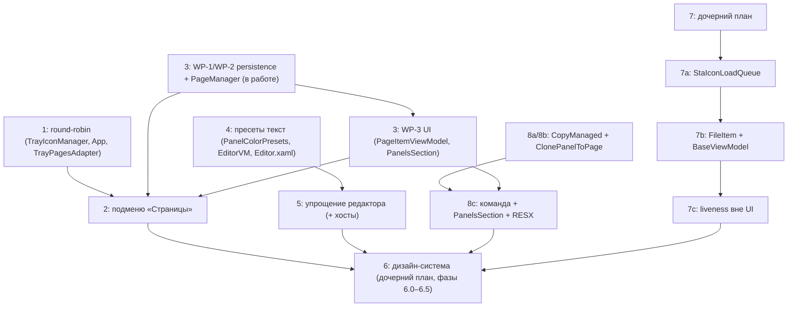

# Мастер-план: «Бэклог 1.x: UX-полировка» (8 пунктов)

> **Статус на 2026-09-30 — бэклог 1.x закрыт целиком (все 8 пунктов).** Пункты 1, 2, 4, 5, 8 реализованы и
> закрыты — см. [ADR-044](../../adr/ADR-044-tray-page-navigation.md) (1–2),
> [ADR-045](../../adr/ADR-045-panel-clone-to-page.md) (8), amendments
> [ADR-042](../../adr/ADR-042-color-presets-rgb-picker-stepped-size.md) (4–5). Пункт 3 — см.
> [page-display-names.md](page-display-names.md)/[ADR-043](../../adr/ADR-043-page-display-names.md)
> (реализовано). §8.4 расширен по факту реализации сверх исходного плана: «Копировать на страницу»
> добавлено не только в раздел «Панели» окна настроек, но и в собственное контекстное меню заголовка
> панели (`ChildWindowViewModel.CopyPanelToPageCommand`), через общий `IPanelCloneFlow` — см. ADR-045.
> Пункт 7 (фоновая загрузка иконок) закрыт —
> [ADR-046](../../adr/ADR-046-background-icon-loading.md), дочерний план
> `background-icon-loading.md`. Пункт 6 (единая дизайн-система) закрыт последним, как и предполагал этот
> мастер-план, — [ADR-047](../../adr/ADR-047-unified-design-system.md), дочерний план
> `design-system-1x.md` (фазы 6.0–6.5).

> **Источник:** `docs/ROADMAP.md` → «Бэклог 1.x: UX-полировка (поставлено 2026-09-28)», включая пункт 8
> «Скопировать панель на другую страницу (полный клон)», добавленный 2026-09-29.
> **Ветка:** `rc/0.8.0` (база `v0.7.0`, `5b83eb5`). **Планировщик:** `fences-feature-planner`, 2026-09-29.
> **Пункт 3 (переименование страниц)** уже спланирован в [page-display-names.md](page-display-names.md) и
> реализуется. Здесь он не переплани́руется, только используются его контракты (§0.2).

---

## 0. Общие правила для всех пунктов

### 0.1. Ограничения (обязательны для каждого исполнителя)

| # | Правило |
|---|---|
| G-1 | **Persistence заморожен.** Расширение состояния разрешено только одно: схема v6 из пункта 3 (ADR-043). Пункты 1, 2, 4, 5, 6, 7, 8 **не** меняют `StateEnvelope`/DTO/миграции/`IAppSettings`/`user.config`/дефолты настроек/семантику загрузки и сохранения. Если исполнителю «нужно» новое поле, он останавливается с `CLARIFICATION_NEEDED` (§11), а не расширяет схему сам. Пункт 8 пишет обычный дополнительный `PanelStateDto` в существующем формате, и это изменением формата не считается. |
| G-2 | **0 errors / 0 warnings** (CS/CA/SA/nullable/`linter.ruleset`) в `dotnet build` и `dotnet test` всего solution. Без `#pragma`/`[SuppressMessage]`/`<NoWarn>`/правок ruleset. |
| G-3 | Новая логика покрыта unit-тестами (xUnit + Moq). STA-тесты оформляются по `docs/Refactoring/Testing/sta-test-conventions.md`. |
| G-4 | Каждый новый RESX-ключ добавляется **одновременно** в `Strings.resx` (en) и `Strings.ru.resx` (ru) и где-то реально используется: `ResxConsistencyTests`, `KeyUsageCoverageTests` и `XamlKeyCoverageTests` должны оставаться зелёными. Ключ, который стал неиспользуемым, удаляется в той же задаче. |
| G-5 | P/Invoke только за `INativeApi`. `ImageSource`, покидающий Services, обязан быть `Freeze()`-нут (ADR-012 Решение 3). Services не зависит от UI (у `TrayIconManager` нет доступа к `IPageManager`). |
| G-6 | Manual verify на Windows 11 24H2 выносится отдельным блоком (§10) и **не блокирует** закрытие пункта. |
| G-7 | Номер нового ADR — **следующий свободный на момент записи** (ADR-043 занят пунктом 3). Предварительная раскладка — §9. |

### 0.2. Контракты пункта 3, на которые опираются остальные пункты (не менять)

Из [page-display-names.md §4.1/§5.3](page-display-names.md):

- `IPageManager.Pages` (упорядоченные id), `IPageManager.PageDescriptors : IReadOnlyList<PageDescriptor(Id, Name?)>`,
  `IPageManager.CurrentPage`, `event Action<string> PageChanged` (смена текущей страницы),
  **`event Action? PagesChanged`** (состав/порядок/имена), `SwitchTo(id)`.
- `PageDisplayNames.Resolve(string id, string? name, CultureInfo culture)` (UI/Localization) — единственный
  способ получить отображаемое имя страницы (unnamed `default` → локализованное `Page_Default_DisplayName`).
- `MainWindowViewModel.Pages : ObservableCollection<PageItemViewModel>` (`Id`, `Name`, `Display`).
  Команды (`SwitchPageCommand`, `MovePanelToPageCommand`, …) по-прежнему получают **id**
  (`CommandParameter="{Binding Id}"`).

**Правило:** трей и «Скопировать на страницу» показывают **только** `PageDisplayNames.Resolve(...)` и
никогда не показывают сырой id.

### 0.3. Карта «пункт → слои → агент»

| Пункт | Scope | Слои | Реализует | Натив |
|---|---|---|---|---|
| 1. Round-robin по двойному клику трея | **S/M** | Services.Abstractions + Services (`TrayIconManager`) + UI (`App`, новый адаптер) | `dotnet-services-engineer` | нет (WinForms `NotifyIcon`, уже за адаптером) |
| 2. Подменю «Страницы» в трее | **M** | те же + RESX | `dotnet-services-engineer` | нет |
| 3. Переименование страниц | L | — (в работе, [page-display-names.md](page-display-names.md)) | — | — |
| 4. Пресеты задают и цвет текста | **M** | UI/Theming + UI/ViewModels + `PanelColorEditor.xaml` | `wpf-ui-builder` | нет |
| 5. Упрощение настройки цветов | **M/L** | UI/Controls + 2 хоста + RESX | `wpf-ui-builder` | нет |
| 6. Единая дизайн-система | **XL** | UI/Resources + все View + трей (Services) | `wpf-ui-builder` (+ `win32-interop-specialist` для трея) | частично (трей-меню) |
| 7. Фоновая загрузка иконок | **XL** | Services (очередь, STA-поток) + Core (`FileItem`) + UI (`BaseViewModel`) | `dotnet-services-engineer` + `win32-interop-specialist` | **да** (shell COM вне UI-потока) |
| 8. Скопировать панель на страницу | **L** | Services (`PanelItemStorageService`) + UI/Services (`WindowManager`) + UI (VM/XAML) + RESX | `dotnet-services-engineer` (8a/8b) → `wpf-ui-builder` (8c) | нет |

---

## 1. Пункт 1 — двойной клик по иконке трея: round-robin страниц

**Scope: S/M.** Агент: `dotnet-services-engineer`. Тесты: `tdd-test-engineer`. ADR: новый **ADR-044
«Tray page navigation»** (общий для пунктов 1 и 2) + amendment к ADR-002 (двойной клик в трее больше не
показывает и не скрывает окно).

### 1.1. Решение

- `TrayIconManager.Initialize`: `DoubleClick` поднимает новое событие **`OnNextPageRequested`**
  (`EventHandler`) вместо `ToggleMainWindowVisibility()`. Слой Services по-прежнему ничего не знает о
  страницах. Это тот же приём «событие наружу, решение в UI», что и у `OnEditLayoutToggleRequested` и
  `ToggleDesktopIconsRequested`.
- Решение о следующей странице принимается в UI-слое, в новом **`TrayPagesAdapter`**
  (`src/DesktopOrganizer.UI/Lifecycle/TrayPagesAdapter.cs`, DI-singleton, `IDisposable`). Он подписан на
  `ITrayIconManager.OnNextPageRequested`, берёт `IPageManager.Pages`/`CurrentPage` и вызывает
  `SwitchTo(PageCycling.Next(pages, current))`.
- Чистая функция **`PageCycling.Next(IReadOnlyList<string> pages, string current) → string?`**
  (`src/DesktopOrganizer.UI/Services/PageCycling.cs`, `internal static`). Правила: следующая по порядку,
  после последней идёт первая; `pages.Count <= 1` → `null` (ничего не делать); `current` отсутствует в
  списке → первая страница; пустые/`null` элементы пропускаются.
  **`IPageManager` не расширяется:** пункт 3 сейчас правит этот интерфейс, так что здесь нет ни
  `SwitchToNext()`, ни конфликта. Если позже захочется метод на интерфейсе, это отдельный рефакторинг.
- Единственная страница → no-op, как написано в ROADMAP. Окно настроек по-прежнему открывается пунктом
  трея «Settings».
- Мёртвый код удаляется: `ITrayIconManager.OnToggleMainWindowVisibilityRequested`,
  `TrayIconManager.ToggleMainWindowVisibility`, `App.ToggleSettingsWindow` и `IWindowManager.StartMainWindow`
  с реализацией в `WindowManager` (других вызывающих нет; проверено Grep 2026-09-29). XML-doc
  `ITrayIconManager`/`IWindowManager` обновляется.
- Порядок: `App.InitTrayIcon` получает адаптер из DI и вызывает `adapter.Start()` **после**
  `TrayIconManager.Initialize()`. Колбэк NotifyIcon приходит в UI-поток (WinForms message loop того же
  потока), но адаптер всё равно вызывает `SwitchTo` через `Dispatcher.BeginInvoke`, чтобы не переключать
  страницу внутри диспетчеризации WinForms-события (тот же приём, что у `ShowSettingsWindow`).

### 1.2. Файлы

| Файл | Изменение |
|---|---|
| `src/DesktopOrganizer.Services.Abstractions/Interfaces/ITrayIconManager.cs` | `+event OnNextPageRequested`; `−OnToggleMainWindowVisibilityRequested` |
| `src/DesktopOrganizer.Services/Providers/TrayIconManager.cs` | DoubleClick → `OnNextPageRequested` |
| `src/DesktopOrganizer.UI/Lifecycle/TrayPagesAdapter.cs` | **новый** |
| `src/DesktopOrganizer.UI/Services/PageCycling.cs` | **новый** |
| `src/DesktopOrganizer.UI/App.xaml.cs` | `InitTrayIcon`: убрать toggle, стартовать адаптер |
| `src/DesktopOrganizer.UI/Services/IWindowManager.cs`, `WindowManager.cs` | удалить `StartMainWindow` |
| `src/DesktopOrganizer.UI/Configuration/DiConfig.cs` (UI) | регистрация `TrayPagesAdapter` |

RESX: **нет** (у двойного клика нет текста).

### 1.3. Тесты

- `PageCyclingTests`: 3 страницы, переход по кругу (a→b→c→a); одна страница → `null`; пустой список →
  `null`; `current` отсутствует в списке → первая; регистр id учитывается (ordinal).
- `TrayIconManagerTests`: заменить `Initialize_StillWires_DoubleClick_ToToggleMainWindowVisibilityRequested`
  на `Initialize_Wires_DoubleClick_ToNextPageRequested`.
- `TrayPagesAdapterTests` (мок `ITrayIconManager`/`IPageManager`, синхронный диспетчер-шим): событие →
  `SwitchTo(next)`; одна страница → `SwitchTo` не вызывается; `Dispose` отписывается.

### 1.4. DoD

1. Двойной клик по трею переключает на следующую страницу по кругу, при одной странице ничего не происходит.
2. Пункт «Settings» открывает окно, как и раньше.
3. `StartMainWindow`/`OnToggleMainWindowVisibilityRequested` удалены, в solution на них нет ссылок.
4. Тесты §1.3 зелёные, 0 warnings.

### 1.5. Риски

| Риск | Митигация |
|---|---|
| Пользователь привык открывать настройки двойным кликом (ADR-002) | Amendment ADR-002 + строка в CHANGELOG «Changed»; `fences-ux-parity-reviewer` проверяет соответствие Fences (в Fences двойной клик по трею — отдельная настраиваемая функция) |
| WinForms перед `DoubleClick` поднимает `Click` | Сейчас `Click` не обрабатывается; не добавлять обработчик одиночного клика в этой задаче |

---

## 2. Пункт 2 — подменю «Страницы» в меню трея

**Scope: M.** Агент: `dotnet-services-engineer` (тот же пакет, что пункт 1, второй коммит). Зависит от
пункта 3 WP-2 (`PageDescriptors`/`PagesChanged`) и WP-3 (`PageDisplayNames.Resolve`). ADR: ADR-044.

### 2.1. Решение

- **Services.Abstractions:** новый примитив без типов UI
  `public sealed record TrayPageEntry(string Id, string DisplayName, bool IsCurrent);`
  (`Services.Abstractions/TrayPageEntry.cs`).
- **`ITrayIconManager`:**
  - `void SetPages(IReadOnlyList<TrayPageEntry> pages);` — вызывающий передаёт снимок, как в
    `UpdateContextMenu`/`SetDesktopIconsVisible`;
  - `event EventHandler<string>? OnPageSelected;` — клик по странице, аргумент — id;
  - «Следующая страница» в подменю поднимает то же `OnNextPageRequested`, что и двойной клик (один путь).
- **`TrayIconManager`:** в `EnsureContextMenuBuilt` один раз создаётся `_pagesItem`
  (`Name = "Tray.Pages"`), он становится **первым** пунктом меню, перед «Settings», с разделителем после
  него. Внутри лежат `_nextPageItem` (`Tray.NextPage`), `ToolStripSeparator` и N пунктов страниц
  (`Name = "Tray.Page:" + id`, `Tag = id`).
  - Инвариант MAJOR-1 (верхний `ContextMenuStrip` никогда не пересобирается) **сохраняется**. Меняется
    только `_pagesItem.DropDownItems`.
  - `SetPages`: если последовательность (Id, DisplayName) совпадает с текущей, у существующих пунктов
    меняются только `Checked`, пересборки нет. Иначе удаляются **и `Dispose()`-ятся** только пункты
    страниц (`_nextPageItem` и разделитель остаются), затем создаются новые.
  - `_nextPageItem.Enabled = pages.Count > 1`.
  - `ApplyTexts()` дополнен: `Tray_Pages`, `Tray_NextPage`. Имена страниц `ApplyTexts` не трогает: это
    данные, их поставляет `SetPages`.
- **`TrayPagesAdapter` (UI):**
  - подписывается на `IPageManager.PageChanged`, `IPageManager.PagesChanged` и
    `ILocalizationService.CultureChanged` (у unnamed `default` меняется локализованное имя) и на каждое
    событие вызывает `PushPages()`;
  - `PushPages()` строит `TrayPageEntry` из `PageDescriptors` + `PageDisplayNames.Resolve(id, name,
    localization.CurrentCulture)` + `IsCurrent = id == CurrentPage` и вызывает `SetPages` **через
    `Dispatcher.BeginInvoke(DispatcherPriority.Background)`**. Так перестройка подменю никогда не
    происходит внутри Click-диспетчеризации его же пункта: клик → `SwitchTo` → `PageChanged` → `SetPages`
    выполнится уже после выхода из обработчика. Это тот же класс гонки, что описан в MAJOR-1;
  - `OnPageSelected(id)` → `SwitchTo(id)`, если id всё ещё есть в `Pages` (устаревший пункт молча
    игнорируется);
  - первый `PushPages()` выполняется в `Start()`.
- Переименование страницы из трея **не** делается (WinForms без inline-ввода; см. page-display-names §5.1).

### 2.2. RESX (en / ru, регион `Tray_`)

| Ключ | en | ru |
|---|---|---|
| `Tray_Pages` | `Pages` | `Страницы` |
| `Tray_NextPage` | `Next page` | `Следующая страница` |

### 2.3. Тесты

- `TrayIconManagerTests`: `SetPages` создаёт N пунктов с `Checked` только на текущей; повторный `SetPages`
  с теми же (Id, DisplayName) и другой текущей страницей **не** пересоздаёт экземпляры (ReferenceEquals) и
  только переключает `Checked`; при изменении состава старые пункты удалены, `_nextPageItem` и разделитель
  на месте; клик по пункту страницы → `OnPageSelected(id)`; клик «Следующая страница» →
  `OnNextPageRequested`; `Enabled=false` при одной странице; `CultureChanged` перерисовывает
  `Tray_Pages`/`Tray_NextPage`; верхний strip не передаётся адаптеру повторно (`SetContextMenu`
  вызывается ровно один раз).
- `TrayPagesAdapterTests`: `PagesChanged`/`PageChanged`/`CultureChanged` → `SetPages` с корректными
  `DisplayName` (unnamed `default` в en/ru, переименованная страница, страница с GUID-id и именем);
  `OnPageSelected` с неизвестным id → `SwitchTo` не вызывается.

### 2.4. DoD

1. В меню трея есть «Страницы ▸» со списком всех страниц по отображаемым именам, галочкой на текущей и
   пунктом «Следующая страница».
2. Список обновляется при переключении, добавлении, удалении и переименовании страницы и при смене языка,
   без переоткрытия приложения.
3. Нигде не показывается сырой id (GUID).
4. MAJOR-1 соблюдён, пункты подменю при пересборке освобождаются через `Dispose()` (тест).
5. 0 warnings, тесты §2.3 зелёные.

### 2.5. Риски

| Риск | Натив/вне CI | Митигация |
|---|---|---|
| Пересборка подменю в момент, когда оно открыто | визуально — только вручную | Изменения, затрагивающие только текущую страницу, делаются in-place; структурные откладываются через `BeginInvoke`; manual verify M-2.3 |
| Длинные имена (до 40 символов) растягивают меню | вручную | Допустимо (как в Explorer); при необходимости усекать до 40 с `…` в адаптере (не в данных) |

---

## 3. Пункт 3 — переименование страниц

Реализуется по [page-display-names.md](page-display-names.md) (WP-1…WP-3, ADR-043). **Мастер-план его
не меняет.** Точки синхронизации с другими пунктами:
- после WP-2 (менеджер) можно начинать пункт 2 (`PagesChanged`/`PageDescriptors`);
- после WP-3 (UI) можно начинать пункт 2 (`PageDisplayNames`) и пункт 8c (`MainWindowViewModel`,
  `PanelsSection.xaml` с меню «Переместить на страницу» уже на `PageItemViewModel`).

---

## 4. Пункт 4 — пресеты цвета задают и цвет текста

**Scope: M.** Агент: `wpf-ui-builder`. Тесты: `tdd-test-engineer`. ADR: **amendment ADR-042** («Пресет —
явная пара фон/текст»).

### 4.1. Корневая причина (по коду, 2026-09-29)

1. **У всех 12 пресетов одинаковый `DarkModeTextHex = #FFFFFF`**
   (`src/DesktopOrganizer.UI/Theming/PanelColorPresets.cs`). В режиме Dark (дефолт для новых панелей)
   любой пресет пишет в `TextColor` одно и то же значение, `#FFFFFF`, поэтому пользователь видит, что
   «текст не меняется». Технически пара пишется атомарно (`ApplyAccent` → `_setBoth`), ошибки в записи нет.
   Проблема в данных и в том, как они видны пользователю.
2. **No-op guard в `ApplyAccent` сравнивает только accent** (`if (accentHex == AccentColor) return;`).
   Если панель уже имеет accent пресета, но другой текст (legacy `#DDDDDD`, ручная правка в Advanced или
   значение, записанное до смены данных пресета), повторный клик по тому же свотчу **ничего не делает**:
   текст пресета нельзя применить заново.
3. Свотч показывает только accent, поэтому текстовую половину пары увидеть нельзя.

### 4.2. Решение

- **(а) Данные.** `DarkModeTextHex` каждого пресета — светлый тинт своего accent, а не общий белый.
  Критерии, закреплённые тестом: контраст ≥ **4.5:1** с композитной поверхностью
  (`SurfaceComposer.ComposeSurface`) для всех `PanelSurfaceStyle` при минимальной и максимальной
  `SurfaceOpacity` в Dark; `PanelThemeRules.FromTextColor(DarkModeTextHex) == Dark` и
  `FromTextColor(LightModeTextHex) == Light`, иначе режим «перепрыгнет». Исполнитель подбирает значения,
  ориентир — HSL-lightness ≈ 90–93 % при оттенке accent. Нейтральные пресеты (Graphite, Stone) допустимо
  оставить белыми или почти белыми. Состояние не мигрирует: у существующих панелей `TextColor` не
  меняется (это данные пользователя), новая пара применяется только по явному клику.
- **(б) Атомарность и повторное применение.** Guard в `ApplyAccent` становится no-op только если
  **и accent, и ожидаемый текст** (`preset.TextFor(Mode)` или `DefaultTextFor(Mode)`) уже совпадают
  (регистр не важен). Иначе пара записывается одним `_setBoth` (один save). Для `SetMode` правило
  прежнее: пишется только текст.
- **(в) Видимость пары.** Свотч пресета — круг accent с маленьким глифом «Aa» цветом
  `TextFor(текущий Mode)` в нижнем правом сегменте (или двухсегментный круг). Конкретный вид выбирает
  wpf-ui-builder, UX-ревьюер проверяет. `ColorPresetOption` получает свойство `PreviewTextHex`
  (INPC, пересчитывается при смене `Mode`). `AutomationProperties.Name` свотча называет пресет и
  упоминает текст (см. RESX).
- **Выделение свотча:** `SelectedPreset` по-прежнему определяется по accent. Если accent совпал, а текст
  отличается от `TextFor(Mode)`, свотч выделен и рядом с кольцом стоит маркер «изменено» (точка).
  Повторный клик применяет пару.
- `Reset` для новых панелей по-прежнему `Default.TextFor(Dark)`, теперь с тинтованным текстом Blue.

### 4.3. Файлы

`UI/Theming/PanelColorPresets.cs`, `UI/ViewModels/PanelColorEditorViewModel.cs`,
`UI/ViewModels/ColorPresetOption.cs` (где бы он ни лежал), `UI/Controls/PanelColorEditor.xaml`,
`UI/Resources/Styles/Icons.xaml` (при необходимости), RESX.

### 4.4. RESX

| Ключ | en | ru |
|---|---|---|
| `Common_ColorPreset_Swatch_A11y_Format` | `{0}: accent and text colour` | `{0}: цвет фона и текста` |
| `Common_ColorPreset_Modified_A11y` | `Text colour differs from the preset — click to reapply` | `Цвет текста отличается от пресета — щёлкните, чтобы применить заново` |

(Тексты можно отполировать через `design:ux-copy`; набор ключей фиксированный.)

### 4.5. Тесты

- `PanelColorPresetsTests`/`PanelColorPresetsContrastTests`: для каждого пресета
  `FromTextColor(Dark text) == Dark` и `FromTextColor(Light text) == Light`; контраст ≥ 4.5 с композитной
  поверхностью для всех `SurfaceStyle` × {min, max opacity} × оба режима; `DarkModeTextHex` **различаются**
  у хроматических пресетов (регрессия «все белые»); `CustomDialogSeed` по-прежнему 16 элементов
  (пересчитать ожидания).
- `PanelColorEditorViewModelTests`: `ApplyAccent(тот же accent)` при отличающемся тексте → `_setBoth` ровно
  1 раз с текстом пресета; при совпадающей паре → 0 вызовов; в Light и Dark пишется соответствующий
  `TextFor`; `PreviewTextHex` меняется при `SetMode`; кастомный accent → `DefaultTextFor`.

### 4.6. DoD

1. Любой хроматический пресет визуально меняет и фон, и текст в обоих режимах.
2. Повторный клик по выделенному пресету восстанавливает его текст.
3. На свотче видна текстовая половина пары.
4. Формат состояния и `IAppSettings` не изменены (`git diff` по `State/`, `Storage/`, `Settings.settings`
   пуст).
5. Тесты §4.5 зелёные, 0 warnings.

### 4.7. Риски

| Риск | Митигация |
|---|---|
| Тинтованный текст на солнечных пресетах (Amber/Lime) в режиме Solid не дотягивает до 4.5 | Контраст-тест по всем комбинациям; при провале — ближе к белому |
| Известный пробел ADR-042 «текст на сплошном accent» (иконки) | Не расширять; тест `KnownGap_*` оставить как есть или обновить значения |

---

## 5. Пункт 5 — упростить настройку цветов

**Scope: M/L.** Агент: `wpf-ui-builder` (**строго после пункта 4**: те же файлы). Тесты: `tdd-test-engineer`.
ADR: **amendment ADR-042** («Упрощённый редактор: пресет — основной путь, остальное под „Дополнительно“»)
+ amendment ADR-031 (раскладка окна Customize).

### 5.1. Инвентаризация (сделана при планировании)

| Место | Как редактируется цвет сейчас | Контрол |
|---|---|---|
| Customize панели (`Views/PanelCustomizeWindow.xaml`) | `PanelPreviewCard` + `PanelColorEditor` (Mode, сетка 12+1, Advanced: hex accent/text, пикер текста, Reset) + **отдельные карточки хоста**: Surface style (сегменты), Opacity, Icon size | `PanelColorEditor` + разметка хоста |
| Settings → New panel defaults (`Views/Settings/NewPanelDefaultsSection.xaml`) | то же (`DefaultColors`) + свои карточки Surface/Opacity/Icon size | `PanelColorEditor` + разметка хоста |
| Панель системных иконок (`SystemIconsPanelWindow`) | **цвета нет** (D-7: сайдбар не тематизируется) | — (менять не нужно) |
| `SelectedPanelSettingsViewModel` | прокси accent/text для Customize (без собственного UI) | — |

Вывод: общий контрол уже один, `PanelColorEditor`. Сложность в **структуре**: 4–6 карточек равного веса
(Mode, Accent, Advanced, Surface, Opacity), решение о режиме Mode стоит до выбора цвета, а surface и
opacity дублируются в двух хостах.

### 5.2. Целевая структура (одна для обоих хостов)

1. **Preview** (`PanelPreviewCard`, без изменений).
2. **Карточка «Цвет»:** сетка свотчей (12 пресетов + «Свой…») с видимой текстовой парой из пункта 4.
   Клик — готово: это основной путь для 90 % случаев. Под сеткой стоит компактный переключатель
   **Светлая/Тёмная**, вторичный (меньше, без собственной карточки). Microcopy — одна строка.
3. **«Дополнительно»** (`Settings.CardExpander`, **свёрнут по умолчанию**; состояние раскрытия хранится
   только в памяти окна — `IAppSettings` не расширять, см. G-1): hex accent и text, «Свой цвет текста…»,
   **стиль поверхности**, **прозрачность** и «Сбросить».
   - Surface/Opacity переезжают из разметки хостов в общий контрол через DP-слот
     `PanelColorEditor.AdvancedExtraContent` (`object`, `ContentPresenter`). Каждый хост передаёт свои
     уже существующие привязки (к `Appearance` у Customize, к `GlobalDefaults` у defaults), так что VM
     хостов не меняются. Альтернатива «перенести surface/opacity во VM редактора» отклонена: это владение
     данными хоста (ADR-042 «thin proxy»).
   - Icon size и Icon layout остаются в хостах: это не цвет.
4. Карточка Mode как отдельная сущность удаляется.

### 5.3. Файлы

`UI/Controls/PanelColorEditor.xaml(.cs)`, `UI/ViewModels/PanelColorEditorViewModel.cs` (если нужен флаг
`IsAdvancedExpanded` в памяти), `UI/Views/PanelCustomizeWindow.xaml`,
`UI/Views/Settings/NewPanelDefaultsSection.xaml`, `UI/Resources/Styles/Settings.xaml` (при необходимости
компактный вариант `SegmentedGroup`), RESX.

### 5.4. RESX

| Ключ | en | ru |
|---|---|---|
| `Common_Color_Header` | `Colour` | `Цвет` |
| `Common_Color_Description` | `Pick a preset — background and text are set together.` | `Выберите пресет — цвет фона и текста задаются вместе.` |
| `Common_ColorAdvanced_Header` | `More options` | `Дополнительно` |
| `Common_ColorAdvanced_Description` | `Custom colours, surface and transparency` | `Свои цвета, поверхность и прозрачность` |

Ключи, которые станут неиспользуемыми (вероятно, `Common_Mode_Header`/`Common_Mode_Description` и
заголовки отдельных карточек хостов), **удалить** в en и ru (G-4). Исполнитель фиксирует список в отчёте.

### 5.5. Тесты

- `PanelColorEditorViewModelTests`: без регрессий в трёх путях записи (`ApplyAccent`/`SetMode`/сеттеры).
- `PanelCustomizeWindowClosingTests` и существующие XAML-load-тесты хостов: окна загружаются, ресурсы
  резолвятся (`Settings.xaml` смёржен).
- `XamlKeyCoverageTests`/`KeyUsageCoverageTests` с новыми и удалёнными ключами.
- Новый лёгкий STA-тест: `PanelColorEditor` с `AdvancedExtraContent` рендерит переданный контент, а
  expander по умолчанию свёрнут.

### 5.6. DoD

1. Первое, что видит пользователь в обоих местах, — Preview и сетка пресетов. Всё остальное свёрнуто в
   «Дополнительно».
2. Ни одна возможность не потеряна: произвольный accent и текст, hex, surface, opacity, reset.
3. Surface/Opacity больше не продублированы разметкой в двух хостах.
4. Формат хранения цветов и `IAppSettings` не изменены.
5. 0 warnings, тесты зелёные.

### 5.7. Риски

- RU-раскладка при ширине 420 DIP (бэклог ADR-042): проверить в manual verify M-5.2.
- Бэклог «Icon layout/geometry на сегментированный контрол» **не** включается сюда: он уходит в пункт 6.

---

## 6. Пункт 6 — единая дизайн-система (меню, настройки, диалоги)

**Scope: XL.** По правилу планировщика XL разбивается на подпланы: **перед реализацией перезапустить
`fences-feature-planner` на `docs/PLANS/design-system-1x.md`** (дочерний план). Здесь фиксируются рамки,
фазы и решения, которые дочерний план не должен пересматривать. Выполняется **последним**, после пунктов
1–5, 7 и 8. Агенты: `wpf-ui-builder` (основной), `win32-interop-specialist` (трей, фаза 6.4). ADR: новый
**ADR-047 «Unified design system»** (amends ADR-025/ADR-031/ADR-042; фиксирует ограничения нативного
shell-меню, ADR-040, и трея).

### 6.1. Фазы (каждая — отдельный проход конвейера)

| Фаза | Содержание | Агент |
|---|---|---|
| 6.0 Аудит | Инвентарь экранов (MainWindow и 9 секций, `PanelCustomizeWindow`, `InputDialog`, `ConfirmationService`/`MessageBox`, first-run, контекстные меню панели (`ChildWindow.xaml`), меню «Переместить/Скопировать на страницу», трей, shell-меню значков). Для каждого: шрифт/размер, контраст (WCAG AA ≥ 4.5:1 основной текст, ≥ 3:1 крупный и UI-элементы), состояния hover/pressed/disabled/focus, HC, «стены текста». Результат — таблица в дочернем плане и автотест контраста токенов | `wpf-ui-builder` (+ `design:accessibility-review`) |
| 6.1 Токены | Свести `Colors.xaml`/`Brushes.xaml`/`Typography.xaml`/`Spacing.xaml` в одну систему: семантические токены (`Text.Primary/Secondary/Disabled`, `Surface.*`, `Control.*` с состояниями, `Focus`), типографическая шкала не меньше системного размера (`SystemFonts.MessageFontSize`), отступы 4/8/12/16/24. Тёмный вариант палитры Settings | `wpf-ui-builder` |
| 6.2 Контролы | Единые стили `ContextMenu`/`MenuItem`/`Separator` (панельные меню, меню «на страницу»), `Button` (primary/secondary/subtle), заголовки групп, `SegmentedGroup` для Icon layout и Panel geometry (из бэклога ADR-042), HC-пробел сегментов и свотчей (`SystemColors.Highlight*`) | `wpf-ui-builder` |
| 6.3 Диалоги | `ConfirmationService` (`MessageBox`) и `InputDialog` → единый WPF-диалог в стиле Settings (заголовок, текст, primary/secondary, Esc/Enter, UIA); `IConfirmationService` сохраняет сигнатуры | `wpf-ui-builder` |
| 6.4 Трей | Решение (см. 6.2 ниже): WinForms `ContextMenuStrip` с кастомным `ToolStripProfessionalRenderer`, цвета из токенов, тёмная/светлая по теме Windows | `win32-interop-specialist` ∥ `wpf-ui-builder` |
| 6.5 Сквозной аудит | Повтор таблицы 6.0: всё зелёное или осознанное ограничение в ADR-047 | `fences-ux-parity-reviewer` |

### 6.2. Решения, которые фиксирует мастер-план

- **Тема окна настроек:** светлая или тёмная **следует теме Windows** (`AppsUseLightTheme`, чтение через
  `INativeApi`/registry-обёртку, реакция на `WM_SETTINGCHANGE`/`SystemEvents.UserPreferenceChanged`).
  **Без новой настройки** (G-1). Явный переключатель темы в настройках — только по CLARIFICATION CN-1 (§11).
- **Трей:** вариант **A** — остаться на WinForms `ContextMenuStrip` + собственный renderer (цвета, отступы,
  шрифт по токенам; тёмная и светлая схема). Вариант B (WPF-`ContextMenu` из трея через скрытое
  host-окно, `SetForegroundWindow`/`TrackPopupMenu`-семантика) отклонён для 1.x: больше нативного риска,
  известные проблемы с закрытием меню по клику мимо, а выигрыш только визуальный. Фиксируется в ADR-047
  как «осознанное ограничение + renderer».
- **Нативное shell-меню значков (ADR-040):** не стилизуется, это системное меню Explorer. Фиксируется как
  ограничение.
- **Метрика читаемости** закрепляется автотестом: для каждой пары `Text.*` на `Surface.*` и
  `Settings.*` контраст ≥ 4.5 (≥ 3 для крупного текста и Disabled по WCAG — Disabled освобождён от
  требования, но проверяется ≥ 3 для различимости).

### 6.3. RESX

Определяются в дочернем плане: ключи для единого диалога, если меняются тексты кнопок; стандартные
`Common_OK`/`Common_Cancel` переиспользуются.

### 6.4. DoD (уровень мастер-плана)

1. Дочерний план `docs/PLANS/design-system-1x.md` создан и закрыт по фазам 6.0–6.5.
2. Все экраны из инвентаря используют общие стили. Инлайн-hex и инлайн-`FontSize` в `Views/` отсутствуют
   (Grep-проверка в DoD дочернего плана).
3. Автотест контраста токенов зелёный. HC-пробелы бэклога ADR-042 закрыты или задокументированы.
4. ADR-047 создан, ограничения трея и shell-меню записаны.
5. 0 warnings; persistence и `IAppSettings` не изменены.

### 6.5. Риски

| Риск | Натив/вне CI | Митигация |
|---|---|---|
| Перестилизация ломает раскладку RU при узкой ширине | визуально | Manual verify по экранам; `MinWidth` в токенах |
| `ToolStripRenderer` мерцает или не учитывает DPI | натив, вне CI | `win32-interop-specialist`; проверка на 125/150 % |
| Тёмная тема Settings без переключателя может не понравиться | UX | CN-1 (§11) |
| Самый большой риск регрессий во всём бэклоге | — | Последним; по фазам, каждая с ревью |

---

## 7. Пункт 7 — фоновая загрузка иконок

**Scope: XL** (Services: новая очередь и STA-поток; Core: `FileItem`; UI: `BaseViewModel`/
`ChildWindowViewModel`; нативный shell COM вне UI-потока). **Перед реализацией перезапустить
`fences-feature-planner` на дочернем плане `docs/PLANS/background-icon-loading.md`**. Ниже — рамки и
решения, которые дочерний план должен детализировать, а не пересматривать. Агенты: `dotnet-services-engineer`
(7a, 7b, 7c) + **`win32-interop-specialist`** (ревью и доводка STA/COM-части 7a). ADR: новый **ADR-046
«Background STA icon loading»** (закрывает «Known follow-up» ADR-039; amendment ADR-012 Решение 3:
`Freeze()` теперь несёт нагрузку межпоточной передачи).

### 7.1. Что блокирует UI сегодня (по коду)

1. `BaseViewModel.AddFilesCore` → `IIconProvider.GetIcon` синхронно для каждого файла (стадии 1–2
   открывают shell-item; `File.Exists`/`Directory.Exists` в начале `GetIcon` — metadata round-trip).
2. **`FileItem` ctor** сам делает `File.Exists` + `Directory.Exists` ×2 (`ComputeExists`, `_isDirectory`),
   тоже синхронно на UI. Для `Z:\` или UNC это тот же сетевой стопор.
3. `RefreshItemsLiveness` (тик ≈ 3 с) → `FileItem.Refresh()` (fs-проверки) для **каждого** элемента на
   UI-потоке. Панель с ярлыками на недоступную шару подвешивает UI на каждом тике, не только при старте.
4. `TryRenameItem`/`RefreshAllItemIcons`/`RetryPlaceholderIcon` — синхронные `GetIcon`.

Если убрать с UI только п.1, метрика «не дольше одного кадра» не выполнится из-за п.2–3. Поэтому они в
scope.

### 7.2. Решение (рамки)

- **7a. Очередь (Services).** `IIconLoadQueue` (Services.Abstractions) + `StaIconLoadQueue` (Services/Tools):
  - 1 выделенный поток (`ApartmentState.STA`, `IsBackground = true`); константа `MaxWorkers = 1` (не
    настройка) с возможностью 2 — решает дочерний план по замерам;
  - запрос `(path, pixelSize, priority, CancellationToken)` → результат `IconLoadResult(ImageSource Icon,
    bool Exists, bool IsDirectory)`. Проверка существования делается **на воркере**, вместе с иконкой;
  - два уровня приоритета: `Visible` (панели текущей страницы) и `Background` (скрытые страницы); внутри
    уровня — FIFO в порядке отображения;
  - дедупликация одинаковых `(path, bucket)`: один fetch, много ожидающих;
  - отмена: токен поколения панели (ReplaceAll/Relocate/закрытие/удаление панели → cancel); отменённые
    запросы не исполняются, а результаты для них отбрасываются;
  - доставка на UI через `SynchronizationContext`, захваченный при создании (UI-поток), `Post`. Ни одного
    `Send`/`Invoke`, которые заблокировали бы воркер на UI;
  - внутри воркер вызывает **существующий** `IconProvider.GetIcon` (кеш `(path, bucket)`, трёхстадийный
    фолбэк и UNC/offline-скип ADR-039 **не меняются**, меняется только поток вызова). `IconProvider`
    становится потокобезопасным по всему пути: ленивый `_placeholderIcon` → потокобезопасная
    инициализация (плейсхолдер создаётся заранее на UI-потоке при старте, `RenderTargetBitmap` + `Freeze`);
    `IDiagnosticsLog` проверяется на потокобезопасность;
  - `Dispose`: `CompleteAdding` + cancel + `Join(1 s)`; регистрация в Services `DiConfig` как singleton.
- **7b. Интеграция (Core + UI).**
  - `FileItem`: новый ctor или фабрика `FileItem.CreatePending(path, placeholderIcon, displayName)` без
    обращения к fs (`Exists = true`, `IsDirectory` по эвристике расширения, флаг `IsProbePending`) и метод
    `ApplyProbe(bool exists, bool isDirectory)` (INPC только для изменившихся). Существующий ctor остаётся
    для тестов и совместимости;
  - `BaseViewModel.AddFilesCore`: элемент создаётся сразу с плейсхолдером **типа по расширению** (кеш
    `(extension|folder, bucket)` → `SHGFI_USEFILEATTRIBUTES`, без fs; один раз на расширение) или
    универсальным `IsPlaceholder`. Затем `Enqueue`; по готовности `ApplyProbe` + `UpdateIcon`, если
    элемент ещё отслеживается и `Path` не изменился;
  - после первой волны результатов, где изменился `IsDirectory`, выполняется **один** отложенный
    `OnSourceChanged()` на панель (debounce ≈ 100 мс через существующий `IDebounceTimer`), чтобы
    фильтр FoldersOnly/HideShortcuts и сортировка стали корректными. Выделение сохраняется
    (`ReplaceFileItems`, ADR-012/013);
  - `TryRenameItem`/`RefreshAllItemIcons`/`RetryPlaceholderIcon` переходят на ту же очередь.
- **7c. Liveness вне UI.** `RefreshItemsLiveness` снимает снимок путей, выполняет пакетную пробу
  существования на воркере (очередь с приоритетом `Background`, один пакет на панель за тик, новый пакет
  не ставится, пока не вернулся предыдущий) и применяет результат на UI. Логика переходов (missing ↔
  present, `OnItemsVanished`, bounded retry) сохраняется, меняется только место fs-вызовов.
- **Инвариант ADR-012:** всё, что возвращает воркер, `Freeze()`-нуто (ассерт в debug +
  тест `IsFrozen`).

### 7.3. RESX

**Нет** (пользовательских текстов не добавляется). Диагностика — `IconDiagnostics` (новые события
`IconQueueStarted/Drained/Cancelled` с closed-set полями и без путей, по privacy-инварианту).

### 7.4. Тесты

- `StaIconLoadQueueTests` (реальный поток, мок `IIconProvider`): `GetIcon` вызывается **не** на
  вызывающем потоке и на потоке с `ApartmentState.STA`; результат доставляется через переданный
  `SynchronizationContext`; приоритет `Visible` обгоняет `Background`; дедупликация (1 вызов на 2 запроса);
  отмена до старта → вызова нет, результата нет; отмена во время работы → результат отброшен;
  исключение провайдера → плейсхолдер, очередь жива; `Dispose` завершает поток ≤ 1 с; результат
  `IsFrozen`.
- `BaseViewModel*Tests` с фейковой синхронно-управляемой очередью (`IIconLoadQueue`-мок с ручным
  «drain»): `AddFiles(1000)` не вызывает `IIconProvider.GetIcon` синхронно (verify `Times.Never` до
  drain) и укладывается в бюджет (порядок 16 мс для 1000 элементов на CI как ориентир; тест проверяет
  **отсутствие синхронных вызовов**, а не время, чтобы не было флаки); после drain иконки подменены
  через `UpdateIcon`; элемент удалён до drain → результат не применён; `IsDirectory` сменился →
  фильтр пересчитан один раз.
- `FileItemTests`: `CreatePending` не касается fs (путь на несуществующем диске не бросает и мгновенный);
  `ApplyProbe` поднимает INPC только для изменившихся свойств.
- Liveness: пакет пробы уходит в очередь, переходы missing→present и vanished сохраняют прежнюю
  семантику (адаптировать существующие тесты).
- `IconProviderTests`: параллельные `GetIcon` с двух потоков не ломают LRU (стресс-тест с малым
  capacity).

### 7.5. DoD

1. Старт с порталом на 1000+ локальных файлов и панелью с ярлыками на недоступную шару / `Z:\` **не
   блокирует UI дольше одного кадра** (manual verify M-7.1 с `docs/DIAGNOSTICS`-замером). В тестах:
   нет синхронных `GetIcon`/fs-вызовов на UI-пути добавления и liveness.
2. Кеш `(path, bucket)`, трёхстадийный фолбэк и UNC/offline-скип ADR-039 не изменены (дифф
   `IconProvider` ограничен потокобезопасностью).
3. Всё, что пересекает границу потоков, заморожено.
4. Отмена при удалении или перестройке панели работает, лишних подмен иконок нет.
5. ADR-046 создан; ADR-039 «Known follow-up» помечен закрытым; ADR-012 amendment.
6. 0 warnings; тесты §7.4 зелёные.

### 7.6. Риски (нативные помечены)

| # | Риск | Натив/вне CI | Митигация |
|---|---|---|---|
| R7-1 | Сторонние shell-extension ведут себя иначе вне UI-STA (падения, зависания) | **натив, вне CI** | Отдельный STA-поток с message pump при необходимости (решает `win32-interop-specialist`); try/catch на задачу, фолбэк на стадию 3 |
| R7-2 | Зависший shell-handler блокирует **весь** воркер, и очередь стоит | **натив** | Сторожевой таймаут на задачу (например, 5 с): задача помечается «stuck», её результат игнорируется, воркер пересоздаётся (дочерний план) |
| R7-3 | `IconProvider` не потокобезопасен в мелочах (ленивый плейсхолдер, лог) | нет | Аудит + стресс-тест |
| R7-4 | Мигание: плейсхолдер → иконка у 1000 элементов | визуально | Пакетная доставка (N результатов за один `Post`), без анимации |
| R7-5 | Неверный `IsDirectory` до пробы → временно неверный фильтр | нет | Эвристика по расширению + единичный пересчёт |
| R7-6 | Перечисление сетевого портала (`Directory.EnumerateFiles`) — отдельный стопор | натив/сеть | **Вне scope**, фиксируется как follow-up в ADR-046 |

---

## 8. Пункт 8 — скопировать панель на другую страницу (полный клон)

**Scope: L.** Пакеты: **8a** storage (`dotnet-services-engineer`), **8b** клонирование в `WindowManager`
(`dotnet-services-engineer`), **8c** команда, UI и RESX (`wpf-ui-builder`, **после пункта 3 WP-3**).
Тесты: `tdd-test-engineer`. ADR: новый **ADR-045 «Panel clone to page»** + amendment ADR-035 (явное
исключение: откат свежесозданной копии удаляется напрямую) + amendment ADR-010.

### 8.1. Факт о хранилище (важно для реализации)

Managed-хранилище устроено **поэлементно, не попанельно**: `PanelItems\{itemGuid}\{name}` плюс один
корневой манифест `PanelItems\.manifest.json` (managed path → original path). Каталога
`PanelItems\<panelGuid>\` не существует. Формулировку ROADMAP «дублировать в `PanelItems\<newGuid>\`»
нужно понимать так: **каждый managed-элемент панели копируется в свой новый `PanelItems\{newItemGuid}\`
с новой записью манифеста**. Формат манифеста не меняется, добавляются только записи.

### 8.2. 8a — `IPanelItemStorageService.CopyManaged`

Новый член интерфейса (Services.Abstractions) и реализация в `PanelItemStorageService`:

```csharp
/// Duplicates a managed item into a brand-new per-item directory ({root}\{newGuid}\{same name}) and records a
/// manifest entry for the copy with the SAME original path as the source. Never touches the source.
ManagedCopyResult CopyManaged(string storedPath);
// ManagedCopyResult(ManagedCopyOutcome Outcome, string? CopyPath)
// ManagedCopyOutcome { Copied, NotManaged, SourceMissing, TooLarge, InsufficientSpace, Failed }

/// Rollback helper for a clone that failed midway: deletes ONLY directories this service itself created
/// through CopyManaged in the current operation (verified: path is {root}\{guid}\... and its manifest entry
/// was written by CopyManaged), and removes their manifest entries.
void DiscardCopies(IReadOnlyList<string> copyPaths);
```

- Файл → `File.Copy`, каталог → рекурсивное копирование (корень хранилища один, том тот же). Лимиты
  `MaxDirectoryImportBytes`/`MaxDirectoryImportFileCount` переиспользуются. Путь ≤
  `MaxDestinationPathLength` (имя то же, длина GUID та же, то есть укладывается, но проверка остаётся).
- Порядок: копия в новый каталог → запись манифеста (write-through). Если манифест записать не удалось,
  копия удаляется (это свежий дубликат, оригинал цел) и возвращается `Failed`.
- **Исходный путь копии = исходный путь источника.** Следствия, которые фиксирует ADR-045:
  `Restore`/`--restore-panel-items` вернут обе копии (вторая получит суффикс `(2)` — существующая
  Explorer-логика); `TryFindManagedPath` для такого original станет неоднозначным и вернёт `false`
  (существующий принцип «явный отказ вместо угадывания»; кросс-панельная логика
  `WindowManager.ResolveStalePanelPaths` уже это обрабатывает).
- Предпроверка перед копированием всего набора: сумма размеров ≤ свободного места на томе
  (`DriveInfo.AvailableFreeSpace`) с запасом 5 %, иначе `InsufficientSpace`.
- **`DiscardCopies`** — единственное прямое удаление в сервисе. Ограничено каталогами, созданными в
  текущей операции клонирования (не пользовательский контент). Amendment ADR-035 формулирует
  исключение: «откат незавершённого клона удаляет только свои свежие дубликаты; содержимое пользователя
  по-прежнему уходит только в Корзину».

### 8.3. 8b — клонирование в `WindowManager`

Новый метод `IWindowManager`:

```csharp
/// Creates a fully independent copy of <paramref name="source"/> on <paramref name="pageId"/> (may equal the source's own page).
PanelCloneResult ClonePanelToPage(ChildWindowModel source, string pageId);
// PanelCloneResult(PanelCloneOutcome Outcome, ChildWindowModel? Clone, int SkippedMissingItems)
// PanelCloneOutcome { Cloned, UnknownPage, TooLarge, InsufficientSpace, CopyFailed }
```

Алгоритм (транзакционно: либо клон целиком, либо ничего):
1. `pageId` пустой или отсутствует в `PageManager.Pages` → `UnknownPage` (как в `MovePanelToPage`).
2. `SyncToModel` **только источника** (`SyncEachIsolated` для одного окна), чтобы `FilePaths` и геометрия
   соответствовали экрану.
3. Для каждого `source.FilePaths` (включая сохранённый pre-portal снимок у Folder Portal):
   - `IsManaged` и файл существует → `CopyManaged` → карта `old → new`;
   - `IsManaged` и файла нет → элемент **не копируется** (`SkippedMissingItems++`). Иначе у двух панелей
     оказалась бы общая ссылка на managed-путь, а удаление одной панели удалило бы файл другой;
   - не managed (внешняя ссылка или ярлык, который пользователь оставил на месте) → копируется **как
     запись** (тот же путь; файл пользователю принадлежит, и удаление панели его не трогает — ADR-035
     касается только managed);
   - любой отказ `CopyManaged` → `DiscardCopies(созданные)` → соответствующий outcome, панель не создаётся.
4. Модель клона строится чистой функцией **`PanelCloneBuilder.Build(...)`**
   (`UI/State/PanelCloneBuilder.cs`, internal static) через **`PanelStateMapper.ToDto(source)` →
   мутация DTO → `PanelStateMapper.FromDto(dto)`**. Так все персистентные поля копируются автоматически
   (сегодняшние и будущие). `FileItems` не копируется (новая пустая коллекция, панель заполнит её из
   `FilePaths`), общих ссылок нет (`FilePaths` — новый список). Мутации:
   - `Id = Guid.NewGuid()`, `PageId = pageId`, `FilePaths = mapped`;
   - `SourceFolderPath` — **как есть** (портал копирует привязку к папке, не файлы; у клона свой watcher,
     `ChildWindowViewModel` подключит его сам по `SourceFolderPath`);
   - `Title` — `PanelCloneTitles.Resolve(sourceTitle, titlesOnTargetPage, localization)`: нет совпадения
     (trim, OrdinalIgnoreCase) → тот же заголовок; есть → `Panel_CopyTitle_Format` («{0} — копия»); и он
     занят → `Panel_CopyTitle_Numbered_Format` («{0} — копия ({1})», n = 2, 3, …). Локализуется в момент
     создания, дальше это данные (ADR-032 D-5). Для копии на **ту же** страницу коллизия гарантирована
     (там источник);
   - геометрия: другая страница → **та же** позиция, размер и монитор; та же страница →
     `PanelCloneGeometry.Offset(...)` (чистая функция): `LegacyFreeform` → +`IAppSettings.GridSize` по X и
     Y (при `GridSize <= 1` — 24 DIP); `GridAligned` → +1 `WorkspaceGridMetrics.UnitSize` по X и Y (спаны
     не меняются). Затем кламп в рабочую область монитора (существующий `ClampIntoMonitor`); если после
     клампа позиция совпала с источником, смещение идёт в обратную сторону;
   - `IsVisible = pageId == PageManager.CurrentPage`; `IsRolledUp`, `WindowState`, внешний вид, режимы,
     фильтр и сортировка — как у источника.
5. `CreateChildWindow(clone)` — существующий путь регистрации окна (поднимает `OnChildWindowAdded` →
   `MainWindowViewModel.OnPanelAdded`). Для скрытой страницы исполнитель проверяет, что окно создаётся
   скрытым, как в `LoadWindowsState`; при необходимости после создания вызывает `ApplyPanelVisibility`.
6. `SaveWindowsStateNow()` — структурное изменение (ADR-024 D-12). Формат не меняется: в `panels` просто
   появляется ещё один `PanelStateDto`.

### 8.4. 8c — команда, UI и тексты

- `MainWindowViewModel.CopyPanelToPageCommand` (`RelayCommand<string>`, параметр — page id), `CanExecute`:
  выбранная панель есть и `pageId` непустой. **Текущая страница разрешена**, в отличие от Move.
- Обработчик вызывает `_windowManager.ClonePanelToPage`. `Cloned` → при копии на текущую страницу
  выделить клон (`SelectedPanel = clone`) и `RefreshPanelsOnCurrentPage()`. Отказы → `IConfirmationService.Notify`
  с локализованным текстом. `SkippedMissingItems > 0` → информационное уведомление не показывается,
  только лог (не отвлекать пользователя).
- `PanelsSection.xaml`: кнопка «Копировать на страницу ▾» рядом с «Переместить на страницу ▾», то же
  устройство: `ContextMenu` c `ItemsSource="{Binding Pages}"`, `Header` через `Display` и
  `PageDisplayNameConverter`, `CommandParameter="{Binding Id}"` — в той форме, которую оставит пункт 3
  WP-3. Обработчик `Click` в code-behind по образцу `MoveToPageButton_Click`.
- Контекстное меню самой панели (`ChildWindow.xaml`) в этой задаче **не** расширяется (там нет и
  «Переместить»). Это возможный follow-up в ADR-045.

### 8.5. RESX

| Ключ | en | ru |
|---|---|---|
| `Settings_Panels_CopyToPage_Button` | `Copy to page ▾` | `Копировать на страницу ▾` |
| `Panel_CopyTitle_Format` | `{0} — copy` | `{0} — копия` |
| `Panel_CopyTitle_Numbered_Format` | `{0} — copy ({1})` | `{0} — копия ({1})` |
| `Panel_Copy_Failed_Title` | `Couldn't copy the panel` | `Не удалось скопировать панель` |
| `Panel_Copy_Failed_Message` | `Some items couldn't be copied. Nothing was changed.` | `Не удалось скопировать часть элементов. Ничего не изменено.` |
| `Panel_Copy_TooLarge_Message` | `The panel's items are too large to copy.` | `Элементы панели слишком велики для копирования.` |
| `Panel_Copy_NoSpace_Message` | `There isn't enough free disk space to copy the panel.` | `Недостаточно места на диске, чтобы скопировать панель.` |

### 8.6. Тесты

- **8a** `PanelItemStorageServiceCopyTests` (temp-корень, мок `INativeApi`): файл и каталог копируются в
  **новый** GUID-каталог с тем же именем; источник байт-в-байт не изменён; манифест содержит обе записи с
  одинаковым original; `CopyManaged` не-managed пути → `NotManaged`; отсутствующий → `SourceMissing`;
  превышение лимита → `TooLarge` без следов на диске; сбой записи манифеста → копия удалена, `Failed`;
  `DiscardCopies` удаляет только свои каталоги и записи, а путь источника или чужой каталог не трогает
  (защитный тест); `ReleaseToRecycleBin(копия)` не затрагивает источник (независимость); `Restore` обеих
  → вторая с `(2)`.
- **8b** `PanelCloneBuilderTests` (чистые): новый `Id`, все INPC-поля совпадают (сравнение через
  `ToDto` обоих с исключением Id/PageId/Title/Position/FilePaths), `FilePaths` — **другой экземпляр**,
  мутация клона не меняет источник (и наоборот), `FileItems` пустой и другой экземпляр,
  `SourceFolderPath` скопирован, спаны сохранены у GridAligned. `PanelCloneTitlesTests`: без коллизии,
  коллизия (регистр и пробелы), цепочка `(2)`, `(3)`, en/ru. `PanelCloneGeometryTests`: Legacy и
  GridAligned смещение, `GridSize <= 1`, кламп у правого нижнего края → обратное смещение.
  `WindowManagerCloneTests` (как `WindowManagerTests`, без реального окна: извлечь «план клонирования»
  в internal static по образцу `ReleaseManagedItems`): отсутствующий managed пропущен, не-managed
  скопирован как запись, сбой копии на k-м элементе → `DiscardCopies` для первых k−1, клона нет,
  `SaveWindowsStateNow` не вызван; `UnknownPage`.
- **8c** `MainWindowViewModelTests`: `CanExecute` (нет выбора → false; текущая страница → true); успешное
  копирование на текущую страницу выделяет клон; отказ → `Notify` с нужным ключом.

### 8.7. DoD

1. «Копировать на страницу ▾» создаёт независимую копию: новый `Id`, заголовок по правилу коллизий, та же
   геометрия (или смещение на шаг сетки на той же странице), внешний вид, режимы, фильтр, сортировка и
   все существующие элементы.
2. Managed-элементы продублированы в новые `PanelItems\{guid}\`, общих путей между источником и клоном
   для managed нет (тест). Удаление клона отправляет в Корзину только его копии (ADR-035), источник цел.
3. Folder Portal: клон смотрит в ту же папку, файлы не копируются.
4. Сбой посередине не оставляет ни панели, ни осиротевших копий.
5. Формат состояния не изменён: клон — обычный `PanelStateDto` (`git diff` по `State/Dto`, `Storage/`
   пуст).
6. 0 warnings; тесты §8.6 зелёные. ADR-045 и amendments ADR-035/ADR-010 созданы.

### 8.8. Риски

| Риск | Натив/вне CI | Митигация |
|---|---|---|
| Удвоение места на диске для больших managed-папок | нет | Лимиты + предпроверка места |
| Устаревшие снапшоты раскладки не знают клона: восстановление старого снапшота удалит панель-клон без release, её копии станут сиротами | нет | Существующее поведение для любой панели, созданной после снапшота; зафиксировать в ADR-045 «Known limitation» |
| Неоднозначный манифест (две записи с одним original) | нет | Осознанно; поведение `TryFindManagedPath` описано; тест |
| Два портала на одну папку — двойной watcher | нет | Допустимо (независимые панели); проверить в manual verify M-8.3 |
| Долгое копирование большого набора на UI-потоке | вне CI | Лимиты ограничивают худший случай; прогресс-UI вне scope, возможный follow-up |

---

## 9. ADR — сводка

| ADR (предварительный номер) | Пункты | Тип |
|---|---|---|
| ADR-043 | 3 | новый (в работе, page-display-names) |
| **ADR-044** Tray page navigation | 1, 2 | новый; amendment **ADR-002** (двойной клик трея) |
| ADR-042 amendments ×2 | 4, 5 | amendment («пара фон/текст», «упрощённый редактор»); + amendment **ADR-031** (раскладка Customize) |
| **ADR-045** Panel clone to page | 8 | новый; amendments **ADR-035**, **ADR-010** |
| **ADR-046** Background STA icon loading | 7 | новый; amendments **ADR-039** (закрыт follow-up), **ADR-012** (Freeze) |
| **ADR-047** Unified design system | 6 | новый; amendments **ADR-025**, **ADR-031**, **ADR-042**; ограничения ADR-040 и трея |

Номера — следующие свободные на момент записи (G-7). `architecture-documenter` сверяет их с
`adr/README.md` при каждом закрытии.

---

## 10. Граф зависимостей, конфликты файлов, волны

### 10.1. Граф



### 10.2. Матрица горячих файлов

| Файл | 1 | 2 | 3 | 4 | 5 | 6 | 7 | 8 |
|---|---|---|---|---|---|---|---|---|
| `Strings.resx` / `Strings.ru.resx` | — | ✎ | ✎ | ✎ | ✎ | ✎ | — | ✎ (8c) |
| `MainWindowViewModel.cs` | — | — | ✎ | — | — | ? | — | ✎ (8c) |
| `PanelsSection.xaml(.cs)` | — | — | ✎ | — | — | ✎ | — | ✎ (8c) |
| `TrayIconManager.cs` / `ITrayIconManager.cs` / `TrayIconManagerTests.cs` | ✎ | ✎ | — | — | — | ✎ (6.4) | — | — |
| `App.xaml.cs` | ✎ | ✎ | — | — | — | ? | — | — |
| `PanelColorEditor.xaml` / `PanelColorEditorViewModel.cs` / `PanelColorPresets.cs` | — | — | — | ✎ | ✎ | ✎ | — | — |
| `PanelCustomizeWindow.xaml` / `NewPanelDefaultsSection.xaml` | — | — | — | — | ✎ | ✎ | — | — |
| `IWindowManager.cs` / `WindowManager.cs` | ✎ (удалить `StartMainWindow`) | — | — | — | — | — | — | ✎ (8b) |
| `IPanelItemStorageService.cs` / `PanelItemStorageService.cs` | — | — | — | — | — | — | — | ✎ (8a) |
| `IconProvider.cs`, `BaseViewModel.cs`, `FileItem.cs` (Core) | — | — | — | — | — | — | ✎ | — |
| Services `DiConfig.cs` | — | — | ✎ (V5ToV6) | — | — | — | ✎ (очередь) | — |
| UI `DiConfig.cs` | ✎ (адаптер) | — | ? | — | — | — | — | — |
| `docs/ROADMAP.md`, `adr/README.md`, `CHANGELOG.md` | документатор | документатор | документатор | … | … | … | … | … |

Выводы:
- **Строго последовательно:** 1 → 2 (трей); 4 → 5 (редактор цветов); 3 WP-3 → 8c
  (`MainWindowViewModel`/`PanelsSection`); 7a → 7b → 7c; всё → 6.
- `IWindowManager.cs`/`WindowManager.cs`: пункт 1 удаляет `StartMainWindow`, 8b добавляет
  `ClonePanelToPage`. Правки в **разных** регионах файла; параллельно допустимо, если каждый агент
  перечитывает файл непосредственно перед правкой. Безопаснее перенести удаление `StartMainWindow` из
  пункта 1 в его последний коммит.
- **RESX — главная точка конфликта.** Протокол: (1) каждый агент добавляет ключи **одной правкой в конце
  работы**, перечитав файл непосредственно перед правкой, и в конец **своего** региона; (2) оркестратор
  не запускает одновременно финальные RESX-шаги двух агентов в одном дереве; (3) пункт 7 и пакеты 8a/8b
  RESX не трогают, поэтому они — лучшие параллельные партнёры.
- **Тяжёлые сборки.** Два `dotnet build/test` в одном дереве конфликтуют за `obj/`/`bin/`
  (MSB3026/MSB3027 file lock). Правило: в одном рабочем дереве **не больше двух реализующих агентов
  одновременно**, их финальные прогоны `dotnet build`/`dotnet test` оркестратор выполняет
  последовательно. При file-lock исполнитель повторяет сборку, а не «чинит» её. Для долгого пункта 7
  рекомендуется **отдельный git worktree** (прецедент — settings-window-redesign с тремя worktree-пакетами)
  с последующим мёржем в `rc/0.8.0`.
- **Документация:** `architecture-documenter` запускается **пакетно в конце волны** (один запуск
  закрывает все пункты волны), чтобы не было конфликтов в `ROADMAP.md`, `adr/README.md` и `CHANGELOG.md`.

### 10.3. Волны выполнения (≤ 5 агентов одновременно)

| Волна | Параллельно | Агенты (одновременно) | Условие старта |
|---|---|---|---|
| **0** (идёт) | Пункт 3: WP-1+WP-2 → WP-3 | `dotnet-services-engineer`, затем `wpf-ui-builder` (+ `tdd-test-engineer` §8.1–8.2) | — |
| **1** | **1** (трей, round-robin) ∥ **4** (пресеты, текст) ∥ **8a+8b** (storage + `ClonePanelToPage`) ∥ дочерний план **7** (`fences-feature-planner`, без сборки) | до 4 новых + агенты пункта 3 ≤ 5; реализующих в дереве ≤ 2 одновременно в фазе сборки (1 и 8a/8b — Services; 4 — UI), сборки последовательно | сразу |
| **2** | **2** (подменю страниц) ∥ **5** (упрощение, после 4) ∥ **8c** (UI клона) ∥ **7a** (очередь, в worktree) | 4 | пункт 3 закрыт (WP-3 смёржен); 1 и 4 закрыты; дочерний план 7 готов |
| **3** | **7b → 7c** (в worktree) ∥ ревью и тесты хвостов волны 2 | 2–3 | 7a закрыт |
| **4** | Дочерний план **6** → фазы 6.0…6.5 последовательно (внутри фазы 6.4 `win32-interop-specialist` ∥ `wpf-ui-builder`) | 1–2 | все пункты 1–5, 7, 8 закрыты |

На каждом пункте внутри волны — стандартный конвейер: реализующий агент → `tdd-test-engineer` →
[`debug-healer`, если красное] → (`code-quality-reviewer` ∥ `fences-ux-parity-reviewer`) → документатор
пакетно в конце волны.

### 10.4. Что нужно от ревьюеров и документатора

| Пункт | `code-quality-reviewer` | `fences-ux-parity-reviewer` | `architecture-documenter` |
|---|---|---|---|
| 1+2 | MAJOR-1 (strip один), `Dispose` пунктов подменю, отписки адаптера, отсутствие Services → UI | двойной клик как в Fences? «Страницы» — порядок и расположение в меню | ADR-044, amendment ADR-002, ROADMAP `[x]` ×2, CHANGELOG (Changed: двойной клик) |
| 4+5 | 3 пути записи в VM не смешаны; удалены неиспользуемые RESX; нет новых настроек | один клик — готово; видимость пары; читаемость RU при 420 DIP | ADR-042 amendments, ADR-031 amendment, ROADMAP ×2 |
| 8 | транзакционность, `DiscardCopies` не может задеть чужое, нет общих ссылок, формат состояния без диффа | заголовок копии, смещение, выделение клона, тексты ошибок | ADR-045, amendments ADR-035/010, README (раздел о страницах), ROADMAP |
| 7 | потокобезопасность `IconProvider`, `Freeze`, отмена, отсутствие `Invoke` из воркера, `Dispose` потока | ощущение старта: нет «подвисания», нет заметного мигания | ADR-046, amendments ADR-039/012, ROADMAP, docs/DIAGNOSTICS |
| 6 | нет инлайн-hex и `FontSize` во View, HC-ресурсы, тест контраста | паритет визуального языка, трей и диалоги | ADR-047 + amendments, ROADMAP, README (скриншоты при наличии) |

Каждый ревьюер дополнительно проверяет **G-1**: в `src/DesktopOrganizer.UI/State/**`,
`src/DesktopOrganizer.Services/Storage/**`, `Properties/Settings.settings`, `IAppSettings.cs` нет диффа,
кроме того, что внёс пункт 3.

---

## 11. CLARIFICATION_NEEDED

Ни один пункт, кроме 3, не требует расширять persistence. Открыт один вопрос, он **не блокирует** старт
и касается только пункта 6 (волна 4):

**CN-1. Тема окна настроек в дизайн-системе (пункт 6).**
- **A (по умолчанию, рекомендовано):** окно настроек и диалоги следуют теме Windows (светлая или тёмная,
  чтение `AppsUseLightTheme`, живое переключение). Новой настройки нет, persistence не затрагивается.
- **B:** явный выбор «Системная / Светлая / Тёмная» в Settings → General. Нужен новый ключ в
  `IAppSettings`/`user.config`, а значит, **явное «да» пользователя** на расширение замороженного контура
  (по прецеденту `IAppSettings.Language`, ADR-032).
- **C:** оставить окно настроек светлым всегда (как сейчас) и унифицировать только стили и контраст.

Дочерний план пункта 6 работает по варианту A, пока пользователь не выберет B или C.

Для сведения (решено в плане, вопросом не является): пункт 4 меняет **данные пресетов** (тинтованный
текст в Dark) без миграции панелей; пункт 1 делает двойной клик при одной странице no-op, как в ROADMAP.

---

## 12. Manual verify (Windows 11 24H2) — отдельный блок, не блокер

Сначала на Debug-корне (`%LOCALAPPDATA%\DesktopOrganizer.Dev`), затем на Release.

**Пункты 1–2 (трей)**
- M-1.1 Двойной клик по трею с 3 страницами: 1→2→3→1; с одной страницей ничего не происходит; «Settings»
  открывает окно.
- M-2.1 «Страницы ▸»: имена (включая переименованные и `default` в en/ru), галочка на текущей,
  «Следующая страница» неактивна при одной странице.
- M-2.2 Добавить, удалить или переименовать страницу при закрытом меню → при открытии список актуален.
- M-2.3 Переключить страницу кликом в подменю несколько раз подряд → нет падений и «залипших» пунктов.
- M-2.4 Смена языка en↔ru → «Страницы»/«Следующая страница» и имя `default` перерисованы.

**Пункты 4–5 (цвета)**
- M-4.1 В Dark и Light каждый хроматический пресет меняет и фон, и текст; на свотче видна пара.
- M-4.2 У старой панели с accent пресета и `#DDDDDD` повторный клик по пресету применяет текст пресета.
- M-5.1 Customize и New panel defaults: сразу видны Preview и сетка, «Дополнительно» свёрнуто, всё прежнее
  доступно внутри.
- M-5.2 RU при ширине 420 DIP — подписи не обрезаются.

**Пункт 8 (клон)**
- M-8.1 Копия панели с managed-файлами на другую страницу: элементы на месте; в `PanelItems\` появились
  новые GUID-каталоги; удаление клона → в Корзине только его копии, источник цел.
- M-8.2 Копия на текущую страницу: смещение на шаг сетки, заголовок «… — копия», затем «… — копия (2)».
- M-8.3 Копия Folder Portal: обе панели показывают папку; добавленный в папку файл виден в обеих.
- M-8.4 Перезапуск: клон и его элементы на месте.

**Пункт 7 (иконки)**
- M-7.1 Старт с порталом на 1000+ файлов и панелью ярлыков на недоступную шару / отключённый `Z:\`:
  UI отзывчив сразу (перетаскивание панели, меню); иконки подгружаются.
- M-7.2 Панель с ярлыками на недоступную шару: нет подвисаний каждые ≈ 3 с (liveness).
- M-7.3 Удаление или перестройка панели во время загрузки иконок — без исключений в логе.
- M-7.4 Сторонние shell-extension (архиватор, облачный клиент) — иконки корректны.

**Пункт 6 (дизайн-система)** — чек-лист в дочернем плане: HC Black/White, 125/150 % DPI, тёмная и
светлая тема Windows, трей-меню в обеих темах.

---

## 13. Definition of Done мастер-плана

1. Пункты 1, 2, 4, 5, 7, 8 закрыты по своим DoD (§1.4, §2.4, §4.6, §5.6, §7.5, §8.7); пункт 6 закрыт по
   дочернему плану; пункт 3 — по page-display-names.md.
2. Финальная сборка всего solution: **0 errors, 0 warnings**; `dotnet test` зелёный.
3. Формат состояния = v6 (только пункт 3); `IAppSettings`/`user.config` без изменений (или с изменением
   по CN-1 = B при явном «да» пользователя).
4. ADR-044…047 и amendments из §9 записаны; `adr/README.md`, ROADMAP (`[x]` по каждому пункту),
   CHANGELOG и README обновлены.
5. Manual verify §12 — отдельным блоком в финальном отчёте, не блокер.
