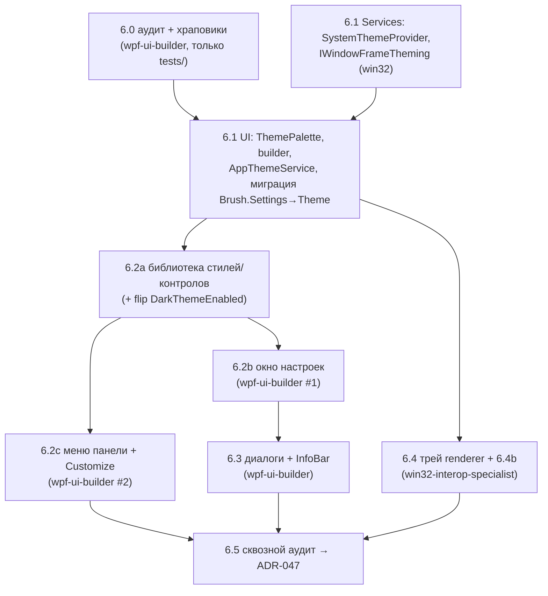

# Дочерний план: «Бэклог 1.x, пункт 6 — единая дизайн-система (меню, настройки, диалоги)»

> **Статус: реализовано, закрыто 2026-09-30.** Фазы 6.0–6.5 пройдены (волны, коммиты `6582af2`/`eb4af36`/
> `6f563d6`/`f98da21` на ветке `feature/backlog-1x`); архитектурное решение и итоговый DoD —
> [ADR-047](../../adr/ADR-047-unified-design-system.md) (amends ADR-025/ADR-031/ADR-042/ADR-040/ADR-044/
> ADR-013/ADR-001/ADR-033/ADR-002). ROADMAP пункт 6 → `[x]`; бэклог 1.x закрыт целиком. Отклонение от
> плана (гейт `DarkThemeEnabled` включён в волне 6.3/6.5, а не в конце 6.2a, как предполагалось здесь) и
> известные ограничения/долг (T-5 RESX-длина, `LayoutSnappingSection`) — см. ADR-047 «Реализация»/«Известные
> ограничения». Текст ниже сохранён как исходный план фазы, не отредактирован постфактум.

> **Родитель:** [backlog-1x-master-plan.md §6](backlog-1x-master-plan.md) — рамки, фазы 6.0–6.5, ADR-047 и
> решения §6.2 (тема окна настроек = тема Windows; трей остаётся WinForms + renderer по токенам; нативное
> shell-меню ADR-040 — осознанное ограничение) **здесь не пересматриваются**, только детализируются.
> **Пункт ROADMAP:** «Унифицировать интерфейс: меню, настройки, диалоги в одном стиле» (акцент — читаемость:
> WCAG AA ≥ 4.5:1, шрифт не меньше системного, иерархия заголовков, без «стен текста»).
> **Ветка/снимок кода:** `feature/backlog-1x`, HEAD `4e7268b` (прочитано 2026-09-29, только чтение).
> **Решение CN-1:** вариант **A** — окно настроек, Customize, диалоги и WPF-меню следуют теме Windows,
> **без новой настройки**. Никаких новых полей в persistence / `IAppSettings` / `user.config`.
> **Scope:** **XL** → 6 фаз, каждая — отдельный проход конвейера (реализация → тесты → ревью).
> **Планировщик:** `fences-feature-planner`, 2026-09-29.

---

## 0. Правила, входные условия, границы

### 0.1. Наследуемые ограничения (обязательны в каждой фазе)

| # | Правило |
|---|---|
| G-1 | **Persistence заморожен.** Ни одна фаза не трогает `StateEnvelope`/DTO/миграции/`IAppSettings`/`Settings.settings`/`user.config`/дефолты. Состояние «раскрыт ли expander», текущая тема, текущий InfoBar — **только в памяти**. Если исполнителю «нужно» поле — `CLARIFICATION_NEEDED`, не расширение схемы. |
| G-2 | 0 errors / 0 warnings (CS/CA/SA/nullable/`linter.ruleset`) в `dotnet build` и `dotnet test`. Без `#pragma`/`[SuppressMessage]`/`<NoWarn>`. Это же правило **исключает** WPF Fluent `ThemeMode` (.NET 9+/10): он требует подавления экспериментальной диагностики `WPF0001` (см. §2.11, D-12). |
| G-3 | Новая логика покрыта unit-тестами; STA-тесты по `docs/Refactoring/Testing/sta-test-conventions.md`. |
| G-4 | RESX: каждый новый ключ — одновременно в `src/DesktopOrganizer.Localization/Strings.resx` и `Strings.ru.resx` и реально используется (`ResxConsistencyTests`, `KeyUsageCoverageTests`, `XamlKeyCoverageTests`, `XamlLiteralGuardTests` зелёные). Ставший неиспользуемым ключ удаляется в той же фазе. |
| G-5 | P/Invoke только за `INativeApi` (он `internal` в Services — UI получает нативное поведение только через публичные интерфейсы Services.Abstractions). Services не зависит от UI (трей не видит WPF-ресурсы). |
| G-6 | Manual verify Win11 — отдельный блок (§10), **не блокер**. |
| G-7 | Номер ADR — следующий свободный на момент записи (предварительно **ADR-047**; ADR-043…046 зарезервированы пунктами 3, 1–2, 8, 7 и на 2026-09-29 ещё не записаны в `adr/`). |

### 0.2. Границы: что входит и что НЕ входит

**Две палитры, одна система правил.** Главное архитектурное разделение этого плана:

| Палитра | Кто рисуется | Статус в пункте 6 |
|---|---|---|
| **Palette P — панели** (Ambient Accent, ADR-025/030/042): `Colors.xaml`/`Brushes.xaml` (`Color.Surface.*`, `Color.Text.*`, `Color.Accent.*`…), `PanelTheme.*`, `SurfaceComposer`, `PanelChromeForegroundPolicy` | `ChildWindow` (хром, заголовок, значки, скроллбар), `SystemIconsPanelWindow`, `PanelPreviewCard` | **Вне scope** (кроме меню/тултипов/хинт-попапов панелей). Пер-панельные цвета — данные пользователя; frozen-кисти и порядок merge (App.xaml.cs `LoadResourceDictionaries`) не меняются. |
| **Palette T — «хром приложения»** (новая, theme-aware): `Theme.*` | окно настроек (`MainWindow` + 8 секций), `PanelCustomizeWindow`, `PanelColorEditor`/`SteppedValueEditor` (как контролы хрома), все **WPF-меню** (меню заголовка панели, меню «на страницу» в Settings), тултипы, хинт-попапы, новый единый диалог, InfoBar, **трей** (через renderer) | **В scope.** Светлая/тёмная по теме Windows, HC по `SystemColors`. |

Нативные поверхности, которые система не стилизует (фиксируются в ADR-047 как ограничения): shell-меню
значков (ADR-040), `ColorDialog` (WinForms, «Свой цвет…»), `FolderBrowserDialog` (Folder Portal «Обзор…»),
крэш/стартовые/CLI `MessageBox` (`App.ShowCrashDialog`, `Program.cs`) — последние **намеренно** остаются
`MessageBox`: они работают до/после WPF-UI и обязаны иметь минимум зависимостей (ADR-033).

### 0.3. Предусловия старта

- Мастер-план: пункт 6 — последним, после 1–5, 7, 8. По факту HEAD `4e7268b`: пункты 1, 2, 4, 5, 8 и 3
  реализованы в коде (волны 1–2), ROADMAP ещё не отмечен (документатор пакетно).
- **Пункт 7** (фоновая загрузка иконок) не пересекается с пунктом 6 ни по одному файлу (Services/Core/
  `BaseViewModel` против `Resources/Styles`/`Views`). Жёсткой зависимости нет: оркестратор **может**
  начать 6.0–6.1 параллельно с 7b/7c, если нужна экономия времени (≤ 2 реализующих агента в одном
  дереве, сборки последовательно — правило мастер-плана §10.2). По умолчанию — после 7.
- Фаза 6.0 (аудит, без визуальных правок) может стартовать сразу.

---

## 1. Инвентаризация (состояние на HEAD 4e7268b)

### 1.1. Экраны, меню, диалоги и их визуальные языки

Контраст — расчёт планировщика по WCAG 2.x (relative luminance); **авторитетными станут числа из
характеризационного теста фазы 6.0** (`ChromeContrastAuditTests`, конвенция `AmbientAccentContrastAuditTests`).
«Aero2» = стоковый WPF-шаблон темы Windows (светлый, не знает о нашей палитре).

| # | Поверхность | Файл(ы) | Визуальный язык сейчас | Типографика | Контраст / состояния (находки) | HC | Фаза |
|---|---|---|---|---|---|---|---|
| S-1 | Оболочка Settings (сайдбар + контент) | `Views/MainWindow.xaml`, `Resources/Styles/Settings.xaml` (`Settings.Sidebar*`) | Светлая «Win11 Personalization» (ADR-031), фикс. 720×560, сайдбар 190 DIP; **тёмной темы нет** | пункты 12, глифы 14 | Выбранный пункт = белая заливка на `#F0F0F0` → **1.14:1** (индикатор состояния, WCAG 1.4.11 требует ≥ 3:1) ✗; глифы `#888888` на `#F0F0F0` = 3.11:1 (на грани); hover `#14000000` | `TabActiveBackground`→Highlight (m7) | 6.1, 6.2b |
| S-2 | General | `Views/Settings/GeneralSection.xaml` | карточки + ComboBox (Aero2) + toggle; «Дополнительно» — **голый стоковый `Expander`**, не `Settings.CardExpander` | CardHeader 13 SB, Description **11** (< 12 системного) | Description `#666666` на белом 5.74:1 ✓ | частично | 6.2b |
| S-3 | Layout & snapping | `LayoutSnappingSection.xaml` | карточки, toggles, Slider (Aero2) | 13/11 | toggle «выкл» трек `#9A9A9A` на белом **2.81:1** ✗ (1.4.11) | трек→GrayText | 6.2a/b |
| S-4 | Panels | `PanelsSection.xaml(.cs)` | **ряд из 5 кнопок** (Add · Customize · Move ▾ · Copy ▾ · Remove) в `WrapPanel` — в RU переносится на 2 строки; меню Move/Copy — **стоковые светлые Aero2 `ContextMenu`**, тогда как те же команды в меню панели — тёмные; ListBox Aero2 | 13/11; кнопки 12 | деструктивная «Удалить» равноправна с «Добавить» | системный | 6.2a/b |
| S-5 | New panel defaults | `NewPanelDefaultsSection.xaml` + `Controls/PanelColorEditor.xaml` | карточки, `PanelColorEditor` (после п.5), **ComboBox на 2 значения** (Panel geometry, Icon layout — бэклог ADR-042 «на сегменты») | 13/11 | — | пробел ADR-042 (свотч/сегмент) | 6.2b/c |
| S-6 | Pages | `PagesSection.xaml(.cs)` | строки с 3 кнопками Rename / Make current / Remove, **FontSize 11** | 11 (< 12) ✗ | ошибка переименования `#B8860B` на белом **3.25:1** ✗ (текст) | Warning→Highlight | 6.2b |
| S-7 | System icons | `SystemIconsSection.xaml` | карточки; предупреждение `Brush.Settings.Warning` 11 px | 11 ✗ | **3.25:1** ✗ | — | 6.2b |
| S-8 | Backup (снапшоты) | `BackupSection.xaml` | `ListView`+`GridView` (Aero2-заголовки), кнопки строк **11 px, Padding 6,3** (мелкая цель) | 11 ✗ | дата `TextMuted` 5.74 ✓ | системный | 6.2b |
| S-9 | About | `AboutSection.xaml` | 3 внешние ссылки как обычные кнопки в ряд; статус проверки обновлений — обычный `TextBlock` (не LiveRegion) | 13/11 | — | — | 6.2b |
| S-10 | Customize panel | `Views/PanelCustomizeWindow.xaml` | 420×640 NoResize; карточки ADR-042; заголовки групп «Содержимое»/«Макет» = `Settings.PageHeader` + **инлайн `FontSize="14"`**; Auto-size — **обычный CheckBox** (в Settings — toggle); Icon layout — ComboBox на 2 значения; фон окна по умолчанию | 18→14 inline, 13/11 | — | частично | 6.2c |
| S-11 | `PanelColorEditor` / `SteppedValueEditor` | `Controls/*.xaml` | свотчи, compact-сегменты (11 px), «Aa» 9 px | 9/11 | кольцо выбора свотча в HC не на Highlight (пробел ADR-042) | ✗ | 6.2c |
| S-12 | Ввод текста (Save snapshot as…, …) | `Views/InputDialog.xaml`, `Services/InputDialogService.cs` | WPF, фон `#F0F0F0`, стоковые кнопки `Width=80`, без заголовка в контенте/иконки | системный | — | — | 6.3 |
| S-13 | Подтверждения (удалить панель/страницу, restore/delete снапшота, Align all, Apply to all panels) | `Services/ConfirmationService.Confirm` → `MessageBox` Yes/No | **Win32 MessageBox** (системный вид, кнопки локализует ОС) | системный | — | системный | 6.3 |
| S-14 | Информационные уведомления «Панель перемещена/скопирована на страницу …» | `MainWindowViewModel.MovePanelToPage/CopyPanelToPage` → `Notify(Information)` | **блокирующий MessageBox на успех** | — | лишний модальный шаг | — | 6.3 (→ InfoBar) |
| S-15 | Предупреждения (копирование не удалось; Корзина не приняла) | `MainWindowViewModel` ×2, `PageManagerService` ×1 → `Notify(Warning)` | MessageBox | — | `Recycle_Failed_Message_Format` ≈ 290 символов — «стена текста» | — | 6.3 |
| S-16 | Крэш / старт / CLI restore | `App.xaml.cs:263`, `Program.cs:206,257,273,283,461,469` | MessageBox | — | — | — | **ограничение** (ADR-047) |
| S-17 | Меню заголовка панели | `Views/ChildWindow.xaml` `HeaderContextMenu` + `Controls.xaml` `Control.ContextMenu/MenuItem` | Aero2-шаблон `MenuItem` + тёмный фон `#262626`, **всегда тёмное**; ≈ 20 пунктов; «Содержимое»/«Упорядочить значки» — **disabled-пункты как заголовки групп** | системный 12 | текст `#DDDDDD` на `#262626` 11.1 ✓; disabled-заголовки (Aero2 `#707070`) **≈ 3.0:1** ✗; hover — голубая Aero2-подсветка; **H-1** (ниже) | фон/текст — да | 6.2c |
| S-18 | Подменю панели (Move/Copy to page ▸, Size ▸, Icon layout ▸, Panel sizing ▸) | там же | Aero2 `SubmenuHeader` | 12 | **H-1**: фон попапа подменю берётся из Aero2 (`Menu.Static.Background` ≈ `#F0F0F0`), а текст — `#DDDDDD` из неявного стиля → **≈ 1.2:1** ✗ | ? | 6.0 подтвердить, 6.2c |
| S-19 | Хинт-попапы панели (Move-hint, ошибка переименования) | `ChildWindow.xaml` `MoveHintPopup`/`RenameErrorPopup` + `Control.Popup.Chrome` | тёмный попап | **11** ✗ | ✓ | да | 6.2c |
| S-20 | Тултипы (кнопки заголовка панели, пункты меню, Settings) | — | стоковые Aero2 (светлые) | системный | ✓ | системный | 6.2a |
| S-21 | Меню трея | `Services/Providers/TrayIconManager.cs` (`ContextMenuStrip`, `ManagerRenderMode` → Professional renderer) | WinForms «Office»-стиль: градиентная колонка под значки, синяя подсветка, **всегда светлое** | Segoe UI 9 pt | ✓ (светлое) | системный | 6.4 |
| S-22 | Shell-меню значков | ADR-040, скрытое helper-окно + `TrackPopupMenuEx` | нативное Win32-меню **нашего процесса** | системный | **H-2**: без opt-in (`SetPreferredAppMode`) нативные меню процесса всегда светлые даже в тёмной теме Windows | системный | 6.4b (оценка) / ограничение |
| S-23 | «Свой цвет…» | `IColorPickerService` → WinForms `ColorDialog` | классический диалог (ADR-042 manual verify) | — | — | — | ограничение |
| S-24 | «Обзор…» (Folder Portal) | `FolderBrowserDialog` | системный Common Item Dialog | — | — | — | ограничение (ok) |
| S-25 | Заголовки окон (Settings, Customize, диалог) | — | DWM, **всегда светлые** | — | в тёмной теме будет светлая рамка над тёмным контентом | — | 6.1 |
| S-26 | Панели, first-run-панель (ADR-041), сайдбар системных иконок | Palette P | Ambient Accent | подписи значков 11, сайдбар 10 | — | да | **вне scope** (геометрия `GridMetrics.LabelHeight`); исключение фиксируется в ADR-047 |

**Гипотезы для подтверждения в 6.0** (каждая — STA-характеризационный тест или manual verify):

- **H-1** (P0): подменю в меню панели рисуются светлым попапом Aero2 со светлым текстом `#DDDDDD`
  (≈ 1.2:1). Проверка без экрана: STA-тест применяет шаблон к `MenuItem` с `Role=SubmenuHeader` внутри
  `HeaderContextMenu`-стиля, находит `SubMenuBorder` и сравнивает его `Background` с `Foreground` пунктов.
- **H-2**: shell-меню значков (ADR-040) всегда светлое (процесс не делает opt-in тёмных нативных меню).
  Manual verify M-0.2.
- **H-3**: `Settings.ToggleCheckBox` не имеет собственного фокус-визуала (остаётся стоковый пунктирный
  `FocusVisualStyle`), а сегменты — 1 px рамка фокуса. Проверка — ревью шаблонов + manual.
- **H-4**: в RU при 720×560 сайдбар 190 DIP и ряд кнопок Panels переносятся/обрезаются при Body ≥ 13.

### 1.2. «Стены текста» (RESX en, > 100 символов: 19 ключей en, 30 ru)

Самые длинные (> 150): `Recycle_Failed_Message_Format` (~290), `Panel_Menu_Size_Tooltip` (~215),
`Settings_Layout_LockLayout_Description` (~160), `Settings_Confirm_AlignAll_Message_Format` (~160),
`Page_Confirm_Remove_ManagedFiles_Message` (~165), `Crash_Dialog_Message` (~155, остаётся MessageBox).
Правило и тест-«храповик» — §2.12, T-5.

### 1.3. Результаты аудита 6.0

*Заполняет исполнитель фазы 6.0: подтверждение/опровержение H-1…H-4, фактические числа контраста из
`ChromeContrastAuditTests`, скриншоты manual verify M-0.1/M-0.2 (ссылки).*

### 1.4. Итоговый аудит 6.5

*Заполняет фаза 6.5: повтор таблицы §1.1, в каждой строке — «соответствует» или ссылка на ограничение ADR-047.*

---

## 2. Целевая дизайн-система

### 2.1. Архитектура темы

```mermaid
graph TD
    Reg["HKCU\\...\\Themes\\Personalize<br/>AppsUseLightTheme / SystemUsesLightTheme"] --> STP["SystemThemeProvider (Services/Tools)<br/>ISystemThemeProvider (Services.Abstractions)"]
    SE["WM_SETTINGCHANGE 'ImmersiveColorSet'<br/>/ SystemEvents.UserPreferenceChanged"] --> STP
    HC["SystemParameters.HighContrast (+StaticPropertyChanged)"] --> ATS
    STP --> ATS["AppThemeService (UI/Theming)<br/>IAppThemeService: Current, ThemeChanged"]
    Pal["ThemePalette.Light / .Dark (C#, источник правды)<br/>TypeRamp (от SystemFonts.MessageFontSize)"] --> TRB["ThemeResourceBuilder → ResourceDictionary<br/>(Theme.* Color + frozen Brush + Font.Size.*)"]
    ATS --> TRB
    TRB --> Slot["Application.Resources: слот темы<br/>(замена словаря целиком)"]
    Slot -->|DynamicResource Theme.*| XAML["Settings.xaml, Theme.Controls.xaml,<br/>MainWindow, секции, Customize, AppDialog, InfoBar,<br/>меню панели, тултипы"]
    ATS --> WFT["IWindowFrameTheming (Services.Abstractions)<br/>→ INativeApi: DwmSetWindowAttribute(DWMWA_USE_IMMERSIVE_DARK_MODE)"]
    ATS --> TTA["TrayThemeAdapter (UI/Lifecycle)"]
    Pal --> TPF["TrayMenuPaletteFactory (UI/Theming)"]
    TPF --> TTA
    TTA -->|TrayMenuPalette (ARGB-примитивы)| TIM["ITrayIconManager.SetMenuPalette → TrayMenuRenderer (Services, WinForms)"]
    PanelsP["Palette P (Colors/Brushes.xaml, frozen, StaticResource)"] -.не меняется.-> Panels["ChildWindow / SystemIconsPanelWindow"]
```

Ключевые решения (детали — §3 фаза 6.1, ADR-047 D-1…D-3):

- **Источник правды — C#** (`ThemePalette` record: Light, Dark), по прецеденту `AccentPalette.cs`.
  Причины: (1) трей в Services не может читать WPF-XAML, а палитра должна быть одна; (2) тест контраста —
  чистый C# без STA; (3) HC-вариант строится из `SystemColors` тем же билдером. XAML-файлов тем нет.
- **Потребление — только `DynamicResource`** для `Theme.*`. Замена темы = замена одного merged-словаря
  в `Application.Resources` → все `DynamicResource`-потребители перерисовываются живьём. Кисти внутри
  словаря по-прежнему `Freeze()` (словарь заменяется целиком, а не мутируется).
  `StaticResource Theme.*` запрещён guard-тестом (заморозил бы стартовую тему).
- **Palette P не трогается**: её frozen `StaticResource`-цепочка и HC-оверлей «при старте» (D-12 ADR-025)
  остаются как есть. Старые `Color.Settings.*`/`Brush.Settings.*` (и их строки в
  `Colors.HighContrast.xaml`) **удаляются** после миграции потребителей на `Theme.*` (конец 6.1).
- **Тема окна**: `AppsUseLightTheme` (режим приложений). **Трей**: `SystemUsesLightTheme` (режим Windows —
  так рисуются нативные меню трея и панели задач); при отсутствии значения — fallback на
  `AppsUseLightTheme`, затем Light. **HC** → `SystemColors`, живое переключение для Palette T
  (панели по-прежнему требуют перезапуска — задокументированное расхождение, D-12 ADR-025).
- **Заголовок окна**: `DWMWA_USE_IMMERSIVE_DARK_MODE` (атрибут 20, Win11/Win10 20H1+) на каждое окно
  семейства хрома при `SourceInitialized` и при `ThemeChanged` — через новый публичный
  `IWindowFrameTheming` (Services.Abstractions) → `INativeApi`.
- **Feature gate**: до готовности 6.2a (стилизованные стоковые контролы) `AppThemeService` принудительно
  отдаёт Light (`internal const bool DarkThemeEnabled = false` — **константа кода, не настройка**).
  Иначе в промежутке 6.1→6.2 белые Aero2-контролы окажутся на тёмных карточках. Флип — последний коммит 6.2a.

### 2.2. Цветовые токены Palette T

Имена — семантические (`Theme.<группа>.<роль>[.<состояние>]`), константы-строки в `ThemeKeys`.
Значения — ориентир в стиле Windows 11 (финал фиксирует тест T-1; исполнитель может сдвинуть оттенок,
не опуская контраст ниже порога). Контраст посчитан планировщиком.

| Токен | Light | Dark | HC (`SystemColors`) | Проверка (T-1) |
|---|---|---|---|---|
| `Theme.Surface.Window` (фон окна/сайдбара) | `#F3F3F3` | `#202020` | `Window` | — |
| `Theme.Surface.Card` | `#FBFBFB` | `#2B2B2B` | `Window` | — |
| `Theme.Surface.CardHover` | `#F6F6F6` | `#323232` | `ControlLight`/`Highlight`-рамка | текст ≥ 4.5 |
| `Theme.Surface.Flyout` (меню, тултип, диалог, InfoBar-база) | `#F9F9F9` | `#2C2C2C` | `Menu`/`Window` | — |
| `Theme.Text.Primary` | `#1B1B1B` | `#FFFFFF` | `WindowText` | ≥ 4.5 на всех Surface (факт ≈ 15–17:1) |
| `Theme.Text.Secondary` (описания) | `#5F5F5F` | `#C5C5C5` | `WindowText`* | ≥ 4.5 (L: 6.17 на Card, 5.76 на Window; D: 8.2 на Card) |
| `Theme.Text.Disabled` | `#8A8A8A` | `#7A7A7A` | `GrayText` | ≥ 3.0 (L 3.34, D 3.30 на Card) — WCAG освобождает, но различимость держим |
| `Theme.Text.OnAccent` | `#FFFFFF` | `#000000` | `HighlightText` | ≥ 4.5 на Accent.* (L 6.31, D 11.7) |
| `Theme.Text.Caution` | `#9D5D00` | `#FCE100` | `WindowText` | ≥ 4.5 (L 5.07, D 10.7) — заменяет `#B8860B` (3.25) |
| `Theme.Text.Critical` | `#C42B1C` | `#FF99A4` | `WindowText` | ≥ 4.5 (L 5.47, D 6.97) |
| `Theme.Text.Success` | `#0F7B0F` | `#6CCB5F` | `WindowText` | ≥ 4.5 (L 5.26, D 6.97) |
| `Theme.Accent.Fill` / `.Hover` / `.Pressed` / `.Disabled` | `#005FB8` / `#196EBF` / `#3183CA` / `#C5C5C5` | `#60CDFF` / `#5AB8E6` / `#52A6CE` / `#434343` | `Highlight` | Text.OnAccent ≥ 4.5 на Fill/Hover/Pressed; Fill vs Card ≥ 3 (L 6.1, D 7.9) |
| `Theme.Control.Fill` / `.Hover` / `.Pressed` / `.Disabled` (secondary-кнопки, поля) | `#FFFFFF` / `#F9F9F9` / `#F5F5F5` / `#F5F5F5` | `#2D2D2D` / `#323232` / `#272727` / `#2A2A2A` | `ButtonFace` | Text.Primary ≥ 4.5 |
| `Theme.Control.Subtle.Hover` / `.Pressed` (subtle-кнопки, пункты меню, сайдбар) | `#0A000000` / `#06000000` | `#0FFFFFFF` / `#0AFFFFFF` | `Highlight` (+`HighlightText`) | текст на композите ≥ 4.5 |
| `Theme.Stroke.Card` / `.Divider` | `#E5E5E5` | `#3A3A3A` / `#404040` | `WindowText` | декоративные (освобождены) |
| `Theme.Stroke.Control` | `#E5E5E5` (+ нижняя `#C4C4C4`) | `#3F3F3F` | `ButtonText` | декоративная (кнопка идентифицируется текстом) |
| `Theme.Stroke.Input` (граница TextBox/ComboBox, трек toggle «выкл», radio/checkbox) | `#8A8A8A` | `#9A9A9A` | `WindowText` | **≥ 3.0** vs Control.Fill и Card (L 3.45, D 4.9) — закрывает 2.81 |
| `Theme.Stroke.Focus` (двойное кольцо: внешнее) / `.FocusInner` | `#1B1B1B` / `#FFFFFF` | `#FFFFFF` / `#000000` | `WindowText` / `Window` | ≥ 3.0 vs всех Surface |
| `Theme.Selection.Indicator` (пилюля выбранного пункта сайдбара, выбранный сегмент/свотч) | = Accent.Fill | = Accent.Fill | `Highlight` | ≥ 3.0 vs Card/Window — закрывает 1.14 |
| `Theme.Selection.Fill` / `.Text` (выбранный сегмент/строка списка) | `#FFFFFF` + Stroke / Text.Primary | `#3A3A3A` / Text.Primary | `Highlight` / `HighlightText` | ≥ 4.5; закрывает HC-пробел ADR-042 |
| `Theme.InfoBar.{Info,Success,Caution,Critical}.Background` | `#F4F4F4` / `#DFF6DD` / `#FFF4CE` / `#FDE7E9` | `#2B2B2B` / `#393D1B` / `#433519` / `#442726` | `Window` + `Highlight`-рамка | Text.Primary и Text.* severity ≥ 4.5 |

\* HC: вторичный текст в HC = `WindowText` (в HC-темах `GrayText` зарезервирован для disabled).

**Правила состояний (ADR-047 D-6):**
- **hover** — только заливка (`Control.*.Hover`/`Subtle.Hover`), текст не меняется;
- **pressed** — заливка `*.Pressed`, текст — `Text.Secondary` для secondary/subtle (как Win11);
- **disabled** — токены `Text.Disabled`/`Control.Fill.Disabled`/`Accent.Fill.Disabled`, **не** `Opacity`
  на весь контрол (сейчас 0.45/0.5 — непредсказуемый контраст). Исключение — Palette P (кнопки заголовка
  панели) — вне scope;
- **focus** — единый `Theme.FocusVisual` (`FocusVisualStyle`): 2 px `Stroke.Focus` + 1 px
  `Stroke.FocusInner`, радиус 4, отступ −3; только клавиатурный фокус (стандартная семантика
  `FocusVisualStyle`); у сегментов/свотчей — тот же визуал, не 1 px рамка;
- **selected** — индикатор `Selection.Indicator` (контраст ≥ 3:1) + `Selection.Fill`; цвет не единственный
  носитель состояния (пилюля/галочка/кольцо).

### 2.3. Типографика (`TypeRamp`, ADR-047 D-4)

База **M = `SystemFonts.MessageFontSize`** (12 DIP при 100 % и «Размер текста» = 100 %; растёт вместе с
настройкой Windows «Специальные возможности → Размер текста»). Токены — `sys:Double` в словаре темы,
`DynamicResource` → при `WM_SETTINGCHANGE` пересчёт без перезапуска.

| Токен | Значение | Вес | Где | UIA `HeadingLevel` |
|---|---|---|---|---|
| `Font.Size.Caption` | M (12) | Regular | описания карточек, бейджи, подписи сегментов compact, пункты меню (= нативные меню 9 pt) | — |
| `Font.Size.Body` | M + 2 (14)* | Regular | заголовок карточки, текст контролов (кнопки, поля, сегменты), тело диалога/InfoBar | — |
| `Font.Size.BodyStrong` | M + 2 (14)* | SemiBold | заголовок группы (`Settings.GroupHeader`), заголовок InfoBar | Level2 |
| `Font.Size.Subtitle` | M + 6 (18) | SemiBold | заголовок диалога | Level1 (в диалоге) |
| `Font.Size.Title` | M + 8 (20) | SemiBold | заголовок страницы Settings (`Settings.PageHeader`), заголовок Customize | Level1 |

\* **Fallback, решаемый в 6.1 по тесту T-9 (раскладка 420 DIP, ru):** если Body = M + 2 не помещается в
`PanelCustomizeWindow`/сегменты без обрезки — Body = M + 1 (13). Решение фиксируется в ADR-047; ниже M не
опускается ничего.

Правила: **ни один текст Palette T не меньше M** (сейчас 11 и 9 — нарушения); шрифт — системный (Segoe UI /
Segoe UI Variable, `FontFamily` не задаём); глифы — `Segoe Fluent Icons, Segoe MDL2 Assets` (Fluent первым,
как в Win11); допускаемые исключения (фиксируются в ADR-047 и allowlist теста T-3): миниатюра
`PanelPreviewCard` (масштабная копия панели, `AccessibilityView=Raw`), глиф-иконки (не текст), Palette P
(геометрия `GridMetrics.LabelHeight`).

### 2.4. Отступы и геометрия (ADR-047 D-5)

Шкала хрома — **4 / 8 / 12 / 16 / 24** (+2 только для внутреннего зазора сегментов). Существующие `Space.6`,
`Space.10` остаются для Palette P (панели), в Palette T не используются (T-3).

| Токен | Значение | Назначение |
|---|---|---|
| `Theme.Card.Padding` | 16,12 | внутренний отступ карточки (сейчас 14,12) |
| `Theme.Card.Gap` | 4 | между карточками внутри группы (сейчас 10) |
| `Theme.Group.Gap` | 24 сверху, 8 снизу у `GroupHeader` | между группами |
| `Theme.Page.Padding` | 24,16 (Settings), 16,12 (Customize 420) | поле контента |
| `Theme.Control.MinHeight` | 32 | кнопки, поля, ComboBox (цель клика ≥ 24 — WCAG 2.5.8) |
| `Theme.MenuItem.MinHeight` / `.Padding` | 30 / 12,6 | пункты меню (метрика нативного меню Win11) |
| `Theme.Radius.Control` / `Theme.Radius.Popup` / `Theme.Radius.Card` | 4 / 8 / 6 | Palette T; **новые ключи**, чтобы не сдвинуть панели (Palette P сохраняет `Radius.Control`/`Radius.Popup`/`Radius.Panel` = 3/4/8) |

### 2.5. Каталог стилей и контролов (`Resources/Styles/Theme.Controls.xaml`, новый)

| Стиль / контрол | Тип | Заменяет | Примечание |
|---|---|---|---|
| `Theme.FocusVisual` | `Style` для `FocusVisualStyle` | стоковый пунктир, 1 px сегментов | §2.2 |
| `Theme.Button` (secondary, неявный в окнах хрома) | `Button` | Aero2 | MinHeight 32, Padding 12,5, Body |
| `Theme.Button.Primary` | `Button` | — | Accent.Fill + Text.OnAccent; **≤ 1 на вид/группу** |
| `Theme.Button.Subtle` | `Button` | кнопки строк Pages/Backup (11 px) | прозрачная, hover Subtle.* |
| `Theme.Button.Link` | `Button` | ссылки About | текст Accent.Fill (L 6.3 ✓), подчёркивание на hover, глиф «открыть во внешнем» |
| `DropDownButton` | **новый контрол** `Controls/DropDownButton.cs` (`ToggleButton` + `Menu : ContextMenu`) | `OpenMenuOnLeftClick_Click` в code-behind | `IsChecked`↔`Menu.IsOpen`; Space/Enter/Alt+↓ открывает, фокус на первый пункт; шеврон E70D; UIA Toggle-pattern |
| `Theme.ToggleSwitch` | `CheckBox` | `Settings.ToggleCheckBox` | + фокус, + `Stroke.Input` трека «выкл», disabled по токенам |
| `Theme.CheckBox`, `Theme.RadioButton` | неявные | Aero2 | списки видимости системных значков, прочее |
| `Theme.ComboBox` (+`ComboBoxItem`, попап) | неявный | Aero2 | попап — `Surface.Flyout`, радиус 8 |
| `Theme.TextBox` | неявный | Aero2 | нижняя граница `Stroke.Input`, фокус — Accent-подчёркивание 2 px |
| `Theme.Slider` | неявный | Aero2 | трек `Stroke.Input`, заполненная часть и thumb — Accent |
| `Theme.ScrollBar` | неявный в окнах хрома | Aero2 (светлый в тёмной теме) | тонкий, как Win11; **не** `Control.ScrollBar.Overlay` панелей |
| `Theme.ListBox`/`ListBoxItem`, `Theme.ListView`/`GridViewColumnHeader` | неявные | Aero2 | выделение — `Selection.*` + индикатор |
| `Theme.ToolTip` | неявный **app-wide** | Aero2 | `Surface.Flyout`, Caption, радиус 4; единственный неявный стиль, который достаётся и панелям (безопасно: тултип — отдельный попап) |
| `Theme.ContextMenu` / `Theme.MenuItem` / `Theme.Separator` | ключевые (явно у каждого меню) | `Control.ContextMenu`/`Control.MenuItem` (Controls.xaml) и стоковые меню Settings | **полный шаблон `MenuItem` для всех 4 ролей** (TopLevelHeader/Item, SubmenuHeader/Item) — закрывает H-1; галочка — глиф E73E цветом текста; стрелка подменю E76C; `InputGestureText` справа (Caption, Text.Secondary) |
| `Theme.MenuItem.GroupHeader` | `MenuItem` | disabled-пункты «Содержимое»/«Упорядочить значки» | не `IsEnabled=False`: `Focusable=False`, `IsHitTestVisible=False`, Caption SemiBold, `Text.Secondary` (≥ 4.5) — используется только если UX-ревью оставит группы плоскими (см. §2.6) |
| `SettingsCard` | **новый** templated-контрол `Controls/SettingsCard.cs` (`Header`, `Description`, `ActionContent`, `Content`) | ручная разметка Border+Grid+StackPanel (~15 строк × ~35 карточек; follow-up **DO-026**) | гарантирует иерархию и отступы; `ActionContent` получает `AutomationProperties.LabeledBy` на заголовок |
| `Settings.GroupHeader` | `TextBlock` style | `PageHeader` + инлайн `FontSize="14"` в Customize | BodyStrong, HeadingLevel2 |
| `Settings.PageHeader`, `Settings.CardHeader`, `Settings.CardDescription` | обновлённые | — | на `Font.Size.*`/`Theme.Text.*` (DynamicResource), HeadingLevel |
| `Settings.CardExpander` | обновлённый | + голый `Expander` в General | единственный expander хрома |
| `Settings.SegmentedGroup/Item(.Compact)` | обновлённые | ComboBox на 2 значения (Icon layout ×2, Panel geometry) | бэклог ADR-042; `Selection.*` → HC-пробел закрыт |
| `InfoBar` | **новый** контрол `Controls/InfoBar.cs` | блокирующий MessageBox на успех | Severity (Info/Success/Caution/Critical), Title, Message, кнопка закрытия; `AutomationProperties.LiveSetting=Polite` (Assertive для Critical) |
| `Theme.Popup.Chrome` | `Border` | `Control.Popup.Chrome` (хинт-попапы панели) | Caption ≥ M вместо 11 |

**Область применения неявных стилей:** словарь `Theme.Implicit.xaml` мёржится в `Window.Resources`
окон хрома (`MainWindow`, `PanelCustomizeWindow`, `AppDialogWindow`), **не** в `Application.Resources` —
иначе стоковые контролы панелей (например, `TitleEditBox` в `ChildWindow`) внезапно получат тему хрома.
Исключение — `Theme.ToolTip` (app-wide). Меню получают стиль явно (`Style="{StaticResource
Theme.ContextMenu}"` — сам стиль ключевой и неизменяемый, цвета внутри — `DynamicResource`).

### 2.6. Меню (ADR-047 D-7)

1. **Один стиль для всех WPF-меню**: меню заголовка панели, «Переместить/Копировать на страницу» в Settings,
   будущие. Следует **теме Windows**, а не палитре панели: рядом на той же панели открывается нативное
   shell-меню значка, которое рисует система, — WPF-меню заголовка должно выглядеть его соседом, а не
   «третьим языком». Сейчас оно всегда тёмное (`#262626`), Settings-меню — стоковые светлые.
2. **Метрики Win11-меню**: радиус попапа 8, пункт 30 DIP, отступ 12,6, подсветка — скруглённый
   прямоугольник с инсетом 4, Caption (= 9 pt нативного меню), разделитель 1 px `Stroke.Divider` с
   отступами 4.
3. **Структура меню заголовка панели** (≈ 20 → 16 пунктов, без disabled-заголовков):
   `Переименовать (F2)` · `Настроить…` · `Переместить на страницу ▸` · `Копировать на страницу ▸` ·
   `Свернуть/развернуть` · — · `Размер ▸` · `Выровнять по сетке ✓` · `Макет значков ▸` · `Размер панели ▸` ·
   — · `Режим редактирования ✓` · `Заблокировать макет ✓` · — · **`Показывать ▸`** (4 радио фильтра) ·
   **`Упорядочить ▸`** (Вручную / По имени).
   Правило: **радио-группа → подменю** (так уже сделаны «Макет значков», «Размер панели»). Заголовки
   подменю — существующие ключи `Panel_Menu_ContentHeader`/`Panel_Menu_ArrangeIconsHeader` (текст при
   необходимости полирует `design:ux-copy`; новые ключи не нужны). **Паритет с Fences** (контекстное меню
   ограждения в Fences 5/6 тоже сгруппировано подменю) подтверждает `fences-ux-parity-reviewer`; если он
   отклонит перенос, остаётся плоский вариант с `Theme.MenuItem.GroupHeader` (контраст ≥ 4.5).
4. Меню «на страницу» в Settings переезжают внутрь `DropDownButton` «Ещё» (§2.7) как подменю.
5. Живая смена темы при открытом меню — корректна автоматически (`DynamicResource`).

### 2.7. Кнопки и ряд из 5 кнопок в Panels (ADR-047 D-8)

Правила: ≤ 1 primary на вид/группу; ≤ 3 видимых кнопки в командной строке; деструктивное действие — не
рядом с primary, а последним пунктом меню с подтверждением; кнопка, открывающая меню, — всегда
`DropDownButton` с шевроном-глифом (не «▾» в тексте RESX).

Сравнение вариантов для `PanelsSection` (Add · Customize · Move ▾ · Copy ▾ · Remove):

| Вариант | Как | + | − |
|---|---|---|---|
| **A. Командная строка + «Ещё»** | `[Добавить панель]` (primary) `[Настроить…]` `[Ещё ▾]` → `Переместить на страницу ▸` · `Копировать на страницу ▸` · — · `Удалить панель…` | 3 кнопки, одна строка в RU; команды/`CanExecute` VM без изменений; Remove уходит от primary; тот же язык подменю, что у меню панели | действия с выбранной панелью на один клик глубже |
| B. «⋯» в каждой строке списка | меню строки: Настроить / Переместить ▸ / Копировать ▸ / Удалить | как Win11 Apps; не зависит от выделения | меняет модель выбора (`SelectedPanel` ↔ строка), кнопки внутри `ListBoxItem` — фокус/UIA сложнее, больше регрессий |
| C. Split-button «Переместить ▾» | основная часть — ? | — | у «Переместить» нет естественного действия по умолчанию → split-button здесь вреден; **SplitButton в 1.x не вводится** |

**Рекомендация: A.** Для `PagesSection` — тот же язык в строке: `[Сделать текущей]` (`Theme.Button.Subtle`)
+ `DropDownButton` «⋯» (`Переименовать (F2)` · — · `Удалить…`). Backup-строки: `Восстановить` (subtle) +
«⋯» (`Удалить…`). About-ссылки → `Theme.Button.Link`.

### 2.8. Диалоги и уведомления (ADR-047 D-9)

Матрица «вызов → механизм»:

| Вызов сегодня | Кто | Целевой механизм |
|---|---|---|
| `IConfirmationService.Confirm(message, title, icon)` | MainWindowVM (Remove panel, Align all), PageManagerService (Remove page), LayoutSnapshotsVM (restore/delete), `ChildWindow.ContentSizing` (Apply to all ×2) | **`AppDialogWindow`** (модальный WPF, тема T). Сигнатура `IConfirmationService` **не меняется**. Кнопки «Да»/«Нет» (новые ключи). Кнопка по умолчанию (Enter): `Question` → «Да»; `Warning` → **«Нет»** (безопасный дефолт для необратимых — изменение поведения, фиксируется в ADR-047, проверяет UX-ревьюер). Esc = «Нет». |
| `Notify(…, Warning/Error)` | Copy failed (MainWindowVM), Recycle failed (MainWindowVM, PageManagerService) | **`AppDialogWindow`** с одной кнопкой «OK» — остаются модальными: это «fail visibly» ADR-035. Текст сокращается до ≤ 2 предложений (ux-copy). |
| `Notify(…, Information)` | «Панель перемещена/скопирована на страницу …» | **`InfoBar` в окне настроек** (Success, автоскрытие 6 с, кнопка закрытия, LiveRegion). Вызывающие переходят на новый **`IStatusNotifier`**; `Notify(Information)` после миграции не вызывается нигде (сигнатура остаётся — её используют Warning-вызовы). |
| `IInputDialogService.PromptText(title, prompt, default)` | «Сохранить снапшот как…» и др. | **`AppDialogWindow` в режиме ввода** (TextBox + inline-ошибка). Сигнатура не меняется; `Views/InputDialog.xaml(.cs)` удаляется. |
| Inline-ошибки (переименование страницы, значка) | PagesSection, `RenameErrorPopup` | остаются inline (уже правильный паттерн), только токены `Text.Critical`/`Theme.Popup.Chrome` |
| Крэш / старт / CLI restore | App.xaml.cs, Program.cs | **MessageBox — осознанно** (минимум зависимостей до/после WPF-UI, ADR-033) |

Контракты (UI/Services, `internal` где возможно):

```csharp
public enum StatusSeverity { Informational, Success, Caution, Critical }

/// Non-blocking, in-window status (Windows 11 InfoBar pattern). Never modal; never persisted.
public interface IStatusNotifier
{
    void Show(StatusSeverity severity, string message, string? title = null);
}

// Seam for ConfirmationService/InputDialogService so their unit tests don't need a real window.
internal interface IDialogPresenter
{
    AppDialogResult Show(AppDialogRequest request);   // Primary / Secondary / Cancel
}
internal sealed record AppDialogRequest(
    string Title, string Message, MessageBoxImage Icon,
    string PrimaryText, string? SecondaryText, bool PrimaryIsDefault,
    string? InputText = null, Func<string, string?>? ValidateInput = null);
```

- `SettingsStatusNotifier : IStatusNotifier, INotifyPropertyChanged` (singleton): `Current : StatusItem?`,
  `DismissCommand`; автоскрытие Informational/Success через существующий `IDebounceTimer`; Caution/
  Critical — до закрытия. `MainWindowViewModel.Status` отдаёт его для биндинга; `InfoBar` стоит в
  `MainWindow` **над** `ScrollViewer` контента (виден при любой прокрутке). Если окно настроек скрыто —
  сообщение только логируется (Information-вызовы возникают только из действий в этом окне).
- **Кнопки `AppDialogWindow`**: визуальный primary (`Theme.Button.Primary`) — всегда кнопка-действие
  («Да»/«OK»); кнопка по умолчанию для Enter — по правилу выше (у `Warning` это «Нет», визуально secondary).
  Так видимая «главная» кнопка остаётся действием, а случайный Enter не выполняет необратимое.
- **Владелец и активация `AppDialogWindow`**: активное окно → видимое окно настроек → нет (тогда
  `CenterScreen`, `ShowInTaskbar=True`, `Topmost` на время показа + `Activate()`). **Никогда** не
  `ChildWindow` (панель живёт в desktop-слое / `WS_EX_NOACTIVATE`, ADR-001/013) — см. риск R-6.

### 2.9. Трей: сравнение вариантов (ADR-047 D-10)

| Критерий | **A. WinForms `ContextMenuStrip` + `TrayMenuRenderer`** (мастер-план) | B. WPF `ContextMenu` из трея через скрытое host-окно | C. Нативное Win32-меню (`TrackPopupMenuEx`) + opt-in тёмной темы (`SetPreferredAppMode`, uxtheme #135) |
|---|---|---|---|
| Визуальное совпадение с WPF-меню | высокое (те же токены из `ThemePalette`, те же метрики) | полное (тот же стиль) | как у shell-меню значков и системного трея (не наше) |
| Тёмная/светлая | да (renderer) | да | да, только через **недокументированный** API |
| Нативный риск | низкий: WinForms уже в проекте, MAJOR-1 соблюдается | **высокий**: закрытие по клику мимо, `SetForegroundWindow`-семантика, фокус/активация, DPI попапа из невидимого окна, известные проблемы WPF-меню из трея | средний/высокий: undocumented ordinal, поведение зависит от сборки Windows, переписать весь `TrayIconManager` (HMENU, WM_COMMAND) |
| Тестируемость | высокая (renderer и палитра — unit, strip — существующие тесты) | низкая | низкая |
| Изменение контрактов | `ITrayIconManager.SetMenuPalette` (+1 член) | весь `ITrayIconManager`/`INotifyIconAdapter` | весь `TrayIconManager` |
| Стоимость | M | L/XL | L |

**Рекомендация: A** (подтверждает мастер-план). B отклонён (риск ради чисто визуального выигрыша; A
даёт тот же вид). C не выбирается для трея, но **его opt-in-часть** отдельно оценивается в 6.4b для
shell-меню значков (§2.10). Детали A:

- `TrayMenuPalette` (Services.Abstractions, `sealed record` из `uint` ARGB: `Background`, `Border`,
  `Text`, `TextDisabled`, `HoverFill`, `Separator`, `Glyph`, + `double CornerRadius`): Services не знает о
  WPF; палитру строит UI (`TrayMenuPaletteFactory` из `ThemePalette` по `SystemUsesLightTheme`).
- `ITrayIconManager.SetMenuPalette(TrayMenuPalette? palette)`; `null` = HC → стоковый системный renderer
  (`ToolStripSystemRenderer`, системные цвета).
- `TrayMenuRenderer : ToolStripRenderer` (Services/Providers): фон, 1 px рамка, подсветка — скруглённый
  прямоугольник с инсетом 4, текст `TextRenderer` цветом палитры, галочка — глиф `Segoe Fluent Icons`
  E73E (fallback MDL2) вместо бокса, стрелка подменю, разделитель; без градиентной колонки картинок.
  Шрифт — `SystemFonts.MenuFont`. Отступы в DIP × `DeviceDpi/96`.
- **Renderer назначается и корню, и каждому `ToolStripDropDown`** (подменю «Страницы») — WinForms не
  наследует `Renderer` у выпадающих списков; повторно после `SetPages`-пересборки.
- MAJOR-1 сохраняется: смена палитры **не** пересоздаёт strip (`SetContextMenu` — ровно 1 раз), только
  меняет renderer + `Invalidate`. Если меню открыто — палитра применяется в `Opening` следующего показа.
- Опционально (6.4, если `win32-interop-specialist` подтвердит): скругление попапа
  `DWMWA_WINDOW_CORNER_PREFERENCE = DWMWCP_ROUNDSMALL` на `HandleCreated` каждого drop-down — через
  `INativeApi` (Services — законный владелец).
- `TrayThemeAdapter` (UI/Lifecycle, по образцу `TrayPagesAdapter`): подписан на
  `IAppThemeService.ThemeChanged`, вызывает `SetMenuPalette` через `Dispatcher.BeginInvoke(Background)`.

### 2.10. Нативные поверхности (ADR-047 D-11)

- **Shell-меню значков (ADR-040)**: не стилизуется (меню Explorer-расширений). **6.4b (оценка, не
  обязательство):** `win32-interop-specialist` оценивает opt-in тёмных нативных меню процесса
  (`SetPreferredAppMode(AllowDark)` + `FlushMenuThemes`, uxtheme ordinals 135/136, Win10 1903+) за
  `INativeApi`, вызываемый при старте и при `ThemeChanged`. Критерии «да»: нет влияния на WPF/WinForms-
  окна, graceful no-op при отсутствии экспорта, ручная проверка Win10 22H2/Win11 24H2. При «нет» —
  ограничение в ADR-047: «в тёмной теме shell-меню значков остаётся светлым».
- `ColorDialog` — классический вид (уже ADR-042); `FolderBrowserDialog` — системный; оба —
  ограничения. Замена `ColorDialog` на WPF-пикер — вне 1.x (follow-up).

### 2.11. Отклонённые альтернативы (ADR-047 D-12)

- **WPF Fluent `ThemeMode` (.NET 9/10)**: смена TFM (сейчас `net8.0-windows`), экспериментальная
  диагностика `WPF0001` требует подавления (запрещено G-2), глобально перестилизует и панели (Palette P).
- **Сторонние библиотеки (WPF-UI, ModernWpf, MahApps)**: новая зависимость + глобальный рестайл; прецедент
  ADR-031 D-2 «без сторонних библиотек навигации».
- **Статические XAML-словари тем (Light.xaml/Dark.xaml)**: дублирование значений с треем (Services не
  читает XAML) и с тестом контраста; выбран C#-источник.
- **Настройка «Светлая/Тёмная/Системная»**: CN-1 = A.

### 2.12. Читаемость — измеримые правила (ADR-047 D-4/D-6)

| Правило | Метрика | Тест |
|---|---|---|
| Основной и вторичный текст | ≥ 4.5:1 против каждой поверхности, где он может оказаться (включая hover/selected) | T-1 |
| Крупный текст (≥ 18.66 DIP SemiBold / 24 Regular), глифы, границы полей, индикаторы состояния, фокус | ≥ 3:1 | T-1 |
| Disabled | ≥ 3:1 (сверх WCAG, ради различимости) | T-1 |
| Размер | ни один стиль Palette T не задаёт `FontSize` < M | T-4 |
| Иерархия | PageHeader (L1) → GroupHeader (L2) → CardHeader → Description; `AutomationProperties.HeadingLevel` | T-7 (STA) |
| «Стены текста» | `*_Description` ≤ 140 символов en / ≤ 170 ru (≈ 2 строки при ширине контента Settings); `*_Message*` диалогов ≤ 200 en / 240 ru; тултипы ≤ 160 / 190 | T-5 (храповик) |
| Инлайн-литералы | нет `#hex`/`FontSize="…"`/именованных цветов в `Views/**`, `Controls/**` вне allowlist | T-3 (храповик) |

---

## 3. Фазы 6.0–6.5

Каждая фаза — отдельный проход: исполнитель → `tdd-test-engineer` → [`debug-healer`] →
(`code-quality-reviewer` ∥ `fences-ux-parity-reviewer`) → документатор **пакетно** (в 6.1 — черновик
ADR-047 «Proposed», в 6.5 — финал «Accepted» + amendments).

### 6.0 — Аудит и храповики (без визуальных изменений)

**Агент:** `wpf-ui-builder` (+ скилл `design:accessibility-review`), тесты — `tdd-test-engineer`.
**Scope:** S/M.

Работы:
1. Подтвердить/опровергнуть H-1…H-4; заполнить §1.3.
2. Характеризационные тесты текущего состояния (конвенция «KnownGap_*» из `AmbientAccentContrastAuditTests`):
   `ChromeContrastAuditTests` — пары из §1.1 (Warning 3.25, ToggleTrackOff 2.81, выделение сайдбара 1.14,
   disabled-заголовки меню, H-1).
3. Храповики (count-only-decreases, allowlist в тесте с причиной на каждую запись):
   - T-3 `ChromeXamlLiteralGuardTests` — инлайн `#hex`, `FontSize="…"`, `Foreground="<Named>"`,
     `Opacity` в триггерах `IsEnabled` в `Views/**`, `Controls/**`, `Resources/Styles/Settings.xaml`;
   - T-5 `ResxTextLengthGuardTests` — лимиты §2.12 (сейчас 19 en / 30 ru > 100 символов; allowlist текущих
     нарушителей);
   - T-6 `MessageBoxUsageGuardTests` — `MessageBox.` в `src/DesktopOrganizer.UI/**` только в allowlist
     (`App.xaml.cs` крэш, `Program.cs`, `Services/ConfirmationService.cs` — последний уходит в 6.3).

**Файлы:** только `tests/**` и §1.3 этого плана. **RESX:** нет.
**DoD 6.0:** (1) §1.3 заполнен, каждая гипотеза H-1…H-4 закрыта фактом/тестом; (2) три храповика зелёные на
текущем коде; (3) 0 warnings; (4) `git diff src/` пуст.

### 6.1 — Токены и тема-инфраструктура (Light по умолчанию, Dark за gate)

**Агенты:** `wpf-ui-builder` (UI) **∥** `win32-interop-specialist` (Services) — файлы не пересекаются,
контракт ниже фиксируется до старта. **Scope:** L.

Контракты (Services.Abstractions, публичные):

```csharp
public sealed record SystemThemeSnapshot(bool AppsUseLightTheme, bool SystemUsesLightTheme);

public interface ISystemThemeProvider
{
    SystemThemeSnapshot Current { get; }
    /// Raised (on any thread — consumer marshals) only when the snapshot actually changed.
    event EventHandler<SystemThemeSnapshot>? Changed;
}

public interface IWindowFrameTheming
{
    /// DWMWA_USE_IMMERSIVE_DARK_MODE (20; 19 on pre-20H1 Win10). Never throws; false = unsupported/failed.
    bool TryApplyImmersiveDarkMode(IntPtr hwnd, bool dark);
}
```

Работы `win32-interop-specialist` (Services):
- `Services/Tools/SystemThemeProvider.cs`: чтение `HKCU\Software\Microsoft\Windows\CurrentVersion\Themes\
  Personalize` (`AppsUseLightTheme`, `SystemUsesLightTheme`; нет значения → `true`) через `INativeApi`
  (обобщить существующий приватный `ReadCurrentUserDword` в член интерфейса); уведомление —
  `WM_SETTINGCHANGE` с `lParam = "ImmersiveColorSet"` через уже существующее message-only окно
  (`NativeApi` ~613) **или** `SystemEvents.UserPreferenceChanged(General)` — выбирает специалист; дебаунс
  ~100 мс (Windows шлёт серию сообщений); событие — только при реальной смене снимка.
- `INativeApi.TrySetImmersiveDarkMode(hwnd, bool)` (`DwmSetWindowAttribute`), реализация
  `IWindowFrameTheming`; регистрация обоих в Services `DiConfig`.

Работы `wpf-ui-builder` (UI):
- `UI/Theming/ThemePalette.cs` (record, `Light`, `Dark`), `ThemeKeys.cs` (const-строки),
  `TypeRamp.cs` (M → Caption/Body/BodyStrong/Subtitle/Title), `ThemeResourceBuilder.cs` (Light/Dark/HC →
  `ResourceDictionary`: `Color`, frozen `SolidColorBrush`, `sys:Double` размеры, `Thickness`/`CornerRadius`
  геометрии), `AppTheme` enum, `IAppThemeService`/`AppThemeService` (singleton: `Current`,
  `event ThemeChanged`, `Start()`; подписки на `ISystemThemeProvider.Changed`,
  `SystemParameters.StaticPropertyChanged(HighContrast)`, пересчёт `TypeRamp` при смене системного шрифта;
  маршалинг на UI-поток; `DarkThemeEnabled` gate).
- `App.xaml.cs LoadResourceDictionaries`: слот темы (merged-словарь, заменяемый целиком) — **порядок Palette P
  не меняется**; `AppThemeService.Start()` сразу после.
- Окна хрома (`MainWindow`, `PanelCustomizeWindow`, `InputDialog` до его замены): при `SourceInitialized` и
  `ThemeChanged` → `IWindowFrameTheming.TryApplyImmersiveDarkMode`. Общий attached behavior
  `ThemedWindowBehavior`, чтобы не дублировать.
- Миграция **механическая**: `Settings.xaml` и все `Views/Settings/*.xaml`, `PanelCustomizeWindow.xaml`,
  `Controls/PanelColorEditor.xaml`/`SteppedValueEditor.xaml`, `InputDialog.xaml`:
  `{StaticResource Brush.Settings.X}` → `{DynamicResource Theme.…}` по таблице соответствия (в описании
  коммита). Инлайн-размеры шрифтов Palette T → `Font.Size.*` (кроме allowlist). Затем удалить
  `Color.Settings.*`/`Brush.Settings.*` из `Colors.xaml`/`Brushes.xaml`/`Colors.HighContrast.xaml`.
- Тестовые фикстуры с урезанным merge-списком (`WpfApplicationHost`, `PanelCustomizeWindowClosingTests`,
  `SettingsSectionsInitializeTests`, `ChildWindow*Tests`, …) получают общий хелпер
  `TestThemeResources.Merge(app, AppTheme.Light)`.

**Тесты 6.1:** T-1 `ThemePaletteContrastTests` (матрица §2.2/§2.12 для Light и Dark; HC — только
«ключи есть»); T-2 `ThemeKeysCoverageTests` (все `ThemeKeys` есть в словарях Light/Dark/HC; каждый
`{DynamicResource Theme.*}`/`Font.Size.*` в XAML существует в `ThemeKeys` — **DynamicResource с опечаткой
молча не работает**; нет `StaticResource Theme.`; нет `Brush.Settings.`/`Color.Settings.` в `src/`);
T-4 `TypeRampTests` (M = 12 → 12/14/14/18/20; M = 15 → ни один размер < 15); T-8 `AppThemeServiceTests`
(STA: `Border` с `{DynamicResource Theme.Surface.Card}` меняет цвет после Light→Dark при открытом gate;
события HC/системы маршалятся на UI-поток; gate закрыт → всегда Light), `SystemThemeProviderTests`
(фейковый reader: 0/1/нет значения; событие только на реальную смену; дебаунс),
`ThemeResourceBuilderTests` (кисти `IsFrozen`, HC берёт `SystemColors`).

**RESX:** нет. **DoD 6.1:** (1) в `src/` нет `Brush.Settings.`/`Color.Settings.`; (2) Settings/Customize
в Light визуально без изменений, кроме: описания 11→12, выделение сайдбара получает индикатор, Warning и
трек toggle по новым токенам (контраст ≥ порога); (3) T-1/T-2/T-4/T-8 зелёные; (4) `git diff` по
`State/`, `Storage/`, `Settings.settings`, `IAppSettings.cs` пуст; (5) 0 warnings; (6) черновик ADR-047
(D-1…D-5) создан документатором.

### 6.2 — Контролы и перенос экранов

Разбита на **6.2a** (библиотека, последовательно) и **6.2b ∥ 6.2c** (экраны, два `wpf-ui-builder`
параллельно без пересечения файлов). **Scope:** L (вся 6.2).

**6.2a — библиотека стилей и контролов** (`wpf-ui-builder`, один):
- `Resources/Styles/Theme.Controls.xaml` (новый, мёрж app-wide после `Settings.xaml`; ключевые стили) и
  `Resources/Styles/Theme.Implicit.xaml` (неявные стили для окон хрома) — каталог §2.5;
- новые контролы: `Controls/DropDownButton.cs`, `Controls/SettingsCard.cs`, `Controls/InfoBar.cs`
  (шаблоны — в `Theme.Controls.xaml`; `InfoBar` пока без потребителя — он появится в 6.3);
- `Settings.xaml`: обновить `PageHeader`/`CardHeader`/`CardDescription`/`CardExpander`/`Segmented*`/
  `Sidebar*` (индикатор-пилюля выбора), добавить `Settings.GroupHeader`; `Settings.ToggleCheckBox` →
  `Theme.ToggleSwitch` (старый ключ удалить, потребителей перевести);
- `Controls.xaml`: добавить `Theme.ContextMenu`/`Theme.MenuItem`/`Theme.Popup.Chrome`
  (`Control.ContextMenu`/`Control.MenuItem`/`Control.Popup.Chrome` удаляются в конце 6.2c, после перевода
  потребителей); `Theme.ToolTip` app-wide;
- **последний коммит 6.2a** — `DarkThemeEnabled = true`.
- После 6.2a `Theme.Controls.xaml`/`Theme.Implicit.xaml`/`Settings.xaml` **заморожены** для 6.2b/6.2c;
  найденные дефекты стилей копятся в списке и чинятся одним коммитом в конце 6.2 (или в 6.5).

**6.2b — окно настроек** (`wpf-ui-builder` №1). Файлы: `Views/MainWindow.xaml`,
`Views/Settings/*.xaml(.cs)` (8 секций), при необходимости `MainWindowViewModel.cs` (только если
понадобится свойство для «Ещё» — ожидается, что нет).
- все карточки → `SettingsCard`; группы → `Settings.GroupHeader`; General «Дополнительно» →
  `Settings.CardExpander`;
- `PanelsSection`: вариант A §2.7 (`[Добавить панель]` primary · `[Настроить…]` · `DropDownButton «Ещё»` с
  подменю «Переместить/Копировать на страницу» и `Удалить панель…`); удалить `OpenMenuOnLeftClick_Click`;
  *(2026-10-09: «Ещё» заменён контекстным меню строки `ListBox` с теми же пунктами — ADR-047 amendment;
  M-6.6 для Panels проверяет Shift+F10/клавишу Menu на строке вместо `DropDownButton`.)*
- `PagesSection`: `[Сделать текущей]` subtle + «⋯» (`Переименовать (F2)`, `Удалить…`), бейдж «текущая» —
  Caption; ошибка — `Text.Critical`;
- `BackupSection`: строки — `Восстановить` subtle + «⋯» (`Удалить…`); `ListView` → `Theme.ListView`;
- `NewPanelDefaultsSection`: Panel geometry и Icon layout → `Settings.SegmentedGroup` (2 значения);
- `SystemIconsSection`: предупреждение → `InfoBar` (Caution, без закрытия) или `Text.Caution`;
- `AboutSection`: ссылки → `Theme.Button.Link`; статус обновления — `LiveSetting=Polite`;
- сайдбар `MainWindow`: при необходимости (H-4) ширина 190 → 220 и окно 720 → 760 DIP (размер окна не
  персистится — задан только в XAML, в `IAppSettings` его нет), `TextTrimming` + тултип.
- RESX (en/ru) — §6.

**6.2c — поверхности панели и Customize** (`wpf-ui-builder` №2). Файлы: `Views/ChildWindow.xaml`
(только меню и хинт-попапы; хром панели не трогать), `Views/ChildWindow.xaml.cs` (если меняется открытие
подменю), `Views/PanelCustomizeWindow.xaml`, `Controls/PanelColorEditor.xaml(.cs)`,
`Controls/SteppedValueEditor.xaml`, `Views/SystemIconsPanelWindow.xaml` (только тултипы/меню, если есть),
`Resources/Styles/Controls.xaml` (удаление `Control.ContextMenu`/`MenuItem`/`Popup.Chrome` в конце).
- `HeaderContextMenu` → `Theme.ContextMenu`, структура §2.6 (радио-группы → подменю, `F2` у
  «Переименовать»); хинт-попапы → `Theme.Popup.Chrome`, Caption;
- Customize: фон окна `Surface.Window`; «Содержимое»/«Макет» → `Settings.GroupHeader` (убрать инлайн
  14); Auto-size → `Theme.ToggleSwitch` в `SettingsCard`; Icon layout → сегменты; карточки → `SettingsCard`;
- `PanelColorEditor`: кольцо выбора и активный сегмент — `Selection.Indicator`/`Selection.*` (HC-пробел
  ADR-042 закрыт); «Aa» ≥ M или `AccessibilityView=Raw` + allowlist (глиф-образец, не текст);
- 420 DIP: проверка T-9 в en и ru.

**Тесты 6.2:** T-3/T-4/T-5 храповики — allowlist сокращается до исключений ADR-047; T-7
`ChromeStylesStaTests` (каждый стиль загружается в Light/Dark/HC; `MenuItem` всех 4 ролей рендерит
`SubMenuBorder`/фон из `Theme.Surface.Flyout` — регрессия H-1; `DropDownButton`: Space/Enter/Alt+↓
открывают, `IsChecked`↔`IsOpen`, фокус на первом пункте, Esc закрывает и возвращает фокус; `SettingsCard`
выставляет `LabeledBy`; `HeadingLevel` у заголовков; `TitleEditBox` панели **не** получает `Theme.TextBox`);
`SettingsSectionsInitializeTests` × 3 темы; `PanelCustomizeWindowClosingTests` × 3 темы; T-9
`CustomizeLayoutWidthTests` (STA, ru и en: при ширине 420 DIP натуральная ширина однострочных элементов —
сегментов, заголовков карточек с действием — укладывается в выделенную колонку; best effort, allowlist
допускается с причиной); `ChildWindow`-тест: у `HeaderContextMenu` нет пунктов с `IsEnabled=False` в роли
заголовка; число верхнеуровневых пунктов ≤ 16.

**DoD 6.2:** (1) все поверхности S-1…S-11, S-17…S-20 используют стили каталога §2.5; инлайн-hex/
`FontSize` в `Views/`, `Controls/` отсутствуют вне allowlist ADR-047 (T-3); (2) в тёмной теме Windows
окна Settings/Customize, меню панели и меню Settings — тёмные, в светлой — светлые, без перезапуска;
(3) H-1 закрыт тестом; HC-пробел ADR-042 закрыт; (4) ряд Panels — ≤ 3 кнопки, одна строка в ru при
ширине по умолчанию; (5) `Control.ContextMenu`/`Control.MenuItem`/`Control.Popup.Chrome`/
`Settings.ToggleCheckBox` удалены, ссылок нет; (6) 0 warnings; persistence без диффа.

### 6.3 — Диалоги и уведомления

**Агент:** `wpf-ui-builder` (+ `win32-interop-specialist` — ревью активации/владельца, R-5/R-6).
**Scope:** M. Можно вести **параллельно с 6.4** (файлы не пересекаются, кроме UI `DiConfig.cs` — правка
последовательно, с перечитыванием).

Файлы: `Views/Dialogs/AppDialogWindow.xaml(.cs)` (новый), `Services/DialogPresenter.cs` (новый,
`IDialogPresenter`), `Services/ConfirmationService.cs`, `Services/InputDialogService.cs`,
`Views/InputDialog.xaml(.cs)` (**удалить**), `Services/IStatusNotifier.cs` + `SettingsStatusNotifier.cs`
(новые), `ViewModels/MainWindowViewModel.cs` (2 вызова `Notify(Information)` → `IStatusNotifier.Show(Success, …)`,
+ свойство `Status`), `Views/MainWindow.xaml` (хост `InfoBar` над `ScrollViewer`; **после** 6.2b),
`Configuration/DiConfig.cs` (UI), RESX.

`AppDialogWindow`: заголовок Subtitle (L1), глиф severity (Info E946 / Warning E7BA / Error EA39 /
Question E9CE) с `AutomationProperties.Name` из ключей severity, тело Body, `MaxWidth` 440, кнопки справа
по правилу §2.8 (визуальный primary = действие; Enter — по правилу icon; Esc = отмена/«Нет»),
`SizeToContent=Height`, `ResizeMode=NoResize`, `ShowInTaskbar` — по наличию владельца, тема через
`ThemedWindowBehavior`. Режим ввода: `TextBox` (выделение всего текста при открытии, как сейчас),
inline-ошибка `Text.Critical`, primary недоступна при невалидном вводе.

**Тесты 6.3 (T-10):** `ConfirmationServiceTests`/`InputDialogServiceTests` через мок `IDialogPresenter`
(маппинг icon → кнопка по умолчанию, тексты из RESX, результат); `AppDialogWindowTests` (STA: Enter/Esc,
дефолт по icon, UIA-имена, фокус на TextBox в режиме ввода, валидация блокирует primary);
`SettingsStatusNotifierTests` (фейковый `IDebounceTimer`: Success скрывается, Critical — нет; повторный
`Show` заменяет текущий; `Dismiss`); `MainWindowViewModelTests` (move/copy успех → `IStatusNotifier.Show`
с `Success`, `Notify` **не** вызывается; отказ копирования → `Notify(Warning)` как раньше); T-6 храповик:
`ConfirmationService.cs` уходит из allowlist `MessageBox`.

**DoD 6.3:** (1) в UI-слое `MessageBox.` только в allowlist (крэш/старт/CLI); (2) Confirm/Notify/
PromptText — один визуальный язык в обеих темах, сигнатуры интерфейсов не изменены; (3) успешные
move/copy больше не блокируют пользователя — InfoBar; (4) Warning-тексты ≤ лимита T-5; (5) 0 warnings.

### 6.4 — Трей (и оценка 6.4b)

**Агент:** `win32-interop-specialist` (renderer, DPI, опциональное скругление, 6.4b); UI-часть
(`TrayThemeAdapter`, `TrayMenuPaletteFactory`) — тот же специалист или `wpf-ui-builder` после 6.1 (файлы в
`UI/Lifecycle`, `UI/Theming`). **Scope:** M (+ S за 6.4b).

Файлы: `Services.Abstractions/TrayMenuPalette.cs` (новый), `Services.Abstractions/Interfaces/ITrayIconManager.cs`
(+`SetMenuPalette`), `Services/Providers/TrayMenuRenderer.cs` (новый), `Services/Providers/TrayIconManager.cs`,
`UI/Theming/TrayMenuPaletteFactory.cs` (новый), `UI/Lifecycle/TrayThemeAdapter.cs` (новый),
`UI/App.xaml.cs` (`InitTrayIcon`: старт адаптера после `TrayIconManager.Initialize()`), UI `DiConfig.cs`,
`Services/Interfaces/INativeApi.cs` + `NativeApi.cs` (опц. `TrySetWindowCornerPreference`; 6.4b —
`TryAllowDarkNativeMenus`).

**Тесты 6.4 (T-11):** `TrayMenuRendererTests` (палитра → цвета отрисовки: рендер пунктов в `Bitmap` через
события `ToolStripRenderer` на изолированном `ContextMenuStrip`, проверка пикселей фона/подсветки/текста —
smoke; галочка без бокса); `TrayIconManagerTests` (+: `SetMenuPalette` назначает renderer корню **и** всем
drop-down, включая подменю «Страницы» после пересборки `SetPages`; `SetContextMenu` вызван ровно 1 раз;
`null` → системный renderer; повторный вызов с той же палитрой — no-op); `TrayMenuPaletteFactoryTests`
(Light/Dark из `SystemUsesLightTheme`; контраст текст/фон ≥ 4.5, текст на hover ≥ 4.5, disabled ≥ 3);
`TrayThemeAdapterTests` (`ThemeChanged` → `SetMenuPalette` через диспетчер-шим; HC → `null`; `Dispose`
отписывается).

**DoD 6.4:** (1) меню трея в светлой/тёмной теме Windows использует палитру T и метрики §2.6 (подсветка,
галочки, разделители, подменю «Страницы»); (2) смена темы Windows перекрашивает меню без перезапуска;
(3) HC — системный вид; (4) MAJOR-1 соблюдён (тест); (5) 6.4b: решение «opt-in тёмных нативных меню» —
реализовано за `INativeApi` **или** отклонено с записью ограничения в ADR-047; (6) 0 warnings.

### 6.5 — Сквозной аудит и закрытие

**Агенты:** `fences-ux-parity-reviewer` ∥ `code-quality-reviewer` (+ `design:accessibility-review`,
`design:ux-copy` для остатка «стен текста»), затем `wpf-ui-builder` на фиксы (≤ 2 итерации), затем
`architecture-documenter`. **Scope:** M.

- Повтор таблицы §1.1 → §1.4: каждая строка — «соответствует» или ограничение ADR-047.
- Храповики T-3/T-5/T-6: allowlist = только осознанные исключения ADR-047 (каждое с причиной).
- Документатор: ADR-047 «Accepted» + amendments (§8), `adr/README.md`, ROADMAP `[x]` пункта 6,
  CHANGELOG (Changed: тёмная тема по Windows, единые меню/диалоги/трей, InfoBar вместо окна «перемещено»,
  Enter = «Нет» в предупреждениях; Removed: `InputDialog`), README (при наличии скриншотов),
  follow-up DO-026 «SettingsCard» отмечен закрытым.

**DoD 6.5 = DoD пункта 6** (§11).

---

## 4. Порядок и параллелизм



| Волна | Параллельно | Агентов (≤ 5) | Реализующих в дереве / сборки | Условие старта |
|---|---|---|---|---|
| W1 | 6.0 ∥ 6.1-Services | 2 (+ tdd) | 1 UI (только tests) + 1 Services; сборки последовательно | сразу (6.1-Services — по контракту §3 6.1) |
| W2 | 6.1-UI | 1 (+ tdd, ревьюеры) | 1 | 6.0 закрыт; 6.1-Services смёржен |
| W3 | 6.2a | 1 | 1 | 6.1 закрыт |
| W4 | **6.2b ∥ 6.2c** ∥ **6.4** | 3 | **≤ 2 одновременно в фазе сборки** — 6.4 (Services + `UI/Lifecycle`) стартует, когда один из 6.2b/6.2c в фазе ревью; или 6.4 в отдельном worktree | 6.2a закрыт (6.4 — формально уже после 6.1) |
| W5 | 6.3 ∥ хвост 6.4 | 2 | 2 | 6.2b закрыт (хост InfoBar в `MainWindow.xaml`) |
| W6 | 6.5 | 2 ревьюера ∥, затем 1 фиксер, затем документатор | 1 | 6.2c, 6.3, 6.4 закрыты |

**Зоны владения (без пересечений):**

| Файл/зона | 6.1-UI | 6.1-Svc | 6.2a | 6.2b | 6.2c | 6.3 | 6.4 |
|---|---|---|---|---|---|---|---|
| `UI/Theming/Theme*.cs`, `TypeRamp.cs`, `AppThemeService.cs` | ✎ | — | (читает) | — | — | — | (читает) |
| `Services/Tools/SystemThemeProvider.cs`, `INativeApi`/`NativeApi` (theme/DWM) | — | ✎ | — | — | — | — | ✎ (corner, 6.4b — после 6.1-Svc) |
| `Resources/Styles/Theme.Controls.xaml`, `Theme.Implicit.xaml`, `Settings.xaml` | ✎ (Settings.xaml миграция) | — | ✎ | заморожено | заморожено | — | — |
| `Resources/Styles/Colors*.xaml`, `Brushes.xaml` | ✎ (удаление Settings.*) | — | — | — | — | — | — |
| `Resources/Styles/Controls.xaml` | — | — | ✎ (добавить Theme.*) | — | ✎ (удалить Control.*Menu*/Popup) | — | — |
| `Views/MainWindow.xaml`, `Views/Settings/**` | ✎ (механика) | — | — | ✎ | — | ✎ (`MainWindow.xaml` InfoBar, после 6.2b) | — |
| `Views/ChildWindow.xaml(.cs)`, `PanelCustomizeWindow.xaml`, `Controls/PanelColorEditor*`, `SteppedValueEditor*` | ✎ (механика) | — | — | — | ✎ | — | — |
| `Controls/DropDownButton.cs`, `SettingsCard.cs`, `InfoBar.cs` | — | — | ✎ | — | — | (использует) | — |
| `Services/ConfirmationService.cs`, `InputDialogService.cs`, `Views/InputDialog*`, `Views/Dialogs/**` | ✎ (InputDialog механика) | — | — | — | — | ✎ | — |
| `MainWindowViewModel.cs` | — | — | — | (не ожидается) | — | ✎ | — |
| Трей: `ITrayIconManager`, `TrayIconManager`, `TrayMenuRenderer`, `TrayMenuPalette`, `UI/Lifecycle/TrayThemeAdapter`, `App.xaml.cs InitTrayIcon` | ✎ (`App.xaml.cs` — только `LoadResourceDictionaries`) | — | — | — | — | — | ✎ |
| UI `Configuration/DiConfig.cs` | ✎ | — | — | — | — | ✎ | ✎ (последовательно, перечитать) |
| Services `Configuration/DiConfig.cs` | — | ✎ | — | — | — | — | ✎ (последовательно) |
| RESX | — | — | — | ✎ | — (ключи не нужны) | ✎ | — |

Протоколы (из мастер-плана §10.2, обязательны): RESX — одной правкой в конце работы агента, перечитав файл,
в конец своего региона; одновременные финальные RESX-шаги двух агентов запрещены. `dotnet build`/`test` двух
агентов в одном дереве — последовательно (MSB3026/3027); при file-lock — повтор сборки, не «починка».

---

## 5. Тесты — сводка

| ID | Тест | Фаза | Тип |
|---|---|---|---|
| — | `ChromeContrastAuditTests` (KnownGap_* текущего состояния, H-1) | 6.0 | unit + STA |
| T-1 | `ThemePaletteContrastTests` — матрица §2.2/§2.12 Light/Dark (+ трей-палитра в 6.4) | 6.1 | unit (чистый C#, `ContrastCalculator`) |
| T-2 | `ThemeKeysCoverageTests` — ключи во всех темах; каждый `DynamicResource Theme.*`/`Font.Size.*` в XAML существует; нет `StaticResource Theme.*`; нет `Brush.Settings.*` | 6.1 | unit (скан исходников через `RepoRootLocator`) |
| T-3 | `ChromeXamlLiteralGuardTests` — инлайн hex/FontSize/named color/opacity-disabled, храповик | 6.0 → 6.5 | unit (скан) |
| T-4 | `TypeRampTests` + скан: ни одного `FontSize` < M в стилях Palette T | 6.1/6.2 | unit |
| T-5 | `ResxTextLengthGuardTests` — лимиты «стен текста», храповик | 6.0 → 6.5 | unit |
| T-6 | `MessageBoxUsageGuardTests` — allowlist | 6.0 → 6.3 | unit (скан) |
| T-7 | `ChromeStylesStaTests` — все стили × 3 темы; `MenuItem` 4 роли (H-1); `DropDownButton`; `SettingsCard`; `HeadingLevel`; неявные стили не утекают в панели | 6.2 | STA |
| T-8 | `AppThemeServiceTests`, `SystemThemeProviderTests`, `ThemeResourceBuilderTests` | 6.1 | unit + STA |
| T-9 | `CustomizeLayoutWidthTests` — 420 DIP, en/ru | 6.2c | STA (best effort) |
| T-10 | `ConfirmationServiceTests`, `InputDialogServiceTests`, `AppDialogWindowTests`, `SettingsStatusNotifierTests`, `MainWindowViewModelTests` (Notify→Status) | 6.3 | unit + STA |
| T-11 | `TrayMenuRendererTests`, `TrayIconManagerTests` (+palette), `TrayMenuPaletteFactoryTests`, `TrayThemeAdapterTests` | 6.4 | unit (WinForms без показа) |
| — | Существующие: `SettingsSectionsInitializeTests`, `PanelCustomizeWindowClosingTests`, `SegmentedItemStyleTests`, `ResourceDictionaryMergeTests`, `XamlKeyCoverageTests`, `KeyUsageCoverageTests`, `ResxConsistencyTests`, `XamlLiteralGuardTests` | все | адаптация под тему (хелпер `TestThemeResources`) |

---

## 6. RESX (en / ru) — предварительный набор

| Ключ | en | ru | Фаза |
|---|---|---|---|
| `Common_Yes_Button` | `Yes` | `Да` | 6.3 |
| `Common_No_Button` | `No` | `Нет` | 6.3 |
| `Common_Close_A11y` | `Close` | `Закрыть` | 6.3 (InfoBar) |
| `Common_Severity_Info_A11y` | `Information` | `Сведения` | 6.3 |
| `Common_Severity_Warning_A11y` | `Warning` | `Предупреждение` | 6.3 |
| `Common_Severity_Error_A11y` | `Error` | `Ошибка` | 6.3 |
| `Common_Severity_Question_A11y` | `Question` | `Вопрос` | 6.3 |
| ~~`Common_MoreActions_Button`~~ | ~~`More`~~ | ~~`Ещё`~~ | 6.2b — **удалён 2026-10-09** (ADR-047 amendment: «Ещё» в Panels заменён контекстным меню строки) |
| ~~`Settings_Panels_More_A11y`~~ | ~~`More actions for the selected panel`~~ | ~~`Другие действия с выбранной панелью`~~ | 6.2b — **удалён 2026-10-09**, там же |
| `Settings_Pages_More_A11y_Format` | `More actions for page {0}` | `Другие действия со страницей {0}` | 6.2b |
| `Settings_Backup_More_A11y_Format` | `More actions for snapshot {0}` | `Другие действия со снапшотом {0}` | 6.2b |
| `Settings_Panels_Remove_MenuItem` | `Remove panel…` | `Удалить панель…` | 6.2b |

Изменения текстов существующих ключей (не новые ключи): `Settings_Panels_MoveToPage_Button`/
`Settings_Panels_CopyToPage_Button` — убрать «▾» из текста (становятся заголовками подменю; шеврон рисует
контрол); сокращение «стен текста» из §1.2 (через `design:ux-copy`, en и ru синхронно).
Вероятно неиспользуемые после миграции (удалить по G-4, исполнитель фиксирует список в отчёте):
ключи, которые использовал только `InputDialog` (если такие есть), подписи удалённых кнопок строк, если
текст переехал в меню под новым ключом. `Panel_MovedToPage_Title`/`Panel_CopiedToPage_Title` **остаются**
(заголовок InfoBar).

---

## 7. Риски

| # | Риск | Натив / вне CI | Митигация |
|---|---|---|---|
| R-1 | Регрессии раскладки **Customize 420 DIP** (Body 14, Card.Padding 16, ru) — обрезка сегментов/заголовков | визуально | T-9 (STA, en/ru); fallback Body = M+1 (§2.3); `TextTrimming`+тултип только для данных (имя панели), не для подписей; manual M-6.2 |
| R-2 | DPI 125/150/175 %, перенос окна между мониторами (PerMonitorV2, ADR-037) — WPF ок, **трей-renderer (GDI) и DWM-атрибуты** — нет | **натив, вне CI** | renderer считает отступы от `DeviceDpi`; `DpiChangedAfterParent`; manual M-6.4, M-6.14 |
| R-3 | Промежуточное состояние 6.1→6.2: тёмные карточки + белые Aero2-контролы | нет | `DarkThemeEnabled` gate, flip в конце 6.2a |
| R-4 | `DynamicResource` с опечаткой молча не применяется | нет | T-2 (скан ключей) |
| R-5 | WPF `ShowDialog` отключает **все** окна потока (в т.ч., возможно, панели desktop-слоя), а `MessageBox` отключал только владельца; риск «залипшего» disabled при исключении | **натив** | `win32-interop-specialist` проверяет, являются ли панели top-level окнами потока; try/finally-восстановление; при проблеме — модальность через `DispatcherFrame` + `EnableWindow` только владельца; manual M-6.10 |
| R-6 | Подтверждение из меню панели (`WS_EX_NOACTIVATE`, «Apply to all panels») — диалог не получает foreground | **натив** | владелец ≠ ChildWindow; `Topmost` на время показа + `Activate()`; при необходимости foreground-паттерн ADR-040 за `INativeApi`; manual M-6.10 |
| R-7 | Тестовые фикстуры с урезанным merge-списком перестанут резолвить `Theme.*` | нет | общий `TestThemeResources.Merge` в 6.1, прогон всех STA-тестов |
| R-8 | HC: Palette T переключается живьём, Palette P — только после перезапуска | UX | задокументировать в ADR-047 (расширение D-12 ADR-025 — отдельный follow-up) |
| R-9 | Неявные стили «утекают» в панели | нет | `Theme.Implicit.xaml` только в `Window.Resources` окон хрома; STA-тест (T-7) |
| R-10 | Shell-меню значков светлое в тёмной теме (H-2), рядом с тёмным меню заголовка | натив | 6.4b opt-in или ограничение в ADR-047 |
| R-11 | Смена палитры трея при открытом меню (класс гонки MAJOR-1) | натив | применять в `Opening`; strip не пересоздаётся (тест) |
| R-12 | Enter = «Нет» в Warning-подтверждениях ломает мышечную память | UX | осознанное решение ADR-047; `fences-ux-parity-reviewer`; CHANGELOG |
| R-13 | Перенос радио-групп меню панели в подменю ухудшает находимость | UX | решение UX-ревьюера (§2.6 п.3), запасной плоский вариант с `GroupHeader` |
| R-14 | Большой объём механической миграции `StaticResource`→`DynamicResource` | нет | таблица соответствия в коммите, T-2, `SettingsSectionsInitializeTests` × 3 темы |
| R-15 | `SetPreferredAppMode` (6.4b) — недокументированный API | **натив** | только за `INativeApi`, проверка экспорта, graceful no-op; решение специалиста, иначе ограничение |

---

## 8. ADR-047 «Unified design system» (+ amendments) — содержание для документатора

**Статус:** Proposed после 6.1 → Accepted после 6.5. Номер — следующий свободный (G-7).

Решения: **D-1** две палитры (P — панели, неизменна; T — хром, theme-aware), границы §0.2; **D-2** тема =
`AppsUseLightTheme` (окна/WPF-меню), `SystemUsesLightTheme` (трей), HC → `SystemColors`, без настройки
(CN-1 = A), тёмный заголовок окна через DWM; **D-3** C#-источник правды (`ThemePalette`/`ThemeKeys`/
`ThemeResourceBuilder`), `DynamicResource`, удаление `Color/Brush.Settings.*`; **D-4** `TypeRamp` от
`SystemFonts.MessageFontSize`, минимум M, исключения (Palette P `GridMetrics.LabelHeight`, миниатюра
превью, глифы); **D-5** отступы 4/8/12/16/24, `Theme.Radius.*`; **D-6** правила состояний (без `Opacity`
для disabled, единый фокус, индикатор выбора ≥ 3:1), метрики читаемости §2.12 и их тесты; **D-7** один стиль
WPF-меню с метриками Win11, радио-группы → подменю, без disabled-заголовков; **D-8** правила кнопок, вариант A
для Panels, `DropDownButton`, SplitButton не вводится; **D-9** матрица диалогов/уведомлений §2.8, `AppDialog`,
`InfoBar`/`IStatusNotifier`, Enter = «Нет» для Warning, MessageBox только крэш/старт/CLI; **D-10** трей —
вариант A (сравнение §2.9); **D-11** ограничения: shell-меню (результат 6.4b), `ColorDialog`,
`FolderBrowserDialog`, живой HC только для T; **D-12** отклонённые альтернативы §2.11.

Amendments:
- **ADR-025** — `Color.Settings.*`/`Brush.Settings.*` выведены из Ambient Accent в Palette T; `Control.ContextMenu`/
  `MenuItem`/`Popup.Chrome` заменены theme-aware стилями; D-12 (HC при старте) остаётся для Palette P.
- **ADR-031** — D-9 «SettingsCard поверх токенов» → контрол `SettingsCard` (закрывает DO-026), тема по
  Windows, Panels: командная строка A; Customize: `GroupHeader`, toggle вместо CheckBox.
- **ADR-042** — HC-пробел сегмента/свотча закрыт (`Selection.*`); Icon layout/Panel geometry → сегменты.
- **ADR-040** — ограничение/opt-in тёмных нативных меню (итог 6.4b).
- **ADR-044** (трей) — renderer и `SetMenuPalette`, MAJOR-1 сохранён.
- **ADR-013/ADR-001** — диалоги из контекста панели (`WS_EX_NOACTIVATE`): владелец и активация (R-5/R-6).
- **ADR-033** — крэш-диалог намеренно остаётся `MessageBox`.

---

## 9. CLARIFICATION

Блокирующих вопросов нет: CN-1 решён (A), persistence не затрагивается ни в одной фазе. Два решения
приняты в плане и **подлежат проверке `fences-ux-parity-reviewer`**, а не пользователю: радио-группы меню
панели → подменю (§2.6 п.3, запасной вариант есть) и Enter = «Нет» в Warning-подтверждениях (§2.8). Если
ревьюер отвергнет — исполнитель откатывается к запасному варианту без эскалации.

---

## 10. Manual verify (Windows 11 24H2; дополнительно Win10 22H2 для 6.4b) — не блокер

Сначала Debug-корень (`%LOCALAPPDATA%\DesktopOrganizer.Dev`), затем Release.

**6.0**
- M-0.1 H-1: открыть подменю «Переместить на страницу ▸» в меню заголовка панели — зафиксировать вид
  (скриншот в §1.3).
- M-0.2 H-2: тёмная тема Windows → правый клик по значку в панели — цвет shell-меню.

**6.1 / 6.2 (тема, контролы, экраны)**
- M-6.1 Переключить «Режим приложений» Светлый↔Тёмный при открытых Settings, Customize и меню панели — всё
  перекрашивается без перезапуска, заголовки окон (DWM) — тоже.
- M-6.2 Customize 420 DIP в en и ru, обе темы: ни одна подпись/сегмент/заголовок не обрезана; Settings
  720×560 (или новый размер) — сайдбар без обрезки в ru.
- M-6.3 «Размер текста» Windows 125 % → Settings/Customize/диалоги масштабируют текст; ничего не
  перекрывается (скролл допустим).
- M-6.4 DPI 100/125/150/175 % и перенос Settings/Customize на монитор с другим DPI — резкость, фокус-кольца.
- M-6.5 High Contrast (Aquatic/Desert): Settings, Customize, меню, диалоги, InfoBar, трей — выбранный
  сегмент/свотч/пункт сайдбара отличим; живое включение HC при открытом Settings.
- M-6.6 Клавиатура: Tab-порядок Settings, фокус-кольца видны на всех контролах; `DropDownButton` «Ещё» —
  Space/Enter/Alt+↓, стрелки, Esc возвращает фокус; меню панели — F2 у «Переименовать».
- M-6.7 Narrator: заголовки страниц/групп объявляются как заголовки; `SettingsCard` — действие с именем
  заголовка; InfoBar зачитывается.
- M-6.8 Меню панели: структура §2.6, подменю «Показывать ▸»/«Упорядочить ▸» работают, радио-галочка на
  текущем; меню читается и на светлой, и на тёмной панели.

**6.3 (диалоги, уведомления)**
- M-6.9 Удалить панель с managed-файлами (Warning): Enter = «Нет», панель цела; «Да» мышью — удаление.
- M-6.10 «Применить ко всем панелям» из меню панели: диалог поверх, получает фокус, после закрытия
  панели на рабочем столе снова кликабельны (R-5/R-6); LL-хук/лассо/двойной клик по рабочему столу работают.
- M-6.11 Переместить/копировать панель на другую страницу из Settings — InfoBar «успех» вверху контента,
  исчезает через ~6 с, закрывается крестиком; окно не блокируется.
- M-6.12 «Сохранить снапшот как…» — новый диалог ввода: пустое имя не даёт OK, Esc отменяет.

**6.4 (трей)**
- M-6.13 Меню трея в светлом и тёмном «Режиме Windows»: фон/текст/подсветка/галочки/разделители,
  подменю «Страницы» тоже в теме; смена режима при закрытом меню → при открытии актуально.
- M-6.14 Трей на мониторе 150 % и 100 % (перенос панели задач) — отступы, шрифт, галочки без артефактов.
- M-6.15 HC — меню трея системное и читаемое.
- M-6.16 (если 6.4b «да») shell-меню значка в тёмной теме — тёмное; Win10 22H2 — без сбоев.

---

## 11. Definition of Done пункта 6

1. Фазы 6.0–6.5 закрыты по своим DoD; §1.4 (итоговый аудит): каждая строка — соответствует системе или
   записана ограничением в ADR-047.
2. Окно настроек, Customize, диалоги, InfoBar, все WPF-меню и тултипы, меню трея — одна система токенов
   Palette T; светлая/тёмная по теме Windows без перезапуска; HC — по `SystemColors`.
3. Инлайн-hex и инлайн-`FontSize` в `src/DesktopOrganizer.UI/Views/**` и `Controls/**` отсутствуют, кроме
   allowlist ADR-047 (T-3 зелёный); ни одного текста Palette T меньше `SystemFonts.MessageFontSize` (T-4).
4. Контраст: T-1 зелёный (основной и вторичный текст ≥ 4.5, UI-элементы/фокус/индикаторы/disabled ≥ 3) для
   Light и Dark; HC-пробел ADR-042 закрыт; H-1 закрыт.
5. «Стены текста»: T-5 зелёный без allowlist-исключений вне ADR-047.
6. Информационные `MessageBox` заменены InfoBar; Confirm/Notify(Warning)/PromptText — единый `AppDialog`;
   `MessageBox` в UI только крэш/старт/CLI (T-6).
7. Ряд из 5 кнопок Panels заменён командной строкой (≤ 3 кнопки); `DropDownButton` и `SettingsCard`
   используются везде, где применимы.
8. ADR-047 Accepted + amendments §8; ROADMAP пункт 6 `[x]`; `adr/README.md`, CHANGELOG, README обновлены.
9. `git diff` по `src/DesktopOrganizer.UI/State/**`, `src/DesktopOrganizer.Services/Storage/**`,
   `Properties/Settings.settings`, `IAppSettings.cs` — пуст (G-1).
10. `dotnet build` и `dotnet test` всего solution: 0 errors, **0 warnings**, все тесты зелёные.
11. Manual verify §10 — отдельным блоком в финальном отчёте, не блокер.
