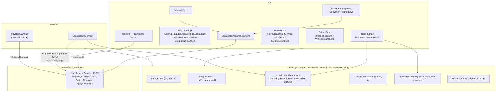

# Мастер-план: локализация UI (ru/en) с горячей сменой языка

> ## Статус реализации (2026-09-27)
>
> **Реализовано целиком.** HEAD `c7a81e5` (ветка `feature/localization`, база `d5312ec` = `rc/0.6.1`).
> `dotnet build`/`dotnet test` — 0 errors, 0 warnings, 3855 тестов. ADR —
> [ADR-032](../../adr/ADR-032-ui-localization.md) (Accepted), с amendments к ADR-023/ADR-024/ADR-031.
> Полная трассировка расхождений с этим планом — раздел «Реализация» в ADR-032. Кратко:
>
> - §3.2 (SHARED-ключи): регион SHARED фактически содержит больше `Common_*`-ключей, чем перечислено
>   здесь (`Common_EditLayout`, `Common_IconLayout_Header`, `Common_IconSize_Header`, `Common_LockLayout`,
>   `Common_Remove_Button`, `Common_Rename`, `Common_SurfaceStyle_Header`, `Common_ValuePx_Format`) —
>   пакеты клали в SHARED переиспользуемые ключи вместо дублирования в своих регионах, как и предвидело
>   §3.3 («если пакету нужен общий ключ… кладёт в свой регион… при cleanup его можно перенести» — в
>   некоторых случаях перенесли сразу).
> - §2.8/§4.5: `Settings_Pages_CurrentBadge` реализован **без** суффикса `_Format` (значение не несёт
>   плейсхолдера); `Settings_Panels_Subtitle_View_Format` (ru) = `"{0}"`, не раскрывает глоссарий §3.1
>   полностью (follow-up).
> - §2.4: дубль `x:Key="EnumDisplayName"` (`Settings.xaml`/`PanelCustomizeWindow.xaml`) **оставлен**
>   намеренно (см. ADR-032 «Реализация») — не перенесён в пост-мерж cleanup §7.4, как планировалось.
> - §4.8: `HotSwitchIntegrationTests` построен через `XamlReader`, не через реальные `MainWindow`/
>   `ChildWindow` на STA.
>
> Ниже — исходный план, зафиксированный до начала реализации; не переписан, только дополнен сносками у
> затронутых пунктов.
>
> ---
>
> **Статус:** готов к исполнению. Ветка `feature/localization` (база `a850e0c`).
>
> **Источник правды:** `docs/prompts/localization.md` (бриф). Решения **D-1…D-6 зафиксированы пользователем**
> и здесь не пересматриваются. План детализирует только «как»: проекты, контракты, пакеты работ, порядок.
> Смежные документы: `adr/ADR-024-versioned-json-persistence.md` (D-10, заморозка `user.config`),
> `adr/ADR-031-settings-window-navigation-and-panel-customize.md` (D-8 «только английский» — отменяется),
> `adr/ADR-023-single-instance-and-ipc.md` (строка 281 «English-only» — отменяется),
> `docs/PLANS/settings-window-redesign.md` (стиль, карточки `Settings.*`), раздел `CLAUDE.md`
> «Настройки и persistence — ЗАМОРОЖЕНЫ». Новый ADR — **ADR-032** (создаёт `architecture-documenter`).
>
> **Scope: XL по ширине, не по риску.** Затрагиваются все слои: новый проект ресурсов, `Services.Abstractions`,
> `Services` (трей), `UI` (Program, App, 13 XAML, 22 C#-файла), один скаляр `user.config`, инсталлятор. Натива,
> P/Invoke и JSON-схемы нет. Поэтому фича разбита на 9 пакетов (WP) размером S–M каждый. Пакеты этапа 1 идут
> параллельно, без пересечения по файлам (§5).
>
> **Главные находки планирования** (в брифе не отражены, влияют на реализацию):
> 1. **Общие `Strings.resx`/`Strings.ru.resx` — единственный файл, который трогают все пакеты.** Без мер
>    это гарантированные конфликты слияния. Решение: WP-0S создаёт в обоих файлах **регионы-маркеры** по
>    одному на пакет. Каждый пакет вставляет ключи только внутри своего региона (§3.6). Общие ключи (enum,
>    plural, Common, Language) засеваются заранее в WP-0S: это контракт.
> 2. **Конвертеры не переоцениваются сами.** Обычный `{Binding X, Converter=…}` не узнает о смене языка.
>    Решение: markup extension `{loc:LocBinding}`. Он превращает биндинг в `MultiBinding` из исходного
>    значения и `CurrentCulture` сервиса и прогоняет **неизменённый** `IValueConverter` с живой культурой
>    (§2.4). Классы и параметры конвертеров остаются прежними, поэтому пакет конвертеров (WP-2) и пакеты
>    XAML (WP-3/4a/4b) не зависят друг от друга.
> 3. **Трей не пересобирается, а переименовывается на месте.** Бриф говорит «пересобирается», но полная
>    пересборка `ContextMenuStrip` уже была источником утечки HWND и гонки с Click (`TrayIconManager.cs:9-20`,
>    MAJOR-1 Phase 6). Поэтому пункты получают стабильный `Name` и новый `Text` по событию (§2.7). Дух D-3
>    соблюдён: трей обновляется без перезапуска.
> 4. **`StateRestoreCommand` (Services/Storage) не трогаем.** Он входит в замороженный контур восстановления
>    ADR-024 §7. Локализованный текст MessageBox собирает `Program.cs` из `StateRestoreResult.Outcome` и путей.
>    Английский `Message` остаётся для консоли и как «Details» (§2.8).
> 5. **Системную UI-культуру нужно захватить до того, как мы её переопределим.** Иначе вариант «как в Windows»
>    после ручного выбора языка разрешится в уже переопределённую культуру. Для этого есть `SystemCulture`
>    (§2.2). `CultureInfo.InstalledUICulture` не подходит: это язык установки ОС, а не язык интерфейса
>    пользователя (MUI).
> 6. **Тесты зависят от культуры машины.** Рабочая машина пользователя русская. Любой тест, передающий
>    `CultureInfo.CurrentCulture`/`CurrentUICulture`, после фичи получит русский текст. Правило: все тесты
>    фиксируют культуру явно, а источник `LocalizationSource` по умолчанию английский (§2.5, R-5).
> 7. **Метки системных значков (`SystemIconItemModel.Label`) не хранятся в JSON.** Они берутся из
>    `SystemIconDescriptor.DefaultCaption` (Core) при построении модели, поэтому при смене языка их нужно
>    пересчитывать (§2.9). Core остаётся без зависимостей: `DefaultCaption` становится английским fallback.

---

## 0. Границы

### 0.1 В объёме

- Проект ресурсов `DesktopOrganizer.Localization` (RESX en/ru, plural-правила, резолвер языка).
- `ILocalizationService` (Abstractions) + `LocalizationService` (Services) + DI.
- WPF-инфраструктура: `{loc:Loc}`, `{loc:LocBinding}`, `{loc:CultureBinding}`, `LocalizationSource`, `CultureSync`
  (язык потоков + `FrameworkElement.Language`).
- Перевод всех пользовательских строк из инвентаризации брифа: 177 XAML-литералов и ~98 C#-литералов.
- Выбор языка в Settings → General («Как в Windows» / English / Русский), горячая смена, сохранение в
  `IAppSettings.Language` (D-1).
- Единый конвенционный `EnumDisplayNameConverter`. Закрывает бэклог ROADMAP «общий EnumDisplayConverter»
  (`docs/ROADMAP.md:1229-1232`) и убирает сырые `ToString()` у `SystemIconSize`/`PanelSurfaceStyle`.
- Display-конвертер страницы `"default"` (D-5).
- Инсталлятор: `SatelliteResourceLanguages`, проверка состава publish, исправление «Выход»/"Exit".
- ADR-032 и amendments (этап 3).

### 0.2 Вне объёма (явно)

| Не делаем | Почему |
|---|---|
| Любые изменения `application-state.json`: `schemaVersion` (=5), миграции, DTO, `PanelStateMapper` | D-1, `CLAUDE.md`. |
| Любые ключи `user.config`, кроме **одного** `Language` | D-1: разрешение ограничено одним скаляром. |
| Правки `StateRestoreCommand`, `JsonApplicationStateStore`, `ApplicationStateService`, `LayoutSnapshotService` | Замороженный контур. Находка 4. |
| Перевод уже сохранённых данных: заголовки «New Panel» у существующих панелей, имена снапшотов, ID `"Page N"` | D-5: это данные. Показываются как есть. |
| Локализация кнопок нативных `MessageBox`/`OpenFolderDialog` | D-6: их рисует ОС. |
| Консольный вывод, диагностические логи (`IDiagnosticsLog`, `Console.Error`), тексты исключений | Не UI. Остаются английскими: их читают скрипты и разработчики. |
| Название продукта `DesktopOrganizer`, глифы Segoe MDL2 | Не переводятся. |
| Изменение `CultureInfo.CurrentCulture` (региональный формат, сортировка) | Решение L-6 (§1). `NaturalStringComparer` не меняется, пересортировки при смене языка нет. |
| Языки, кроме en/ru; RTL; pseudo-localization-сборка | D-4. Pseudo-loc — кандидат в бэклог. |
| Метки системных значков из shell (`SHGetFileInfo`) | Натив, отдельная задача. Используется RESX. |

---

## 1. Архитектурные решения плана (L-1…L-10)

Это решения уровня «как», которые не пересматривают D-1…D-6. Каждое оформляется в ADR-032.

| # | Решение | Отвергнутые альтернативы |
|---|---|---|
| **L-1** | Отдельный проект `src/DesktopOrganizer.Localization` без зависимостей. На него ссылаются `Services`, `UI`, `Tests`. `Core` и `Services.Abstractions` **не** ссылаются: Core остаётся чистым, интерфейс сервиса использует только BCL-типы. | Ресурсы в `UI` (недоступны трею в `Services`); ресурсы в `Core` (Core перестаёт быть моделью). |
| **L-2** | Ключи — строковые литералы. Покрытие гарантируют тесты G-L2: XAML и C# сканируются, каждый найденный ключ должен быть в RESX. Strongly-typed генерация (`StronglyTypedLanguage`/`ResXFileCodeGenerator`) **не** используется. | Генерация `Strings.Designer.cs` + `nameof`: зависимость от VS-only генератора или от поддержки `StronglyTypedLanguage` в `dotnet build`. Риск красной CI-сборки и конфликтов сгенерированного файла между параллельными пакетами. Ручной класс констант — второй источник правды. |
| **L-3** | Все обращения к ресурсам передают культуру **явно**: `ResourceManager.GetString(key, culture)`. От `Thread.CurrentUICulture` ничего не зависит. | Опора на культуру потока — недетерминированные параллельные тесты. |
| **L-4** | Горячая смена: `ILocalizationService` реализует INPC и при смене поднимает `PropertyChanged("Item[]")` и `("CurrentCulture")`. Все XAML-строки — биндинги к индексатору единственного экземпляра. WPF подписывается слабо (`PropertyChangedEventManager`), утечек нет. | Перезагрузка окон; `DynamicResource` на строковых ресурсах (нужен свой `ResourceDictionary` на язык плюс подмена в `MergedDictionaries`, ломает `StaticResource`-порядок App и не работает для конвертеров). |
| **L-5** | Статический `LocalizationSource.Current` — **единственный** санкционированный static-доступ. Им пользуются markup extensions, конвертеры, code-behind `Views`, `Behaviors` и статические хелперы (`PanelDefaults`). ViewModels и сервисы получают `ILocalizationService` через конструктор. | Service locator повсюду; DI в конвертеры (WPF создаёт их из XAML). |
| **L-6** | Выбранный язык задаёт `CurrentUICulture`/`DefaultThreadCurrentUICulture` и `FrameworkElement.Language` окон: числа и даты в биндингах форматируются языком текста. `CurrentCulture` (региональный формат Windows) **не меняется**. | Менять `CurrentCulture`: пересортировка файлов при смене языка (`NaturalStringComparer:75`), смешение с региональными настройками. Оставить `Language` = en-US (текущее): русский текст с английскими датами. |
| **L-7** | Трей переименовывает пункты на месте по `CultureChanged`, не пересобирая strip (находка 3). У пунктов стабильный `ToolStripItem.Name` (`Tray.Settings` и т.д.), тесты ищут пункты по `Name`. | Пересборка strip (MAJOR-1). |
| **L-8** | Plural: категории CLDR `One/Few/Many/Other`. Каждая plural-база имеет в **обоих** RESX все 4 формы (`X_One/_Few/_Many/_Other`): у en `Few`/`Many` = `Other`, у ru `Other` = `Many`. Благодаря этому наборы ключей en и ru совпадают — простой инвариант теста. | Только нужные языку формы: наборы ключей расходятся, fallback ru→en незаметно даёт английский текст. |
| **L-9** | Конвертеры с текстом остаются `IValueConverter` с прежними именами и параметрами. Переоценку даёт `{loc:LocBinding}`. Строки конвертер берёт через `LocalizationResources.GetString(key, culture)`, где `culture` приходит из аргумента. | Перевод всех конвертеров в `IMultiValueConverter`: меняет каждый XAML-usage, пакеты перестают быть независимыми. |
| **L-10** | Данные пользователя (D-5): «New Panel» и имя снапшота берутся из RESX в момент создания и дальше не меняются. `"default"` показывается через `PageDisplayNameConverter`. `"Page N"` новых страниц **остаётся** английским ID (D-5: «ID страниц остаются идентификаторами… остальные показываются как есть»). | Локализовать генерацию ID «Страница N» (ID зависят от языка создания, D-5 это запрещает). Отображать «Page N» как «Страница N» — см. CN-2. |



---

## 2. Контракты и API (фиксированы, между пакетами не переименовываются)

### 2.1 Проект `DesktopOrganizer.Localization`

`src/DesktopOrganizer.Localization/DesktopOrganizer.Localization.csproj`: `Microsoft.NET.Sdk`, без
`ProjectReference`. `UseWPF` наследуется из `Directory.Build.props`: он безвреден, поэтому
переопределять его без надобности не нужно. RootNamespace = `DesktopOrganizer.Localization`, manifest-имя
ресурса — `DesktopOrganizer.Localization.Strings`. В `DesktopOrganizer.sln` проект кладётся в папку `core`.

```csharp
namespace DesktopOrganizer.Localization;

/// Pure, thread-safe, never throws. Missing key → returns the key itself (visible, greppable; covered by G-L2).
public static class LocalizationResources
{
    public static ResourceManager ResourceManager { get; }        // "DesktopOrganizer.Localization.Strings"
    public static string GetString(string key, CultureInfo culture);
    public static string Format(string key, CultureInfo culture, params object?[] args);           // string.Format(culture, …)
    public static string FormatPlural(string baseKey, long count, CultureInfo culture, params object?[] extraArgs);
    // FormatPlural: key = $"{baseKey}_{PluralRules.Select(culture, count)}", {0} = count, {1..} = extraArgs.
}

public enum PluralCategory { One, Few, Many, Other }

public static class PluralRules
{
    /// ru: n%10==1 && n%100!=11 → One; n%10 in 2..4 && n%100 not in 12..14 → Few; else Many.
    /// en и любой другой язык: n==1 → One; else Other. Отрицательные n — по |n|.
    public static PluralCategory Select(CultureInfo culture, long n);
}

public static class SupportedLanguages
{
    public const string FollowSystem = "";                        // значение IAppSettings.Language по умолчанию
    public static IReadOnlyList<CultureInfo> All { get; }         // [en, ru], порядок = порядок в пикере
    public static bool IsSupported(string? tag);                  // "en" / "ru", регистр игнорируется
    /// pref ∈ {"en","ru"} → эта культура; иначе (""/null/мусор) → systemUi, если его
    /// TwoLetterISOLanguageName == "ru", иначе en (D-4). Никогда не бросает.
    public static CultureInfo Resolve(string? preference, CultureInfo systemUiCulture);
}

public static class SystemCulture
{
    /// Захватывается при ПЕРВОМ обращении (Program.Main обращается первой строкой, до любого override).
    public static CultureInfo OriginalUiCulture { get; }
}
```

Культуры — нейтральные `CultureInfo.GetCultureInfo("en")`/`("ru")`, не `en-US`/`ru-RU`. Так поиск satellite
идёт прямо в `ru\` и формат чисел и дат будет базовым для языка.

### 2.2 `ILocalizationService` (`src/DesktopOrganizer.Services.Abstractions/ILocalizationService.cs`)

```csharp
namespace DesktopOrganizer.Services.Abstractions;

/// UI-thread affine: ApplyLanguage и все события — только на UI-потоке (маршалинга нет).
public interface ILocalizationService : INotifyPropertyChanged
{
    /// Строка для CurrentCulture. Binding path "[Key]". Отсутствующий ключ → сам ключ.
    string this[string key] { get; }

    /// Эффективная (разрешённая) культура UI: нейтральная en или ru.
    CultureInfo CurrentCulture { get; }

    /// Сырое предпочтение: "" (как в Windows), "en", "ru".
    string LanguagePreference { get; }

    IReadOnlyList<CultureInfo> SupportedCultures { get; }

    /// Поднимается ПОСЛЕ PropertyChanged("Item[]"/"CurrentCulture"/"LanguagePreference"),
    /// только если изменились эффективная культура или предпочтение.
    event EventHandler<CultureChangedEventArgs>? CultureChanged;

    string GetString(string key);
    string Format(string key, params object?[] args);
    string FormatPlural(string baseKey, long count, params object?[] args);

    /// Разрешает pref через SupportedLanguages.Resolve(pref, systemUi) и применяет.
    /// НЕ сохраняет в IAppSettings (это делает вызывающий UI-код). Возвращает эффективную культуру.
    CultureInfo ApplyLanguage(string? preference);
}

public sealed class CultureChangedEventArgs(CultureInfo oldCulture, CultureInfo newCulture) : EventArgs
{
    public CultureInfo OldCulture { get; } = oldCulture;
    public CultureInfo NewCulture { get; } = newCulture;
}
```

`LocalizationService` (`src/DesktopOrganizer.Services/Localization/LocalizationService.cs`, public sealed):
- `LocalizationService(CultureInfo systemUiCulture, string? initialPreference = null)` — удобен в тестах:
  `new LocalizationService(CultureInfo.GetCultureInfo("en"))` даёт детерминированный английский.
- Сервис **не** трогает культуры потоков (L-3): это делает `CultureSync` в UI. Поэтому в тестах у него
  нет глобальных побочных эффектов.
- Порядок в `ApplyLanguage`: присвоить поля → `PropertyChanged("LanguagePreference")` →
  `PropertyChanged("CurrentCulture")` → `PropertyChanged("Item[]")` → `CultureChanged`. При смене только
  предпочтения («Как в Windows» ↔ ru на русской Windows) эффективная культура та же. Тогда поднимается
  только `LanguagePreference`, `CultureChanged` — нет.

DI (`src/DesktopOrganizer.Services/Configuration/DiConfig.cs`):
`services.AddSingleton<ILocalizationService>(_ => new LocalizationService(SystemCulture.OriginalUiCulture));`.
Начальное предпочтение применяет `App.StartApp` (§2.5): у `Services` нет доступа к `IAppSettings` (тип UI).

### 2.3 `IAppSettings.Language` (D-1, единственное расширение `user.config`)

| Файл | Правка |
|---|---|
| `src/DesktopOrganizer.UI/Properties/Settings.settings` | `<Setting Name="Language" Type="System.String" Scope="User"><Value Profile="(Default)" /></Setting>` (пустая строка = как в Windows) + XML-комментарий со ссылкой на D-1/ADR-032 по образцу соседних. |
| `src/DesktopOrganizer.UI/Properties/Settings.Designer.cs` | Правка **вручную**: `SettingsSingleFileGenerator` работает только в VS. Свойство `Language` с `[UserScopedSetting]`, `[DefaultSettingValue("")]`, по образцу `NormalModeLayoutGestures`. |
| `src/DesktopOrganizer.UI/Services/IAppSettings.cs` | `string Language { get; set; }` + XML-doc: значения `""`/`"en"`/`"ru"`, «unknown → как в Windows, never throws», D-1. |
| `src/DesktopOrganizer.UI/Services/AppSettings.cs` | Проброс к `Properties.Settings.Default.Language`. |

Больше в контуре persistence **ничего** не меняется (гейт G-1, §6). Откат: старая сборка не знает ключа
`Language` и молча его игнорирует (`LocalFileSettingsProvider` читает только известные свойства). Проверка —
MV-L7.

### 2.4 WPF-инфраструктура (`src/DesktopOrganizer.UI/Localization/`, xmlns `loc`)

`xmlns:loc="clr-namespace:DesktopOrganizer.UI.Localization"` — обычный clr-namespace, `XmlnsDefinition` не нужен.

| Тип | Контракт |
|---|---|
| `LocalizationSource` (static) | `ILocalizationService Current { get; }`. По умолчанию (до `Initialize`) — ленивый `new LocalizationService(CultureInfo.GetCultureInfo("en"))`: тесты и дизайнер всегда видят английский. `Initialize(ILocalizationService)` вызывается один раз из `App.StartApp` **до** разбора любого XAML. Если `Current` уже прочитан и передан другой экземпляр — `InvalidOperationException`: иначе биндинги ранее созданных элементов держали бы старый источник. `internal static void ResetForTests()` — только для non-parallel коллекции тестов. |
| `LocExtension` → `{loc:Loc Key}` | Ctor `(string key)`. `ProvideValue`: `new Binding($"[{Key}]") { Source = LocalizationSource.Current, Mode = OneWay }`. Если цель — DP, возвращается `binding.ProvideValue(sp)`; если `Setter`/шаблон (нет `IProvideValueTarget` с DP), — сам `Binding`. Работает в `ContextMenu`/`ToolTip`/`Popup`: источник явный, от DataContext не зависит. |
| `LocBindingExtension` → `{loc:LocBinding Path, …}` | Свойства: `Path` (ctor, опционально; без пути — биндинг на сам DataContext), `Converter`, `ConverterParameter`, `FormatKey`, `RelativeSource`, `ElementName`, `Source`, `FallbackValue`, `TargetNullValue`. Только `OneWay`. Строит `MultiBinding { [0] = исходный Binding, [1] = Binding(Source = LocalizationSource.Current, Path = CurrentCulture) }`, `Converter = LocalizedValueConverter`. Конвейер: `v = values[0]` → если `Converter` задан, `v = Converter.Convert(v, typeof(object), ConverterParameter, culture)` → если задан `FormatKey`, `v = LocalizationResources.Format(FormatKey, culture, v)`. `DependencyProperty.UnsetValue` на входе → `FallbackValue`/`UnsetValue`. Правило возврата для `Setter` такое же, как у `LocExtension`. |
| `CultureBindingExtension` → `{loc:CultureBinding}` | Возвращает `Binding(Source = LocalizationSource.Current, Path = CurrentCulture)`. Нужен для **существующих** `MultiBinding` (`PanelsSection.xaml:53`): добавляется последним дочерним биндингом. |
| `LocalizedValueConverter` (internal) | `IMultiValueConverter` из описания `LocBinding`. Никогда не бросает: исключение внутреннего конвертера → `FallbackValue` + `Debug.WriteLine`. |
| `LocKeyConverter` | `string key → LocalizationResources.GetString(key, culture)`. Используется с `LocBinding` для данных, хранящих ключ (`SettingsSectionInfo.TitleKey`, §4.4). |
| `PageDisplayNameConverter` | `"default"` → `Page_Default_DisplayName`, любой другой ID → как есть (D-5, L-10). `null` → `string.Empty`. |
| `CultureSync` (internal sealed) | `Attach(ILocalizationService, Application)`: (1) один раз `FrameworkElement.LanguageProperty.OverrideMetadata(typeof(FrameworkElement), new FrameworkPropertyMetadata(XmlLanguage.GetLanguage(startup.IetfLanguageTag)))`, строго до создания первого окна; (2) `EventManager.RegisterClassHandler(typeof(Window), FrameworkElement.LoadedEvent, …)` задаёт `Language` каждому новому окну по текущей культуре; (3) на `CultureChanged` — `CultureInfo.DefaultThreadCurrentUICulture`/`CurrentUICulture` и `Language` каждого окна из `Application.Current.Windows`. `CurrentCulture` не трогается (L-6). |

Декларации экземпляров конвертеров (`x:Key`) делает **потребитель** в своих `Resources` — так, как
`PanelsSection.xaml:10` уже объявляет `PanelSubtitle`. Нового общего словаря нет. `LoadResourceDictionaries`,
`WpfApplicationHost` и локальные списки словарей в тестах **не меняются**. Дубли объявления `EnumDisplayName`
(`Settings.xaml:20`, `PanelCustomizeWindow.xaml:27`) переносятся в пост-мерж cleanup (§7.4).

### 2.5 Порядок старта

```
Program.Main
  1. _ = SystemCulture.OriginalUiCulture                       // захват ДО override (находка 5)
  2. pref = TryReadLanguagePreference()                        // Properties.Settings.Default.Language в try/catch;
                                                               // ConfigurationErrorsException и т.п. → ""
  3. culture = SupportedLanguages.Resolve(pref, SystemCulture.OriginalUiCulture)
     CultureInfo.DefaultThreadCurrentUICulture = CultureInfo.CurrentUICulture = culture
  4. все MessageBox в Program — LocalizationResources.GetString/Format(key, CultureInfo.CurrentUICulture)
     (catch-блок M-4 тоже: если исключение до шага 3 — останется культура ОС, это приемлемо)
  … handshake, storage lock, Load(), new App(...)
App.StartApp
  a. var loc = sp.GetRequiredService<ILocalizationService>(); loc.ApplyLanguage(AppSettings.Language)
  b. LocalizationSource.Initialize(loc)
  c. CultureSync.Attach(loc, this)                             // OverrideMetadata до первого окна
  d. LoadResourceDictionaries()                                // прежняя первая строка сдвигается ниже a–c
  … InitTrayIcon (TrayIconManager уже подписан на CultureChanged), LoadPanels, …
```

Шаги a–c выполняются **до** `LoadResourceDictionaries`: комментарий в `App.xaml.cs:267-269` требует, чтобы
до окон ничего не создавалось, и a–c этому не противоречат.

### 2.6 Соглашение об именовании ключей RESX

- Формат: `Area_Sub_Element[_Part]`, токены PascalCase через `_`, regex `^[A-Z][A-Za-z0-9]*(_[A-Z0-9][A-Za-z0-9]*)+$`.
  Без точек: ключ совпадает с путём биндинга `[Key]` и не требует экранирования.
- Области (первый токен): `Common`, `App`, `Startup`, `Restore`, `Tray`, `Language`, `Settings`, `Customize`,
  `Panel`, `SystemIcon`, `Snapshot`, `Page`, `Hint`, `Enum`, `Plural`, `Dialog`.
- Суффиксы частей: `_Header`, `_Description`, `_DisabledReason`, `_Tooltip`, `_A11y` (только если
  `AutomationProperties.Name` отличается от видимого текста; иначе переиспользуется ключ видимого текста),
  `_Title`/`_Message` (диалоги), `_Format` (**только** такие ключи содержат `{n}`), `_Button`.
- Enum: `Enum_{EnumType}_{Member}` — по этой конвенции работает `EnumDisplayNameConverter`.
- Plural: база `Plural_{Noun}` + суффикс категории: `Plural_Items_One`, `…_Few`, `…_Many`, `…_Other`; `{0}` = число.
- Правила контента: без ведущих и хвостовых пробелов; склейки (`" (current)"`, `"Version "`) превращаются в
  `_Format` с плейсхолдером. У ru и en совпадает набор индексов плейсхолдеров. Кавычки: en “…”, ru «…».
  Многоточие — символ `…`.

### 2.7 Трей (`TrayIconManager`)

- Ctor: `TrayIconManager(INotifyIconAdapter notifyIconAdapter, ILocalizationService localization)`. DI
  автоматический (`AddSingleton<ITrayIconManager, TrayIconManager>`), `ITrayIconManager` **не меняется**.
- Все 5 пунктов хранятся в полях (сейчас в полях только 3: нужны ещё `_settingsItem`, `_exitItem`).
  `Name` = `"Tray.Settings"`, `"Tray.EditLayout"`, `"Tray.LockLayout"`, `"Tray.ShowDesktopIcons"`, `"Tray.Exit"`
  (публичные `internal const` для тестов).
- `ApplyTexts()`: `Text` каждого пункта и `ToolTipText` у Edit layout (`Tray_LayoutLockedTooltip`, только
  при `!canEnterEditLayout`: последнее значение запоминается в поле). Вызывается в `EnsureContextMenuBuilt`
  и по `CultureChanged`. Подписка — в ctor, отписка — в `Dispose`.
- Текст `NotifyIcon` (hover) — «DesktopOrganizer», не переводится.

### 2.8 `Program.cs`

| Сейчас | Становится |
|---|---|
| `OtherSessionMessage` | `Startup_OtherSession_Message` |
| `ActivationFailedMessage` | `Startup_ActivationFailed_Message` |
| `StartupFailedMessage` (`{0}`) | `Startup_Failed_Format` (`{0}` = `ex.Message`, текст исключения не переводится) |
| `RestoreLockUnavailableMessage` | `Restore_LockUnavailable_Message` (MessageBox); в консоль — прежний английский текст |
| `result.Message` в MessageBox | `Restored` + нет карантина → `Restore_Restored_Format` (`{0}` = имя файла кандидата); `Restored` + карантин → `Restore_RestoredQuarantined_Format` (`{0}`, `{1}` = имя файла карантина); `NoCandidateFound` → `Restore_NoCandidate_Message`; `CandidateInvalid` → `Restore_CandidateInvalid_Format`; `Failed` → `Restore_Failed_Format`; любой другой → `Restore_Unknown_Format`. Для `CandidateInvalid`/`Failed`/Unknown `{1}` = английский `result.Message` как «Details». Консольный вывод — прежний `result.Message`. |
| `StorageLockUnavailableMessage` | Не меняется: только `Console.Error`, не UI. |
| Комментарии «deliberately not localized» (`:24-39`) | Заменяются ссылкой на ADR-032. |

`AppTitle = "DesktopOrganizer"` — не переводится.

### 2.9 ViewModels и данные

- **Правило re-raise.** VM, у которой есть **привязанные** вычисляемые строки, подписывается на
  `CultureChanged` и поднимает `PropertyChanged` по **явному** списку имён (`RaiseLocalizedProperties()`), не
  `string.Empty`. Иначе пересчитались бы все биндинги, включая `SelectedItem`. Singleton-VM подписываются
  навсегда. `IDisposable`-VM (`PanelCustomizeViewModel`, `SelectedPanelSettingsViewModel`) отписываются в `Dispose`.
- **Строки «по требованию»** (текст `Confirm`/`PromptText`/MessageBox, собранный в момент действия) переоценки
  не требуют: берутся из сервиса в момент вызова.
- **Per-panel VM (`ChildWindowViewModel`) на `CultureChanged` не подписывается**: весь текст панели — в XAML
  через `{loc:…}` (риск утечки на N панелей, R-11).
- **Системные значки:** `SystemIconsPanelModel.RefreshLabels(Func<SystemIconKind, string>)` задаёт `Label` каждому
  item по ключу `SystemIcon_{Kind}` (fallback — `DefaultCaption`). Вызывает `SystemIconsPanelManager` после
  `Load()` и на `CultureChanged`. `Label` не хранится в JSON (проверено: в `State/` нет ссылок), поэтому
  persistence не затрагивается.
- **Выбор языка (контракт C-5):** `MainWindowViewModel.LanguageOptions : IReadOnlyList<LanguageOption>` (3 элемента:
  `""`, `"en"`, `"ru"`) и `MainWindowViewModel.SelectedLanguageOption : LanguageOption` (TwoWay).
  `LanguageOption` (`UI/Models/LanguageOption.cs`, INPC): `string Tag`, `string DisplayName`, `internal void Refresh(ILocalizationService)`.
  `DisplayName`: `""` → `Language_FollowWindows_Format` с `{0}` = самоназвание языка, в который разрешается
  Windows; `"en"` → `Language_Name_En` («English» в обоих RESX); `"ru"` → `Language_Name_Ru` («Русский» в обоих).
  Сеттер `SelectedLanguageOption`: если `Tag` изменился → `_appSettings.Language = Tag; _appSettings.Save();
  _localization.ApplyLanguage(Tag)`. Начальное значение — по `_localization.LanguagePreference`.

---

## 3. Словарь и контрактные ключи

### 3.1 Глоссарий en → ru (обязателен для всех пакетов)

| en | ru | Примечание |
|---|---|---|
| Panel | панель | |
| Page | страница | «default» → «Основная» |
| Settings | Параметры | как в Windows 11 |
| Layout (panel arrangement) | расположение | CN-1; «Edit layout» → «Изменить расположение», «Lock layout» → «Закрепить расположение» |
| Layout & snapping | Расположение и привязка | |
| Snap / snapping | привязка | как «Привязка окон» в Windows |
| Grid / workspace grid | сетка / сетка рабочей области | |
| Snapshot | снимок | «Layout snapshot» → «снимок расположения» |
| Backup | Резервные копии | раздел |
| Restore | Восстановить | |
| Roll up / Expand | Свернуть / Развернуть (панель) | |
| Folder Portal | Портал папки | |
| Desktop icons | значки рабочего стола | термин Windows |
| Icon / item / shortcut | значок / элемент / ярлык | |
| Customize | Настроить; окно — «Настройка «{0}»» | |
| Rename / Remove / Delete | Переименовать / Удалить / Удалить | |
| Start with Windows | Запускать при старте Windows | совпадает с инсталлятором (`DesktopOrganizer.iss:97`) |
| Exit | Выход | |
| Free-form / Grid aligned | Произвольная / По сетке | |
| Surface style: Solid / Ambient / Glass | Сплошной / Акцентный / Стекло | |
| Opacity / Accent color / Text color | Непрозрачность / Цвет акцента / Цвет текста | |
| Sort: Manual / By name | Вручную / По имени | |
| Content filter: Show all / Hide content / Hide shortcuts / Folders only | Показывать всё / Скрыть содержимое / Скрыть ярлыки / Только папки | |
| This PC / Control Panel / Recycle Bin / Network / User | Этот компьютер / Панель управления / Корзина / Сеть / Пользователь | |
| Unavailable while the layout is locked. | Недоступно, пока расположение закреплено. | общий `Common_LockedReason` |

Тон: en — sentence case (как сейчас); ru — с прописной только первое слово, обращение на «вы» в
инфинитивных/повелительных формах Windows («Выберите…», «Закройте…»).

### 3.2 Контрактные ключи, которые засевает WP-0S (полный en/ru)

> **Сноска (статус реализации, см. блок выше):** факт содержит больше `Common_*`-ключей, чем указано в
> этой таблице — `Common_EditLayout`, `Common_IconLayout_Header`, `Common_IconSize_Header`,
> `Common_LockLayout`, `Common_Remove_Button`, `Common_Rename`, `Common_SurfaceStyle_Header`,
> `Common_ValuePx_Format` были добавлены пакетами этапа 1 в SHARED-регион напрямую, вместо дублирования
> в своих регионах. `Settings_Pages_CurrentBadge` (§4.5) реализован без суффикса `_Format`.

| Ключ | en | ru |
|---|---|---|
| `Common_Ok_Button` / `Common_Cancel_Button` | OK / Cancel | ОК / Отмена |
| `Common_LockedReason` | Unavailable while the layout is locked. | Недоступно, пока расположение закреплено. |
| `Page_Default_DisplayName` | Default | Основная |
| `Panel_NewTitle` | New Panel | Новая панель |
| `Snapshot_DefaultName_Format` | Layout {0:dd.MM HH:mm} | Расположение {0:dd.MM HH:mm} |
| `Language_Name_En` / `Language_Name_Ru` | English / Русский | English / Русский |
| `Language_FollowWindows_Format` | Windows default ({0}) | Как в Windows ({0}) |
| `Plural_Items_{One,Few,Many,Other}` | {0} item / {0} items / {0} items / {0} items | {0} элемент / {0} элемента / {0} элементов / {0} элементов |
| `Plural_Panels_{…}` | {0} panel / {0} panels ×3 | {0} панель / {0} панели / {0} панелей / {0} панелей |
| `Enum_PanelGeometryMode_{GridAligned,LegacyFreeform}` | Grid aligned / Free-form (legacy) | По сетке / Произвольная (устар.) |
| `Enum_IconLayoutPolicy_{FixedGap,LegacyStretch}` | Fixed spacing / Adaptive stretch (legacy) | Фиксированный интервал / Адаптивное растяжение (устар.) |
| `Enum_PanelContentFilter_{ShowAll,HideAll,HideShortcuts,FoldersOnly}` | Show all / Hide content / Hide shortcuts / Folders only | см. §3.1 |
| `Enum_PanelSurfaceStyle_{Solid,Ambient,Glass}` | Solid / Ambient / Glass | см. §3.1 |
| `Enum_NormalModeLayoutGestures_{MoveAndResize,MoveOnly,None}` | Move and resize / Move only / None (Edit layout mode only) | Перемещение и изменение размера / Только перемещение / Нет (только в режиме изменения расположения) |
| `Enum_PanelViewMode_{Grid,List}` | Grid / List | Сетка / Список |
| `Enum_PanelSortMode_{Manual,Name}` | Manual / By name | Вручную / По имени |
| `Enum_PanelSizePreset_{Small,Medium,Large,ExtraLarge}` | Small / Medium / Large / Extra large | Маленький / Средний / Большой / Очень большой |
| `Enum_PanelSizingMode_{Manual,AutoContent}` | Manual / Auto-size to content | Вручную / Автоподбор по содержимому |
| `Enum_SystemIconSize_{Small,Medium,Large}` | Small (32 px) / Medium (48 px) / Large (64 px) | Маленькие (32 пкс) / Средние (48 пкс) / Крупные (64 пкс) |
| `SystemIcon_{ThisPc,ControlPanel,RecycleBin,Network,UserFolder}` | This PC / Control Panel / Recycle Bin / Network / User | см. §3.1 |
| `Startup_*`, `Restore_*` (§2.8) | английский — текущие литералы `Program.cs` | перевод |
| `Settings_General_Language_Header` / `_Description` | Language / Changes the language of DesktopOrganizer right away. | Язык / Меняет язык DesktopOrganizer сразу, без перезапуска. |

Реализатор может править пунктуацию, но не смысл. Ключи `Enum_*` и `Plural_*` использует несколько пакетов,
поэтому они и засеваются заранее.

### 3.3 Регионы в RESX (находка 1)

WP-0S создаёт в **обоих** файлах одинаковую структуру: сначала `<resheader>`, затем регионы в фиксированном порядке.

```xml
  <!-- ==== BEGIN SHARED (owner: WP-0S; Common_, Enum_, Plural_, Language_, Page_, Panel_NewTitle, Snapshot_, SystemIcon_, Startup_, Restore_) ==== -->
  …
  <!-- ==== END SHARED ==== -->
  <!-- ==== BEGIN WP-1 Tray (Tray_) ==== -->
  <!-- ==== END WP-1 ==== -->
  <!-- ==== BEGIN WP-2 Converters (Panel_ViewToggle_, Panel_SortToggle_, Panel_RollUp_, Settings_Panels_Subtitle_) ==== -->
  <!-- ==== END WP-2 ==== -->
  <!-- ==== BEGIN WP-3 Panel surfaces (Panel_, Hint_) ==== -->
  <!-- ==== END WP-3 ==== -->
  <!-- ==== BEGIN WP-4a Settings window (Settings_) ==== -->
  <!-- ==== END WP-4a ==== -->
  <!-- ==== BEGIN WP-4b Customize & dialogs (Customize_, Dialog_) ==== -->
  <!-- ==== END WP-4b ==== -->
  <!-- ==== BEGIN WP-5 ViewModels (Settings_Confirm_, Snapshot_, Page_Confirm_) ==== -->
  <!-- ==== END WP-5 ==== -->
```

Правила: пакет вставляет `<data>` **только** между своими BEGIN/END, в алфавитном порядке ключей. Одинаковые
вставки идут в en и ru. Между регионами есть ≥ 2 неизменяемые строки (END-X, BEGIN-Y), поэтому 3-way merge
проходит без конфликтов. Если конфликт всё же случится, его разрешение — «взять обе стороны». Если пакету
нужен общий ключ, которого нет в SHARED, он **не** добавляет его в SHARED, а кладёт ключ в свой регион
с префиксом своей области и пишет об этом в отчёте: при cleanup его можно перенести. XML-комментарии в
`.resx` допустимы: `ResXResourceReader`/`GenerateResource` их игнорируют. Дизайнер VS комментарии
выбрасывает, поэтому RESX правится только текстом (это правило в описании региона SHARED).

---

## 4. Пакеты работ

Общие правила для всех пакетов:
- ViewModels и сервисы получают `ILocalizationService` через конструктор. Views/Behaviors/Converters/static-хелперы
  используют `LocalizationSource.Current` (L-5).
- Каждый пакет переводит **все** литералы своих файлов из инвентаризации (§8) и добавляет ключи en+ru в свой регион.
- Тесты с assert на текст в своих файлах: культура фиксируется явно (`CultureInfo.GetCultureInfo("en")`, либо
  `new LocalizationService(en)`), английское ожидание сохраняется. Для plural и хотя бы одного ключевого
  сценария добавляется ru-кейс.
- Сборка каждого пакета: `dotnet build` + `dotnet test` по solution — **0 errors / 0 warnings**, число warnings в
  отчёте. Без `#pragma`/`NoWarn`/`SuppressMessage`/правок ruleset.

### 4.0 WP-0S — ядро локализации и persistence (`dotnet-services-engineer`) · этап 0 · M

**Создать**
- `src/DesktopOrganizer.Localization/DesktopOrganizer.Localization.csproj`, `Strings.resx`, `Strings.ru.resx`
  (регионы §3.3 + SHARED §3.2), `LocalizationResources.cs`, `PluralCategory.cs`, `PluralRules.cs`,
  `SupportedLanguages.cs`, `SystemCulture.cs`.
- `src/DesktopOrganizer.Services.Abstractions/ILocalizationService.cs`, `CultureChangedEventArgs.cs`.
- `src/DesktopOrganizer.Services/Localization/LocalizationService.cs`.
- Тесты `tests/DesktopOrganizer.Tests/Unit/Localization/`: `PluralRulesTests` (`[Theory]` ru: 0,1,2,4,5,11,12,14,21,22,25,101,111,
  отрицательные; en: 0,1,2), `SupportedLanguagesTests` (pref en/ru/""/null/"de"/"RU" × system ru-RU/en-US/uk-UA/de-DE),
  `LocalizationResourcesTests` (neutral и ru найдены, missing key → key, Format с культурой, FormatPlural),
  `LocalizationServiceTests` (порядок событий, отсутствие `CultureChanged` при той же эффективной культуре,
  `Item[]` поднимается, `ApplyLanguage` не трогает культуры потоков), **`ResxConsistencyTests`** (гейт G-L3, §6).

**Изменить**
- `DesktopOrganizer.sln`: новый проект в папку `core`.
- `Directory.Build.props`: `<SatelliteResourceLanguages>en;ru</SatelliteResourceLanguages>`,
  `<NeutralLanguage>en</NeutralLanguage>` (генерирует `NeutralResourcesLanguageAttribute`, закрывает CA1824).
- `DesktopOrganizer.Services.csproj`, `DesktopOrganizer.UI.csproj`, `DesktopOrganizer.Tests.csproj`: `ProjectReference` на Localization.
- `src/DesktopOrganizer.Services/Configuration/DiConfig.cs`: регистрация (§2.2).
- `Settings.settings`, `Settings.Designer.cs`, `IAppSettings.cs`, `AppSettings.cs` (§2.3).
- `src/DesktopOrganizer.UI/Program.cs` (§2.5 шаги 1–4, §2.8).
- Тесты, конструирующие `IAppSettings`-моки строгого режима (если такие есть), — добавить `Language`.

**DoD WP-0S**
1. Проект собирается, `ru\DesktopOrganizer.Localization.resources.dll` лежит в `bin` UI и Tests.
2. API §2.1/§2.2 — буква в букву, XML-doc на всех публичных членах.
3. `IAppSettings.Language` есть, дефолт `""`. Diff контура persistence — только 4 файла §2.3 (G-1).
4. `Program.cs`: 5 MessageBox-путей локализованы, консольный вывод прежний, bootstrap-культура до DI.
5. RESX: регионы §3.3, ключи SHARED §3.2 в обоих файлах, `ResxConsistencyTests` зелёные.
6. `DiConfigTests`: `ILocalizationService` разрешается.
7. 0/0.

### 4.1 WP-0U — WPF-плумбинг (`wpf-ui-builder`) · этап 0, после слияния WP-0S · S–M

**Создать** (`src/DesktopOrganizer.UI/Localization/`): `LocalizationSource.cs`, `LocExtension.cs`,
`LocBindingExtension.cs`, `CultureBindingExtension.cs`, `LocalizedValueConverter.cs`, `LocKeyConverter.cs`,
`PageDisplayNameConverter.cs`, `CultureSync.cs` (§2.4).

**Изменить**: `src/DesktopOrganizer.UI/App.xaml.cs` — шаги a–c (§2.5), поля и геттер `ILocalizationService` по
образцу соседних.

**Тесты** (`tests/.../Unit/Localization/`, STA через `StaTestRunner`):
- `LocExtensionTests`: `TextBlock` с биндингом из `LocExtension` показывает en. Смена культуры на **локальном**
  экземпляре сервиса обновляет текст. Биндинг строится через internal-фабрику, которую использует `LocExtension`,
  глобальный источник не меняется.
- `LocBindingExtensionTests`: только Path, Path+Converter (+Parameter), Path+FormatKey, Converter+FormatKey,
  без Path (DataContext), `RelativeSource TemplatedParent` внутри `ControlTemplate`, использование в `Style.Setter`,
  исключение внутреннего конвертера → Fallback.
- `PageDisplayNameConverterTests`, `LocKeyConverterTests`.
- `CultureSyncTests` — в коллекции `[CollectionDefinition("GlobalCulture", DisableParallelization = true)]`:
  `Language` открытого окна обновился, культура потока восстановлена в `finally`.

**DoD WP-0U**
1. Контракты §2.4 реализованы, `{loc:Loc}`/`{loc:LocBinding}`/`{loc:CultureBinding}` работают в `Window`,
   `UserControl`, `DataTemplate`, `ControlTemplate`, `Style.Setter`, `ContextMenu`, `ToolTip` (тесты).
2. `App.StartApp`: язык применяется до первого окна. `LocalizationSource.Initialize` вызывается ровно один раз.
3. Тесты зелёные, 0/0.

### 4.2 WP-1 — трей и инсталлятор (`dotnet-services-engineer`) · этап 1 · S

**Изменить**
- `src/DesktopOrganizer.Services/Providers/TrayIconManager.cs` (§2.7).
- `tests/.../Unit/Services/TrayIconManagerTests.cs`: поиск пунктов по `Name`, конструктор с
  `new LocalizationService(en)`. Новые тесты: `CultureChanged_RelabelsItemsInPlace_SameInstances`,
  `CultureChanged_DoesNotCallSetContextMenuAgain`, `LockedTooltip_Localized`, `Dispose_UnsubscribesFromCultureChanged`.
- `installer/DesktopOrganizer.iss:107` (ru): «…значок в трее → «Выход» (в старых версиях — «Exit»), затем
  нажмите «Повторить»». Сообщение адресовано **старой** установленной версии, а у неё трей только
  английский. en-строка не меняется.
- `installer/build.ps1`: `-p:SatelliteResourceLanguages=en%3Bru` в `dotnet publish` (явно, дублирует
  `Directory.Build.props` на случай запуска с другим props) + **проверка после publish**: в `publish\<rid>`
  подкаталоги-культуры = только `ru`, и в нём есть `DesktopOrganizer.Localization.resources.dll`. Иначе `throw`.
- Регион WP-1: `Tray_Settings`, `Tray_EditLayout`, `Tray_LockLayout`, `Tray_ShowDesktopIcons`, `Tray_Exit`,
  `Tray_LayoutLockedTooltip`.

**DoD WP-1**: трей переводится на лету без пересоздания strip (тест); `ITrayIconManager` не изменён; инсталлятор
кладёт только `ru\`; строка 107 исправлена; 0/0.

### 4.3 WP-2 — конвертеры и enum-отображение (`wpf-ui-builder`) · этап 1 · S–M

**Изменить** (`src/DesktopOrganizer.UI/Converters/`)

| Файл | Что |
|---|---|
| `EnumDisplayNameConverter.cs` | `switch` заменяется конвенцией: `value is Enum e` → `LocalizationResources.GetString($"Enum_{e.GetType().Name}_{e}", culture)`. Если ключа нет (вернулся сам ключ), fallback — `ToString()`. Класс и `x:Key` не переименовываются (L-9). Doc — «закрывает ROADMAP:1229-1232». |
| `PanelSubtitleConverter.cs` | Вид — `Enum_PanelViewMode_*` через `Settings_Panels_Subtitle_View_Format` («{0} view» / «{0}»). Счётчик — `FormatPlural("Plural_Items", n, culture)`. Портал — `Settings_Panels_Subtitle_Portal`. Культура: `values.Length >= 4 && values[3] is CultureInfo c ? c : culture` (4-й элемент добавляет `{loc:CultureBinding}` в WP-4a). |
| `ItemCountToTextConverter.cs` | `FormatPlural("Plural_Items", n, culture)`; ≤0 → `""`. |
| `SortModeTooltipConverter.cs`, `ViewModeGlyphConverter.cs`, `BoolToGlyphConverter.cs` | Тексты тултипов — ключи `Panel_SortToggle_*`, `Panel_ViewToggle_*`, `Panel_RollUp_*`. Глифы не меняются. |

**Тесты**: `AmbientConverterTests.cs` (ItemCountToText), `EnumDisplayNameConverterTests.cs` (все значения всех 10
enum §3.2 в en и ru; неизвестный член → `ToString()`), `PanelSubtitleConverterTests.cs` (+ 4-й элемент культура,
ru 1/2/5/21), `SortModeTooltipConverterTests.cs`, `ViewModeGlyphConverterTests.cs`, `RollUp/RollUpTests.cs:85-109`.
Культура в каждом вызове явная.

**DoD WP-2**: ни одного текстового литерала в 6 конвертерах; `EnumDisplayNameConverter` покрывает все enum
§3.2; ru-plural корректен; 0/0.

### 4.4 WP-3 — поверхности панелей (`wpf-ui-builder`) · этап 1 · M

**Изменить**
- `src/DesktopOrganizer.UI/Views/ChildWindow.xaml` (36 литералов). Заголовки CM для enum-пунктов берутся из общих
  `Enum_*` (`{loc:Loc Enum_PanelContentFilter_ShowAll}` и т.д.). Тултипы и `AutomationProperties.Name` у toggle-кнопок
  (`:436-445`) — `{loc:LocBinding EffectiveSortMode, Converter={StaticResource SortModeTooltip}}` и аналоги.
- `src/DesktopOrganizer.UI/Views/ChildWindow.ContentSizing.cs:181-218`: названия политики и режима — `Enum_*`.
  Подтверждения — `Panel_Confirm_ApplyIconLayout_Format`/`_Title`, `Panel_Confirm_ApplySizingMode_Format`/`_Title`
  с `FormatPlural("Plural_Panels", …)` вместо `"(N panel(s))"`. Через `LocalizationSource.Current`, ctor не меняется
  (5 фикстур `ChildWindow` не трогаются).
- `src/DesktopOrganizer.UI/Views/ChildWindow.xaml.cs`: литералы, если найдутся.
- `src/DesktopOrganizer.UI/Resources/Templates.xaml` (6), `Resources/Styles/Panels.xaml:305`
  (`ItemCountToText` → `LocBinding` с `RelativeSource TemplatedParent`).
- `src/DesktopOrganizer.UI/Behaviors/HintPopupController.cs:82-85` → `Hint_Rename_*`.
- `src/DesktopOrganizer.UI/Views/SystemIconsPanelWindow.xaml` — литералы, если найдутся.
- `src/DesktopOrganizer.UI/Models/SystemIconsPanelModel.cs` (`RefreshLabels`), `src/DesktopOrganizer.UI/Services/SystemIconsPanelManager.cs`
  (ctor + `ILocalizationService`, `RefreshLabels` после `Load()` и на `CultureChanged`, отписка в `Dispose`, если он есть;
  иначе singleton-подписка навсегда), `src/DesktopOrganizer.UI/Configuration/DiConfig.cs` (фабрика `SystemIconsPanelManager` +
  аргумент) — **единственный** пакет этапа 1, трогающий UI `DiConfig.cs`.
- Тесты: `SystemIconsPanelManagerTests` (ctor), новые `SystemIconsPanelModel_RefreshLabels_*`, текстовые assert'ы
  в `ChildWindow*`-тестах, если есть.

**DoD WP-3**: панели, CM, тултипы, подсказки, свёрнутая панель («N элементов»), панель системных значков
переводятся на лету; `ChildWindowViewModel` на `CultureChanged` не подписан; 0/0.

### 4.5 WP-4a — окно настроек (`wpf-ui-builder`) · этап 1 · M

**Изменить**
- `src/DesktopOrganizer.UI/Views/MainWindow.xaml` (`Title`, навигация: `{loc:LocBinding TitleKey, Converter={StaticResource LocKey}}`).
- `src/DesktopOrganizer.UI/Models/SettingsSection.cs`: `SettingsSectionInfo(Section, TitleKey, Glyph)`, ключи
  `Settings_Nav_{Section}`. Doc «English only (D-8)» удаляется.
- `src/DesktopOrganizer.UI/Views/Settings/*.xaml` (9 файлов): `GeneralSection` (13 + **новая карточка «Language»**
  первой в разделе, ComboBox `ItemsSource={Binding LanguageOptions}`, `SelectedItem={Binding SelectedLanguageOption,
  Mode=TwoWay}`, `DisplayMemberPath=DisplayName`, `AutomationProperties.Name={loc:Loc Settings_General_Language_Header}` —
  контракт C-5), `LayoutSnappingSection` (20), `PanelsSection` (15; + `{loc:CultureBinding}` 4-м в `MultiBinding :53`,
  `PageDisplayName` для ComboBox страниц и меню «Move to page»), `NewPanelDefaultsSection` (23), `PagesSection` (7;
  `:36` " (current)" → `LocBinding` + `PageDisplayName` + `Settings_Pages_CurrentBadge_Format`
  (сноска: реализовано как `Settings_Pages_CurrentBadge`, без суффикса `_Format` — значение не несёт
  плейсхолдера; см. блок «Статус реализации» в начале документа); `:59,63` →
  `FormatKey` + `Converter=PageDisplayName`), `SystemIconsSection` (15; `:111` сырой `ToString()` → `EnumDisplayName`),
  `BackupSection` (9; `:43` дата → `FormatKey=Settings_Backup_CreatedAt_Format` = `{0:g}` в обоих языках; `:53,57` →
  `FormatKey`), `AboutSection` (5; `:15` `Run "Version "` → `Settings_About_Version_Format`).
- `src/DesktopOrganizer.UI/Resources/Styles/Settings.xaml`: шаблон enum-элемента `:184` →
  `{loc:LocBinding Converter={StaticResource EnumDisplayName}}` и литералы стилей, если есть.
- Тесты: `SettingsSectionsInitializeTests` (все 8 разделов инициализируются с loc-разметкой), тесты `SettingsSection`
  (ключи каталога существуют в RESX).

**DoD WP-4a**: в 11 файлах нет UI-литералов (G-L1); карточка языка есть; `"default"` везде показывается как
«Default/Основная»; `SystemIconSize` в человекочитаемом виде; числа и даты — по языку; 0/0.

### 4.6 WP-4b — диалоги Customize и Input (`wpf-ui-builder`) · этап 1 · S–M

**Изменить**
- `src/DesktopOrganizer.UI/Views/PanelCustomizeWindow.xaml` (25; `:76` `PanelSurfaceStyle` → `EnumDisplayName`;
  `:107-154` дубли строк `PanelViewMode`/`PanelSortMode` → `Enum_*`; `:133,201` ItemTemplate → `LocBinding`).
- `src/DesktopOrganizer.UI/Views/InputDialog.xaml` (2: `Common_Ok_Button`/`Common_Cancel_Button`).
- `src/DesktopOrganizer.UI/ViewModels/PanelCustomizeViewModel.cs`: `WindowTitle` → `Customize_WindowTitle_Format`;
  описания `:124-201` → ключи (`Common_LockedReason` для lock-причин); `PickFolder` title `:227`; re-raise по
  `CultureChanged` (`WindowTitle` и все описательные свойства), отписка в `Dispose`.
- `src/DesktopOrganizer.UI/ViewModels/SelectedPanelSettingsViewModel.cs` (`Appearance`) — литералы, если есть.
- Тесты: `PanelCustomizeViewModelTests.cs:214,250,254,465,581` (en зафиксирован), новые
  `CultureChanged_RaisesWindowTitleAndDescriptions`, `Dispose_UnsubscribesFromCultureChanged`.

**DoD WP-4b**: диалог Customize, открытый во время смены языка, обновляет заголовок и все тексты; 0/0.

### 4.7 WP-5 — ViewModels и UI-сервисы C# (`dotnet-services-engineer`) · этап 1 · M

**Создать**: `src/DesktopOrganizer.UI/Models/LanguageOption.cs` (C-5).

**Изменить**
- `src/DesktopOrganizer.UI/ViewModels/MainWindowViewModel.cs`: ctor + `ILocalizationService`; `LanguageOptions`/
  `SelectedLanguageOption` (§2.9); подтверждения `:635-640` (`FormatPlural("Plural_Panels")`), `:784-790` → ключи;
  re-raise для привязанных строк, если они есть; `LanguageOption.Refresh` на `CultureChanged`. **`"Page {n}"` в
  `:656,663` не меняется** (ID, L-10).
- `src/DesktopOrganizer.UI/ViewModels/LayoutSnapshotsViewModel.cs:67-98`: имя по умолчанию
  `Snapshot_DefaultName_Format` (в момент создания, D-5), prompt/confirm → ключи.
- `src/DesktopOrganizer.UI/Services/PageManagerService.cs:146-153`: ctor + `ILocalizationService`, confirm → ключи.
- `src/DesktopOrganizer.UI/Services/PanelDefaults.cs:38`: `Title = LocalizationSource.Current.GetString("Panel_NewTitle")`
  (static-хелпер, L-5; сигнатура `CreateNew` не меняется, поэтому `App.xaml.cs` не трогается).
- `src/DesktopOrganizer.UI/ViewModels/BaseViewModel.cs:53`: удалить мёртвый `FileCountText` (предварительно Grep:
  ссылок нет).
- Тесты: `MainWindowViewModelTests.cs:326,355,400` + ctor; новые `SelectedLanguageOption_Set_WritesSettingsSavesAndApplies`,
  `SelectedLanguageOption_SameTag_NoSave`, `LanguageOptions_FollowWindowsDisplayName_Localized`,
  `AlignAllConfirm_UsesRussianPlural`. `LayoutSnapshotsViewModelTests` (имя по умолчанию en/ru),
  `PageManagerServiceTests.cs:201,222,282` + ctor, `PanelDefaultsTests.cs:133` (en по умолчанию `LocalizationSource`).

**DoD WP-5**: выбор языка сохраняется в `IAppSettings.Language` (`Save()` вызывается только при изменении) и
применяется на лету; новая панель и снапшот получают имя на текущем языке; ID страниц не меняются; 0/0.

### 4.8 WP-6 — сквозные тесты и гейты (`tdd-test-engineer`) · этап 2 · M

После слияния этапа 1:
- **`XamlKeyCoverageTests`** (G-L2a): корень репо находится подъёмом от `AppContext.BaseDirectory` до
  `DesktopOrganizer.sln`. Сканируются `src/DesktopOrganizer.UI/**/*.xaml` на `{loc:Loc (\w+)}` и
  `FormatKey=(\w+)`: каждый ключ должен быть в neutral RESX.
- **`CodeKeyCoverageTests`** (G-L2b): сканируются `src/**/*.cs` на `(GetString|Format|FormatPlural|LocalizationResources\.\w+)\(\s*"(\w+)"`
  и `\["(\w+)"\]` на `ILocalizationService`. Plural-базы проверяются на 4 формы.
- **`XamlLiteralGuardTests`** (G-L1): в XAML нет `Text|Header|Content|ToolTip|Title|AutomationProperties.Name|AutomationProperties.HelpText="[^{]…"`
  с буквами. Allowlist: глифы `&#x…;`, «DesktopOrganizer», `d:`-атрибуты, пустые значения.
- **`HotSwitchIntegrationTests`** (коллекция `GlobalCulture`, non-parallel): `MainWindow` + одна `ChildWindow` на
  STA → `ApplyLanguage("ru")` → проверяются тексты нескольких `TextBlock`/`MenuItem.Header`, `Window.Language`,
  культура потока. В `finally` — `ApplyLanguage("en")`.
- **Аудит культуры тестов**: Grep по `tests/` на `CultureInfo.CurrentCulture|CurrentUICulture` в вызовах `Convert` →
  явная культура.
- `DiConfigTests`: разрешаются `ILocalizationService` (один экземпляр для трея и UI), `MainWindowViewModel`,
  `PageManagerService`, `SystemIconsPanelManager`.
- Полный `dotnet build`/`dotnet test`: 0/0, число тестов в отчёте.

### 4.9 WP-7 — документация (`architecture-documenter`) · этап 3 · S

- **ADR-032** «Localization infrastructure (ru/en, hot switch)»: D-1…D-6 брифа + L-1…L-10, альтернативы, последствия,
  раздел «Реализация». Plus README-индекс.
- Amendments: ADR-031 D-8 → «superseded by ADR-032»; ADR-023 строка 281 → примечание «superseded by ADR-032»;
  ADR-024 D-10 → `Language` в списке аддитивных скаляров `user.config` со ссылкой на явное разрешение пользователя (D-1).
- `docs/ROADMAP.md:1229-1232` → `[x]` со ссылкой на ADR-032. Сквозная задача «Локализация» → закрыта.
- `docs/PLANS/phase-3-single-instance-ipc.md` §8 и `ui-polishing-1.md` (упоминания «только английский») — аннотации.
- `CLAUDE.md`, раздел заморозки: добавить `Language` в перечень разрешённых скаляров **только после подтверждения
  пользователя** (правка `CLAUDE.md` — решение пользователя, агент её лишь предлагает).
- §9 этого плана («Реализация vs план») — по итогам.

---

## 5. Параллельность, порядок, слияние

### 5.1 Матрица владения файлами (этап 1)

| Файл / группа | WP-1 | WP-2 | WP-3 | WP-4a | WP-4b | WP-5 |
|---|:-:|:-:|:-:|:-:|:-:|:-:|
| `Strings.resx` / `Strings.ru.resx` (свой регион) | R1 | R2 | R3 | R4a | R4b | R5 |
| `Services/Providers/TrayIconManager.cs`, installer/* | ● | | | | | |
| `UI/Converters/*` (6 файлов) | | ● | | | | |
| `Views/ChildWindow*.{xaml,cs}`, `Templates.xaml`, `Panels.xaml`, `HintPopupController.cs`, `SystemIconsPanel*`, UI `DiConfig.cs` | | | ● | | | |
| `Views/MainWindow.xaml`, `Views/Settings/*`, `Styles/Settings.xaml`, `Models/SettingsSection.cs` | | | | ● | | |
| `Views/PanelCustomizeWindow.xaml`, `Views/InputDialog.xaml`, `PanelCustomizeViewModel.cs`, `SelectedPanelSettingsViewModel.cs` | | | | | ● | |
| `MainWindowViewModel.cs`, `LayoutSnapshotsViewModel.cs`, `PageManagerService.cs`, `PanelDefaults.cs`, `BaseViewModel.cs`, `Models/LanguageOption.cs` | | | | | | ● |

Тестовые файлы принадлежат пакету, чьи продуктовые файлы они тестируют (§4.x). Файлы, которых нет в таблице,
этап 1 **не трогает**. Если пакету понадобился чужой файл, он останавливается и пишет в отчёте
`CLARIFICATION_NEEDED` с вариантами.

### 5.2 Зависимости между пакетами этапа 1 (только через контракты)

| Контракт | Поставщик | Потребитель | Почему нет блокировки |
|---|---|---|---|
| Ключи `Enum_*`, `Plural_*`, `Common_*`, `SystemIcon_*` | WP-0S (SHARED) | WP-2, 3, 4a, 4b, 5 | Засеяны на этапе 0. |
| Имена классов конвертеров и параметры | существующие | WP-3, 4a, 4b | L-9: не меняются. |
| 4-й элемент `PanelSubtitleConverter` (культура) | WP-2 | WP-4a | Необязателен: без него используется `culture` из аргумента. |
| C-5 `LanguageOptions`/`SelectedLanguageOption`/`DisplayName` | WP-5 | WP-4a | XAML-биндинг по имени компилируется без поставщика. До слияния карточка пустая. |
| `PageDisplayNameConverter`, `LocKeyConverter` | WP-0U | WP-4a | Этап 0. |

### 5.3 Порядок

```
Этап 0 (последовательно):  WP-0S  →  merge  →  WP-0U  →  merge  →  build 0/0
Этап 1 (параллельно, ≤5):  WP-2 ∥ WP-3 ∥ WP-4a ∥ WP-4b ∥ WP-5   (+ WP-1, как только освободится слот)
                           каждый — отдельный worktree от HEAD после этапа 0
Слияние этапа 1:           WP-2 → WP-3 → WP-4b → WP-5 → WP-4a → WP-1  (WP-4a после WP-5: карточка языка оживает)
                           после каждого merge — dotnet build; конфликты в RESX — «взять обе стороны»
Этап 2:                    WP-6 (tdd-test-engineer) → [debug-healer при красном]
Этап 3:                    code-quality-reviewer ∥ fences-ux-parity-reviewer → WP-7 (architecture-documenter)
```

WP-0U можно запустить параллельно с WP-0S, если оркестратор уверен в точном совпадении интерфейса §2.2.
**Рекомендация — последовательно**: этап 0 короткий, а расхождение контракта ломает все шесть пакетов этапа 1.

### 5.4 Ожидаемые конфликты

| Файл | Стороны | Разрешение |
|---|---|---|
| `Strings.resx`, `Strings.ru.resx` | все | Регионы §3.3, конфликта быть не должно. Если он возник, взять обе стороны и прогнать `ResxConsistencyTests`. |
| UI `DiConfig.cs` | только WP-3 на этапе 1 | — |
| `MainWindowViewModelTests.cs` | только WP-5 | — |

---

## 6. Глобальный DoD и гейты

1. Все пункты инвентаризации брифа (§8) переведены. Трассировку по пакетам подтверждает `code-quality-reviewer`.
2. **Горячая смена**: выбор языка в General за один кадр меняет тексты всех открытых окон (Settings, Customize,
   Input), панелей (заголовки кнопок, тултипы, CM при следующем открытии), панели системных значков и трея.
   `Window.Language` и культура UI-потока обновлены. Перезапуск не нужен.
3. **Дефолт D-4**: при `Language = ""` русская Windows даёт ru, любая другая — en. Выбор переживает перезапуск.
4. **0 errors / 0 warnings** в `dotnet build` и `dotnet test` по solution. Без подавлений.
5. **G-1 (persistence)**: `git diff --name-only a850e0c...HEAD` в контуре заморозки содержит **только**
   `Properties/Settings.settings`, `Properties/Settings.Designer.cs`, `Services/IAppSettings.cs`, `Services/AppSettings.cs`,
   и в них добавлен только `Language`. Не тронуты: `State/Dto/*`, `State/PanelStateMapper.cs`, `Migrations/*`,
   `JsonApplicationStateStore*`, `ApplicationStateService*`, `LayoutSnapshotService*`, `StateRestoreCommand*`,
   `AppStorageRoot.cs`. `SchemaContractTests`, `PanelStateMapperTests`, `SystemIconsPanelStateMapperTests`,
   `LayoutSnapshotServiceTests`, `StateRestoreCommandTests` зелёные **без правок**.
6. **G-2 (native)**: в новых и изменённых файлах нет `DllImport`/`LibraryImport`.
7. **G-L1** XAML-литералы — 0 вне allowlist. **G-L2** покрытие ключей XAML + C# — 100 %. **G-L3** паритет RESX:
   одинаковые наборы ключей en/ru; у `_Format` и plural совпадают индексы плейсхолдеров; у не-`_Format` нет
   `{\d`; нет пустых значений; у plural-баз все 4 формы; ключи соответствуют regex §2.6.
8. **Сборка/инсталлятор**: publish содержит `ru\DesktopOrganizer.Localization.resources.dll` и не содержит других
   папок-культур (проверка в `build.ps1`).
9. Бэклог ROADMAP:1229-1232 закрыт. ADR-032 и amendments оформлены (WP-7).
10. Матрица §7.3 передана в финальный отчёт как «manual verify (Win10/Win11)».

---

## 7. Риски, cleanup, manual verify

### 7.1 Риски

| # | Риск | Вероятн./влияние | Митигирование |
|---|---|---|---|
| **R-1** | Конфликты слияния в общих RESX при 6 параллельных пакетах. | высок./средн. без мер | Регионы §3.3, SHARED засеян заранее, порядок слияния §5.3, `ResxConsistencyTests` после каждого merge. |
| **R-2** | Markup extension в нетипичных местах: `Style.Setter`, `ControlTemplate.Triggers`, `ContextMenu` (отдельное дерево), `x:Shared=False`, `DataTrigger.Value`. `Binding` в `DataTrigger.Value` не поддерживается WPF. | средн./средн. | Правило возврата `Binding` для не-DP целей (§2.4); тесты WP-0U на каждый контекст; `SettingsSectionsInitializeTests`; строки в `Trigger.Value` переносятся в `Setter` с loc-биндингом. |
| **R-3** | Текст на русском длиннее английского на 20–35 %: обрезка в карточках (окно 720 px, навигация 200 px), диалоге 480 px, CM, трее. | высок./средн. | `TextWrapping=Wrap` у описаний (есть в `Settings.CardDescription`), `TextTrimming` + тултип у навигации; короткие ru-формулировки; `fences-ux-parity-reviewer` + MV-L4 на 175 % DPI. |
| **R-4** | Порядок старта: `OverrideMetadata(LanguageProperty)` после создания первого `FrameworkElement` или `LocalizationSource.Initialize` после разбора XAML → старый источник или исключение. | низк./высок. | Шаги a–c строго до `LoadResourceDictionaries` (§2.5); `Initialize` бросает при повторе с другим экземпляром; `HotSwitchIntegrationTests`. |
| **R-5** | Тесты зависят от культуры машины: русская машина разработчика, английский CI. | высок./средн. | L-3: культура везде явная; `LocalizationSource` по умолчанию en; аудит в WP-6. |
| **R-6** | Глобальное состояние (`LocalizationSource`, культура потоков, `OverrideMetadata`) и параллельные xUnit-коллекции. | средн./средн. | Сервис не трогает культуру потоков; глобальные тесты — в коллекции `GlobalCulture` с `DisableParallelization = true` и восстановлением в `finally`; `OverrideMetadata` — только в `App` (тесты `App` не создают). |
| **R-7** | Расширение `user.config` и откат на старую сборку (инцидент 2026-09-24). | низк./высок. | Единственный скаляр, дефолт `""`, старые сборки игнорируют неизвестный ключ; G-1; MV-L7. |
| **R-8** | Несогласованная терминология у 6 параллельных «переводчиков». | высок./низк. | Глоссарий §3.1 обязателен; `fences-ux-parity-reviewer` сверяет ru-копию целиком; CN-1. |
| **R-9** | Смешение форматов: `Language` = язык UI, а `CurrentCulture` = регион. `string.Format` без провайдера в C# даст региональный формат. | средн./низк. | Все локализованные форматы через `LocalizationResources.Format(key, culture, …)`; ревьюер ищет `string.Format`/`$"…{n:…}"` в UI-строках. |
| **R-10** | Чтение `Properties.Settings.Default.Language` до DI при битом `user.config` бросает `ConfigurationErrorsException` раньше прежнего. | низк./средн. | try/catch → `""`; последующее поведение (DI, `AppSettings`) — как раньше. Тест на `Resolve` с мусором. |
| **R-11** | Утечки подписок на `CultureChanged`: transient-VM, панели, диалоги. | средн./средн. | Per-panel VM не подписываются (§2.9); `IDisposable`-VM отписываются (тесты `Dispose_Unsubscribes…`); XAML-биндинги — слабые (L-4). |
| **R-12** | D-5: старые данные («New Panel», имена снапшотов) и ID «Page N» остаются английскими в русском UI. | высок./низк. | Ожидаемо по D-5, фиксируется в ADR-032 как известное ограничение; CN-2. |
| **R-13** | Язык `Popup`/`ContextMenu`/`ToolTip` берётся из `OverrideMetadata` (стартовая культура) и не всегда наследуется от окна после горячей смены. | средн./низк. | Строки — через источник-биндинги (от `Language` не зависят); влияет только на форматирование чисел в всплывающих элементах, таких мест нет. MV-L2. |
| **R-14** | `MessageBox` — русский текст с английскими кнопками (или наоборот), если язык приложения ≠ язык Windows. | высок./низк. | D-6, ожидаемо. Фиксируется в ADR-032. |
| **R-15** | Поиск по ключам регэкспами (G-L2b) пропустит ключ, собранный динамически (`$"Enum_{…}"`). | средн./низк. | Динамические ключи разрешены только для `Enum_*`, `SystemIcon_*`, `Plural_*`; их покрывают перечисляющие тесты (все значения enum и все `SystemIconKind`). |
| **R-16** | Изменение порядка в `App.StartApp` задевает шаткий старт (single-instance, write barrier ADR-024 D-11). | низк./высок. | a–c не пишут состояние и не вызывают `SaveNow`/`RequestSave`; `ApplyLanguage` не сохраняет (§2.2). Ревьюер сверяет с комментариями `App.xaml.cs:307-317`. |

### 7.2 `CLARIFICATION_NEEDED` (неблокирующие: у каждого пункта есть дефолт, который реализует план)

**CN-1. Русский термин для «layout» (Edit layout / Lock layout / Layout & snapping / layout snapshot).**
- **A (дефолт):** «расположение»: «Изменить расположение», «Закрепить расположение», «Расположение и привязка», «снимок расположения».
- **B:** «макет» (как Snap layouts в Windows — «Макеты прикрепления»).
- **C:** «раскладка» (разговорно, у Fences нет официального ru).

**CN-2. Как показывать страницы с ID «Page N» в русском UI.**
- **A (дефолт, буквально по D-5):** как есть — «Page 2».
- **B:** display-конвертер показывает «Страница 2», ID в JSON остаётся «Page 2». Требует явного «да»: D-5
  говорит «остальные показываются как есть».
- **C:** новые страницы получают ID на языке UI в момент создания. Противоречит D-5 («ID остаются идентификаторами»), не рекомендуется.

**CN-3. Культура форматирования чисел и дат в UI (L-6).**
- **A (дефолт):** язык интерфейса: русский UI → «26.09.2026 15:15», английский → «9/26/2026 3:15 PM».
- **B:** региональный формат Windows (`CurrentCulture`) независимо от языка UI.
- **C:** фиксированный инвариантный шаблон (как сейчас `dd.MM.yyyy HH:mm`).

### 7.3 Manual verify (Win10 / Win11)

| ID | Сценарий | Ожидание |
|---|---|---|
| MV-L1 | Чистый профиль (нет `Language`) на Windows с языком интерфейса ru, en-US, de-DE, uk-UA | ru → русский UI; остальные → английский. Инсталлятор и приложение на одном языке для ru/en. |
| MV-L2 | Settings → General → Language: English ↔ Русский ↔ «Как в Windows», при открытых Settings, Customize, 3+ панелях на двух мониторах и панели системных значков | Всё открытое переводится сразу, без мерцания и потери выделения в ComboBox. CM панели, трей, тултипы — на новом языке при следующем открытии. Счётчики и даты в новом формате. |
| MV-L3 | Выбрать ru → Exit → запуск | Русский UI с первого кадра, включая трей. «Как в Windows» → Exit → запуск: язык ОС. |
| MV-L4 | Русский UI при 100/125/150/175 % DPI: все 8 разделов, Customize, CM панели (все подменю), трей, Input dialog | Нет обрезаний без переноса или тултипа, нет горизонтального скролла, кнопки не перекрываются. |
| MV-L5 | Второй экземпляр из другого сеанса (быстрое переключение пользователей); зависший Primary; `--restore-state-backup` (успех, нет кандидата, блокировка) | MessageBox на языке пользователя (кнопки — язык ОС, D-6); консольный вывод прежний, английский. |
| MV-L6 | Установка ru/en поверх v0.6.0; содержимое `{app}` | Есть `ru\DesktopOrganizer.Localization.resources.dll`, других папок культур нет. При работающей старой версии ru-текст упоминает «Exit». |
| MV-L7 | Новая сборка → выбрать ru → закрыть → запустить v0.6.0 → закрыть → снова новая | v0.6.0 стартует, все панели на месте, read-only-сессии нет. Новая сборка восстанавливает ru либо «как в Windows» (оба допустимы). |
| MV-L8 | Narrator, русский UI: навигация настроек, карточки, кнопки панели (roll up, view, sort, More) | Озвучиваются русские `AutomationProperties.Name`. |
| MV-L9 | Высокий контраст + русский UI | Читаемо, раскладка как в MV-L4. |
| MV-L10 | В ru: Add panel, лассо, Save as… снапшота; затем переключить на en | «Новая панель», «Расположение 26.09 15:15». После переключения имена не меняются (данные, D-5). |
| MV-L11 | Страница «default» в ru: ComboBox Panels, список Pages (+ бейдж текущей), меню «Move to page» | «Основная» везде; в `application-state.json` ID по-прежнему `"default"`. |
| MV-L12 | Русский plural: панели с 1, 2, 5, 11, 21, 22, 25 элементами (свёрнутая панель, подзаголовок в Panels), Align all при 1/3/5 панелях | Правильные формы: «1 элемент / 2 элемента / 5 элементов / 11 элементов / 21 элемент…». |
| MV-L13 | Трей в ru: Lock layout включён → навести на disabled «Изменить расположение» | Тултип на русском; после смены языка тултип и тексты обновлены, меню не пересоздано (нет мерцания и утечки GDI за 20 переключений — Task Manager, GDI objects). |
| MV-L14 | Сортировка по имени в панели с кириллическими и латинскими файлами до и после смены языка | Порядок не меняется (L-6). |
| MV-L15 | Панель системных значков в ru/en, переключение на лету | «Этот компьютер / Корзина…» ↔ «This PC / Recycle Bin…». |

Обязательные: **MV-L2, MV-L4, MV-L6, MV-L7, MV-L12**.

### 7.4 Пост-мерж cleanup (для `code-quality-reviewer`)

- Одно объявление `EnumDisplayName` вместо двух (`Settings.xaml:20`, `PanelCustomizeWindow.xaml:27`).
- Ключи, которые пакеты положили в свои регионы как «кандидаты в SHARED», переносятся в SHARED.
- Неиспользуемые ключи RESX: отчёт `XamlKeyCoverage`/`CodeKeyCoverage` в обратную сторону. Удалять только
  после ревью: ключи enum и системных значков собираются динамически.
- `SystemIconDescriptor.DefaultCaption` (Core) остаётся английским fallback, это документируется в doc-комментарии.

---

## 8. Трассировка инвентаризации брифа → пакеты

| Инвентарь (бриф) | Пакет |
|---|---|
| `Program.cs:22-47` (5, до DI) | WP-0S |
| `Services/Providers/TrayIconManager.cs:98,122-142` (6) | WP-1 |
| `Services/Storage/StateRestoreCommand.cs:78-130` (5) | **не трогается** (находка 4); тексты MessageBox — WP-0S в `Program.cs` |
| `Core/Models/SystemIconDescriptor.cs:23-39` (5) | Core не трогается; ключи `SystemIcon_*` — WP-0S; применение — WP-3 |
| `UI/Converters/EnumDisplayNameConverter.cs:30-46`, `PanelSubtitleConverter`, `ItemCountToTextConverter`, `SortModeTooltipConverter`, `ViewModeGlyphConverter`, `BoolToGlyphConverter` | WP-2 |
| `Views/ChildWindow.xaml` (36), `ChildWindow.ContentSizing.cs` (8; plural `:187,217`), `Resources/Templates.xaml` (6), `Styles/Panels.xaml:305`, `Behaviors/HintPopupController.cs:82-85` (4) | WP-3 |
| `Views/MainWindow.xaml` (1), `Views/Settings/*` (Layout 20, Panels 15, NewPanelDefaults 23, SystemIcons 15, General 13, Backup 9, Pages 7, About 5), `Styles/Settings.xaml`, `Models/SettingsSection.cs:57-67` (8) | WP-4a |
| `Views/PanelCustomizeWindow.xaml` (25), `Views/InputDialog.xaml` (2), `ViewModels/PanelCustomizeViewModel.cs` (8) | WP-4b |
| `ViewModels/MainWindowViewModel.cs` (10; plural `:635-639`), `ViewModels/LayoutSnapshotsViewModel.cs` (7), `Services/PageManagerService.cs:146-153` (4), `Services/PanelDefaults.cs:38`, `ViewModels/BaseViewModel.cs:53` (мёртвый код) | WP-5 |
| Сырой `ToString()`: `SystemIconsSection.xaml:111` / `PanelCustomizeWindow.xaml:76` | WP-4a / WP-4b (через `EnumDisplayName` WP-2) |
| Дубли enum-строк: `PanelCustomizeWindow.xaml:107-154` / `ChildWindow.xaml:179-183,216-228,313-365` | WP-4b / WP-3 (через `Enum_*` SHARED) |
| `StringFormat`: `BackupSection.xaml:43,53,57`, `PagesSection.xaml:59,63`, `{0:P0}` в `PanelCustomizeWindow.xaml:73` и `NewPanelDefaultsSection.xaml:61` | WP-4a / WP-4b (`P0`/`F0` — через `Window.Language`, `CultureSync`) |
| Склейки `PagesSection.xaml:36`, `AboutSection.xaml:15` | WP-4a |
| `NaturalStringComparer.cs:75` | не меняется (L-6), MV-L14 |
| 33 текстовых assert'а в тестах | в пакетах-владельцах (§4.x), аудит — WP-6 |
| Инсталлятор: `DesktopOrganizer.iss:107`, `build.ps1` | WP-1 |
| ADR-031 D-8, ADR-023:281, `Program.cs:24-37` «not localized» | WP-7 (ADR), WP-0S (комментарии Program) |
| ROADMAP:1229-1232 | закрывает WP-2, отмечает WP-7 |

---

## 9. Recommended Next Actions

```
fences-feature-planner completed
План: docs/PLANS/localization.md (scope XL по ширине → 9 пакетов S–M; DoD: WP-0S 7, WP-0U 3, WP-1..WP-5 по 3–4,
глобальный 10 + гейты G-1, G-2, G-L1..G-L3; manual verify MV-L1..MV-L15, обязательные L2/L4/L6/L7/L12)

Recommended Next Actions:
1. CRITICAL: dotnet-services-engineer → WP-0S (§4.0). Этап 0, первым и в одиночку: проект Localization,
   ILocalizationService/LocalizationService, IAppSettings.Language (единственный скаляр D-1), Program.cs,
   регионы RESX + SHARED-ключи, ResxConsistencyTests. Отчёт: 0/0 + diff контура persistence (G-1).
2. CRITICAL: wpf-ui-builder → WP-0U (§4.1) от HEAD после слияния WP-0S.
3. CRITICAL, параллельно (≤5, отдельные worktree от HEAD этапа 0):
   wpf-ui-builder → WP-2 (конвертеры), WP-3 (панели), WP-4a (окно настроек), WP-4b (Customize/Input);
   dotnet-services-engineer → WP-5 (ViewModels/UI-сервисы); затем dotnet-services-engineer → WP-1 (трей + инсталлятор).
   Слияние в порядке §5.3, после каждого merge — dotnet build.
4. CRITICAL: tdd-test-engineer → WP-6 (§4.8): G-L1/G-L2, HotSwitchIntegrationTests, аудит культуры тестов,
   DiConfigTests; полный прогон 0/0.
5. CRITICAL (условно): debug-healer, если сборка или тесты красные или warnings > 0 (ожидаемые причины: новые
   параметры ctor MainWindowViewModel/PageManagerService/SystemIconsPanelManager/TrayIconManager в тестах,
   культурозависимые assert'ы, markup extension в Setter/Trigger). Максимум 2–3 итерации.
6. RECOMMENDED, параллельно одним сообщением:
   - code-quality-reviewer: G-1 (построчно 4 файла persistence), G-2, 0 warnings, подписки/отписки
     CultureChanged (R-11), порядок App.StartApp (R-16), string.Format без провайдера (R-9), cleanup §7.4;
   - fences-ux-parity-reviewer: вся ru-копия по глоссарию §3.1 (R-8), длины строк (R-3), карточка языка,
     поведение «Как в Windows», CN-1..CN-3.
7. RECOMMENDED: architecture-documenter → WP-7: ADR-032, amendments ADR-031 D-8 / ADR-023:281 / ADR-024 D-10,
   ROADMAP:1229-1232 [x], аннотации старых планов; предложение правки CLAUDE.md — только через пользователя.
8. OPTIONAL: вынести CN-1..CN-3 пользователю в финальном отчёте как неблокирующие вопросы с дефолтом A.
Manual verify (Win10/Win11): §7.3.
```
