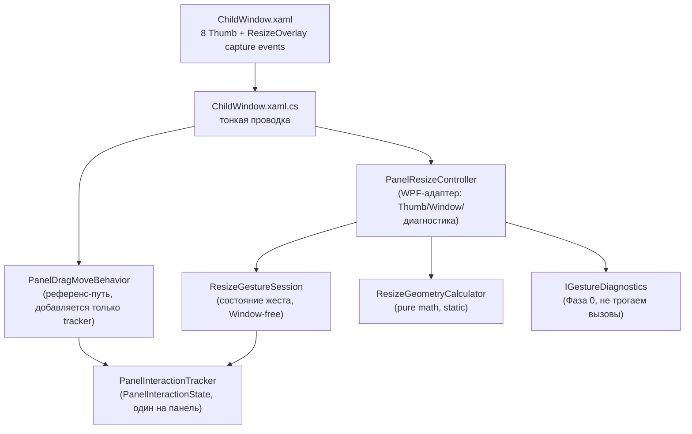

# Phase 1 — Resize Stabilization + Interaction State (мастер-план реализации)

Ветка: `fix/resize-lifecycle` (от `rc/0.4.0`).
Спецификация: `docs/Refactoring/PHASES/PHASE-1-resize-stabilization.md` (§1.1–1.4).
ADR: `adr/ADR-021-interaction-state-and-gesture-lifecycle.md` (Proposed → Accepted в конце фазы).
Вход из Фазы 0 (уже в `rc/0.4.0`): `IGestureDiagnostics`/`GestureDiagnostics`, схема
`docs/Refactoring/Testing/diagnostics-log-events.md`, матрица `docs/Refactoring/Testing/resize-repro-matrix.md`.

**Scope: L** — один слой (UI), но 6 новых файлов, 7 изменяемых, ~45 новых тестов, ADR-переход и
высокорисковая regression-поверхность (snap-to-grid semantics + порядок применения геометрии).

---

## 0. Инвентаризация текущего состояния (факты, на которых построен план)

| Факт | Источник | Следствие для плана |
|---|---|---|
| Resize — 8 `Thumb` с `Tag` = `TopLeft/Top/TopRight/Left/Right/BottomLeft/Bottom/BottomRight`, все три события в один handler | `ChildWindow.xaml:231-238` | direction приходит строкой; нужен typed `ResizeEdge` + парсер ровно этих 8 строк |
| `PanelResizeController` не имеет ни одного флага состояния | `PanelResizeController.cs:29-43` (только raw-аккумуляторы) | Begin/Update/End нужно вводить с нуля |
| `OnResizeDragCompleted` игнорирует `e.Canceled` (только логирует) | `PanelResizeController.cs:217-236` | §1.3: это и есть точка реакции на потерю capture |
| `SaveWindowsState()` вызывается ровно один раз, в `DragCompleted` (не на delta) | `PanelResizeController.cs:222` | §1.3 «уже так» — подтверждено; менять только условие вызова, не место |
| Drag-путь — рабочий референс: `_isDragging` + `EndDrag(element)` идемпотентен + `LostMouseCapture` → `EndDrag` | `PanelDragMoveBehavior.cs:36,176-203` | копируем форму: один приватный `End*`, ранний `if (!active) return`, `ReleaseMouseCapture()` внутри |
| `ResizeOverlay` уже имеет bubbling `Mouse.GotMouseCapture`/`LostMouseCapture` — **log-only**, один на все 8 thumb'ов | `ChildWindow.xaml:217-219`, `ChildWindow.xaml.cs:368-380` | точка подключения реального cleanup уже существует; провод есть, логики нет |
| Тестовый проект **не может** создать WPF `Window` (нет STA-потока/диспетчера) | `SystemIconsPanelManagerTests.cs:58`, `AssemblyInfo.cs` (parallel off) | все новые тесты должны бить в Window-free сиды; STA-инфраструктуру в этой фазе НЕ вводим |
| `System.Windows.Rect/Point/Size` в тестах доступны | `ChildWindowReorderGeometryTests.cs:1` | калькулятор может принимать/возвращать `Rect` без STA |
| Phase 2 обязуется «сохранить existing grid snap math как managed pure calculator» | `PHASE-2-native-resize-and-host.md:37` | API калькулятора должен быть пригоден и для `WM_SIZING` (proposed rect), не только для Thumb-дельт |

---

## 1. Архитектурное решение (что именно строим)

Новый namespace `DesktopOrganizer.UI.Interaction` (совпадает с namespace черновиков в
`docs/Refactoring/UI/`). Три независимых слоя, каждый тестируется отдельно:



Разделение ответственности (жёсткое, это и есть предмет ревью):

- **`ResizeGeometryCalculator`** — чистая математика. Ноль состояния, ноль WPF-объектов кроме
  `Rect`/`Vector`. Единственный источник правды для snap-семантики; Phase 2 вызовет его же из
  `WM_SIZING`.
- **`ResizeGestureSession`** — конечный автомат ОДНОГО resize-жеста. Знает `ActiveEdge`, `StartBounds`,
  `IsActive`, счётчик применённых дельт. Не знает ни про `Thumb`, ни про `Window`. Отвечает за
  идемпотентность End и за ответ на вопрос «надо ли сохранять состояние».
- **`PanelInteractionTracker`** — владелец `PanelInteractionState` на панель. Обеспечивает инвариант
  ADR-021 «только один жест владеет capture одновременно» и «disposal форсирует Idle».
- **`PanelResizeController`** — остаётся WPF-адаптером: `Thumb` → `ResizeEdge`, `Window` → `Rect`,
  вызовы `_diagnostics.*` (все существующие сохраняются на своих местах), `ReleaseMouseCapture`,
  `_snapToGrid()`, `_windowManager.SaveWindowsState()`.

### Почему не «просто добавить `_isResizing` в контроллер»

Контроллер держит `Window` в поле → тест на него требует STA. Без вынесения сессии DoD-пункт
«`LostMouseCapture` ВСЕГДА приводит к Idle» остаётся непроверяемым автоматически — ровно та дыра,
на которую указал ревью Фазы 0. Вынесение сессии переводит этот пункт из «manual verify» в
«покрыто unit-тестом» на уровне логики (реальная доставка WPF-события остаётся manual).

---

## 2. Новые файлы и сигнатуры

### 2.1 `src/DesktopOrganizer.UI/Interaction/PanelInteractionState.cs`

Переносится из `docs/Refactoring/UI/PanelInteractionState.cs` **без изменений** (5 значений,
namespace `DesktopOrganizer.UI.Interaction`). Добавить XML-doc:

- `Idle`/`Dragging`/`Resizing` — производятся кодом Фазы 1.
- `Hover`, `Editing` — **зарезервированы** (Phase 6 «Edit Layout UX», inline-rename). В Фазе 1 ни один
  путь их не устанавливает; это фиксируется тестом (см. §5.2, T-TRK-08), чтобы не получить «мёртвое
  состояние» — прямой риск, названный в ADR-021 Consequences/Negative.
- Явно: enum живёт только в UI; в `Core`/`Services` не попадает (ADR-021 Decision).

### 2.2 `src/DesktopOrganizer.UI/Interaction/PanelInteractionTracker.cs`

```csharp
public sealed class PanelInteractionTracker
{
    public PanelInteractionState State { get; }
    public event EventHandler<PanelInteractionState>? StateChanged;   // для будущего биндинга визуальных состояний

    public bool TryEnter(PanelInteractionState state);   // разрешено только из Idle/Hover; иначе false
    public void Exit(PanelInteractionState state);       // идемпотентно: no-op, если State != state
    public void ForceIdle();                             // disposal/Unloaded/Closing; всегда переводит в Idle
}
```

Матрица переходов (фиксируется в ADR-021 и в тестах):

| Из \ В | Idle | Hover | Editing | Dragging | Resizing |
|---|---|---|---|---|---|
| Idle | — | ✔ (Ph6) | ✔ (Ph6) | ✔ | ✔ |
| Hover | ✔ | — | ✔ (Ph6) | ✔ | ✔ |
| Editing | ✔ | ✖ | — | ✖ | ✖ |
| Dragging | ✔ | ✖ | ✖ | — | ✖ |
| Resizing | ✔ | ✖ | ✖ | ✖ | — |

UI-thread-affine, без блокировок (все вызовы из WPF input pipeline). Задокументировать это явно —
`ForceIdle` из финалайзера/фонового потока запрещён.

### 2.3 `src/DesktopOrganizer.UI/Interaction/ResizeEdge.cs`

```csharp
public enum ResizeEdge { Left, Top, Right, Bottom, TopLeft, TopRight, BottomLeft, BottomRight }

public static class ResizeEdgeParser
{
    public static bool TryParse(string? tag, out ResizeEdge edge);   // ровно 8 строк из ChildWindow.xaml, Ordinal
    public static bool AffectsWidth(this ResizeEdge edge);           // Left/Right/*Left/*Right
    public static bool AffectsHeight(this ResizeEdge edge);
    public static bool AnchorsRight(this ResizeEdge edge);           // edge тянет ЛЕВЫЙ край ⇒ правый якорится
    public static bool AnchorsBottom(this ResizeEdge edge);          // edge тянет ВЕРХНИЙ край ⇒ нижний якорится
}
```

Требование: `TryParse` регистрозависим и `Ordinal` — значения приходят из XAML `Tag`, не из
локали. Добавить комментарий-«якорь»: строки дублируют `ChildWindow.xaml:231-238`, менять парами.
Существующая семантика `direction.Contains("Left")` (подстрока) воспроизводится ИМЕННО через
`AnchorsRight/AffectsWidth`, а не новым `switch` «как удобнее» — иначе угловые случаи разъедутся.

### 2.4 `src/DesktopOrganizer.UI/Interaction/ResizeConstraints.cs`

```csharp
public readonly record struct ResizeConstraints(
    double MinWidth,          // Grid: GridMetrics.MinPanelWidth(iconSize); List: GridMetrics.MinPanelSize
    double MinHeight,         // всегда GridMetrics.MinPanelSize (сегодняшнее поведение)
    double SnapCellWidth,     // 0 ⇒ ось свободна (pixel-accurate)
    double SnapCellHeight,    // 0 ⇒ ось свободна
    double TitleBarHeight,    // ChildWindow.TitleBarHeight
    double HorizontalChrome,  // GridMetrics.FileListHPadding
    double VerticalChrome);   // GridMetrics.FileListVPadding
```

Плюс фабрика в контроллере (НЕ в калькуляторе — калькулятор не должен знать `ChildWindowModel`):
`PanelResizeController.BuildConstraints(ChildWindowModel? model, bool snapEnabled)` — переносит
как есть ветвление `SnapResizeToIconGrid && ViewMode == Grid` из `OnResizeDragStarted:100-117`.

### 2.5 `src/DesktopOrganizer.UI/Interaction/ResizeGeometryCalculator.cs`

Черновик `docs/Refactoring/UI/ResizeGeometryCalculator.cs` **брать только как форму подписи**, но
НЕ как реализацию: он считает по «start bounds + суммарная дельта» и не знает ни про chrome, ни про
snap, ни про `Math.Ceiling`. Продакшн-версия обязана воспроизводить `OnResizeDragDelta:132-215`
построчно.

```csharp
public readonly record struct ResizeRawExtent(double Width, double Height);

public static class ResizeGeometryCalculator
{
    /// Шаг 1: накопление raw-экстента (замена _rawWidth/_rawHeight ±= change).
    public static ResizeRawExtent Accumulate(ResizeRawExtent current, ResizeEdge edge, Vector delta);

    /// Шаг 2: квантование + clamp + репозиционирование относительно якорей.
    /// anchorRight/anchorBottom — снимок start.Right/start.Bottom, сделанный в BeginResize.
    public static Rect Apply(
        Rect current,
        ResizeEdge edge,
        ResizeRawExtent raw,
        double anchorRight,
        double anchorBottom,
        ResizeConstraints constraints);
}
```

**Контракт сохранения семантики (это красная зона, ревьюер будет сверять построчно):**

1. `contentW = Max(0, raw.Width - HorizontalChrome)`;
   `contentH = Max(0, raw.Height - TitleBarHeight - VerticalChrome)`.
2. Snap-ветка ширины: `Ceiling(Max(MinWidth, SnapExtent(contentW, SnapCellWidth, DefaultMinGap,
   EdgePadding(SnapCellWidth, DefaultEdgePaddingRatio)) + HorizontalChrome))`.
3. Free-ветка ширины: `Max(MinWidth, contentW + HorizontalChrome)`.
4. Snap-ветка высоты: `Ceiling(Max(MinHeight, TitleBarHeight + VerticalChrome +
   SnapExtent(contentH, SnapCellHeight, DefaultMinGap, EdgePadding(SnapCellHeight,
   DefaultVerticalEdgePaddingRatio))))`.
5. Free-ветка высоты: `Max(MinHeight, raw.Height)` — **намеренная асимметрия с п.3** (высота берёт
   `raw.Height`, а не `contentH + chrome`). Сегодня это числовой no-op, потому что
   `FileListHPadding == 0`, но воспроизвести надо ровно так. **Запрещено «причёсывать» при
   извлечении** — любое выравнивание этих двух веток = поведенческое изменение и отдельный тикет.
6. Горизонтальный edge-padding — ratio `DefaultEdgePaddingRatio` (0.5); вертикальный —
   `DefaultVerticalEdgePaddingRatio` (0). Разные, намеренно (см. doc-комментарии
   `ResizeSnapEdgePadding`/`ResizeSnapVerticalEdgePadding`, `PanelResizeController.cs:260-290`) —
   **перенести эти XML-doc блоки целиком в калькулятор**, они несут историю двух багов.
7. Позиционирование: `AnchorsRight` ⇒ `X = anchorRight - newWidth`, `Width = newWidth`;
   иначе если `AffectsWidth` ⇒ только `Width = newWidth`. То же для Y/Height с `anchorBottom`.
   Ось, которую edge не трогает, возвращается **из `current` без изменений** (сегодняшний код
   считает `newWidth` для `Top`/`Bottom`, но не применяет — результат идентичен, но в калькуляторе
   это должно быть выражено явно).
8. `MinWidth` в Grid-режиме уже клампится `GridMetrics.MinPanelWidth` до `MinPanelSize` (см.
   `GridMetrics.cs:144-151`) — это то, что защищает Left-handle от рассинхрона с WPF-коэрцией
   `Window.MinWidth=120` (`ChildWindow.xaml:1-7`, finalization M-1). Калькулятор НЕ имеет права
   вернуть ширину меньше `MinWidth`; добавить `Debug.Assert`/тест на это.

Дополнительно (**новое**, защита от H3 из §6): `Apply` возвращает `current` без изменений, если
любой из входов не `double.IsFinite` — вместо того чтобы записать `NaN` в `Window.Width` (что
выбрасывает и роняет весь жест в неопределённое состояние).

### 2.6 `src/DesktopOrganizer.UI/Interaction/ResizeGestureSession.cs`

```csharp
public enum ResizeEndReason { Completed, Canceled, CaptureLost, SourceChanged, Unloaded, Closing, Failed }

public readonly record struct ResizeEndOutcome(
    bool WasActive,        // false ⇒ вызывающий не делает НИЧЕГО (идемпотентность)
    bool ShouldPersist,    // true ⇒ snapToGrid + SaveWindowsState
    ResizeEdge Edge,
    ResizeEndReason Reason,
    int AppliedDeltaCount);

public sealed class ResizeGestureSession
{
    public ResizeGestureSession(PanelInteractionTracker tracker);

    public bool IsActive { get; }
    public ResizeEdge ActiveEdge { get; }        // валиден только когда IsActive
    public Rect StartBounds { get; }
    public ResizeRawExtent Raw { get; }
    public double AnchorRight { get; }
    public double AnchorBottom { get; }
    public ResizeConstraints Constraints { get; }

    public bool TryBegin(ResizeEdge edge, Rect startBounds, ResizeConstraints constraints);
    public bool TryUpdate(ResizeEdge edge, Vector delta, Rect current, out Rect applied);
    public ResizeEndOutcome End(ResizeEndReason reason);   // идемпотентно + re-entrancy-safe
}
```

Семантика:

- `TryBegin` → `false`, если `IsActive` (двойной Begin) или `tracker.TryEnter(Resizing)` вернул
  `false` (идёт drag/rename). При `true`: сохраняет `StartBounds`, `Raw = (StartBounds.Width,
  StartBounds.Height)`, `AnchorRight = StartBounds.Right`, `AnchorBottom = StartBounds.Bottom`,
  `AppliedDeltaCount = 0`.
- `TryUpdate` → `false`, если `!IsActive` **или** `edge != ActiveEdge` (unexpected source change —
  §1.2). Вызывающий обязан на `false` немедленно вызвать `End(SourceChanged)` + `thumb.CancelDrag()`.
  При `true` — `Accumulate` + `Apply`, `AppliedDeltaCount++`.
- `End` → `WasActive = false` при повторном вызове (первый выигрывает); внутренний флаг `_ending`
  защищает от реентерации (`Thumb.CancelDrag()` синхронно поднимает `DragCompleted` → снова наш
  handler). Всегда вызывает `tracker.Exit(Resizing)` — **в `finally`**, чтобы даже исключение
  оставляло состояние `Idle` (DoD «LostMouseCapture всегда → Idle»).
- `ShouldPersist` = `AppliedDeltaCount > 0` **независимо от `Reason`** (кроме `Failed`, см. ниже).
  Обоснование §1.3: WPF при canceled `DragCompleted` НЕ откатывает уже применённую геометрию —
  панель на экране осталась изменённой, значит на диск обязана попасть именно эта геометрия. Но
  жест, отменённый до первой дельты (клик по thumb без движения, Alt+Tab сразу после mouse-down),
  геометрию не менял ⇒ `SaveWindowsState()` не вызывается вообще. Это и есть точная реализация
  «сохранить последнюю валидную геометрию только если она реально применена».
- `Failed` (исключение в delta-пути) → `ShouldPersist = false`: геометрия могла остаться
  полуприменённой, persist её нельзя.

---

## 3. Изменяемые файлы

### 3.1 `src/DesktopOrganizer.UI/Behaviors/PanelResizeController.cs` (ядро правки)

Новые/изменённые публичные члены:

```csharp
public PanelResizeController(..., PanelInteractionTracker tracker, IGestureDiagnostics diagnostics)  // +1 параметр

public void OnResizeDragStarted(object sender, DragStartedEventArgs e);      // → BeginResize
public void OnResizeDragDelta(object sender, DragDeltaEventArgs e);          // → UpdateResize
public void OnResizeDragCompleted(object sender, DragCompletedEventArgs e);  // → EndResize(e.Canceled ? Canceled : Completed)
public void OnCaptureLost(object sender, MouseEventArgs e);                  // НОВОЕ — из ResizeOverlay_LostMouseCapture
public void OnUnloaded();                                                    // НОВОЕ — ChildWindow.Unloaded
public void AbortResize(ResizeEndReason reason);                             // НОВОЕ — OnClosing/дисposal
public void SnapWidthToGrid();                                               // без изменений
```

Правила правки:

1. **Все существующие вызовы `_diagnostics.*` сохраняются** на своих местах и в своём порядке.
   `ResizeStarted` — после вычисления constraints (ему нужны `_snapCellWidth/Height`, теперь
   `constraints.SnapCellWidth/Height`). `ResizeDelta` — после применения геометрии. `ResizeCompleted` —
   **после** `_snapToGrid()`/`SaveWindowsState()` (finalization M-5, комментарий на строках 224-230
   переносится дословно).
2. `OnResizeDragStarted`:
   - `_clearDragObstacles()` и `_onResizeGestureStarting()` остаются **первыми** (MINOR m-1);
   - парсинг `sender` → `Thumb` + `ResizeEdge`; при неудаче — лог + `return` (не начинать жест);
   - **stale-recovery (новое, см. §6/H4)**: если `_session.IsActive` — значит предыдущий жест не
     закрылся; вызвать `EndResize(ResizeEndReason.SourceChanged)` и продолжить (self-healing, а не
     «висим навсегда»);
   - **проверка capture (новое, §1.2)**: `Mouse.Captured` должен быть тем же `Thumb`. `Thumb` уже
     захватывает мышь сам (`Thumb.OnMouseLeftButtonDown` → `CaptureMouse()` → только потом
     `DragStarted`), поэтому **повторный `CaptureMouse()` запрещён** — он бы отобрал capture у самого
     же `Thumb` и сломал его внутренний `IsDragging`. Правильная реализация «explicit capture» из
     §1.2 для этой кодовой базы = *верифицировать и зафиксировать* владельца capture, а не
     захватывать заново. Если `Mouse.Captured` не этот thumb — логировать через уже существующий
     `captureOwner`-аргумент `ResizeStarted` и не начинать жест (`thumb.CancelDrag()`);
   - `_session.TryBegin(...)`; при `false` — `thumb.CancelDrag()` + `return`.
3. `OnResizeDragDelta`: весь блок математики (строки 136-205) заменяется на
   `_session.TryUpdate(...)` + применение полученного `Rect` к `Window` (`Left/Top/Width/Height`).
   При `false` → `EndResize(SourceChanged)` + `thumb.CancelDrag()`. Тело обёрнуто в
   `try/catch (Exception ex)` → `EndResize(Failed)` + лог **только имени типа исключения**
   (privacy-инвариант `diagnostics-log-events.md`: сообщение исключения может содержать путь к файлу —
   писать `ex.GetType().Name`, никогда `ex.Message`).
4. `OnResizeDragCompleted`: `EndResize(e.Canceled ? ResizeEndReason.Canceled : ResizeEndReason.Completed)`.
   Это и есть «реакция на `Canceled`», которой сейчас нет.
5. Единый приватный `EndResize(ResizeEndReason)` — зеркало `PanelDragMoveBehavior.EndDrag`:
   ```
   outcome = _session.End(reason);
   if (!outcome.WasActive) return;                 // идемпотентность
   ReleaseCaptureIfOurs();                          // только если Mouse.Captured — наш thumb
   if (outcome.ShouldPersist) { _snapToGrid(); _windowManager.SaveWindowsState(); }
   _diagnostics.ResizeCompleted(id, edge.ToString(), canceled, bounds, endReason);
   ```
   Порядок: release → snap → save → diagnostics (как в `EndDrag:179-203`).

### 3.2 `src/DesktopOrganizer.UI/Behaviors/PanelDragMoveBehavior.cs`

Минимальная правка (путь уже рабочий — не переписывать):

- `+ PanelInteractionTracker _tracker` в конструктор;
- в `OnTitleBarMouseLeftButtonDown` после успешного `CaptureMouse()`:
  `if (!_tracker.TryEnter(PanelInteractionState.Dragging)) { element.ReleaseMouseCapture(); return; }`
  (порядок важен: capture уже взят, при отказе его надо вернуть);
- в `EndDrag` — `_tracker.Exit(PanelInteractionState.Dragging)` в `finally`;
- `_isDragging` **оставить** — это локальный флаг гейта, tracker его не заменяет (tracker — про
  межжестовую эксклюзивность, флаг — про «этот конкретный обработчик активен»).

### 3.3 `src/DesktopOrganizer.UI/Behaviors/RollUpBehavior.cs` — **обязательный сопутствующий фикс**

`ApplyRollUp` (строки 96-106) создаёт `DoubleAnimation` без `FillBehavior` → по умолчанию
`FillBehavior.HoldEnd` → после завершения анимация **продолжает удерживать** `Window.HeightProperty`.
Любая последующая запись `_window.Height = x` (включая весь вертикальный resize в
`OnResizeDragDelta`) становится локальным значением с меньшим приоритетом, чем удерживающая
анимация, и **не даёт визуального эффекта**. Это прямой кандидат на симптом «после сворачивания/
разворачивания панели вертикальный ресайз перестаёт работать» и находится ровно в DoD Фазы 1.

Фикс: по `animation.Completed` снять держатель —
`_window.BeginAnimation(Window.HeightProperty, null)` и сразу выставить `_window.Height = toHeight`
как локальное значение. Альтернатива (`FillBehavior.Stop`) даёт мигание на последнем кадре —
отклонена.

> Проверяемо только вживую (нужен Dispatcher) ⇒ **manual verify**, но код-фикс обязателен в этой фазе.

### 3.4 `src/DesktopOrganizer.UI/Views/ChildWindow.xaml`

- `ResizeOverlay`: добавить `PreviewMouseLeftButtonDown="ResizeOverlay_PreviewMouseLeftButtonDown"`
  (stale-drag recovery до того, как `Thumb.OnMouseLeftButtonDown` сделает ранний выход по
  `IsDragging == true` — см. §6/H4). Обработчик **никогда** не ставит `e.Handled`.
- Существующие `Mouse.GotMouseCapture`/`Mouse.LostMouseCapture` — оставить, к `LostMouseCapture`
  добавляется вызов реального cleanup (сейчас он log-only).
- 8 `Thumb` — без изменений (XAML не трогаем, чтобы не расширять regression-поверхность).

### 3.5 `src/DesktopOrganizer.UI/Views/ChildWindow.xaml.cs`

- создать `PanelInteractionTracker` **до** `_dragMoveBehavior` (строка ~85) и передать в оба
  behaviour'а;
- `ResizeOverlay_LostMouseCapture`: сохранить существующий `_diagnostics.CaptureLost(...)` вызов
  **первым**, затем `_resizeController.OnCaptureLost(sender, e)`;
- новый `ResizeOverlay_PreviewMouseLeftButtonDown` → `_resizeController.RecoverStaleDrag(e.OriginalSource)`;
- `Loaded/Unloaded`: подписка на `Unloaded` → `_resizeController.OnUnloaded()` + `tracker.ForceIdle()`;
- `OnClosing` (строка 186): существующий `_diagnostics.PanelClosing(...)` остаётся **первой**
  строкой, сразу после — `_resizeController.AbortResize(ResizeEndReason.Closing)`.

### 3.6 Диагностика — `IGestureDiagnostics.cs` / `GestureDiagnostics.cs`

Решение: **расширить payload, не вводить новых имён событий** (схема Фазы 0 остаётся совместимой).

```csharp
void ResizeCompleted(Guid? panelId, string direction, bool canceled, Rect bounds, string endReason);
```

- `endReason` — `ResizeEndReason.ToString()`, закрытый набор строк ⇒ privacy-инвариант соблюдён.
- `canceled` сохраняется (обратная совместимость с `diagnostics-log-events.md`).
- Для `Failed` дополнительно поле `exceptionType` (имя типа, **не** `Message`).
- Обновить таблицу событий в `docs/Refactoring/Testing/diagnostics-log-events.md` (строка про
  `ResizeCompleted`) и существующие `GestureDiagnosticsTests`.

Отклонённые варианты: (B) новое событие `ResizeAborted` — ломает «один жест = один Completed» и
усложняет триаж по матрице; (C) ничего не добавлять — тогда в логе не отличить Alt+Tab от
mouse-up, а именно это и есть главный вопрос триажа.

---

## 4. Порядок работ (логические коммиты)

| # | Коммит | Содержание | Зависит от |
|---|---|---|---|
| C1 | `test(ui): characterization tests pinning current resize geometry` | Тесты против **текущей** математики (через временный internal-хелпер или напрямую по формулам §2.5) — золотые значения для Grid/List × snap on/off × 8 edges. Пишутся ДО извлечения. | — |
| C2 | `refactor(ui): extract pure ResizeGeometryCalculator + ResizeEdge` | §2.3–2.5; `PanelResizeController` делегирует, поведение бит-в-бит. C1 должен пройти без правок. | C1 |
| C3 | `feat(ui): PanelInteractionState + PanelInteractionTracker` | §2.1–2.2 + проводка в `PanelDragMoveBehavior` и `ChildWindow.xaml.cs`. | — |
| C4 | `feat(ui): explicit resize gesture lifecycle (ResizeGestureSession)` | §2.6 + переписанный `PanelResizeController` на Begin/Update/End, идемпотентный cleanup. | C2, C3 |
| C5 | `fix(ui): resize capture hardening and single cleanup path` | `OnCaptureLost`/`OnUnloaded`/`AbortResize`/`RecoverStaleDrag`, реакция на `e.Canceled`, try/catch delta-пути, XAML-проводка §3.4–3.5. | C4 |
| C6 | `fix(ui): persist resize state only when geometry was actually applied` | §1.3 — `ShouldPersist`, снятие безусловного `SaveWindowsState`. | C4 |
| C7 | `fix(ui): release Height animation hold after roll-up` | §3.3. Независим — можно вести параллельно с C4–C6. | — |
| C8 | `feat(diag): endReason in ResizeCompleted` | §3.6 + обновление `diagnostics-log-events.md` + правка `GestureDiagnosticsTests`. | C5 |
| C9 | `test(ui): resize lifecycle regression suite` | §5.2–5.3, включая 100-итерационный fuzz. | C4–C6 |
| C10 | `docs(adr): ADR-021 Proposed→Accepted; phase-1 status` | ADR-021 + `adr/README.md` индекс + `docs/Refactoring/ROADMAP.md` (Phase 1 `[~]`/`[x]`) + `resize-repro-matrix.md` (что закрыто кодом, что остаётся ручным). | C1–C9 |

Параллелизуемо: C1/C3/C7 — независимы между собой. C2 строго после C1. C5/C6 строго после C4.

---

## 5. Тесты

Все новые тесты — в `tests/DesktopOrganizer.Tests/Unit/Interaction/`, трейт
`[Trait(UnitTests, "DesktopOrganizer.UI")]` (как `ChildWindowReorderGeometryTests`). **Ни один не
создаёт `Window`/`Thumb`** — среда без STA.

### 5.1 `ResizeGeometryCalculatorTests.cs` (~25 кейсов)

- **T-GEO-01..08**: по одному на каждый `ResizeEdge` — свободный режим (List, snap off): проверка,
  что меняется только нужная ось и что якорится противоположный край (`Left`-edge: `Right` остался
  прежним; `Top`-edge: `Bottom` остался прежним).
- **T-GEO-09..12**: углы (`TopLeft`/`TopRight`/`BottomLeft`/`BottomRight`) — обе оси одновременно,
  оба якоря.
- **T-GEO-13..16**: min size — тянем внутрь за пределы минимума; ширина/высота = `MinWidth`/
  `MinHeight`, **противоположный край не сдвинулся** (repro-matrix строка 14).
- **T-GEO-17..19**: Grid + snap on — ширина кратна колонке (`SnapExtent`), высота кратна строке,
  `Math.Ceiling` применён (дробный `IconSize` ⇒ целочисленный результат).
- **T-GEO-20**: Grid + snap off ⇒ pixel-accurate (нет квантования).
- **T-GEO-21**: List-режим всегда свободен по обеим осям, даже при `SnapResizeToIconGrid = true`.
- **T-GEO-22**: `MinWidth` в Grid = `GridMetrics.MinPanelWidth(iconSize)`, в List =
  `GridMetrics.MinPanelSize` (расхождение намеренное, ADR-018).
- **T-GEO-23**: разные edge-padding ratio по осям (0.5 против 0) — регрессия бага «одна строка
  иконок отчитывалась двойной высотой».
- **T-GEO-24**: `Accumulate` — знаки (`Left`/`Top` вычитают, `Right`/`Bottom` прибавляют).
- **T-GEO-25**: не-finite вход (`NaN`/`Infinity` в delta) ⇒ возвращается `current` без изменений.

### 5.2 `PanelInteractionTrackerTests.cs` (~10)

- T-TRK-01: старт — `Idle`.
- T-TRK-02: `TryEnter(Resizing)` из `Idle` ⇒ `true`.
- T-TRK-03: `TryEnter(Dragging)` во время `Resizing` ⇒ `false`, состояние не изменилось.
- T-TRK-04: `Exit` чужого состояния ⇒ no-op.
- T-TRK-05: двойной `Exit` ⇒ идемпотентно.
- T-TRK-06: `ForceIdle` из любого состояния ⇒ `Idle` + событие.
- T-TRK-07: `StateChanged` поднимается ровно один раз на переход.
- T-TRK-08: **ни один переход Фазы 1 не устанавливает `Hover`/`Editing`** (защита от мёртвых
  состояний, ADR-021 Negative).

### 5.3 `ResizeGestureSessionTests.cs` (~18) — здесь закрываются lifecycle-пункты DoD

- T-SES-01: `TryBegin` из Idle ⇒ `true`, tracker = `Resizing`.
- T-SES-02: двойной `TryBegin` ⇒ второй `false`, первый жест не тронут.
- T-SES-03: `TryBegin` при активном `Dragging` ⇒ `false`.
- T-SES-04: `TryUpdate` до `Begin` ⇒ `false`.
- T-SES-05: `TryUpdate` с чужим `edge` ⇒ `false` (unexpected source change).
- T-SES-06: `End(Completed)` после N дельт ⇒ `ShouldPersist = true`, tracker = `Idle`.
- T-SES-07: `End(Canceled)` после N дельт ⇒ `ShouldPersist = true` (геометрия применена, WPF её не
  откатывает).
- T-SES-08: `End(CaptureLost)` **без единой дельты** ⇒ `ShouldPersist = false`.
- T-SES-09: повторный `End` ⇒ `WasActive = false` (идемпотентность).
- T-SES-10: `End` без `Begin` ⇒ `WasActive = false`, исключения нет.
- T-SES-11: реентерантный `End` изнутри обработчика первого `End` ⇒ не зацикливается, tracker `Idle`.
- T-SES-12: `End(Failed)` ⇒ `ShouldPersist = false`.
- T-SES-13..17: `End(<reason>)` для **каждого** `ResizeEndReason` ⇒ tracker всегда `Idle`
  (табличный `[Theory]` — прямая формализация DoD «`LostMouseCapture` ВСЕГДА приводит к Idle»).
- **T-SES-18 (DoD «100 подряд»)**: цикл 100 итераций Begin → 1..5 `TryUpdate` → `End(случайная
  причина из полного набора, включая SourceChanged/Failed)`; инварианты после каждой итерации:
  `tracker.State == Idle`, `session.IsActive == false`, следующий `TryBegin` возвращает `true`.
  Плюс проход по всем 8 `ResizeEdge` (детерминированный seed, без `Random` без seed).

### 5.4 Обновляемые тесты

- `tests/.../Unit/Diagnostics/GestureDiagnosticsTests.cs` — новая сигнатура `ResizeCompleted`
  (+ privacy-тест: `endReason`/`exceptionType` не содержат путей — проверить, что пишется
  `GetType().Name`, а не `Message`).

Ожидаемый итог: текущие 983 теста зелёные + ~53 новых, `dotnet build` без новых warnings
(StyleCop + `linters/linter.ruleset`).

---

## 6. Риски и гипотезы о причине зависания

Гипотезы ранжированы; Фаза 1 должна быть устойчива к каждой, даже если лог Фазы 0 подтвердит только
одну.

- **H1 — `Canceled` трактуется как успешное завершение** (подтверждено чтением кода:
  `OnResizeDragCompleted` игнорирует `e.Canceled`). Последствие — не зависание, а рассинхрон
  сохранённой и экранной геометрии. Закрывается C5/C6.
- **H2 — исключение внутри `DragDelta`.** В delta-пути нет ни одного `try/catch`; исключение уходит
  в WPF input pipeline, `Thumb.IsDragging` остаётся `true`, capture удержан ⇒ панель «прилипает».
  Закрывается C5 (try/catch → `End(Failed)` → `CancelDrag`) + T-GEO-25.
- **H3 — `Window.Height` удерживается roll-up-анимацией** (`FillBehavior.HoldEnd`, §3.3). Симптом:
  вертикальный resize мёртв после первого сворачивания. Закрывается C7. **Сильный кандидат, найден
  при планировании — обязателен к проверке ревьюером и вживую.**
- **H4 — capture теряется без `LostMouseCapture` на самом `Thumb`.** Панель — `WS_EX_NOACTIVATE`,
  встроена в `WorkerW`; при перехвате native-capture другим HWND (Alt+Tab, перезапуск Explorer,
  переключение виртуального стола) WPF может не поднять `LostMouseCapture` на элементе. Тогда
  `Thumb.IsDragging` навсегда `true`, а `Thumb.OnMouseLeftButtonDown` **делает ранний выход**, если
  `IsDragging` — handle мёртв до перезапуска. Закрывается `RecoverStaleDrag` на
  `PreviewMouseLeftButtonDown` оверлея: если `thumb.IsDragging && !ReferenceEquals(Mouse.Captured,
  thumb)` ⇒ `thumb.CancelDrag()` + `AbortResize(SourceChanged)` до того, как отработает собственный
  handler `Thumb`. Это делает DoD «100 подряд без зависания» **самовосстанавливающимся**, даже если
  корневая причина останется в платформе.

Прочие риски:

- **R1 (высокий) — regression snap-to-grid.** Митигация: C1 (характеризационные тесты ДО
  извлечения) + запрет «причёсывания» асимметрии §2.5/п.5 + перенос doc-комментариев дословно.
  `fences-ux-parity-reviewer` проверяет именно этот пункт.
- **R2 (средний) — tracker залипает и блокирует жесты.** Если `Exit` где-то не вызван, resize
  станет полностью недоступен — хуже исходного бага. Митигация: `Exit` только в `finally`;
  stale-recovery в `OnResizeDragStarted`; T-SES-13..18.
- **R3 (средний) — catch-all маскирует реальные баги.** Митигация: исключение всегда попадает в
  diagnostics (`exceptionType`), жест завершается с `ShouldPersist = false`; в Debug — дополнительно
  `Debug.Fail`. Требует явного одобрения `code-quality-reviewer`.
- **R4 (средний) — реентерация через `Thumb.CancelDrag()`** (синхронно поднимает `DragCompleted` →
  наш же handler). Митигация: флаг `_ending` + T-SES-11.
- **R5 (низкий) — расширение конструкторов** `PanelResizeController`/`PanelDragMoveBehavior`.
  Оба создаются только в `ChildWindow.xaml.cs`, DI не затрагивается (`DiConfigTests` должны
  остаться зелёными — проверить).
- **R6 (низкий) — Phase 2 совместимость.** API `ResizeGeometryCalculator.Apply` принимает
  «current + raw extent + якоря», что напрямую ложится на `WM_SIZING` (proposed rect → raw extent).
  Явно зафиксировать в ADR-021, чтобы Phase 2 не начала вторую копию математики.

---

## 7. DoD: что закрывается здесь, что остаётся на живой Windows

### Достижимо в этой среде (`dotnet build` + `dotnet test`)

| DoD-пункт | Чем закрывается |
|---|---|
| Geometry calculator покрыт unit-тестами по всем направлениям | T-GEO-01..25 (8 edge × свободный/snap, углы, min size, Grid/List) |
| Existing snap-to-grid semantics сохранены | C1 характеризационные тесты + C2 бит-в-бит извлечение + ревью `fences-ux-parity-reviewer` |
| `LostMouseCapture` ВСЕГДА приводит к `Idle` — **на уровне логики** | T-SES-13..17 (`[Theory]` по всем `ResizeEndReason`) + `Exit` в `finally` |
| 100 последовательных resize без зависания — **логическая гарантия** | T-SES-18 (100 итераций × 8 edge × все причины завершения; инвариант «всегда можно начать следующий жест») |
| Идемпотентный cleanup / отсутствие двойного Begin | T-SES-02, T-SES-09..11 |
| `SaveWindowsState()` только по факту применённой геометрии | T-SES-06..08, T-SES-12 |
| Нет новых warnings, 983 существующих теста зелёные | `dotnet build` + `dotnet test` |

### Manual verify (Win10/Win11) — вносится в `docs/Refactoring/Testing/resize-repro-matrix.md`

| Строка матрицы | Проверка | Почему нельзя автоматизировать здесь |
|---|---|---|
| 1, 2 | 100 живых resize правым краем / углом | нужен реальный input + GUI |
| 3 | release мыши вне окна | реальная доставка `MouseLeftButtonUp` вне HWND |
| 4 | Alt+Tab во время resize | реальный перехват capture системой |
| 5 | контекстное меню во время/после resize | вложенный message loop |
| 6, 7 | виртуальный стол / смена DPI / другой монитор | WorkerW + DPI-контекст |
| 8, 9 | sleep/wake, перезапуск Explorer | внешние системные события |
| 10, 11 | resize↔drag вплотную | проверяет tracker вживую |
| 15 | закрытие панели в середине жеста | `AbortResize(Closing)` вживую |
| — | **H3**: roll-up → roll-down → вертикальный resize работает | анимация требует Dispatcher |
| — | Триаж по логу: нет ни одного `CaptureLost` без последующего `ResizeCompleted` | запускать с `--diag`, см. `diagnostics-log-events.md` |

Формулировка для отчёта: Фаза 1 закрывается статусом `[~]` в `docs/Refactoring/ROADMAP.md` —
«код + автотесты завершены; 15 строк repro-matrix + H3 остаются manual verify (Win10/Win11)», по
образцу того, как закрыта Фаза 0.

---

## 8. Артефакты фазы

Новые:
- `src/DesktopOrganizer.UI/Interaction/PanelInteractionState.cs`
- `src/DesktopOrganizer.UI/Interaction/PanelInteractionTracker.cs`
- `src/DesktopOrganizer.UI/Interaction/ResizeEdge.cs`
- `src/DesktopOrganizer.UI/Interaction/ResizeConstraints.cs`
- `src/DesktopOrganizer.UI/Interaction/ResizeGeometryCalculator.cs`
- `src/DesktopOrganizer.UI/Interaction/ResizeGestureSession.cs`
- `tests/DesktopOrganizer.Tests/Unit/Interaction/ResizeGeometryCalculatorTests.cs`
- `tests/DesktopOrganizer.Tests/Unit/Interaction/PanelInteractionTrackerTests.cs`
- `tests/DesktopOrganizer.Tests/Unit/Interaction/ResizeGestureSessionTests.cs`

Изменяемые:
- `src/DesktopOrganizer.UI/Behaviors/PanelResizeController.cs`
- `src/DesktopOrganizer.UI/Behaviors/PanelDragMoveBehavior.cs`
- `src/DesktopOrganizer.UI/Behaviors/RollUpBehavior.cs`
- `src/DesktopOrganizer.UI/Views/ChildWindow.xaml` / `ChildWindow.xaml.cs`
- `src/DesktopOrganizer.UI/Diagnostics/IGestureDiagnostics.cs` / `GestureDiagnostics.cs`
- `tests/DesktopOrganizer.Tests/Unit/Diagnostics/GestureDiagnosticsTests.cs`
- `adr/ADR-021-interaction-state-and-gesture-lifecycle.md` (Proposed → Accepted) + `adr/README.md`
- `docs/Refactoring/Testing/diagnostics-log-events.md`, `resize-repro-matrix.md`,
  `docs/Refactoring/ROADMAP.md`

Черновики `docs/Refactoring/UI/PanelInteractionState.cs` и `ResizeGeometryCalculator.cs` остаются
на месте как артефакты пакета рефакторинга (не удалять, не перемещать) — в шапке продакшн-файлов
дать ссылку «расширенная реализация черновика `docs/Refactoring/UI/...`, отличия: см. §2.5 плана».

---

## 9. Открытые вопросы (если реализующий агент упрётся — эскалировать с вариантами)

1. **Catch-all в `OnResizeDragDelta`** — A: ловить всё и завершать жест (рекомендуется, закрывает H2);
   B: только валидация входов без catch; C: и то, и другое. План исходит из **C**.
2. **`ShouldPersist` при `Canceled`** — A: сохранять применённую геометрию (рекомендуется, экран =
   диск); B: откатывать к `StartBounds`. Откат означает видимый прыжок панели при Alt+Tab и
   расходится с поведением Fences ⇒ **A**.
3. **`Hover`/`Editing`** — вводить значения сейчас (рекомендуется, черновик уже их содержит, тест
   T-TRK-08 страхует от мёртвого состояния) vs отложить до Phase 6. План исходит из **«ввести»**.
