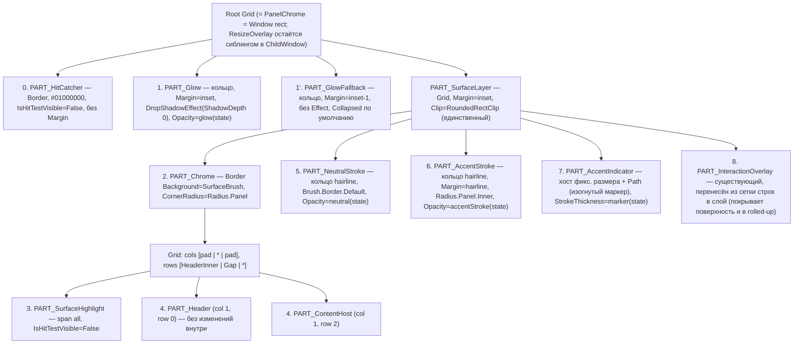

# План реализации ADR-030 — Reference-Style Layered Panel Chrome

> **Статус: реализовано** (`af2c235` + round-2 polish, ветка `feature/reference-chrome`) — см.
> `adr/ADR-030-reference-panel-chrome.md` Amendment 2026-09-25 «Реализация» для полной сверки план-vs-факт
> (токены, слои, решения ревью M-1/M-2/M-3/T-C1/T-V2, известные ограничения, manual verify).
>
> Источник правды: `adr/ADR-030-reference-panel-chrome.md` (Accepted), `adr/ADR-025-ambient-accent-visual-language.md`
> (+ Amendments P07-visual / fix-cycle 1 / fix-cycle 2 / P09), `docs/Ref image.png`, `CLAUDE.md` (persistence freeze,
> правило 0 warnings).
> Смежные инварианты, которые план обязан сохранить: ADR-021 (gesture lifecycle), ADR-022 (`NativePanelSizing`,
> `NativeHitTestMapper`), ADR-028/029 (workspace grid, F-3: `GridMetrics.FileListHPadding == PanelMetrics.ContentLeftInset`),
> ADR-015 (item chrome), D-11 фазы 5 (`PanelMetrics` — единый источник правды), D-12 (High Contrast «один раз при старте»).
> Ветка: `feature/reference-chrome`. Дата: 2026-09-25.
> **Scope: L** — один слой (UI: `Controls`/`Resources`/`Theming`/`Converters`/`Models`-токены) плюс тесты; ни нативного
> кода, ни persistence, ни сервисов. Не XL, потому что WorkerW/Win32/`INativeApi` не затрагиваются.
>
> **Главная находка планирования (§1 D-1).** Бюджет прозрачного inset'а внутри текущих, уже persisted-геометрий, равен
> **2 DIP**, не больше. Любой более широкий ореол требует либо сдвигать границы окна (native/WorkerW-геометрия), либо
> менять учёт хрома в snap-математике (сохранённые раскладки перестроятся). Оба варианта выходят за рамки заморозки —
> см. §11, вопрос Q-1.

---

## 0. Границы — что НЕ трогаем

| Не трогать | Почему |
|---|---|
| Весь контур persistence (полный список — §10) | `CLAUDE.md`: schemaVersion = 5, миграции, DTO, `IAppSettings`/`Settings.settings`/`user.config` заморожены. Ни одного нового persisted-поля — все параметры задаются design-токенами в коде. |
| `Views/ChildWindow.xaml` — `ResizeOverlay`, `Window.Width/Height/MinWidth/MinHeight`, строки `PanelRoot`, `FileListHost.Margin`, `TitleText.Margin` | Геометрия окна = persisted `Size`/`Position`; сетка хендлов ресайза закреплена `ResizeOverlayGeometryTests` (P09). **Цель — ноль изменённых строк в `ChildWindow.xaml`.** Inset живёт в шаблоне `PanelChrome` (D-2). |
| `Views/ChildWindow.xaml.cs`, `ViewModels/ChildWindowViewModel.cs`, `Models/ChildWindowModel.cs` | DO-002 / R-12: вид задаётся только шаблоном и токенами; новых свойств ViewModel/Model нет. |
| `Interaction/Native/*` (`NativeHitTestMapper`), `Behaviors/NativePanelResizeController.cs`, `Behaviors/PanelResizeController.cs`, `Behaviors/ResizeConstraintsFactory.cs`, `Interaction/ResizeGeometryCalculator.cs` | ADR-022, bit-for-bit равенство путей Thumb/native. Этот план меняет только то, что нарисовано ВНУТРИ прямоугольника окна. |
| `Models/GridMetrics.cs`, `Models/AdaptiveGridLayout.cs`, `Models/PanelContentSizer.cs`, `Controls/AdaptiveIconGridPanel.cs` | F-3 / ADR-029: `FileListHPadding` (8) и `FileListVPadding` (4) остаются как есть. Инвариант D-3 доказывает, что ширина/высота контента не меняются. |
| `Behaviors/RollUpBehavior.cs`, `Behaviors/PanelVisualStateBehavior.cs`, `Interaction/PanelInteractionTracker.cs` | Одна state machine (ADR-021 → `InteractionVisualState` → `LayoutEditVisuals`). Новый chrome только **читает** её. |
| `Theming/InteractionVisualState.cs`, `Theming/LayoutEditVisuals.cs` — существующие ветки и значения | Закреплены `InteractionVisualStateTests`/`LayoutEditVisualsTests` (монотонность, различимость). Новые каналы — производные функции рядом (D-6), а не правка этих веток. |
| WorkerW/Progman (`Tools/*`, `EmbedInDesktop`, `INativeApi`) | Условие задачи. DWM Acrylic, `SetWindowCompositionAttribute`, `DwmSetWindowAttribute` — запрещены (ADR-030 §11). |
| `App.xaml.cs`, `installer/*`, `SingleInstance/*`, `DiConfig.cs`, `IShutdownRequestListener` | В рабочем дереве есть незакоммиченные правки, НЕ относящиеся к задаче. Не править, не индексировать (`git add` только по конкретным путям из §7). Поэтому новому startup-флагу (D-9) нельзя инициализироваться в `App.xaml.cs`: он ленивый. |
| `Views/SystemIconsPanelWindow.xaml` | `PanelChrome` не использует (только упоминание в комментарии). Боковая панель остаётся в старом визуале — известный разрыв (§8, R-11), вне scope. |

---

## 1. Архитектурные решения

### D-1. Где живёт glow и какой ширины он может быть — бюджет inset'а

**Проблема.** Окно панели — `AllowsTransparency="True"` (layered). Всё, что нарисовано за пределами прямоугольника окна,
обрезается. `Window.Left/Top/Width/Height` ≡ persisted `Model.Position`/`Model.Size` (`ChildWindow.Initialize`), и тот же
прямоугольник — это workspace-grid footprint (ADR-028), прямоугольник коллизий (ADR-017) и `windowRect` для
`NativeHitTestMapper`.

**Рассмотренные варианты**

| # | Вариант | Вердикт |
|---|---|---|
| A-wide | Inset внутри окна, 6–10 DIP (ореол «как на референсе») | **Отклонён без явного «да» пользователя (§11 Q-1).** Контент сужается на `2·I`. Чтобы snap-математика не разошлась с реальной раскладкой, пришлось бы поднять `FileListHPadding`/`HeaderHeight` — а это меняет, какие ширины считаются snap-точками. Сохранённые панели потеряли бы колонку при первом запуске: тот же класс регрессии, что finalization MAJOR-1 P05 (`ChildWindow.Initialize`, комментарий «persisted 344 → 352»). `AutoContent`-панели затем записали бы новый `Size` — мутация persisted-данных по факту загрузки. |
| B | Окно растёт наружу на `I` с каждой стороны, persisted rect = «логический» прямоугольник | **Отклонён.** Нужен шов трансляции во всех писателях геометрии (`PanelGeometryWriter`, `PanelDragMoveBehavior`, оба resize-контроллера, `RollUpBehavior`, `WindowManager`), дефляция `windowRect` в `NativeHitTestMapper`, `SetWindowPos` под WorkerW. Пиксели ореола соседних окон перекрывались бы и перехватывали клики через OS alpha hit-test. Затрагивает native/WorkerW — запрещено условием. |
| C | Без inset, только внутренний glow | Безопасно, но нарушает явное требование «glow внутри прозрачного inset». Остаётся запасным вариантом, если Q-1 решится в пользу «ещё тоньше». |
| **D (выбран)** | **Бюджетный inset `ChromeOuterInset = 2 DIP`**, целиком из чрома, который уже есть и уже учтён | Геометрия окна, snap-математика, persisted-семантика, ResizeOverlay, NativeHitTestMapper — без изменений. Glow = тонкий внешний ореол ≤ 2 DIP + мягкое внутреннее свечение сквозь полупрозрачную поверхность (слой glow лежит ПОД поверхностью). |

**Почему максимум — ровно 2 DIP (проверяется тестами D-3):**

| Ограничение | Формула | Предел `I` |
|---|---|---|
| Кнопки заголовка в свёрнутом (rolled-up) виде: окно = `HeaderHeight` (32), кнопка = `HeaderButtonSize` (28) | `HeaderHeight − 2·I ≥ HeaderButtonSize` | **I ≤ 2** |
| Горизонтальный чром уже равен `ContentLeftInset` (8) = `FileListHPadding` | `2·I + ContentPaddingL + ContentPaddingR == ContentLeftInset` | I ≤ 4 |
| Вертикальный чром снизу: `FileListVPadding` (4) учтён в snap/fit, а фактический `FileListHost.Margin` = `0,0,0,0` | `I ≤ FileListVPadding` (4 DIP резерва уже есть — см. F-1) | I ≤ 4 |
| Каждый пиксель inset должен лежать внутри полосы ресайза (D-5) | `I < ResizeEdgeThickness` (6) | I < 6 |

Связывающее ограничение — свёрнутая панель. Поэтому `I = 2`. Значит, **внешний** ореол по построению едва заметен
(«subtle»). Основная глубина достигается слоями: внутренний glow + accent stroke + neutral stroke + highlight + marker.

**F-1 (попутная находка, не исправлять в этой задаче).** Комментарий к `GridMetrics.FileListVPadding` и комментарий в
`ChildWindow.xaml` над `FileListHost` говорят про `Margin="0,0,0,4"`. Фактический XAML (`ChildWindow.xaml:477`) —
`Margin="0,0,0,0"`. Учёт хрома (`VerticalChrome = 4`) поэтому уже несёт 4 DIP неиспользуемого вертикального резерва.
Нижний inset в 2 DIP расходует половину: высота контента = `H − 34` ≥ учтённой `H − 36`. Snap/fit-высоты не теряют строку.
Передать `architecture-documenter` как doc-drift (DO-backlog), код не трогать.

### D-2. Inset живёт в шаблоне `PanelChrome`, а не в `ChildWindow.xaml`

- `PanelChrome` уже занимает всё окно (`Grid.RowSpan="2"` в `PanelRoot`). Его шаблон получает корневой слоистый `Grid`
  с сиблингами (§3). Поверхностные слои сдвинуты на `ChromeOuterInset` через `Margin="{x:Static PanelMetrics.ChromeOuterInsetThickness}"`.
- `ResizeOverlay`, `ReorderInsertionIndicator`, попапы остаются в координатах окна. Их не трогаем. Индикатор вставки
  позиционируется через `TranslatePoint` от реального `FileListHost` (`ChildWindow.xaml.cs:857/887`), поэтому сдвиг
  контента подхватится сам.
- Вся арифметика бюджета (строка заголовка, колонки-отступы контента) находится в одном файле — `Panels.xaml` — и
  читает `PanelMetrics`. В `ChildWindow.xaml` ничего менять не нужно.

### D-3. Геометрия контента не меняется (закреплено тестами)

| Величина | Сейчас | После | Меняется ли snap-математика |
|---|---|---|---|
| Ширина `PART_ContentHost` | `W − 8` | `W − 2·2 − 2 − 2 = W − 8` | нет (`FileListHPadding` = 8) |
| Верх `PART_ContentHost` | `y = 32` | `2 (inset) + 28 (строка заголовка) + 2 (спейсер) = 32` | нет (`TitleBarHeight` = 32) |
| Низ `PART_ContentHost` | `H` | `H − 2` (расходует резерв F-1) | нет (`VerticalChrome` = 4 ≥ 2) |
| Rolled-up: поверхность | 32 | `32 − 2·2 = 28` = строка заголовка | кнопки 28×28 влезают ровно |
| Кнопки заголовка (экран) | `y ∈ [2, 30]` | `y ∈ [2, 30]` (строка 28, центр) | нет |
| Начало контента по X | 8 | 4 (inset 2 + отступ 2) — иконки визуально сдвигаются на 4 DIP влево | нет (важна только ширина) |

Новые токены (§2): `ChromeOuterInset = 2`, `ContentSidePadding = (ContentLeftInset − 2·ChromeOuterInset) / 2 = 2`,
`HeaderInnerHeight = HeaderHeight − 2·ChromeOuterInset = 28`, `HeaderContentGap = ChromeOuterInset = 2`.
`ContentLeftInset` (8) и `FileListHPadding` **не меняются**. Колонка `ContentLeftInsetColumnWidth` (8) перестаёт быть
колонкой акцента: её заменяют симметричные колонки `ContentSidePaddingLength` (2 | * | 2). Отступы контента от
видимого края выравниваются слева и справа (сейчас 8 / 0).

### D-4. Изогнутый маркер заменяет `PART_AccentIndicator` и сохраняет имя части шаблона

- Новый элемент — `Path` (`Stretch="None"`, `StrokeStartLineCap`/`StrokeEndLineCap`/`StrokeLineJoin="Round"`,
  `Stroke="{TemplateBinding AccentBrush}"`, `IsHitTestVisible="False"`) в хосте фиксированного размера
  (`Width`/`Height` из токенов, не `Auto`). **Имя `PART_AccentIndicator` сохраняется**: семантика та же — accent
  identity + emphasis по состоянию. `PanelChrome.PartAccentIndicator` и тесты по `FindName` остаются рабочими. ADR-030
  прямо разрешает корректировать имена частей шаблона. Таблица соответствия имён — §3.
- **Геометрия повторяет верхний левый скруглённый угол поверхности.** Осевая линия идёт по краю поверхности: вертикальный
  отрезок по левому краю в пределах заголовка, затем четверть окружности радиуса `Radius.Panel` (8) в точку `(R, 0)`,
  затем короткий хвост вправо вдоль верхнего края. Слой маркера клипуется той же скруглённой геометрией, что и
  поверхность. Поэтому видна **только внутренняя половина** штриха: маркер всегда прижат к краю, повторяет дугу угла
  и растёт **только внутрь**. Никакой зависимости геометрии от состояния нет — меняется лишь `StrokeThickness`.
- Геометрию строит новый `Converters/AccentMarkerGeometryConverter` (single-value, вход — `CornerRadius` из
  `{StaticResource Radius.Panel}`, выход — замороженная `PathGeometry`, кэш по радиусу). Длина ствола и хвоста берутся
  из токенов `PanelMetrics`. Ни одного числа в разметке `Path.Data`. Причина конвертера: `Radius.Panel` — XAML-ресурс
  (`Spacing.xaml`), а C#-константа `PanelMetrics` его не видит. Переносить `Radius.Panel` в C# — рефакторинг вне scope.
- Толщина: существующий `EditAwareAccentIndicatorWidthConverter` получает `ConverterParameter="marker"` →
  `PanelMetrics.AccentMarkerStrokeThickness × LayoutEditVisuals.AccentEmphasisFor(state, isEditing)`. Без параметра
  поведение прежнее (регрессионный тест). Видимая ширина = `stroke / 2`. Токен задаётся как «2 × желаемая видимая ширина»
  с doc-комментарием.
- **Отсутствие коллизий:** при максимальной эмфазе (Resizing + Edit Layout, радиус скругления конца = `stroke/2` ≈ 4.6)
  (а) описывающий прямоугольник маркера не пересекается с описывающим прямоугольником `TitleText`: хвост лежит у
  верхнего края `y ∈ [0, 4.6]`, текст центрирован в строке 28 примерно в `y ∈ [6, 22]`; (б) нижний круглый конец ствола
  не выходит за `HeaderInnerHeight`. Закрепляется тестами T-R4/T-V2.

### D-5. Hit-test в зоне inset — «ловушка кликов» с alpha 1/255 внутри шаблона

- **Риск.** Сейчас внешние 2 DIP полос ресайза (6 DIP по краю, 8×8 в углах) лежат над закрашенной поверхностью
  (alpha > 0), и ОС доставляет клики окну. После inset'а эти 2 DIP почти прозрачны: только затухающий хвост glow.
  Layered-окно пропускает клик по пикселю с alpha = 0 прямо на рабочий стол, не спрашивая дерево hit-test WPF
  (ADR-025 MAJOR-1). На нативном пути (`NativePanelSizing=True`) `ResizeOverlay` свёрнут (`ThumbOverlayAffordance`,
  `ChildWindow.xaml.cs:178`), поэтому `WM_NCHITTEST` для таких пикселей вообще не придёт. Реальная ширина захвата упала
  бы с 6 до ~4 DIP на обоих путях.
- **Решение.** Нижний слой шаблона — `PART_HitCatcher`: `Border` во весь `PanelChrome` (= всё окно),
  `Background="{StaticResource Brush.HitTest.Catcher}"` (`#01000000`, визуально невидим), `IsHitTestVisible="False"`.
  Для ОС пиксель непрозрачный (alpha ≥ 1), поэтому клик приходит в окно. Для WPF элемент невидим: маршрутизация
  достаётся `Thumb` (путь WPF) либо классифицируется нативным хуком на уровне HWND (нативный путь).
  `NativeHitTestMapper` и `ResizeOverlay` **не меняются**.
- **Инвариант.** `ChromeOuterInset < ResizeEdgeThickness`: каждый пиксель inset'а лежит внутри полосы ресайза на обоих
  путях. Посторонних «мёртвых» пикселей не появляется.
- **Побочный эффект (положительный, для amendment ADR-025).** Ловушка покрывает и «линзу» за дугой скругления угла.
  Сквозной клик в углу, из-за которого пришлось расширять угловой хендл (MAJOR-1), полностью закрывается на обоих
  путях. `ResizeCornerThickness_CoversMajorityOfCornerDeadZone` остаётся зелёным (чистая математика), но его обоснование
  дополняется в amendment.
- **Принятая цена.** Когда ресайз выключен (rolled-up; Normal mode, где политика запрещает ресайз), кольцо 2 DIP
  вокруг панели поглощает клики вместо рабочего стола. Пренебрежимо; записать в amendment.
- `Brush.HitTest.Catcher` **намеренно НЕ переопределяется** в `Colors.HighContrast.xaml`: системный цвет покрасил бы
  непрозрачное кольцо. Это задокументированное исключение из правила MAJOR-A «весь chrome-цвет переопределяется в HC»,
  закреплённое тестом (alpha == 1 в обоих вариантах слияния).
- **Отклонённая альтернатива:** фон `ResizeHandleStyle` = catcher (`Controls.xaml`). Не работает на нативном пути
  (overlay свёрнут) и расширяет зону правок.

### D-6. Выразительность по состоянию — производные каналы, без второй state machine

Новый чистый класс `Theming/LayeredChromeVisuals` (паттерн `LayoutEditVisuals`). Каждый новый декоративный канал —
**аффинное отображение существующего канала** `LayoutEditVisuals.BorderOpacityFor(state, isLayoutEditing)`:

```
t(state, edit) = (LayoutEditVisuals.BorderOpacityFor(state, edit) − B_idle) / (B_max − B_idle)
                 // B_idle = InteractionVisualState.BorderOpacityFor(Idle), B_max = ...(Resizing) — читаются, не копируются
GlowOpacityFor          = GlowOpacityIdle          + (GlowOpacityMax          − GlowOpacityIdle)          · t
AccentStrokeOpacityFor  = AccentStrokeOpacityIdle  + (AccentStrokeOpacityMax  − AccentStrokeOpacityIdle)  · t
NeutralStrokeOpacityFor = NeutralStrokeOpacityIdle + (NeutralStrokeOpacityMax − NeutralStrokeOpacityIdle) · t
```

- Монотонность, различимость пяти состояний и «в режиме редактирования не слабее» наследуются от уже протестированного
  канала. Параллельной state machine нет **по построению**.
- Толщина маркера — существующий `LayoutEditVisuals.AccentEmphasisFor` (D-4). Контраст оверлея — существующий
  `PART_InteractionOverlay` без изменений.
- **Подключение без новых классов конвертеров:** `EditAwareVisualStateToDoubleConverter` получает параметры `"glow"`,
  `"accentStroke"`, `"neutralStroke"`. Прежние `"chrome"`/`"border"`/неизвестные параметры ведут себя как раньше
  (регрессионные тесты).
- High Contrast в `LayeredChromeVisuals` **не** моделируется. HC обрабатывается в одном месте — триггерах шаблона (D-8).

### D-7. Отсутствие дрожания layout (layout jitter) — структурные гарантии

1. Все декоративные слои — сиблинги в корневом `Grid` / `PART_SurfaceLayer` без `Auto`-строк и колонок. Состояние
   меняет только `Opacity`, `StrokeThickness` (`Path` внутри хоста фиксированного размера) и `Effect` (через триггер HC
   или fallback, но не через состояние). Ни одно из этих свойств не влияет на `DesiredSize` соседей.
2. Хост маркера имеет явные `Width`/`Height` из токенов, не меньше `bounds(geometry) ⊕ max(stroke)/2`. Существующая
   колонка 8 DIP «с запасом под 6.885» (MAJOR-1 фазы 5) больше не нужна: маркер не участвует в раскладке колонок.
3. Строки и колонки шаблона — только `x:Static` `GridLength` из `PanelMetrics`.
4. `UseLayoutRounding` **не** ставится на общего предка контента: это могло бы округлить доступную ширину
   `AdaptiveIconGridPanel` на дробном DPI и перевернуть `RowCapacity`. `SnapsToDevicePixels="True"` ставится только на
   рамочных `Border`. Абсолютный отступ контента `4 DIP` целочислен в пикселях на 125/150/175 % (5/6/7 px).
5. Тест T-R3 (§5): `DesiredSize`/`ActualWidth`/`ActualHeight`/`TranslatePoint` для `PART_Header`, `PART_ContentHost`,
   `PART_SurfaceLayer` и хоста маркера побитово совпадают во всех комбинациях {5 состояний} × {`IsLayoutEditing`} ×
   {`SurfaceStyle` Ambient/Glass}.

### D-8. Стратегия High Contrast

- Флаг — существующий `HighContrastState.IsActive` (D-12, читается при старте в `App.xaml.cs:220` **до** слияния
  словарей). В шаблоне используется привязка к статическому свойству
  `{Binding Path=(theming:HighContrastState.IsActive), Mode=OneTime}`, а не `x:Static` на этапе парсинга. Значение
  читается при применении шаблона, и тест может переключать флаг до создания экземпляра без перезагрузки словарей.
- `ControlTemplate.Triggers`, `DataTrigger` при `True`:
  - `PART_Glow`: `Visibility=Collapsed`, `Effect={x:Null}`, чтобы шейдер не выполнялся вообще. `PART_GlowFallback` — `Collapsed`.
  - `PART_SurfaceHighlight`: `Collapsed`.
  - `PART_AccentStroke`: `Collapsed` (декоративный канал; accent identity несёт маркер).
  - `PART_NeutralStroke`: `Opacity=1`. Его кисть `Brush.Border.Default` уже переопределена в HC на
    `SystemColors.ActiveBorderColor`, поэтому основная граница различима системным цветом. Setter триггера шаблона
    старше привязки, заданной в шаблоне (порядок приоритетов DP: «template triggers > template property sets»).
  - Маркер **остаётся** с `AccentBrush`: ADR-025 сознательно не переопределяет акцент в HC.
- Подстраховка на уровне токенов: `Color.Chrome.Highlight.Top`/`.Bottom` переопределяются в `Colors.HighContrast.xaml`
  на `Colors.Transparent`. Так сохраняется правило MAJOR-A «каждый chrome-цвет переопределён». `Brush.HitTest.Catcher`
  — задокументированное исключение (D-5).
- Смена HC на лету по-прежнему не поддерживается (DO-015). Новых ограничений не вводится.

### D-9. Производительность `DropShadowEffect` и fallback без шейдера

- **Ровно один** `Effect` на панель: `PART_Glow` — пустое кольцо (`Border`, `BorderThickness` = hairline, без
  потомков), `DropShadowEffect` с `ShadowDepth=0`, `BlurRadius=PanelMetrics.GlowBlurRadius`,
  `Opacity=PanelMetrics.GlowEffectOpacity`, `RenderingBias="Performance"`, `Color` — из `AccentBrush`
  (`{Binding AccentBrush.Color, RelativeSource={RelativeSource TemplatedParent}}`; `AccentBrush` всегда
  `SolidColorBrush` из кэширующего `AccentBrushConverter`). Выразительность по состоянию задаётся `UIElement.Opacity`
  самого `PART_Glow`, который умножает и выход эффекта. Параметры эффекта статичны и не пересоздаются.
- **Запрещено:** эффекты на элементах/контейнерах (`PanelItemContainerStyle`, `GridViewTemplate`, `ListViewTemplate`),
  эффект на корне `PanelChrome` (вариант D из ADR-030), дополнительные окна-тени. Закрепляется тестом T-R6 и
  grep-гейтом G-3.
- **Стоимость:** промежуточная поверхность эффекта размером с панель пересчитывается, только когда `PART_Glow`
  перерисовывается: resize, кадры анимации roll-up, смена `Opacity` по состоянию. Перемещение окна (drag) и простой
  (idle) бесплатны. Роутинг hover/drag других панелей не затрагивается.
- **Автоматический fallback без шейдера** — `Theming/ChromeEffectsPolicy.cs`:
  - чистая функция `ShouldRenderGlowEffect(int renderTier, bool highContrast)` → `renderTier >= 2 && !highContrast`
    (`RenderCapability.Tier >> 16`; tier < 2 — software rendering, типичный случай RDP/VM, где пиксельные шейдеры
    эмулируются на CPU);
  - `public static bool IsGlowEffectEnabled` — ленивое вычисление при первом обращении (UI-поток, при применении
    шаблона); `internal` переопределение для тестов, как у `HighContrastState`. **`App.xaml.cs` не трогается** (§0).
  - Шаблон: `DataTrigger` на `IsGlowEffectEnabled == False` → `PART_Glow` `Collapsed` + `Effect={x:Null}`,
    `PART_GlowFallback` `Visible`. `PART_GlowFallback` — заранее рассчитанный мягкий штрих без эффекта: одно кольцо
    `Border` на `Margin = ChromeOuterInset − GlowFallbackRingOffset` (1 DIP снаружи поверхности), `BorderBrush=AccentBrush`,
    `Opacity` = тот же канал `"glow"` × `GlowFallbackOpacityFactor`.
  - Выключатель на уровне кода — `ChromeEffectsPolicy.GlowEffectAllowed` (`const bool`). Используется в выражении
    `return GlowEffectAllowed && …`, а не в `if` — иначе на константе появится CS0162 (правило 0 warnings).
- **Ручная проверка** (§6): 10 и 20 панелей; FPS при resize/drag; CPU/GPU в простое; RDP-сессия (включается fallback).
  Если на tier-2 железе деградация заметна, fallback без шейдера становится значением по умолчанию через одну константу,
  без изменения структуры.

### D-10. Внешний хвост glow не должен давать «линию среза» на краю окна

Модель: гауссов профиль с `σ ≈ BlurRadius / 3` (допущение о ядре WPF, подтверждается ручной проверкой). Остаточная
альфа на краю окна:

```
residual = GlowEffectOpacity · GlowOpacityMax · exp(−ChromeOuterInset² / (2·(GlowBlurRadius/3)²)) ≤ GlowEdgeResidualMax (0.08)
```

Стартовые значения: `GlowBlurRadius = 3`, `GlowEffectOpacity = 0.6`, `GlowOpacityMax = 0.8` → residual ≈ 0.065.
Чистый тест T-M5 закрепляет неравенство. Любая «подкрутка» `BlurRadius` вверх красная без одновременного пересмотра
inset (а это Q-1).

### D-11. Surface highlight

- `PART_SurfaceHighlight` — `Border` внутри `PART_Chrome`, первый ребёнок сетки строк: над `SurfaceBrush`, **под**
  заголовком и контентом (порядок ADR-030 §1). `ColumnSpan`/`RowSpan` на всю поверхность, `IsHitTestVisible="False"`.
- Кисть — `Brush.Chrome.SurfaceHighlight`: `LinearGradientBrush` в `Brushes.xaml`, `po:Freeze="True"`, общий экземпляр
  для всех панелей, без аллокаций на панель. Сверху вниз: `Color.Chrome.Highlight.Top` (`#0FFFFFFF`, ~6 %) →
  `Color.Chrome.Highlight.Bottom` (`#00FFFFFF`) на `Offset = PanelMetrics.SurfaceHighlightEndOffset` (0.5).
- Несемантический: не зависит от акцента, это не `PanelSurfaceStyle`, не persisted. Проверка «не ухудшает
  читаемость» — T-C1/T-C2 (§5).

### D-12. Где новый токен / конвертер / DP нужен, а где — нет

| Потребность | Решение | Новое? |
|---|---|---|
| Цвет accent для штриха, glow, маркера | `PanelChrome.AccentBrush` (уже есть, из `PanelTheme.Accent`) | нет |
| Состояние | `PanelChrome.VisualState` + `IsLayoutEditing` (есть) | нет |
| Флаг HC | `HighContrastState.IsActive` (есть) | нет |
| Rolled-up | `PanelChrome.IsRolledUp` (есть, триггеры не нужны — D-3 покрывает свёрнутый вид геометрически) | нет |
| Скруглённый clip | `RoundedRectClipConverter` (есть), переносится с `PART_Chrome` на `PART_SurfaceLayer`: одна геометрия на панель, как сейчас | нет |
| Прозрачность штрихов и glow по состоянию | `EditAwareVisualStateToDoubleConverter` + новые параметры → `LayeredChromeVisuals` | **новый чистый класс**, конвертер тот же |
| Толщина маркера | `EditAwareAccentIndicatorWidthConverter` + параметр `"marker"` | нет (расширение) |
| Геометрия маркера | `AccentMarkerGeometryConverter` | **новый конвертер** (нужен: радиус — XAML-ресурс) |
| Fallback без шейдера | `ChromeEffectsPolicy` | **новый чистый класс** |
| Новые DP на `PanelChrome` | — | **не нужны** (все входы уже есть) |
| Новые свойства ViewModel/Model/persisted | — | **запрещены и не нужны** |
| Новые окна-тени, DWM API | — | **запрещены** |

---

## 2. Артефакты

### 2.1 Новые файлы

| Файл | Содержание |
|---|---|
| `src/DesktopOrganizer.UI/Theming/LayeredChromeVisuals.cs` | D-6: `GlowOpacityFor`, `AccentStrokeOpacityFor`, `NeutralStrokeOpacityFor` (state, isLayoutEditing), чистые функции. |
| `src/DesktopOrganizer.UI/Theming/ChromeEffectsPolicy.cs` | D-9: чистая `ShouldRenderGlowEffect(int, bool)`, ленивое `IsGlowEffectEnabled`, `const bool GlowEffectAllowed`, `internal` переопределение для тестов. |
| `src/DesktopOrganizer.UI/Converters/AccentMarkerGeometryConverter.cs` | D-4: `CornerRadius` → замороженная `PathGeometry`, ограниченный кэш, никогда не бросает (`Binding.DoNothing` на некорректном входе) — контракт `RoundedRectClipConverter`. |
| `tests/DesktopOrganizer.Tests/Unit/Theming/LayeredChromeVisualsTests.cs` | §5 T-P1…T-P5 |
| `tests/DesktopOrganizer.Tests/Unit/Theming/ChromeEffectsPolicyTests.cs` | §5 T-P6 |
| `tests/DesktopOrganizer.Tests/Unit/Converters/AccentMarkerGeometryConverterTests.cs` | §5 T-K3 (паттерн `RoundedRectClipConverterTests`) |
| `tests/DesktopOrganizer.Tests/Unit/Views/PanelChromeLayeredGeometryTests.cs` | §5 T-V1…T-V3 (обвязка `ResizeOverlayGeometryTests`: реальный `ChildWindow`, **без** `Show()`) |

### 2.2 Изменяемые файлы

| Файл | Что меняется |
|---|---|
| `src/DesktopOrganizer.UI/Models/PanelMetrics.cs` | Токены §2.3 + обёртки `Thickness`/`GridLength`. Doc-комментарий `ContentLeftInset` обновляется: теперь это «общий горизонтальный чром = 2·inset + 2·padding», а не «колонка акцента». Значение 8 не меняется. `ContentLeftInsetColumnWidth` удаляется (единственный потребитель — `Panels.xaml`) вместе с его тестом. Либо оставляется: решает реализатор, но без предупреждений о неиспользуемом коде. |
| `src/DesktopOrganizer.UI/Resources/Styles/Panels.xaml` | Слоистый шаблон (§3), регистрация `AccentMarkerGeometry`, триггеры HC/fallback. `PanelItemContainerStyle` — **без изменений**. |
| `src/DesktopOrganizer.UI/Resources/Styles/Colors.xaml` | `Color.Chrome.Highlight.Top`, `Color.Chrome.Highlight.Bottom`, `Color.HitTest.Catcher` (`#01000000`). |
| `src/DesktopOrganizer.UI/Resources/Styles/Colors.HighContrast.xaml` | Переопределения `Color.Chrome.Highlight.*` → `Colors.Transparent`. Для `Color.HitTest.Catcher` — комментарий, объясняющий отсутствие переопределения. |
| `src/DesktopOrganizer.UI/Resources/Styles/Brushes.xaml` | `Brush.Chrome.SurfaceHighlight` (замороженный `LinearGradientBrush`, `Offset` через `x:Static`), `Brush.HitTest.Catcher`. |
| `src/DesktopOrganizer.UI/Resources/Styles/Spacing.xaml` | `Radius.Panel.Inner` (= `Radius.Panel − Thickness.Hairline` = 7) для концентрического внутреннего кольца `PART_AccentStroke`. Равенство закрепляется тестом, а не комментарием. |
| `src/DesktopOrganizer.UI/Controls/PanelChrome.cs` | Только константы `PART_*` (`PartHitCatcher`, `PartGlow`, `PartGlowFallback`, `PartSurfaceLayer`, `PartSurfaceHighlight`, `PartNeutralStroke`, `PartAccentStroke`) и XML-doc про требование `IsHitTestVisible=false`. `PartAccentIndicator` сохраняется, doc описывает новую геометрию. |
| `src/DesktopOrganizer.UI/Converters/EditAwareVisualStateToDoubleConverter.cs` | Параметры `"glow"`/`"accentStroke"`/`"neutralStroke"`. |
| `src/DesktopOrganizer.UI/Converters/EditAwareAccentIndicatorWidthConverter.cs` | Параметр `"marker"`. |
| `src/DesktopOrganizer.UI/Converters/RoundedRectClipConverter.cs` | Только doc: новый потребитель (`PART_SurfaceLayer`); ссылка на D-5 (ловушка закрывает линзу). |
| Тесты: `Unit/Resources/ResourceDictionaryMergeTests.cs`, `Unit/Models/PanelMetricsTests.cs`, `Unit/Controls/PanelChromeMetadataTests.cs`, `Unit/Converters/AmbientConverterTests.cs`, `Unit/Theming/AmbientAccentContrastAuditTests.cs`, `Unit/Theming/HoverOverlayPolicyTests.cs` | §5 |

### 2.3 Design-токены (стартовые значения; подбираются только внутри неравенств, закреплённых тестами)

Геометрия и прозрачность (C#, `PanelMetrics` — конвенция D-11 фазы 5):

| Токен | Значение | Инвариант / тест |
|---|---|---|
| `ChromeOuterInset` (+ `ChromeOuterInsetThickness`) | 2 | T-M1…T-M4 |
| `ContentSidePadding` (+ `ContentSidePaddingLength`) | `(ContentLeftInset − 2·ChromeOuterInset) / 2` = 2 | T-M2 |
| `HeaderInnerHeight` (+ `HeaderInnerRowHeight`) | `HeaderHeight − 2·ChromeOuterInset` = 28 | `≥ HeaderButtonSize` (T-M1) |
| `HeaderContentGap` (+ `HeaderContentGapLength`) | `ChromeOuterInset` = 2 | `ChromeOuterInset + HeaderInnerHeight + HeaderContentGap == HeaderHeight` |
| `GlowBlurRadius` | 3 | T-M5 (D-10) |
| `GlowEffectOpacity` | 0.6 | T-M5 |
| `GlowOpacityIdle` / `GlowOpacityMax` | 0.35 / 0.8 | T-P2, T-M5 |
| `GlowFallbackRingOffset` / `GlowFallbackOpacityFactor` | 1 / 0.5 | `≤ ChromeOuterInset`; `∈ (0, 1]` |
| `GlowEdgeResidualMax` | 0.08 | T-M5 |
| `AccentStrokeOpacityIdle` / `AccentStrokeOpacityMax` | 0.25 / 0.55 | T-P4: accent stroke ≪ marker |
| `NeutralStrokeOpacityIdle` / `NeutralStrokeOpacityMax` | 0.55 / 0.9 | T-P2 |
| `AccentMarkerStrokeThickness` | 4 (видимая ширина 2 в Idle; максимум 4 × 1.7 × 1.35 / 2 ≈ 4.6) | T-R4, T-V2 |
| `AccentMarkerStemLength` / `AccentMarkerTailLength` | 16 / 2 (конец ствола `R + 16 = 24`, плюс радиус конца 4.6 ≤ 28) | T-K3, T-R4, T-V2 |
| `AccentMarkerHostWidth` / `AccentMarkerHostHeight` | из геометрии + max половина штриха (вычисляемые `static readonly`, не литералы) | T-R4 |
| `SurfaceHighlightEndOffset` | 0.5 | T-C1 |

Цвета (XAML — `Colors.xaml` / `Colors.HighContrast.xaml` / `Brushes.xaml`): `Color.Chrome.Highlight.Top` `#0FFFFFFF`,
`Color.Chrome.Highlight.Bottom` `#00FFFFFF`, `Color.HitTest.Catcher` `#01000000`. Neutral stroke **переиспользует**
`Brush.Border.Default` (уже переопределён в HC). Ни одного hex цвета категории: весь accent идёт через `AccentBrush`.

---

## 3. Структура шаблона (снизу вверх)



Сопоставление с ADR-030 §1 (ADR разрешает корректировать имена):

| ADR-030 | План | Примечание |
|---|---|---|
| `PART_Glow` | `PART_Glow` (+ `PART_GlowFallback`) | Под поверхностью: внутренняя половина свечения видна сквозь Ambient/Glass. У Solid при `SurfaceOpacity=1` — только внешние 2 DIP (осознанно). |
| `PART_AccentStroke` | `PART_AccentStroke` | **Над** поверхностью, внутреннее кольцо. Штрих, нарисованный под непрозрачной Solid-поверхностью на тех же пикселях, был бы невидим, а места за её пределами нет (бюджет inset'а — D-1). |
| `PART_NeutralStroke` | `PART_NeutralStroke` | Над поверхностью, внешнее кольцо поверхности — по той же причине. |
| `PART_Chrome` | `PART_Chrome` | Clip перенесён на `PART_SurfaceLayer`. |
| `PART_SurfaceHighlight` | `PART_SurfaceHighlight` | — |
| `PART_AccentCurve` | `PART_AccentIndicator` | Имя сохранено (D-4). |
| `PART_InteractionOverlay` | `PART_InteractionOverlay` | Без изменения поведения, только родитель. |
| — | `PART_HitCatcher`, `PART_SurfaceLayer` | Новые служебные части (D-5, одиночный clip). |

Триггер `SurfaceStyle=Glass` (`PART_InteractionOverlay.BorderThickness=1.5`) сохраняется как есть.

---

## 4. Definition of Done

1. **DoD-1** (AC-1): видна нейтральная рамка 1 DIP (`PART_NeutralStroke`) и отдельный, более слабый accent-штрих
   (`PART_AccentStroke`, `AccentStrokeOpacityMax × hairline` < видимой ширины маркера × 1.0 — T-P4).
2. **DoD-2** (AC-2): glow на `DropShadowEffect` (`ShadowDepth=0`, токены), цвет из `AccentBrush`, остаточная альфа на
   краю окна ≤ `GlowEdgeResidualMax` (T-M5). Ручная проверка: без «линии среза» на 100–175 % DPI.
3. **DoD-3** (AC-3): маркер — `Path` по дуге верхнего левого угла, round caps/joins, `AccentBrush`, толщина через
   `LayoutEditVisuals.AccentEmphasisFor`. Не пересекает `TitleText` и не выходит за строку заголовка (T-R4, T-V2).
4. **DoD-4** (AC-4): highlight — замороженный градиент, `IsHitTestVisible=False`, контраст текста заголовка не хуже
   текущего сверх допуска (T-C1), решение `HoverOverlayPolicy` не меняется (T-C2). Никакого backdrop blur.
5. **DoD-5** (AC-5): ноль layout jitter — T-R3 зелёный для всех состояний × режима редактирования × стиля поверхности.
6. **DoD-6** (AC-6): `ResizeOverlayGeometryTests`, `NativeHitTestMapper`-тесты, `NativePanelResizeController*Tests`,
   `PanelDragPipelineTests` зелёные **без правок**. `ChildWindow.xaml` — 0 изменённых строк. Инвариант inset ⊂ полоса
   ресайза (T-M3) плюс ловушка (T-R5).
7. **DoD-7** (AC-7): HC — glow/fallback/highlight/accent stroke свёрнуты, эффект `null`, neutral stroke `Opacity=1` (T-R7).
8. **DoD-8** (AC-8): `dotnet build` и `dotnet test` по всему solution — **0 errors, 0 warnings** (CS/CA/SA/nullable/ruleset),
   без `#pragma`/`SuppressMessage`/`NoWarn`.
9. **DoD-9** (AC-9): gate G-1 — `git diff --name-only master...HEAD` не пересекается со списком §10. `SchemaContractTests`,
   `PanelStateMapperTests`, `SystemIconsPanelStateMapperTests` зелёные и не изменены.
10. **DoD-10**: ровно один `Effect` на `PanelChrome`, ноль — в шаблонах элементов (T-R6, G-3). Нет новых окон/`DwmSetWindowAttribute`/Acrylic (G-4).
11. **DoD-11**: ни одного hex-литерала и числового литерала геометрии/прозрачности у новых `PART_*` в `Panels.xaml` (G-2).
    Все значения — `x:Static PanelMetrics.*` или `StaticResource`.
12. **DoD-12** (AC-10): матрица ручной проверки §6 передана в финальный отчёт как «manual verify (Win10/Win11)».

---

## 5. Тесты и статические гейты

Паттерны, которым обязаны следовать новые тесты:
- WPF-экземпляры — только через `StaTestRunner.Run(...)` + `WpfApplicationHost.EnsureApplication()` с восстановлением
  `app.Resources`/`HighContrastState.IsActive` в `finally` (как в `ResourceDictionaryMergeTests`). Никогда `new Application()`.
- Тесты, меняющие `HighContrastState.IsActive` или `ChromeEffectsPolicy`, — в `[Collection("HighContrastState")]`.
- `ChildWindow` **не показывать** (`Show()` роняет хост тестов — см. remarks `ResizeOverlayGeometryTests`); измерять
  извлечённое поддерево через `FindName` + `Measure`/`Arrange`.
- Значения читаются из реальных источников: скомпилированного XAML, `PanelMetrics`, `LayoutEditVisuals`. Никаких
  скопированных вручную литералов (урок MAJOR-A).

### 5.1 Чистые тесты (без STA)

| ID | Файл | Утверждение |
|---|---|---|
| T-M1 | `Unit/Models/PanelMetricsTests.cs` | `HeaderHeight − 2·ChromeOuterInset ≥ HeaderButtonSize`; `ChromeOuterInset + HeaderInnerHeight + HeaderContentGap == HeaderHeight` |
| T-M2 | там же | `2·ChromeOuterInset + 2·ContentSidePadding == ContentLeftInset == GridMetrics.FileListHPadding` (инвариант F-3 сохранён) |
| T-M3 | там же | `ChromeOuterInset < ResizeEdgeThickness` и `ChromeOuterInset ≤ ResizeCornerThickness` |
| T-M4 | там же | `ChromeOuterInset ≤ GridMetrics.FileListVPadding` (нижний inset укладывается в учтённый вертикальный чром) |
| T-M5 | там же | Неравенство D-10 для residual; `GlowFallbackRingOffset ≤ ChromeOuterInset` |
| T-M6 | там же | Обёртки `Thickness`/`GridLength` оборачивают свои `double` (паттерн `ContentLeftInsetColumnWidth_WrapsContentLeftInset`) |
| T-P1 | `Unit/Theming/LayeredChromeVisualsTests.cs` | Каждый канал при `isLayoutEditing=false` строго возрастает по Idle → Hover → Editing → Dragging → Resizing |
| T-P2 | там же | Idle-значение == `*Idle`, значение при `Resizing, true` == `*Max`; все в `[0, 1]` |
| T-P3 | там же | Для каждого состояния `For(s, true) ≥ For(s, false)`; каналы — аффинная функция `LayoutEditVisuals.BorderOpacityFor` (перекрёстная проверка формулой, без литералов) |
| T-P4 | там же | `AccentStrokeOpacityMax · hairline < AccentMarkerStrokeThickness / 2` («accent stroke существенно слабее маркера», ADR-030 §3) |
| T-P5 | там же | Проверка на полноту: тест перебирает `Enum.GetValues<PanelVisualState>()`, поэтому новое состояние сломает тест, если каналы его не обрабатывают |
| T-P6 | `Unit/Theming/ChromeEffectsPolicyTests.cs` | `ShouldRenderGlowEffect`: tier 0/1 → false, tier 2 → true, HC → false при любом tier |
| T-K1 | `Unit/Converters/AmbientConverterTests.cs` (`EditAwareVisualStateToDoubleConverterTests`) | `"glow"`/`"accentStroke"`/`"neutralStroke"` == `LayeredChromeVisuals.*For`; `"chrome"`/`"border"`/неизвестный — прежние значения (регрессия) |
| T-K2 | там же (`EditAwareAccentIndicatorWidthConverterTests`) | `"marker"` == `AccentMarkerStrokeThickness × LayoutEditVisuals.AccentEmphasisFor`; `null`-параметр — прежние значения |
| T-K3 | `Unit/Converters/AccentMarkerGeometryConverterTests.cs` | Не бросает; `DoNothing` на null/не-`CornerRadius`/`NaN`/отрицательном; `IsFrozen`; тот же экземпляр для того же радиуса (кэш); начальная точка `(0, R + stem)`, ствол вертикален, дуга уходит вправо и заканчивается в `(R, 0)`, хвост горизонтален; `Bounds ⊂ [0, R + tail] × [0, R + stem]` |
| T-C1 | `Unit/Theming/AmbientAccentContrastAuditTests.cs` | Для 7 акцентов × 3 стилей × {мин., дефолтная непрозрачность} × {светлые, тёмные обои}: контраст `Text.Primary` при композиции highlight с альфой `Top` не падает больше чем на 5 % относительно текущего и не пересекает порог 4.5:1/3:1 сверху вниз там, где сейчас PASS. Известные FAIL (DO-021, Glass) не должны стать хуже. **План-vs-реальность:** реально измеренная просадка в min-opacity/светлые обои комбинациях — до −16.1 % (уже FAIL до этой задачи из-за DO-021), т.е. плановый численный порог «≤5 %» не был достижим для уже известного FAIL-диапазона. Критерий переопределён (оркестратор + `code-quality-reviewer`) на «ни одна PASS-комбинация не становится FAIL» + измеренный floor — см. ADR-030 Amendment 2026-09-25, T-C1 |
| T-C2 | `Unit/Theming/HoverOverlayPolicyTests.cs` | Для тех же 21 комбинации решение «осветлять/затемнять» не меняется с учётом highlight |

### 5.2 STA-тесты реального шаблона (`Unit/Resources/ResourceDictionaryMergeTests.cs`)

| ID | Утверждение |
|---|---|
| T-R0 | Существующий `LoadResourceDictionaries_NormalAndHighContrastModes_MaterializeEveryResourceWithoutThrowing` остаётся зелёным: он уже материализует шаблон `PanelChrome` в обоих вариантах слияния (ловит опечатки `StaticResource`/`x:Static`, в том числе в `Effect`, конвертерах, триггерах) |
| T-R1 | Все части `PART_*` из §3 существуют; порядок сиблингов в корне и в `PART_SurfaceLayer` совпадает с §3 (индексы через `VisualTreeHelper`) |
| T-R2 | `IsHitTestVisible == false` у `PART_HitCatcher`, `PART_Glow`, `PART_GlowFallback`, `PART_SurfaceHighlight`, `PART_NeutralStroke`, `PART_AccentStroke`, `PART_AccentIndicator`, `PART_InteractionOverlay` |
| T-R3 | **Jitter:** на размере 400×300 для всех {5 состояний} × {`IsLayoutEditing` false/true} × {Ambient, Glass} после `UpdateLayout` координаты `TranslatePoint(0,0)` и `ActualWidth`/`ActualHeight` частей `PART_SurfaceLayer`/`PART_Header`/`PART_ContentHost`/хоста `PART_AccentIndicator` побитово равны снимку Idle/false/Ambient; `DesiredSize` `PanelChrome` тоже |
| T-R4 | Хост маркера имеет явные конечные `Width`/`Height` (не `NaN`), и они ≥ `Bounds` геометрии, раздутых на `max stroke / 2`. Раздутые границы маркера по вертикали ⊂ `[0, HeaderInnerHeight]`. **Заменяет** `PanelChromeTemplate_AccentIndicatorColumn_WidthCoversMaxCombinedAccentEmphasis` (колонки больше нет) и переписывает `PanelChromeTemplate_AccentIndicator_SpansTheHeaderRowOnly` на эту проверку границ |
| T-R5 | Геометрия контента: при W ∈ {200, 344, 400} ширина `PART_ContentHost.ActualWidth == W − GridMetrics.FileListHPadding`; верх контента в координатах `PanelChrome` == `PanelMetrics.HeaderHeight`; `PART_SurfaceLayer` = rect окна, уменьшенный на `ChromeOuterInset`; `PART_HitCatcher` = rect окна целиком; `Brush.HitTest.Catcher` имеет `Color.A == 1` в обоих вариантах слияния |
| T-R6 | Ровно один элемент с `UIElement.Effect != null` в дереве `PanelChrome` (`PART_Glow`, тип `DropShadowEffect`, `ShadowDepth == 0`, `BlurRadius == GlowBlurRadius`, `Opacity == GlowEffectOpacity`). После `AccentBrush = SolidColorBrush(X)` и layout — `Color == X` (ловит тихий отказ привязки внутри Freezable). Ноль эффектов в `LoadContent()` шаблонов `GridViewTemplate`/`ListViewTemplate` и в шаблоне `PanelItemContainerStyle` |
| T-R7 | HC-слияние + `IsActive=true` до создания экземпляра: `PART_Glow.Visibility == Collapsed && Effect == null`, `PART_GlowFallback`, `PART_SurfaceHighlight`, `PART_AccentStroke` — `Collapsed`; `PART_NeutralStroke.Opacity == 1`; `PART_AccentIndicator` видим |
| T-R8 | Переопределение `ChromeEffectsPolicy` → false (не-HC): `PART_Glow` свёрнут, эффект `null`; `PART_GlowFallback` видим, `Effect == null` |
| T-R9 | Rolled-up: `Arrange(400, HeaderHeight)` → `PART_Header.ActualHeight ≥ HeaderButtonSize`, низ `PART_Header` ≤ низа `PART_SurfaceLayer`; `PART_InteractionOverlay` занимает весь `PART_SurfaceLayer` |
| T-R10 | `PART_SurfaceLayer.Clip` — `RectangleGeometry` с радиусом `Radius.Panel` и размером `(W − 2·inset, H − 2·inset)`; у `PART_Chrome.Clip` клипа больше нет (единственная геометрия на панель) |

### 5.3 STA-тесты вида (`Unit/Views/PanelChromeLayeredGeometryTests.cs`, обвязка `ResizeOverlayGeometryTests`)

| ID | Утверждение |
|---|---|
| T-V1 | В реальном `ChildWindow` (200×200, без `Show`) `ResizeOverlay` по-прежнему занимает всё окно, а `PART_SurfaceLayer` уменьшен на `ChromeOuterInset`: полосы ресайза целиком покрывают кольцо inset'а |
| T-V2 | Описывающий прямоугольник маркера (раздутый на радиус круглого конца при максимальной эмфазе, в координатах окна) **не пересекается** с описывающим прямоугольником `TitleText`. **План-vs-реальность:** буквальный общий `AABB` маркера и `TitleText` пересекался по пустому углу без реального наложения штрихов (ложное срабатывание) — тест переписан на проверку по сегментам геометрии (ствол/хвост/дуга отдельно), реальный запас ≈1.4 DIP по хвосту, ≈4 DIP по дуге — см. ADR-030 Amendment 2026-09-25, T-V2 |
| T-V3 | Кнопки заголовка остаются в тех же экранных координатах (`y ∈ [2, 30]`), что и до изменений. Перекрытие верхней полосы ресайза с кнопками не выросло (сверка с `PanelMetricsTests.ResizeEdgeThickness_TopStrip_*`) |

### 5.4 Метаданные

- `Unit/Controls/PanelChromeMetadataTests.TemplatePartNames_MatchTheirDocumentedPART_Prefix` — добавить новые константы.
- Новых DP нет, поэтому `AllProperties_OwnerTypeIsPanelChrome` не меняется.

### 5.5 Статические гейты (выполняет `code-quality-reviewer`, фиксирует `tdd-test-engineer` в отчёте)

| ID | Команда (из корня репозитория) | Ожидание |
|---|---|---|
| G-1 | `git diff --name-only master...HEAD` ∩ список §10 | ∅ |
| G-2 | `rg -n "#[0-9A-Fa-f]{3,8}" src/DesktopOrganizer.UI/Resources/Styles/Panels.xaml src/DesktopOrganizer.UI/Views/ChildWindow.xaml` | 0 совпадений |
| G-2b | `rg -n "(BlurRadius\|ShadowDepth\|StrokeThickness\|Opacity)=\"[0-9]" src/DesktopOrganizer.UI/Resources/Styles/Panels.xaml` | 0 (исключение — `ShadowDepth="0"` у glow: семантическая константа «без смещения», допускается одна строка с комментарием) |
| G-3 | `rg -n "Effect" src/DesktopOrganizer.UI/Resources/Templates.xaml src/DesktopOrganizer.UI/Resources/Styles/Controls.xaml` | 0; в `Panels.xaml` — только блок `PART_Glow` |
| G-4 | `rg -n "Acrylic\|DwmSetWindowAttribute\|SetWindowCompositionAttribute\|DwmExtendFrame" src` | без новых совпадений относительно `master` |
| G-5 | `git diff master...HEAD -- src/DesktopOrganizer.UI/Views/ChildWindow.xaml src/DesktopOrganizer.UI/Views/ChildWindow.xaml.cs src/DesktopOrganizer.UI/Interaction/Native` | пусто |
| G-6 | `dotnet build` / `dotnet test` (весь solution) | 0 errors, 0 warnings, все тесты зелёные (3–5 повторов полного прогона — тесты STA/`Application` чувствительны к порядку, урок P09) |

---

## 6. Ручная проверка (Win10/Win11) — матрица

Среда разработки не имеет живого Windows GUI. Всё ниже — **manual verify**.

**Оси:** Windows 10 22H2 и Windows 11 23H2/24H2 × DPI 100 / 125 / 150 / 175 % (плюс конфигурация из двух мониторов с
разным DPI) × обои: тёмные, светлые, пёстрые × `SurfaceStyle` Solid / Ambient / Glass × `SurfaceOpacity` мин. / дефолт / 1.0.

| # | Проверка | Приоритет |
|---|---|---|
| MV-1 | Слои читаются как на референсе: нейтральная рамка, слабый accent-штрих, мягкое свечение, едва заметный highlight, изогнутый маркер. Панель не превращается в сплошную цветную карточку | P1 |
| MV-2 | **Нет «линии среза» glow** по краю окна ни на одном DPI; ореол не обрезается на стандартных размерах (Small/Medium/Large/XL пресеты) | P1 |
| MV-3 | Hairline-рамки не размыты на 125 / 175 % (эффект `SnapsToDevicePixels`); маркер гладкий, round caps без артефактов | P1 |
| MV-4 | Idle → Hover → Rename → Drag → Resize и Edit Layout on/off: усиливаются только штрихи, glow и толщина маркера. **Ни иконки, ни заголовок не сдвигаются ни на пиксель** (запись экрана, покадрово) | P1 |
| MV-5 | Resize за внешние 2 DIP (кольцо inset'а) по всем 4 краям и 4 углам начинается сразу. Путь Thumb (`NativePanelSizing=False`) **и** нативный путь (`True`) | P1 |
| MV-6 | Клик точно в геометрический угол (линза MAJOR-1) начинает диагональный resize, а не уходит на рабочий стол (подтверждение D-5) | P1 |
| MV-7 | Кнопки заголовка (включая правый верхний угол `OverflowButton`) и вертикальный скроллбар — зоны захвата не хуже, чем до изменений (ADR-025 fix-cycle 2 MV) | P2 |
| MV-8 | Rolled-up: заголовок и кнопки целиком видны, кнопки не обрезаны; roll-up/down с анимацией и без (Accessibility → Animation effects off) | P1 |
| MV-9 | Две соседние grid-aligned панели: видимый зазор 4 DIP, ореолы не перекрываются; snap/anti-overlap/drag ведут себя как раньше | P2 |
| MV-10 | Сохранённая раскладка (≥ 5 панелей с разными ширинами, включая `LegacyFreeform` и `AutoContent`) после обновления: **то же число колонок иконок**, те же границы окон, `application-state.json` не переписан только из-за загрузки (сравнить mtime/хеш до и после запуска без действий) | P1 |
| MV-11 | High Contrast (HC #1, #2, Black, White; приложение перезапускается после включения): glow/highlight/accent stroke отсутствуют, граница системного цвета различима, маркер виден, текст читается | P1 |
| MV-12 | Производительность: 10 и 20 панелей; resize/drag одной панели — без заметного падения FPS (WPF Performance Suite / PresentMon), CPU/GPU в простое без изменений; roll-up анимация плавная | P1 |
| MV-13 | RDP-сессия / VM без GPU (software tier): включается fallback без шейдера (`PART_GlowFallback`), панели отзывчивы | P2 |
| MV-14 | WorkerW: перезапуск Explorer, Win+D, смена виртуального рабочего стола — панели на месте, визуал корректен | P2 |
| MV-15 | Narrator / Accessibility Insights: новые слои не появляются в UIA-дереве как отдельные элементы (декоративные `Border`/`Path`), имена кнопок заголовка на месте | P3 |

Если в среде проекта есть файл `docs/Refactoring/Testing/ambient-accent-visual-matrix.md`, `architecture-documenter`
добавляет туда MV-1…MV-15 как раздел «ADR-030».

---

## 7. Коммиты (6 кодовых + 1 документационный)

Каждый коммит собирается с 0 warnings и проходит `dotnet test` целиком. Индексировать **только перечисленные пути**
(`git add <path>`), никогда `git add -A`/`.`: в дереве лежат посторонние правки (§0).

| # | Сообщение | Файлы | Тесты в том же коммите | Замечание |
|---|---|---|---|---|
| C1 | `feat(ui): reference chrome design tokens (ADR-030)` | `PanelMetrics.cs`, `Colors.xaml`, `Colors.HighContrast.xaml`, `Brushes.xaml`, `Spacing.xaml` | T-M1…T-M6; T-R0 (материализация новых ключей в обоих слияниях); тест `Radius.Panel.Inner == Radius.Panel − Hairline` | Только токены, без потребителей (паттерн C1 фазы 5). Ноль визуальных изменений |
| C2 | `feat(ui): derived layered-chrome visual channels and marker geometry` | `Theming/LayeredChromeVisuals.cs`, `Theming/ChromeEffectsPolicy.cs`, `Converters/AccentMarkerGeometryConverter.cs`, `EditAwareVisualStateToDoubleConverter.cs`, `EditAwareAccentIndicatorWidthConverter.cs` | T-P1…T-P6, T-K1…T-K3 | Чистая логика; XAML пока не потребляет. Ноль визуальных изменений |
| C3 | `feat(ui): geometry-neutral 2-DIP chrome inset with hit catcher and neutral/accent strokes` | `Panels.xaml` (корневые слои, `PART_HitCatcher`, `PART_SurfaceLayer` + перенос clip, строки/колонки из токенов, перенос `PART_InteractionOverlay`, `PART_NeutralStroke`, `PART_AccentStroke`, HC-триггеры для этих частей), `PanelChrome.cs` (константы), doc в `RoundedRectClipConverter.cs` | T-R1, T-R2, T-R3, T-R5, T-R9, T-R10, T-V1, T-V3, часть T-R7 (strokes); `PanelChromeMetadataTests` | **Самый рискованный коммит**: доказывает D-3/D-5. Старый прямоугольный `PART_AccentIndicator` временно остаётся (в колонке-отступе 2 DIP он виден урезанным — допустимо только внутри ветки); тест ширины колонки временно адаптируется под 2 DIP либо помечается к замене в C4 без `Skip` (0 warnings) |
| C4 | `feat(ui): curved accent marker replaces rectangular accent indicator` | `Panels.xaml` (`PART_AccentIndicator` → `Path` в фиксированном хосте, регистрация конвертера) | T-R4 (заменяет тест ширины колонки, переписывает тест «только строка заголовка»), T-V2, T-R3 повторно (включая хост маркера) | Удаляется последний потребитель `ContentLeftInsetColumnWidth` → решение по константе (§2.2) |
| C5 | `feat(ui): accent glow via single DropShadowEffect with shader-free fallback` | `Panels.xaml` (`PART_Glow`, `PART_GlowFallback`, триггеры HC/fallback) | T-R6, T-R7 (glow), T-R8 | Эффект подключается только в этом коммите; при регрессии производительности его можно откатить отдельно |
| C6 | `feat(ui): non-semantic surface highlight with HC-safe tokens` | `Panels.xaml` (`PART_SurfaceHighlight`, HC-триггер) | T-C1, T-C2, T-R7 (полностью) | Завершает DoD-4/DoD-7 |
| C7 | `docs: ADR-030 accepted + ADR-025 amendment (inset budget, hit catcher)` | `adr/ADR-030-*.md` (Status, Amendment «Решение по inset/именам частей»), `adr/ADR-025-*.md` (Amendment: D-5 закрывает линзу MAJOR-1; колонка 8 → отступы; F-1), `docs/ROADMAP.md`/`BACKLOG.md` (F-1 drift, Q-1, R-11), матрица §6 | — | Выполняет `architecture-documenter` после ревью |

Независимость: C1 → C2 последовательны (C2 читает токены). C3 зависит от C1. C4/C5/C6 зависят от C3 и между собой
независимы по смыслу, но правят один файл `Panels.xaml` — вести **последовательно одним агентом** (параллельные правки
одного XAML-шаблона дают конфликты).

---

## 8. Риски

| ID | Риск | Вероятность / влияние | Митигация |
|---|---|---|---|
| R-1 | Ореол 2 DIP визуально беднее референса | Высокая / средняя (UX) | Задокументировано как следствие заморозки (D-1). Внутреннее свечение сквозь поверхность и маркер несут основную глубину. Q-1 открывает путь к широкому ореолу с разрешения пользователя |
| R-2 | Привязка `Color` внутри `DropShadowEffect` (Freezable в шаблоне, `RelativeSource TemplatedParent`) тихо не резолвится | Средняя / средняя | T-R6 ловит это в headless-хосте. Fallback без изменения архитектуры: `PART_Glow` = кольцо с `AccentBrush` + общий замороженный `BlurEffect` (`StaticResource`, цвет наследуется от кольца, привязки не нужны) |
| R-3 | Потеря захвата resize на внешних 2 DIP (click-through layered-окна) | Высокая без D-5 / высокая | `PART_HitCatcher` (D-5), T-R5, MV-5/MV-6 на обоих путях |
| R-4 | Модель гауссова хвоста (σ = r/3) неточна → видимая линия среза | Средняя / низкая | T-M5 фиксирует порядок величины; MV-2; подстройка токеном `GlowBlurRadius` вниз |
| R-5 | Стоимость `DropShadowEffect` при resize или многих панелях; software tier | Средняя / средняя | Один эффект на панель, `RenderingBias=Performance`, малый радиус, автоматический fallback по tier (D-9), MV-12/13, откат C5 отдельно |
| R-6 | Размытые hairline-рамки на дробном DPI (inset 2 DIP = 2.5 px при 125 %) | Средняя / низкая | `SnapsToDevicePixels` на рамках, MV-3. `UseLayoutRounding` на предке контента запрещён (D-7 п. 4) |
| R-7 | Сдвиг иконок на 4 DIP влево и заголовка на 4 DIP воспринимается как «регрессия» | Низкая / низкая | Ожидаемое визуальное изменение, отметить в релизных заметках. Число колонок и snap не меняются (T-R5, MV-10) |
| R-8 | Скрытая зависимость от старой колонки 8 DIP (тесты, doc-комментарии, `ContentLeftInsetColumnWidth`) | Средняя / низкая | `rg -n "ContentLeftInsetColumnWidth\|PART_AccentIndicator" src tests` перед C4; обновить doc-комментарии `PanelMetrics`/`GridMetrics` (текст, не значения) |
| R-9 | Ловушка поглощает клики по кольцу 2 DIP, когда resize выключен | Высокая / пренебрежимая | Принятая цена (D-5), отметить в amendment |
| R-10 | Нестабильность STA-тестов и `Application` (порядок классов, утечки таймеров) | Средняя / высокая (может обрушить весь хост) | Только `StaTestRunner`/`WpfApplicationHost`, без `Show()`, восстановление в `finally`, 3–5 полных прогонов (G-6) |
| R-11 | `SystemIconsPanelWindow` визуально расходится с панелями | Высокая / низкая | Вне scope, запись в BACKLOG (C7) |
| R-12 | Реализатор соблазнится «починить» F-1 (`FileListHost.Margin`) или поднять `ContentLeftInset` | Средняя / высокая (перестройка сохранённых раскладок) | §0 и D-3 явно запрещают; G-5 |

---

## 9. Особые пункты для реализующего агента

- Порядок коммитов обязателен: C3 до C4/C5/C6. Каждая декоративная часть получает HC-правило в том же коммите, где
  появляется (ни одна промежуточная сборка не ломает HC).
- Doc-комментарии в `Panels.xaml` сейчас очень длинные и местами ссылаются на удаляемую колонку 8 DIP
  (MAJOR-1 фазы 5). Переписать их под новую структуру, **не** оставляя устаревших утверждений (урок P09: неверный
  комментарий «WPF не клипует…» прожил два цикла ревью).
- Новые публичные члены — только те, что нужны для `x:Static` (на .NET `x:Static` требует `public`, см. CRITICAL-1
  фазы 5). Остальное — `internal`.

---

## 10. Файлы, которые persistence freeze запрещает трогать

Любая правка ниже = нарушение `CLAUDE.md` → `CLARIFICATION_NEEDED`, а не «аддитивное расширение».

- `src/DesktopOrganizer.Services/Storage/StateEnvelope.cs` (`CurrentSchemaVersion = 5`)
- `src/DesktopOrganizer.Services/Storage/JsonApplicationStateStore.cs`
- `src/DesktopOrganizer.Services/Storage/StateMigrationRunner.cs`
- `src/DesktopOrganizer.Services/Storage/Migrations/V1ToV2Migration.cs`, `V2ToV3Migration.cs`, `V3ToV4Migration.cs`, `V4ToV5Migration.cs` (и любые новые `V*To*`)
- `src/DesktopOrganizer.Services.Abstractions/Storage/*` (включая `ISettingsMigration.cs`)
- `src/DesktopOrganizer.UI/State/ApplicationStateService.cs`
- `src/DesktopOrganizer.UI/State/PanelStateMapper.cs`, `src/DesktopOrganizer.UI/State/SystemIconsPanelStateMapper.cs`
- `src/DesktopOrganizer.UI/State/Dto/*` — `ApplicationStateDocumentDto.cs`, `LayoutSnapshotStateDto.cs`, `PagesStateDto.cs`,
  `PanelAppearanceDto.cs`, `PanelContentDto.cs`, `PanelGeometryDto.cs`, `PanelStateDto.cs`, `SystemIconsPanelStateDto.cs`
- `src/DesktopOrganizer.UI/Services/IAppSettings.cs`, `src/DesktopOrganizer.UI/Services/AppSettings.cs`
- `src/DesktopOrganizer.UI/Services/LayoutSnapshotService.cs`
- `src/DesktopOrganizer.UI/Properties/Settings.settings`, `src/DesktopOrganizer.UI/Properties/Settings.Designer.cs`
- `src/DesktopOrganizer.UI/App.config` (секция `userSettings`)
- Рантайм: `%LOCALAPPDATA%\DesktopOrganizer\*` (`application-state.json`, бэкапы, `*.premigration-v5.json`), `user.config`
- Тесты-стражи (не изменять, только прогонять): `tests/.../Unit/Storage/SchemaContractTests.cs`,
  `Unit/State/PanelStateMapperTests.cs`, `Unit/State/SystemIconsPanelStateMapperTests.cs`
- Смежное, тоже без правок в этой задаче (источник persisted-значений): `src/DesktopOrganizer.UI/Models/ChildWindowModel.cs`
  (никаких новых свойств вида/свечения), `ViewModels/ChildWindowViewModel.cs`

---

## 11. Открытые вопросы (не блокируют выбранный путь D)

**Q-1 (CLARIFICATION_NEEDED — только если продукт хочет ореол шире 2 DIP). Решение: выбран вариант A.**
Референс показывает ореол примерно 6–10 DIP. В рамках заморозки это недостижимо (D-1). Варианты для
пользователя:
- **A. Оставить 2 DIP** (этот план): ноль изменений геометрии и persisted-семантики. *Рекомендуется.*
- **B. Расширить бюджет чрома** (inset 6: `ContentLeftInset` 8 → 16, `HeaderHeight` 32 → 40 либо кнопки 28 → 24).
  Меняются snap-точки: сохранённые панели теряют колонку или перестраиваются при первом запуске, `AutoContent`
  перезаписывает `Size`. Нужно явное «да» пользователя на изменение наблюдаемого поведения сохранённых раскладок
  плюс отдельный план миграции поведения (не схемы).
- **C. Внешнее окно-ореол / рост окна наружу.** Затрагивает native/WorkerW и геометрию всех писателей. Противоречит
  условию задачи; не рекомендуется.

**Q-2 (для `fences-ux-parity-reviewer`). Решено: равномерное кольцо.** Accent stroke — равномерное кольцо (план) или
направленное затухание от верхнего левого угла (как местами на референсе)? Направленное затухание — это отдельный
кэширующий конвертер `LinearGradientBrush` из цвета акцента. Не входит в план; добавляется, только если ревью сочтёт
равномерное кольцо слишком «карточным». `fences-ux-parity-reviewer` равномерное кольцо слишком «карточным» не счёл —
направленный конвертер не реализован, `PART_AccentStroke` остался равномерной opacity по периметру.
