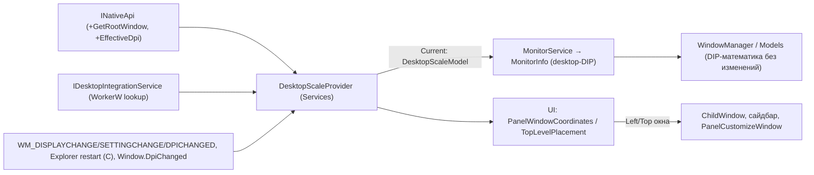

# Под-план F: Per-monitor DPI (PerMonitorV2, двухрежимный) — release hardening 1.0

> Родитель: [release-hardening-1.0.md](release-hardening-1.0.md) §6. Вход: [F0-результаты](release-hardening-1.0-f0-results.md).
> Решение оркестратора: **вариант A** (оба режима в 1.0). Статус: Proposed (2026-09-27). **Волна 4**, после C и E.
> Scope: **XL** → F1–F4. Агенты: win32-interop-specialist (F1), dotnet-services-engineer (F2), wpf-ui-builder (F3), tdd-test-engineer (F4).
> ADR-037 (переименовать: «PerMonitorV2 + двухрежимная шкала desktop-слоя»); amends ADR-001, ADR-004, ADR-022 D-6, ADR-028 (DesktopCoordinateSpace).

---

## 0. Решение одним абзацем

Процесс объявляет **PerMonitorV2** (манифест). Вся px↔DIP-математика геометрии идёт через **один** снимок
`DesktopScaleModel`, который выдаёт `IDesktopScaleProvider`. Снимок знает режим слоя рабочего стола:
**E (Embedded)** — панели дети WorkerW, единый масштаб `GetDpiForWindow(GA_ROOT панели)/96`; **T (TopLevel)** —
панели top-level, масштаб монитора `GetDpiForMonitor(MDT_EFFECTIVE_DPI)/96`. Модель (`ChildWindowModel`,
`MonitorInfo`) живёт в едином **desktop-DIP**; перевод в `Window.Left/Top` конкретного окна — только в адаптере
на границе окна. Persistence не меняется: на односкейловых конфигурациях числа бит-в-бит как в 0.6.1.



## 1. Факты, на которых стоит план (F0)

- Win11 24H2+ (измерено 26200): `GetOrCreateWorkerW()` = 0 → `SetParent` не выполняется → панели **top-level** (режим T).
- Win10 / Win11 ≤ 23H2: панели — дети top-level WorkerW (режим E); DPI ребёнка = DPI корня (документировано, F0 §3).
- E5: cross-process `SetParent` system-aware окна в PMv2-окно Explorer **необратимо** переводит HWND в PMv2, а WPF
  продолжает считать себя system-aware → латентный баг смешанного DPI на Win10/23H2. Манифест PMv2 его снимает.
- Проверено в репозитории: в `src/**` нет ни одного `*.manifest`; в `DesktopOrganizer.UI.csproj` и `Directory.Build.props`
  нет `ApplicationManifest`/`DpiAware*`/`HighDpiMode`; нет `SetProcessDpiAwareness*`/`SetThreadDpi*`/`SetHighDpiMode`
  в коде. Сегодня процесс — `SYSTEM_AWARE` (F0, прогон живого процесса).

## 2. Координатная модель: что такое «DIP» в каждом режиме

Обозначения: `px` — физические экранные пиксели; `s_M` — effective DPI монитора M / 96; `s_ref` — system DPI / 96
(`INativeApi.GetSystemDpiScale()`, ровно то, чем делил 0.6.1); `s_L` — DPI корня панели / 96; `s_w` — текущий DPI окна
(`VisualTreeHelper.GetDpi(window)`).

| Пространство | Режим E | Режим T |
|---|---|---|
| **desktop-DIP** (модель, `MonitorInfo`, persistence) | `px / s_L` (равномерно) | кусочно-линейно по мониторам: `dipOrigin(M) + (px − pxOrigin(M)) / s_M` (якорение ниже) |
| `Window.Left/Top` **панели** (WPF) | `= desktop-DIP` (адаптер — identity; MV-1 не трогаем) | `px / s_w` (WPF: DIP окна считаются по DPI его **текущего** монитора) |
| `Window.Left/Top` **top-level окна** (сайдбар, `PanelCustomizeWindow`, настройки, диалоги) | `px / s_M` | `px / s_M` |
| Размеры (`Width/Height`, `model.Size`) | DIP окна = desktop-DIP | DIP окна = desktop-DIP (оба = `px / s_M` монитора окна) |

**Якорение T-режима (только если масштабы различаются).** Для монитора M с px-прямоугольником `[L,R)×[T,B)` и основного P:
по X — если `R ≤ P.L` (M целиком слева от основного), якорится **правая** грань: `dipR = R / s_ref`, `dipL = dipR − (R−L)/s_M`;
иначе — **левая**: `dipL = L / s_ref`. По Y — аналогично (`B ≤ P.T` → нижняя грань). Грань, обращённая к основному монитору,
сохраняет положение, прямоугольники не перекрываются в типовых раскладках (слева/справа/сверху/снизу).
Если после якорения DIP-прямоугольники мониторов всё же пересекаются (экзотика 3+ мониторов) → снимок деградирует в
**равномерный** режим `px / s_ref` (как 0.6.1) + `Warn DesktopScaleAnchorOverlap`. Правило подтверждается/корректируется F1.0.

**Инвариант неизменности persistence (доказательство).** Если все `s_M` равны `s` (любая односкейловая конфигурация, в т. ч.
один монитор), то `s_ref = s_L = s`, снимок `IsUniform = true` и **обязан** использовать ту же формулу, что 0.6.1:
`r.Left / scale` (fast-path, не `dipOrigin + (px−pxOrigin)/s` — иначе расхождение в последнем ULP). Тогда:
`MonitorInfo` = `px / s` (было `px / GetSystemDpiScale()` = `px / s`); адаптер панели = identity (E) или
`(Left·s_w)/s = Left` при `s_w = s` (T) → `model.Position` = `Window.Left` как сегодня. Округления не меняются
(`OnLocationChanged` сохраняет `(int)`-усечение, `PanelGeometryWriter` — `Math.Round`, как сейчас). ⇒ **никакой миграции,
DTO/схема/ключи не трогаются**; доказывается тестом `PersistedGeometryInvarianceTests` (§7).

**Смешанный DPI — что меняется для существующих установок (честно).**
- E: DIP = `px / s_L`; 0.6.1 делил на `s_ref`. `s_L = s_ref`, пока масштаб основного монитора не меняли без выхода из
  системы → числа те же, визуально панели те же (единый масштаб WorkerW; per-monitor-вида нет — известное ограничение, бывш. Q5).
- T: 0.6.1 (system-aware) получал от Windows виртуализированные координаты. Гипотеза F1.0: виртуализация сохраняет грань/origin
  монитора и масштабирует размер `s_ref/s_M` → совпадает с якорением выше → ноль сдвига. Если F1.0 опровергнет —
  допускается **однократный** сдвиг панелей на мониторе с иным DPI (их удерживает существующий `ClampIntoMonitor`),
  фиксируется в CHANGELOG/README (G1), без правок persistence.
- Смена режима в сессии (E→T, если после рестарта Explorer WorkerW так и не найден) → геометрия переприменяется из модели
  в новом отображении; на односкейловых — без визуального эффекта. `Info DesktopLayerModeChanged`.

## 3. Абстракция (F1)

### 3.1 `Services.Abstractions` (public)
```csharp
public enum DesktopLayerMode { Unknown = 0, Embedded = 1, TopLevel = 2 }

public sealed record MonitorScale(string DeviceName, System.Drawing.Rectangle BoundsPx,
    System.Drawing.Rectangle WorkAreaPx, bool IsPrimary, double Scale);

public sealed class DesktopScaleModel            // неизменяемый снимок, чистый, без P/Invoke
{
    public const double BaseDpi = 96d;           // ЕДИНСТВЕННОЕ место с 96 в арифметике (guard §7)
    public static double ScaleFromDpi(uint dpi, double fallback = 1d);
    public static DesktopScaleModel Create(DesktopLayerMode mode, double layerScale,
        double referenceScale, IReadOnlyList<MonitorScale> monitors);

    public DesktopLayerMode Mode { get; }
    public double LayerScale { get; }            // E: DPI корня панели; T: = ReferenceScale
    public double ReferenceScale { get; }        // system DPI/96
    public bool IsUniform { get; }               // E | все Scale равны | fallback при перекрытии
    public IReadOnlyList<MonitorScale> Monitors { get; }

    public double GetGeometryScale(string deviceName);   // E: LayerScale; T: Scale монитора
    public double GetTopLevelScale(string deviceName);   // всегда Scale монитора (TL-окна)
    public Rect GetBoundsDip(string deviceName);
    public Rect GetWorkAreaDip(string deviceName);

    public Point PxToDip(double x, double y);    // монитор: содержащий точку, иначе ближайший
    public Rect PxToDip(Rect px);                // монитор: max-пересечение, tie → primary
    public Point DipToPx(Point dip);
    public Rect DipToPx(Rect dip);

    public Rect WindowToDesktop(Rect windowBounds, double windowScale);   // E: identity; T: см. §2
    public Point DesktopToWindow(Rect desktopBounds, double windowScale); // E: identity; T: DipToPx(rect).TopLeft / s_w
}

public interface IDesktopScaleProvider
{
    DesktopScaleModel Current { get; }           // кеш; пересобирается только в Refresh/ReportPanelWindow
    DesktopLayerMode Mode { get; }               // = Current.Mode
    event EventHandler<DesktopScaleChangedEventArgs>? Changed;  // (Old, New); UI-поток; только при реальном отличии
    void ReportPanelWindow(IntPtr hwnd);         // вызывается после EmbedInDesktop; «факт» режима
    void Refresh();                              // пересобрать снимок (мониторы, DPI, режим)
}
```
`MonitorInfo` **не меняется** (TL-потребители берут px/scale из `Current`, а не из `MonitorInfo`).

### 3.2 `Services/Tools/DesktopScaleProvider.cs` (internal, singleton, UI-поток)
Детекция режима в `Refresh()`/`ReportPanelWindow()`:
1. Есть живой отчитавшийся HWND панели (`IsWindow` из C): `root = GetRootWindow(hwnd)`; `root != hwnd` → **E**,
   `LayerScale = GetDpiScaleForWindow(root)`; иначе → **T**. Факт важнее прогноза; расхождение с п. 2 → `Warn DesktopLayerModeMismatch`.
2. Панелей ещё нет: `IDesktopIntegrationService.FindDesktopLayerHost()` ≠ 0 → E (`LayerScale` = DPI хоста), иначе T.
3. Любой сбой → остаётся прежний снимок; если его нет — T + `IsUniform` по `s_ref` (эквивалент 0.6.1). Никогда не бросает.

Триггеры `Refresh()`: `MonitorService` WndProc (`WM_DISPLAYCHANGE`, `WM_SETTINGCHANGE`, **новый** `WM_DPICHANGED 0x02E0`) —
**до** `MonitorsChanged`; конец `WindowManager.RecoverDesktopLayer()` (C) — после re-embed всех панелей;
`ChildWindow`/TL-окна `OnDpiChanged`. `MonitorService` подписан на `Changed` и пробрасывает его как `MonitorsChanged`
(потребители `WindowManager`/`SystemIconsPanelManager` не меняют подписки).

### 3.3 `INativeApi` / `NativeApi` (internal, за интерфейсом)
- `IntPtr GetRootWindow(IntPtr hwnd)` — `GetAncestor(hwnd, GA_ROOT = 2)`; 0 при сбое. (`GetAncestor` в `NativeApi` отсутствует — проверено.)
- `NativeMonitorInfo` + `uint EffectiveDpi` (последний параметр, default `0` — не ломает тесты, конструирующие struct);
  заполняется в `GetMonitorInfos()` через `shcore!GetDpiForMonitor(hMon, MDT_EFFECTIVE_DPI = 0, …)`;
  `EntryPointNotFoundException`/`DllNotFoundException`/`HRESULT≠S_OK` → `0` (провайдер подставит `s_ref`).
- `GetSystemDpiScale()`/`GetDpiScaleForWindow()` — `dpi / 96.0` → `DesktopScaleModel.ScaleFromDpi(dpi)`; семантика прежняя.
- `IDesktopIntegrationService.FindDesktopLayerHost()` — публичная обёртка над (уже изменённым в C) поиском WorkerW, без `SetParent`.

### 3.4 Манифест
`src/DesktopOrganizer.UI/app.manifest`: `<dpiAwareness>PerMonitorV2, PerMonitor</dpiAwareness>` (ns 2016) +
`<dpiAware>true/pm</dpiAware>` (ns 2005; fallback: PerMonitor v1 на 1607, system на 8.1-), `asInvoker`, supportedOS Win10.
Без comctl v6 / longPathAware (не расширять scope). `<ApplicationManifest>app.manifest</ApplicationManifest>` — только в
`DesktopOrganizer.UI.csproj`. Откат = удалить манифест и строку csproj (настроек нет). Образец — `tools/dpi-probe/app.manifest`.

## 4. WPF под PMv2 — что обязано учитываться

1. **`Window.Left/Top`** переводятся в px по DPI **текущего** монитора окна. Установка Left на окне, которое окажется на мониторе
   с другим DPI, даёт неверный px до `WM_DPICHANGED`. Правило адаптера: `Left = targetPx / s_w(текущий)`; `Width/Height` —
   DIP-инвариант (не пересчитывать); после `DpiChanged` — **одно** повторное применение позиции (`Dispatcher.BeginInvoke(Background)`,
   т. к. порядок «событие ↔ SetWindowPos(suggested rect)» внутри WPF не гарантирован), пропуск во время жеста/`PanelGeometryWriter.IsApplying`.
2. **`WM_DPICHANGED`** для top-level обрабатывает `HwndSource` (.NET Core 3+ при манифесте PMv2): ререндер + `SetWindowPos` на
   suggested rect, событие `Window.DpiChanged` / `OnDpiChanged`. Для дочерних HWND (режим E) WPF обрабатывает
   `WM_DPICHANGED_AFTERPARENT`. Свой код **не** перехватывает `WM_DPICHANGED` (кроме наблюдательного `NativePanelSizingService`, D-6).
3. **`VisualTreeHelper.GetDpi(window)`** / `CompositionTarget.TransformToDevice` = текущий DPI окна — единственный допустимый
   источник `s_w` в UI; использовать только внутри адаптера.
4. `SystemParameters.WorkArea/PrimaryScreen*` — в system DPI, для геометрии запрещены (сейчас не используются — сохранить).
   `SystemParameters.MinimumHorizontalDragDistance` — DIP, сравнивать с `Δpx / s_w`.
5. Жёсткая `96`-математика и деление на «системный» масштаб в UI/Services — только через `DesktopScaleModel` (guard-тест).
6. Попапы/`ContextMenu` WPF масштабируются по монитору сами; WinForms `NotifyIcon`-меню (Services) — поведение под PMv2 без
   `SetHighDpiMode` не гарантировано → только manual verify.

## 5. Инвентаризация точек px↔DIP (номера строк — на момент плана, после B/C/E сдвинутся)

Класс: **DL** — геометрия desktop-слоя (зависит от режима); **TL** — top-level окно (всегда per-monitor; WPF масштабирует сам,
провайдер нужен только для px-входов); **PX** — только px, конверсии нет; **DIAG** — диагностика.

| # | Место | Класс | Сейчас | После F | Пакет |
|---|---|---|---|---|---|
| 1 | `Services/Tools/MonitorService.cs` `GetMonitors` (~72) | DL | `px / GetSystemDpiScale` | `Current.GetBoundsDip/GetWorkAreaDip` | F2 |
| 2 | `MonitorService.GetWindowRectDip` (~110) | DL | `/ system` | `Current.PxToDip(rect)` | F2 |
| 3 | `MonitorService.FallbackMonitor` (~140) | DL | `/ system` | `/ Current.ReferenceScale` (как было) | F2 |
| 4 | `MonitorService.GetSystemDpiScale` (~107) + `IMonitorService` (~58) | DL | system | F2: `=> provider.Current.ReferenceScale`; F3: **удалить** из интерфейса после миграции #11 | F2/F3 |
| 5 | `MonitorService.WndProcImpl` (~124) | — | DISPLAY/SETTINGCHANGE | + `WM_DPICHANGED`; `provider.Refresh()` до события; проброс `Changed` | F2 |
| 6 | `Services/Tools/NativeApi.cs` `GetSystemDpiScale` (~534), `GetDpiScaleForWindow` (~655) | PX→scale | `dpi / 96.0` | `ScaleFromDpi`; + `EffectiveDpi`, `GetRootWindow` | F1 |
| 7 | `Services/Tools/NativePanelSizingService.cs` `OnDpiChanged` (~462) | DL (per-window) | `dpi / 96.0` | `ScaleFromDpi`; семантика та же, `AFTERPARENT` теперь реально приходит (E) | F2 |
| 8 | `NativePanelSizingService` `OnNcHitTest`/`OnEnterSizeMove` (`GetDpiScaleForWindow`) | DL (per-window) | per-window | без изменений (корректно в обоих режимах) | — |
| 9 | `Services/Tools/DesktopGestureService.cs` (hook-точка, `WindowFromPoint`, `IsListViewPointEmpty`) + `NativeApi.IsListViewPointEmpty` `ScreenToClient` (~430) | PX | px (у system-aware — виртуализация) | без изменений; под PMv2 все px физические → латентный фикс hit-test на смешанном DPI | — |
| 10 | `Services/Tools/DesktopIntegrationService.cs` поиск WorkerW | — | private | `FindDesktopLayerHost()` для провайдера (поверх изменений C) | F2 |
| 11 | `UI/App.xaml.cs` `CreateLassoPanel` (~510) → `UI/Models/LassoPanelGeometry.ToDip` | DL | `px / system` | `ToDip(pxRect, DesktopScaleModel, minSize)` → `PxToDip(rect)` (монитор max-пересечения лассо), затем minSize | F3 |
| 12 | `UI/App.xaml.cs` `GetPrimaryDpiScale` (~94, `g.DpiX / 96.0`) | DIAG | GDI DpiX | поля из `Current` (mode, ReferenceScale, LayerScale, per-monitor Scale); `System.Drawing.Graphics` убрать | F3 |
| 13 | `UI/Behaviors/PanelGeometryWriter.Write` (~108-121) | DL | `Left = bounds.X` | `Left/Top = Current.DesktopToWindow(bounds, s_w)`; модель — desktop-DIP (как сейчас, `Math.Round`) | F3 |
| 14 | `UI/Views/ChildWindow.xaml.cs` `Initialize` (~339), `OnLocationChanged` (~475), `OnSourceInitialized` (~394) | DL | Left ↔ модель напрямую | чтение/запись через адаптер (`(int)`-усечение в `OnLocationChanged` сохранить); `ReportPanelWindow(hwnd)` после `EmbedInDesktop`; новый `OnDpiChanged` → `Refresh` + однократное переприменение позиции | F3 |
| 15 | `UI/Views/ChildWindow.WorkspaceGrid.cs` `GetExpandedBoundsWindowSpace` (~48) | DL | `(Left, Top)` | `Current.WindowToDesktop(...)` | F3 |
| 16 | `UI/Services/WindowManager.cs` `CollectOtherPanelBounds` (~164), `NormalizePanelsToGrid` (~396), `OnMonitorsChanged` (~997 чтение, ~1025 запись), `RecoverDesktopLayer` (C) | DL | `window.Left/Top` | через адаптер. Математика `ClampIntoMonitor`/`NormalizeLegacyFreeformToGridSize`/`PlaceNewPanelOnFreeSlot`/`ResolveMonitorPlacement`/`AlignPanelsToWorkspaceGrid` — **без изменений** (desktop-DIP на входе и выходе) | F3 |
| 17 | `UI/Behaviors/PanelDragMoveBehavior.cs` старт (~243-245), дельта (~273-276), записи (~362, ~411, ~527-533) | DL | `ΔLeft = Δpx / s_w` | px-якорный расчёт: `startPx` + `Δpx` → `Current.PxToDip` → существующий snap/clamp в desktop-DIP → запись через адаптер; порог — `Δpx / s_w`. Чистый хелпер `DragPositionCalculator` | F3 |
| 18 | `UI/Behaviors/PanelResizeController.cs` (~255, ~504; чтения Left/Top) | DL | Left/Top | через адаптер | F3 |
| 19 | `UI/Behaviors/NativePanelResizeController.cs` `GetBoundsDelegate`/`SetBoundsDelegate` (~586-606), `ToDip` (~339, ~343, ~440), `ToPx` (~515) | DL | `px / _dpiScale` | делегаты — через адаптер; в T добавить per-monitor DIP-смещение, захваченное в `SizeMoveEntered` (`Current`, монитор окна) | F3 |
| 20 | `UI/Interaction/Native/NativeSizingCoordinateMapper`, `NativeHitTestMapper` | DL (относит.) | scale окна | без изменений (относительно window rect) | — |
| 21 | `UI/Services/SystemIconsPanelManager.PositionWindow` (~732-740) | TL | `WorkArea` DIP основного | `WorkAreaPx` основного из `Current`: `Left/Top = px / s_w`, `Height = pxH / s_primary`; переприменение на `DpiChanged` | F3 |
| 22 | `UI/Views/SystemIconsPanelWindow.xaml.cs` контекстное меню (~126-132, `TransformToDevice`) | TL/PX | `(Left+x)·dpi` | `PointToScreen(e.GetPosition(this))` | F3 |
| 23 | `UI/Views/PanelCustomizeWindow.PositionForPanel` (~68-79) | TL | DIP-work area | монитор по desktop-DIP панели → `WorkAreaPx`, `px / s_M`; однократное переприменение после первого `DpiChanged` | F3 |
| 24 | `UI/Models/DesktopCoordinateSpace.cs` + его потребители (`PanelDragPipeline`, `PanelGridState`, `ChildWindow.Sizing`, `WindowManager.NormalizeGridAlignedToGridSize`, `PanelCustomizeWindow`) | DL (модель) | identity | остаётся identity; «window space» в моделях переопределяется как desktop-DIP (док-комментарии); `CalibrateOnce` не подключается (MV-1 для E остаётся открытым, вне F) | F3 (docs) |
| 25 | `UI/Models/{WorkspaceGridPlacement,PanelGridState,GridSizeNormalizer,PanelSizePresetCalculator,WorkspaceLayoutPolicy,PanelDragPipeline}`, `Views/ChildWindow.{Sizing,ContentSizing}`, `Behaviors/PanelSizingGridSupport`, `Interaction/ResizeGeometryCalculator` | DIP | DIP | без изменений (проверено: px/DPI нет) | — |
| 26 | `MainWindow` (настройки), `InputDialog` (`CenterScreen`), `MessageBox` (A) | TL | WPF/OS | без изменений; manual verify | — |
| 27 | Трей `NotifyIcon`/`ContextMenuStrip` (Services, WinForms) | TL | WinForms | без изменений; manual verify | — |
| 28 | `Services/Tools/IconFactory.cs` (`RenderTargetBitmap` 96 DPI) | — | — | вне scope (качество иконок); литерал не арифметический — guard не срабатывает | — |
| 29 | `UI/Diagnostics/IGestureDiagnostics.cs:106` | DIAG | px | без изменений | — |

Адаптер (F3, новый): `UI/Interaction/PanelWindowCoordinates.cs` (internal static): `ReadDesktopBounds(Window, DesktopScaleModel)`,
`WriteDesktopPosition(Window, Rect, DesktopScaleModel)`; `UI/Interaction/TopLevelPlacement.cs`: `Apply(Window, Rect px, DesktopScaleModel)`.
WPF-клей тонкий; вся математика — в `DesktopScaleModel` (тестируема без WPF).

## 6. Под-пакеты

### F1 — манифест + абстракция + INativeApi. Агент: **win32-interop-specialist**
- **F1.0 (до кода, `tools/dpi-probe/` только):** эксперимент E6 — SYSTEM_AWARE-окно (thread context) на каждом мониторе:
  `GetWindowRect`/`GetMonitorInfo` глазами system-aware потока vs PMv2 → фактическое отображение 0.6.1 в режиме T. Итог — в
  `release-hardening-1.0-f0-results.md` (новый раздел). Нет машины с 2 мониторами → якорение §2 по умолчанию + пункт manual verify.
  - **Статус E6 (2026-09-27, F1): PENDING.** Машина F1 — Win11 26200, **один** монитор 1920x1080 @ 100 %: у SYSTEM_AWARE-потока
    при system DPI 96 виртуализация — тождество, эксперимент ничего не различает. Код E6 в `tools/dpi-probe` не добавлялся.
    Действует QF-1 (якорение «грань к основному», `s_ref` = system DPI), реализованное в `DesktopScaleModel`. Закрывается
    manual verify §10 #3/#4/#10 на машине с 100 % + 150 % (Win11 24H2): сравнить позиции панелей 0.6.1 и F на мониторе 150 %.
- Артефакты: `UI/app.manifest`, `UI/DesktopOrganizer.UI.csproj`; `Services.Abstractions/{DesktopLayerMode,MonitorScale,DesktopScaleModel,DesktopScaleChangedEventArgs}.cs`,
  `Services.Abstractions/Interfaces/IDesktopScaleProvider.cs`; `Services/Tools/DesktopScaleProvider.cs`; `Services/Interfaces/INativeApi.cs` + `Tools/NativeApi.cs`;
  `Services/Configuration/DiConfig.cs` (одна строка после `AddSingleton<IMonitorService, MonitorService>()`).
- Тесты: `DesktopScaleModelTests`, `DesktopScaleProviderTests` (Moq), `AppManifestContractTests` (§7).
- **DoD F1:** (1) манифест в выходном exe (контракт-тест читает csproj + manifest); (2) `DesktopScaleModel` — все формулы §2,
  fast-path `IsUniform` бит-в-бит `px / s`; (3) провайдер определяет E/T по правилам §3.2, `Changed` только при отличии, не бросает;
  (4) `INativeApi` расширен без P/Invoke вне `NativeApi`; (5) 0 warnings. **Не релизуемо отдельно** — F1–F3 сливаются одной волной.

### F2 — Services. Агент: **dotnet-services-engineer** (консультативно win32-interop-specialist по WndProc)
- Артефакты: `Services/Tools/MonitorService.cs` (#1–#5), `Services/Tools/NativePanelSizingService.cs` (#7),
  `Services.Abstractions/Interfaces/IDesktopIntegrationService.cs` + `Services/Tools/DesktopIntegrationService.cs` (#10),
  конструктор `MonitorService(INativeApi, IDesktopScaleProvider)`.
- Тесты: обновить `Unit/Services/MonitorServiceNativeApiTests.cs` (24 обращения к `GetSystemDpiScale`) под провайдер;
  `MonitorServiceScaleTests` — E/T/uniform, `WM_DPICHANGED` → `Refresh` → `MonitorsChanged` ровно один раз, `Changed` проброшен.
- **DoD F2:** (1) `MonitorService` не делит на масштаб сам — только через `Current`; (2) golden-тест: для односкейловых снимков
  `GetMonitors()` бит-в-бит равен формуле 0.6.1; (3) смена режима/DPI → одно `MonitorsChanged`; (4) 0 warnings.

### F3 — UI. Агент: **wpf-ui-builder**
- Артефакты: `UI/Interaction/{PanelWindowCoordinates,TopLevelPlacement,DragPositionCalculator}.cs` (новые);
  `UI/App.xaml.cs` (#11, #12), `UI/Models/LassoPanelGeometry.cs`, `UI/Behaviors/{PanelGeometryWriter,PanelDragMoveBehavior,PanelResizeController,NativePanelResizeController}.cs`,
  `UI/Views/ChildWindow.xaml.cs`, `UI/Views/ChildWindow.WorkspaceGrid.cs`, `UI/Services/{WindowManager,SystemIconsPanelManager}.cs`,
  `UI/Views/{SystemIconsPanelWindow,PanelCustomizeWindow}.xaml.cs`, `UI/Models/DesktopCoordinateSpace.cs` (только docs),
  `UI/Configuration/DiConfig.cs` (провайдер в фабрику `SystemIconsPanelManager`); удаление `IMonitorService.GetSystemDpiScale` (#4).
- **DoD F3:** (1) ни одного прямого `window.Left/Top =`/чтения `Left/Top` панели вне адаптера (grep-проверка в ревью; список
  разрешённых — файлы адаптера); (2) TL-окна позиционируются от px + `s_M`; (3) `DpiChanged` → однократное переприменение, без
  петли и без вмешательства в активный жест; (4) лассо на каждом мониторе создаёт панель под курсором (manual); (5) 0 warnings.

### F4 — тесты и guard. Агент: **tdd-test-engineer** (далее конвейер: debug-healer при красном → code-quality-reviewer ∥ fences-ux-parity-reviewer → architecture-documenter: ADR-037)
- Артефакты: тесты §7; прогон manual verify §10 (результаты — в этот документ).
- **DoD F4 = DoD пакета F:** (1) процесс `Per-monitor (v2)` в Диспетчере задач (Win10 22H2 и Win11 24H2); (2) односкейловые
  100/125/150% — поведение и файл состояния идентичны 0.6.1 (сравнение `application-state.json` до/после первого запуска);
  (3) смешанный DPI в режиме T: панели на своём мониторе, в work area, per-monitor-чёткие; в режиме E — на своём мониторе, единый
  масштаб (ограничение задокументировано); (4) лассо/drag/resize на каждом мониторе; (5) смена масштаба на лету — панели не уезжают;
  (6) guard-тест зелёный; (7) `git diff --name-only` без замороженных файлов (§8); (8) 0 errors, 0 warnings.

## 7. Тесты

| Тест | Что проверяет |
|---|---|
| `DesktopScaleModelTests` | fast-path uniform `[Theory]` s ∈ {1, 1.25, 1.5, 1.75, 2} × {E, T} × {1 монитор, 2 справа, 2 слева с отрицательными px}: `PxToDip == px / s` **точно** (`Assert.Equal`, без допуска); T 100%+150% справа/слева/сверху: грани, обращённые к основному, сохраняются, DIP-прямоугольники не пересекаются; перекрытие → `IsUniform` fallback; `PxToDip∘DipToPx` ±0.5; точка вне мониторов → ближайший; rect на стыке → max-пересечение, tie → primary; `WindowToDesktop`/`DesktopToWindow`: E identity, T per-monitor; `ScaleFromDpi(0)` → fallback |
| `DesktopScaleProviderTests` (Moq `INativeApi`, `IDesktopIntegrationService`) | хост найден + `GetRootWindow(h) != h` → E, `LayerScale = DPI(root)`; хоста нет / `root == h` → T; факт vs прогноз → факт + Warn; `EffectiveDpi = 0` → `s_ref`; исключение native → прежний снимок; `Changed` только при отличии; смена режима после «рестарта Explorer» |
| `MonitorServiceScaleTests` + обновлённый `MonitorServiceNativeApiTests` | golden 0.6.1 для uniform; `WM_DPICHANGED` в фильтре; одно `MonitorsChanged` на событие |
| `WindowManagerPlacementScaleTests` | `[Theory]` по наборам масштабов {1.0}, {1.5}, {1.0+1.5 справа}, {1.5+1.0 слева}, {1.25+1.75 сверху}: `MonitorInfo` из `DesktopScaleModel` → `ClampIntoMonitor`, `NormalizeLegacyFreeformToGridSize`, `ResolveMonitorPlacement`-логика, `PlaceNewPanelOnFreeSlot`-логика: панель остаётся на своём мониторе, внутри work area, `FindMonitorAt` однозначен |
| `PersistedGeometryInvarianceTests` | фикстура состояния (набор панелей: freeform/grid-aligned/rolled-up, отрицательные координаты) через чистые пути placement + адаптер при uniform s ∈ {1, 1.25, 1.5, 2}, E и T → `Position/Size/MonitorDeviceId/Span` не меняются |
| `LassoPanelGeometryTests` (обновить) | px→DIP через модель в E/T; лассо на вторичном 150% мониторе; лассо через стык — монитор центра/max-пересечения; minSize после конверсии |
| `PanelWindowCoordinatesTests`, `DragPositionCalculatorTests` | чистые части адаптера и px-якорного drag: переход через стык мониторов 100/150 не даёт скачка > 1 DIP в desktop-DIP; порог drag в DIP окна |
| `AppManifestContractTests` | `app.manifest` содержит `PerMonitorV2, PerMonitor` и `true/pm`, `asInvoker`; `ApplicationManifest` только в UI csproj |
| **`DpiLiteralGuardTests`** | скан `src/**/*.cs` (без `obj/`, `bin/`), комментарии (`//`, `///`) вырезаются: regex `[*/]\s*96(\.0)?[dD]?\b|\b96(\.0)?[dD]?\s*[*/]` → 0 совпадений вне allowlist `{Services.Abstractions/DesktopScaleModel.cs}`; `VisualTreeHelper.GetDpi`/`TransformToDevice` → только в `UI/Interaction/{PanelWindowCoordinates,TopLevelPlacement}.cs`; символ `GetSystemDpiScale` — только в `INativeApi`/`NativeApi`/`DesktopScaleProvider`. Сегодня guard ловит 4 места (#6 ×2, #7, #12) — все устраняются в F1–F3 |

Тесты, требующие рабочего стола (реальный `NativeApi`), — `[Trait("Category","RequiresDesktop")]` (конвенция G1).

## 8. Persistence (ЗАМОРОЖЕНО) — гейт

F **не трогает**: `StateEnvelope`/schemaVersion 5, `Storage/Migrations/*`, `JsonApplicationStateStore`, DTO/`PanelStateMapper`,
`ApplicationStateService`, `IAppSettings`/`AppSettings`/`Settings.*`/`user.config`, `LayoutSnapshotService`, пути `%LOCALAPPDATA%`.
Геометрия хранится в DIP, как сейчас; смысл «DIP» по режимам — §2; неизменность на односкейловых — доказательство §2 + тест
`PersistedGeometryInvarianceTests`. Режим и масштабы — **только память процесса** (никаких новых полей/настроек).
Если реализация «требует» сохранить режим/масштаб → СТОП, `CLARIFICATION_NEEDED` оркестратору.
Гейт перед закрытием: `git diff --name-only` не содержит перечисленных файлов.

## 9. Пересечения файлов и волна

- **C (волна 3):** `DesktopIntegrationService`, `WindowManager` (`RecoverDesktopLayer`), `INativeApi/NativeApi` (`IsWindow`,
  `RegisterWindowMessage`), `SystemIconsPanelManager`, `App.xaml.cs`, `ChildWindow.xaml.cs`. F опирается на `IsWindow` и на
  финальный поиск WorkerW из C, вызывает `provider.Refresh()` в конце `RecoverDesktopLayer`.
- **E (волна 3):** `ChildWindow.xaml.cs` (drag/drop-область), UI `DiConfig`. F правит `Initialize`/`OnLocationChanged`/
  `OnSourceInitialized`/новый `OnDpiChanged`.
- ⇒ F стартует **только после** закрытия конвейера C и E (перечитать файлы перед правкой).
- **G2 (та же волна 4) — пересечение, которого нет в таблице §0.5 мастер-плана:** `Services/Configuration/DiConfig.cs` (F1) и
  `UI/Configuration/DiConfig.cs` (F3). Порядок: G2 первым правит оба `DiConfig`, затем F1/F3 (однострочные якорные вставки:
  после `AddSingleton<IMonitorService, MonitorService>()` и внутри фабрики `SystemIconsPanelManager`), либо строго
  последовательно. Остальные файлы F и G2 не пересекаются.
- Внутри F: F1 → (F2 ∥ F3) → F4. F2 и F3 не делят файлов (`IMonitorService.GetSystemDpiScale` удаляется в F3, в F2 он временно
  делегирует в провайдер — без `[Obsolete]`, чтобы не порождать warnings).

## 10. Manual verify (Win10/Win11)

Строки — конфигурации, столбцы — проверки: **P** процесс PMv2 (Диспетчер задач); **L** панели на своих местах после запуска
(сравнить с 0.6.1, файл состояния не изменён без действий пользователя); **D** drag панели между мониторами/по монитору;
**R** resize (native и thumb); **S** лассо; **U** roll-up; **T** сайдбар + `PanelCustomizeWindow` + настройки + трей-меню чёткие и
на нужном мониторе; **X** рестарт Explorer (повтор чек-листа C); **M** смена масштаба на лету; **O** отключение монитора.
Для каждого запуска — `tools/dpi-probe --hold 30` в лог + режим из диагностики (#12).

| # | Конфигурация | ОС / ожидаемый режим | Проверки | Ожидание |
|---|---|---|---|---|
| 1 | 1 монитор 100% | Win11 24H2 / T | P L D R S U T X | идентично 0.6.1 (файл состояния байт-в-байт после запуска без действий) |
| 2 | 1 монитор 150% | Win11 24H2 / T; Win10 22H2 / E | P L D R S U T X | идентично 0.6.1 |
| 3 | 100% (осн.) + 150% справа | Win11 24H2 / T | все | T: на 150% панели крупнее и чёткие, позиции по F1.0; лассо под курсором на обоих |
| 4 | 150% (осн.) + 100% слева (отриц. px) | Win11 24H2 / T | все | нет перекрытий DIP (якорение правой грани), clamp корректен |
| 5 | 100% + 150% справа и слева | **Win10 22H2** / E | все | единый масштаб WorkerW (панели на 150% «мелкие» — ограничение), позиции/клампинг верные, E5-расхождения нет (панели чёткие на основном) |
| 6 | 100% + 150% | Win11 23H2 / E (если доступна) | P L D S X | как #5 |
| 7 | Смена масштаба основного 100→150→100 без выхода | Win10 22H2 / E; Win11 24H2 / T | M L D S | E: `WM_DPICHANGED_AFTERPARENT` → панели ререндер без сдвига; T: `WM_DPICHANGED` → одно переприменение, без «прыжков»; `MonitorsChanged` один раз |
| 8 | Смена масштаба вторичного монитора на лету | Win11 24H2 / T | M L | панели на нём переразмерились, остались в work area |
| 9 | Отключение/подключение 150% монитора | оба | O L | панели переезжают на основной (как 0.6.1), без скачков размера |
| 10 | Upgrade 0.6.1 → F со смешанным DPI (реальный профиль пользователя) | оба | L | E: без сдвига; T: без сдвига, если F1.0 подтвердил гипотезу, иначе однократный сдвиг в пределах монитора |

## 11. Риски

| Риск | Митигация |
|---|---|
| WPF: `Left` по DPI текущего монитора → транзиентная позиция при переезде | правило адаптера §4.1 + однократное переприменение после `DpiChanged`; тест `DragPositionCalculatorTests`; manual #3/#4 |
| Петля «переприменение → DpiChanged → переприменение» на стыке мониторов | максимум 1 переприменение на событие, пропуск при активном жесте/`IsApplying`; `Warn` при повторе |
| Гипотеза виртуализации 0.6.1 (T) неверна → сдвиг у пользователей со смешанным DPI | F1.0 до реализации; clamp удерживает на мониторе; запись в CHANGELOG/README (G1) |
| Смена режима E↔T в сессии (WorkerW не найден после рестарта Explorer) | модель — источник правды, переприменение из модели; лог `DesktopLayerModeChanged` |
| Экзотические раскладки 3+ мониторов → перекрытие якорей | fallback `IsUniform` (поведение 0.6.1 по геометрии) + Warn |
| Регрессии C под PMv2 (re-embed, DPI корня после рестарта Explorer) | `Refresh()` в конце `RecoverDesktopLayer`; manual X во всех строках |
| WinForms-меню трея под PMv2 без `SetHighDpiMode` | manual T; при дефекте — отдельная задача (не расширять F) |
| Иконки 96-DPI bitmap мягкие на 150% | вне scope (#28), как и в 0.6.1 |
| Правки широкие (≈20 файлов UI) → конфликты | волна 4 после C/E; порядок с G2 §9; перечитывать файлы |

## 12. Решения по умолчанию (без эскалации)

- QF-1: якорение T — «грань к основному», `s_ref` = system DPI; F1.0 может заменить на измеренное правило 0.6.1.
- QF-2: однократный сдвиг панелей на мониторе с иным DPI в режиме T допустим, если F1.0 его покажет (без миграции; clamp).
- QF-3: бывш. Q5 мастер-плана — в режиме E (Win10/≤23H2) панели на мониторе с иным DPI визуально не per-monitor — принято
  как известное ограничение 1.0 (README/CHANGELOG, G1). Вариант B (встраивание на 24H2) и D (top-level везде) — вне 1.0.
