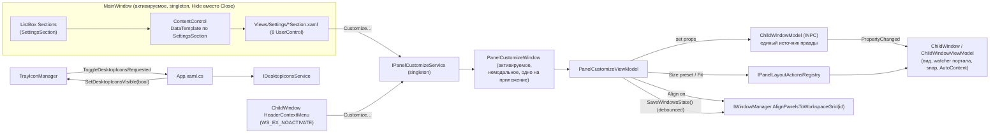

# План реализации — переустройство окна настроек (вариант B) + диалог «Customize panel»

> **Статус:** готов к исполнению. Реализующие пакеты WP-A / WP-B / WP-C **уже запущены параллельно** от базы
> `3628cc4` (ветка `feature/settings-window-redesign`). План служит эталоном для слияния, для
> `tdd-test-engineer` и для ревьюеров. Это не повод переигрывать решения.
>
> **Источник правды:** `docs/prompts/settings-window-redesign.md` (бриф). Решения **D-1…D-10 зафиксированы
> пользователем** и здесь не пересматриваются. Этот план детализирует только «как».
> Смежные документы: `adr/ADR-002-main-window-as-settings.md`, `adr/ADR-026-edit-layout-mode.md` (D-9, точки
> переключения), `adr/ADR-028-workspace-grid.md`, `adr/ADR-029-icon-layout-policy.md` (дефолты и «Apply to all»),
> `adr/ADR-024-versioned-json-persistence.md` + раздел `CLAUDE.md` «Настройки и persistence — ЗАМОРОЖЕНЫ».
> ADR-031 создаёт `architecture-documenter` после слияния.
>
> **Scope: L.** Затрагивается в основном UI: `Views`, `ViewModels`, `Services`, `Resources`, `Converters`, `Models`.
> Кроме того, одна аддитивная правка в `DesktopOrganizer.Services` (`TrayIconManager`) и одна в
> `Services.Abstractions` (`ITrayIconManager`). Нативного кода, P/Invoke и persistence нет, поэтому оценка не XL.
>
> **Главные находки планирования** (в брифе не отражены, влияют на слияние):
> 1. **`App.xaml` не содержит списка слияния словарей.** Словари сливаются в коде: `App.LoadResourceDictionaries()`
>    в `App.xaml.cs`, файл WP-C. Поэтому подключение `Settings.xaml`, отданное в брифе WP-A как «`App.xaml` (merge)»,
>    фактически попадает в файл WP-C. Это второй ожидаемый конфликт слияния, помимо `DiConfig.cs` (§6.3, R-4).
> 2. **`ChildWindowModel.SourceFolderPath` — auto-property без `PropertyChanged`.** Решение D-4 («диалог меняет только
>    модель, VM реагирует») невыполнимо без перевода свойства на `SetField`. Файл `Models/ChildWindowModel.cs` не
>    принадлежит ни одному пакету, поэтому ownership расширяется на **WP-B** (§3.2, R-9). Это не persistence-правка:
>    DTO, mapper и схема не меняются.
> 3. **«Size preset» и «Fit to content» — не мутации модели.** Это геометрия живого окна: `ChildWindow.Sizing.cs` и
>    `ChildWindow.ContentSizing.cs` работают с `Left/Top/ActualWidth` и соседями. Диалогу нужен узкий шов
>    `IPanelLayoutActions` (§3.2, P-B3). «Align to workspace grid» и «Auto-size» шва не требуют: для них уже есть
>    `IWindowManager.AlignPanelsToWorkspaceGrid(Guid?)`, `WorkspaceGridPlacement.ClearAlignment(model)` и
>    `Model.SizingMode`.
> 4. **`GridSize`, `GridSnapDistance` и `SnapResizeToIconGrid` действуют только на `LegacyFreeform`-панели.**
>    GridAligned-панели всегда садятся на workspace grid (`PanelDragMoveBehavior.SnapToGrid`, ADR-028). Описания карточек
>    обязаны это сказать. Старый тултип «0 disables the live magnet; snapping still applies on drop» **неверен**:
>    drop-snap использует тот же порог (`GridSnap.SnapAxis`, `threshold`), поэтому при 0 снапа нет и при drop.
> 5. **Баг лассо (D-7) серьёзнее описания.** Лассо-панель получает `PageId = "default"` при `IsVisible = true`.
>    `WindowManager.CreateChildWindow` показывает окно, только если `PageId == CurrentPage`. Поэтому на любой
>    странице, кроме default, нарисованная панель **сразу исчезает** и «переезжает» на default.

---

## 0. Границы — scope / non-scope

### 0.1 В объёме

- Каркас окна настроек: боковая навигация из 8 разделов, `SettingsSection` (enum), карточки `Settings.xaml` (WP-A).
- Немодальный singleton-диалог `PanelCustomizeWindow`, который открывается из контекстного меню панели и из раздела
  Panels. Правка вживую через `ChildWindowModel` (WP-B).
- Folder Portal в UI: Browse… / Clear. Портал становится реакцией VM на `Model.SourceFolderPath` (WP-B).
- Пункт трея «Show desktop icons» (checkable, синхронизирован), именованный снапшот, подтверждение удаления
  снапшота, фикс `PageId` лассо (WP-C).
- «Move to page», «Take from selected panel», «Reset one-time hints», раздел About. Это новые UI-входы в
  **существующие** данные.

### 0.2 Вне объёма (явно)

| Не делаем | Почему / куда |
|---|---|
| Любые изменения схемы и настроек: `schemaVersion` (=5), миграции, DTO, `PanelStateMapper`, новые, переименованные или удалённые ключи `IAppSettings`/`user.config`, смена их дефолтов, смена семантики загрузки и сохранения | D-1, `CLAUDE.md` (инцидент 2026-09-24). Всё, чему «нужно поле», — §8 `CLARIFICATION_NEEDED`. Запись **существующих** ключей существующими путями (`IAppSettings.X = v; Save()`) разрешена: так было и раньше. |
| Сохранение последнего открытого раздела окна между запусками | D-1: только память singleton `MainWindowViewModel`. |
| Переименование и переупорядочивание страниц | Волна 2 (бриф, раздел Pages). |
| Export/Import снапшотов | Бэклог **DO-012**. В UI не показывать даже disabled. |
| Кнопка «Set as default» внутри диалога | Отброшена в пользу «Take from selected panel» в разделе New panel defaults (бриф). |
| «Apply to all panels…» и «Align all» в диалоге | D-5: остаются в CM панели и в разделе Panels (Align all — текущая страница, с подтверждением). |
| Сторонние NavigationView/ToggleSwitch-библиотеки | D-2 / D-9. |
| Локализация | D-8: только английский. |
| Нативный код, `INativeApi`, `SetForegroundWindow`/`AttachThreadInput` | Инвариант `CLAUDE.md`. Фокус диалога — только средствами WPF (R-1). |
| Удаление мёртвых стилей `Settings.PageTabButtonStyle`/`Settings.PageTabCloseButtonStyle` (`Controls.xaml`) | Файл ничей. Пост-мерж cleanup (§6.4). |
| Событие изменения видимости иконок в `IDesktopIconsService` | Не в пакетах. Известное ограничение R-13. |

### 0.3 Фиксированные контракты D-10 (не переименовывать — от них зависит сборка после слияния)

| Контракт | Владелец реализации | Потребитель |
|---|---|---|
| `IPanelCustomizeService.Show(ChildWindowModel model)` (`UI/Services/IPanelCustomizeService.cs`, есть; заглушка `PanelCustomizeService` есть) | WP-B (заменяет заглушку) | WP-A (`CustomizePanelCommand`), WP-B (CM панели) |
| `MainWindowViewModel.CustomizePanelCommand` (параметр `ChildWindowModel?`, по умолчанию `SelectedPanel`) | WP-A | XAML раздела Panels |
| `MainWindowViewModel.MovePanelToPageCommand` (параметр `string pageId`) → `IWindowManager.MovePanelToPage(ChildWindowModel, string)` | WP-A | XAML раздела Panels |
| `enum SettingsSection { General, LayoutSnapping, Panels, NewPanelDefaults, Pages, SystemIcons, Backup, About }` (`UI/Models/SettingsSection.cs`) | WP-A | WP-A |
| `ITrayIconManager.ToggleDesktopIconsRequested` (event) + `ITrayIconManager.SetDesktopIconsVisible(bool)` | WP-C | `App.xaml.cs` (WP-C) |
| `IInputDialogService.PromptText(string title, string prompt, string defaultValue) : string?` | WP-C | `LayoutSnapshotsViewModel` (WP-C) |

Примечание к именованию: остальные события `ITrayIconManager` названы `On…Requested`. `ToggleDesktopIconsRequested`
зафиксирован D-10 и **не** переименовывается. Расхождение фиксирует `architecture-documenter` в ADR-031 как
осознанное.

---

## 1. Общая архитектура



Сквозные правила (действуют во всех пакетах):
- **Один источник правды — `ChildWindowModel`.** Диалог не хранит копий значений. Каждый геттер читает модель,
  каждый сеттер пишет в модель и вызывает `IWindowManager.SaveWindowsState()`: debounce, прежняя семантика
  `SelectedPanelSettingsViewModel.Apply`.
- **Gating ADR-026.** Явные layout-команды (Align, Size preset, Fit, Auto-size, Icon layout) блокируются
  `IsLayoutLocked` и **не** блокируются `NormalModeLayoutGestures`. Правило то же, что в CM. Отключённый контрол
  объясняет причину **текстом описания** (бриф п.4), а не тултипом.
- **Карточка** = заголовок + описание + контрол справа. Вся пользовательская копия фиксируется в §2–§4. Реализатор
  может править пунктуацию, но не смысл.
- **Никаких мёртвых публичных членов**: свойства, потерявшие биндинг, удаляются вместе со своими тестами (§2.3).

---

## 2. WP-A — Settings shell (`wpf-ui-builder`)

### 2.1 Файлы

**Создать**

| Файл | Содержание |
|---|---|
| `src/DesktopOrganizer.UI/Models/SettingsSection.cs` | `enum SettingsSection` (порядок D-10) + `static class SettingsSectionInfo { string DisplayName(SettingsSection); string Glyph(SettingsSection); }`. Имена: `General` → "General", `LayoutSnapping` → "Layout & snapping", `Panels` → "Panels", `NewPanelDefaults` → "New panel defaults", `Pages` → "Pages", `SystemIcons` → "System icons", `Backup` → "Backup", `About` → "About". Глифы Segoe MDL2 необязательны; если используются, берутся из `Icons.xaml`-токенов. |
| `src/DesktopOrganizer.UI/Converters/SettingsSectionNameConverter.cs` | `SettingsSection` → `SettingsSectionInfo.DisplayName`. `EnumDisplayNameConverter` не расширять: файл ничей. |
| `src/DesktopOrganizer.UI/Converters/PanelSubtitleConverter.cs` | `IMultiValueConverter` (`ViewMode`, `SourceFolderPath`, `FilePaths.Count`) → `"Grid view · 12 items"`, `"List view · 1 item"`, `"Grid view · Folder Portal"`. Не бросает; при некорректном входе возвращает `string.Empty`. |
| `src/DesktopOrganizer.UI/Controls/SettingsCard.cs` | Лёгкий `ContentControl`: DP `Header` (string), `Description` (string), `DisabledReason` (string, показывается вместо/после описания при `IsEnabled=false`). `AutomationProperties.Name` = Header, `HelpText` = Description. Шаблон — в `Settings.xaml`. |
| `src/DesktopOrganizer.UI/Resources/Styles/Settings.xaml` | Контракт ключей (§2.4). Использует только существующие `Brush.Settings.*`, `Brush.Border.*`, Typography-токены. Новых hex-литералов нет. |
| `src/DesktopOrganizer.UI/Views/Settings/GeneralSection.xaml(.cs)` … `AboutSection.xaml(.cs)` | 8 `UserControl`: `GeneralSection`, `LayoutSnappingSection`, `PanelsSection`, `NewPanelDefaultsSection`, `PagesSection`, `SystemIconsSection`, `BackupSection`, `AboutSection`. Code-behind пустой (только `InitializeComponent`). `DataContext` наследуется от `MainWindow` (= `MainWindowViewModel`). |
| `src/DesktopOrganizer.UI/ViewModels/AboutSettingsViewModel.cs` | `Version` (string), `DataFolderPath` (= `AppStorageRoot.Default`), `LogsFolderPath` (= `Path.Combine(DataFolderPath, "Logs")`, та же формула, что `DiConfig.DefaultDiagnosticsLogDirectory`), `OpenDataFolderCommand`/`OpenLogsFolderCommand` → `IFileLauncher.Open(path)`, `CanExecute` = `Directory.Exists`. Создаётся внутри `MainWindowViewModel`, как `SystemIconsSettings`. |
| `tests/.../Unit/ViewModels/AboutSettingsViewModelTests.cs`, `tests/.../Unit/Converters/PanelSubtitleConverterTests.cs`, `tests/.../Unit/Converters/SettingsSectionNameConverterTests.cs` | §2.6 |

**Изменить**

| Файл | Что |
|---|---|
| `src/DesktopOrganizer.UI/Views/MainWindow.xaml` | Полная замена содержимого (§2.2). `Height="560" Width="720"`, `MinWidth` не нужен (`ResizeMode="CanMinimize"` сохраняется). Полоска вкладок страниц удаляется. |
| `src/DesktopOrganizer.UI/Views/MainWindow.xaml.cs` | `Ctrl+E` и `Ctrl+PgUp/PgDn` **сохраняются**. Новых обработчиков не требуется. |
| `src/DesktopOrganizer.UI/ViewModels/MainWindowViewModel.cs` | §2.3 |
| `src/DesktopOrganizer.UI/ViewModels/GlobalDefaultsViewModel.cs` | §2.3 |
| `src/DesktopOrganizer.UI/Services/IWindowManager.cs` + `WindowManager.cs` | `void MovePanelToPage(ChildWindowModel model, string pageId)` (§2.5). |
| Подключение `Settings.xaml` | **Не `App.xaml`** (там нет списка — находка 1). Нужна одна строка в `App.LoadResourceDictionaries()` после `Controls.xaml` и до `Panels.xaml`: `merged.Add(LoadResourceDictionary("/Resources/Styles/Settings.xaml"));`. Файл принадлежит WP-C. WP-A **может** внести строку сам и принять конфликт слияния, либо оставить её оркестратору (§6.3). Подключать **локально** в `MainWindow.Resources` нельзя: диалог WP-B тоже использует эти ключи (R-12). |
| `tests/.../Unit/ViewModels/MainWindowViewModelTests.cs`, `GlobalDefaultsViewModelTests.cs`, `tests/.../Unit/Services/WindowManagerTests.cs` | §2.6 |

### 2.2 Структура `MainWindow.xaml`

```
Window (720×560, Title="DesktopOrganizer — Settings", CanMinimize)
└─ Grid  Columns: [200 | *]
   ├─ Border (col 0, Background=Brush.Settings.ChromeBackground, BorderBrush=ChromeBorder, BorderThickness=0,0,1,0)
   │  └─ ListBox  Style=Settings.NavListBox
   │        ItemsSource={Binding Sections}  SelectedItem={Binding SelectedSection, Mode=TwoWay}
   │        ItemTemplate: [Glyph] TextBlock {Binding Converter=SettingsSectionName}
   │        AutomationProperties.Name="Settings sections"
   └─ ScrollViewer (col 1, VerticalScrollBarVisibility=Auto, Padding=24,16)
      └─ ContentControl Content={Binding SelectedSection}
            ContentTemplateSelector | либо Resources с DataTemplate DataType=… — реализатор выбирает;
            рекомендовано: ContentControl.Style с DataTrigger по SelectedSection → ContentTemplate
            (enum — не тип, DataType-шаблоны неприменимы).
            Каждый шаблон = <settings:XxxSection/>.
```

Скролл — **внешний** (одна `ScrollViewer` на правую колонку), разделы сами не скроллят. Исключение — списки
Panels, Pages и Backup: у них фиксированная высота и внутренний скролл, как сейчас (150–160 px), чтобы не
получался «скролл в скролле» без ограничения.

#### Раздел General (`GeneralSection`)

| Карточка | Контрол | Header / Description (final) |
|---|---|---|
| Start with Windows | Toggle → `AutostartEnabled` | "Start with Windows" / "Start DesktopOrganizer automatically when you sign in." |
| (заметка, не карточка) | TextBlock muted | "To show or hide your desktop icons, use the tray icon menu or double-click an empty area of the desktop." |
| Expander `Settings.Expander` Header="Advanced" (`IsExpanded=False`) | | |
| ↳ Native resize (experimental) | Toggle → `NativePanelSizing` | "Native resize (experimental)" / "Resize panels with the Windows sizing loop instead of the built-in handles. Takes effect after you restart the app." |
| ↳ Reset one-time hints | Button "Reset" → `ResetHintsCommand` | "Reset one-time hints" / "Show tips you've already seen again, such as the note that appears the first time a file is moved into a panel." · DisabledReason: "There are no hints to reset." |

#### Раздел Layout & snapping (`LayoutSnappingSection`)

Вводный текст (muted): "Edit layout mode shows move and resize handles on every panel. Turn it on from the tray
icon or a panel's menu, or press Ctrl+E in this window. Press Esc on a panel to leave it."

Группа **"Editing"**

| Карточка | Контрол | Header / Description |
|---|---|---|
| Lock layout | Toggle → `IsLayoutLocked` | "Lock layout" / "Prevents panels from being moved or resized until you unlock the layout. Rolling up, renaming, and file operations still work." |
| Gestures outside Edit layout | Радиогруппа (`Settings.RadioList`, `SelectedValue` → `NormalModeLayoutGestures`) | "Move and resize outside Edit layout mode" / "Which gestures stay available while Edit layout mode is off." Опции: `MoveAndResize` — "Move and resize" · "Drag the title bar to move and the edges to resize."; `MoveOnly` — "Move only (recommended)" · "Drag the title bar to move. Resize in Edit layout mode."; `None` — "Neither" · "Move and resize only in Edit layout mode." |

Группа **"Free-form panels"**. Описание группы: "These settings apply to panels that aren't aligned to the workspace
grid. Grid-aligned panels always snap to the workspace grid."

| Карточка | Контрол | Header / Description |
|---|---|---|
| Snap panel position to grid | Toggle → `IsPositionGridEnabled`; вложенная строка "Grid step" — Slider `GridStep` (Minimum 2, Maximum 128, SmallChange 1, LargeChange 8, `Delay=300` на биндинге) + `"{0} px"`, `IsEnabled={Binding IsPositionGridEnabled}` | "Snap panel position to grid" / "When you drop a panel, its position snaps to a grid with this step." |
| Snap distance | Slider 0–64 → `GridSnapDistance` + `"{0} px"`; `IsEnabled={Binding IsPositionGridEnabled}` | "Snap distance" / "How close a dragged panel has to get to a grid line before it snaps to it. 0 turns snapping off." · DisabledReason: "Turn on “Snap panel position to grid” to use this." |
| Snap panel size to icon grid | Toggle → `SnapResizeToIconGrid` | "Snap panel size to icon grid" / "When you resize a panel, its width snaps to whole icon columns." |

Чекбокса «Edit layout mode» **нет** (бриф п.3, R-5).

#### Раздел Panels (`PanelsSection`)

```
Card "Page" — ComboBox ItemsSource={Binding Pages} SelectedItem={Binding CurrentPage, Mode=TwoWay}
     Description: "Only panels on the current page are shown on the desktop. Switch pages with Ctrl+PgUp and Ctrl+PgDn."
Border (Height=200) — ListBox ItemsSource={Binding PanelsOnCurrentPage} SelectedItem={Binding SelectedPanel}
     ItemTemplate: StackPanel
        TextBlock {Binding Title} SemiBold
        TextBlock muted  MultiBinding PanelSubtitle (ViewMode, SourceFolderPath, FilePaths.Count)
     MouseDoubleClick / Enter на элементе → CustomizePanelCommand (InputBindings, без code-behind логики)
     Пустое состояние (Visibility по Count==0): "No panels on this page yet. Click Add panel, or drag with the
       right mouse button on an empty area of the desktop to draw one."
Toolbar (right-aligned):
   [Add panel]        → AddPanelCommand
   [Customize…]       → CustomizePanelCommand (без параметра = SelectedPanel)
   [Move to page ▾]   → Button, по клику открывает ContextMenu:
                        ItemsSource={Binding MoveTargetPages}; MenuItem.Command=MovePanelToPageCommand, CommandParameter={Binding}
                        IsEnabled = SelectedPanel != null && MoveTargetPages.Count > 0
   [Remove]           → RemovePanelCommand
Card "Align all panels to grid" — Button "Align…" → AlignAllPanelsCommand
     Description: "Moves every panel on the current page onto the workspace grid and resizes it to whole grid units. There's no single-step undo."
     DisabledReason: "Unavailable while the layout is locked."
```

#### Раздел New panel defaults (`NewPanelDefaultsSection`)

Вводный текст: "Used for panels you create from now on, with Add panel or by drawing on the desktop. Existing panels
don't change." (ADR-029: дефолты действуют только на новые панели.)

| Карточка | Контрол | Header / Description |
|---|---|---|
| Take from selected panel | Button "Take from panel" → `TakeDefaultsFromSelectedPanelCommand` | "Take from selected panel" / "Copy accent color, text color, opacity, icon size, surface style, geometry and icon layout from the panel selected in Panels." · при выбранной панели доп. строка: "Selected: “{SelectedPanel.Title}”" · DisabledReason: "Select a panel in Panels first." |
| Группа "Appearance" | | |
| Accent color | TextBox hex (`UpdateSourceTrigger=LostFocus`) + swatch (`HexBrush`) → `DefaultBackgroundColor` | "Accent color" / "Hex color, for example #3A7BD5." |
| Text color | TextBox + swatch → `DefaultTextColor` | "Text color" / "Hex color used for panel titles and item labels." |
| Surface style | ComboBox → `DefaultPanelSurfaceStyle` (`SurfaceStyleOptions`) | "Surface style" / "Glass reads best on dark wallpapers; for light wallpapers, Solid or Ambient stay more readable." |
| Opacity | Slider 0–1 → `DefaultOpacity`, `{0:P0}` | "Opacity" / "How opaque the panel background is." |
| Icon size | Slider 16–96, tick 4, snap → `DefaultIconSize`, `{0:F0} px` | "Icon size" / — |
| Группа "Layout" | | |
| Panel geometry | ComboBox (`EnumDisplayName`) → `DefaultPanelGeometryMode` | "Panel geometry" / "Grid-aligned panels snap to the workspace grid; free-form panels move and resize freely." |
| Icon layout | ComboBox (`EnumDisplayName`) → `DefaultIconLayoutPolicy` | "Icon layout" / "Fixed spacing keeps a constant gap between icons; adaptive stretch spreads a full row across the panel's width." |

#### Раздел Pages (`PagesSection`)

```
Intro: "Each page is a separate set of panels. Only the current page is shown on the desktop."
Border (Height=200) — ListBox ItemsSource={Binding Pages} SelectedItem={Binding SelectedPageInList}
   ItemTemplate: TextBlock {Binding} + бейдж "Current" (MultiBinding EqualityToBool с CurrentPage)
Toolbar: [Add page] → AddPageCommand · [Make current] → SwitchPageCommand(SelectedPageInList)
         · [Remove] → RemovePageCommand(SelectedPageInList)
Muted-строка под toolbar, видна при SelectedPageInList == "default": "The default page can't be removed."
```
Rename и reorder (волна 2) в UI не упоминаются и не анонсируются.

#### Раздел System icons (`SystemIconsSection`)

Содержимое не меняется, меняется только форма карточек.

| Карточка | Контрол | Header / Description |
|---|---|---|
| Show system icons panel | Toggle → `SystemIconsPanelEnabled` | "Show system icons panel" / "A separate panel with system items such as This PC and Recycle Bin." |
| Show on all virtual desktops | Toggle → `SystemIconsPanelOnAllVirtualDesktops`, `IsEnabled=SystemIconsPanelEnabled` | "Show on all virtual desktops" / "Keep the panel visible when you switch virtual desktops in Task View. When off, it stays on your first virtual desktop." · предупреждение (как сейчас, `Brush.Settings.Warning`, видимость по `SystemIconsVirtualDesktopFeatureIneffective`): "This feature isn't working on this system and has been disabled." |
| Icon size | ComboBox → `SystemIconsSize` | "Icon size" / — |
| Visible icons | Список CheckBox по `SystemIconsItems` | "Visible icons" / "Choose which system items the panel shows." |

Для всех карточек, кроме первой: DisabledReason "Turn on “Show system icons panel” to change this."

#### Раздел Backup (`BackupSection`)

```
Intro: "A snapshot saves your current panel layout so you can restore it later."
Toolbar: [Save as…] → LayoutSnapshots.CaptureSnapshotCommand   (имя запрашивает VM через IInputDialogService — WP-C)
Border (Height=220) — ListView ItemsSource={Binding LayoutSnapshots.Snapshots}
   GridView: "Name" | "Created" ({0:dd.MM.yyyy HH:mm}) | [Restore] [Delete]
   (кнопки в строке, CommandParameter={Binding Id} — существующий контракт, новых членов VM у WP-A нет)
Пустое состояние: "No snapshots yet."
```
Export/Import не показывать (DO-012).

#### Раздел About (`AboutSection`)

| Элемент | Содержимое |
|---|---|
| Заголовок | "DesktopOrganizer" + под ним "Version {About.Version}" |
| Карточка Data folder | "Data folder" / "Panel layout, pages and items moved into panels are stored here." + read-only `TextBox` с `About.DataFolderPath` (можно выделить и скопировать) + Button "Open" → `About.OpenDataFolderCommand` |
| Карточка Diagnostics | "Diagnostics log" / "Logs that help troubleshoot problems with DesktopOrganizer." + Button "Open" → `About.OpenLogsFolderCommand` · DisabledReason: "No logs have been written yet." |

`Version` берётся из `AssemblyInformationalVersionAttribute` сборки `DesktopOrganizer.UI`, хвост `+<sha>` обрезается
до 7 символов (`0.5.1+3628cc4`). Если атрибута нет — `AssemblyName.Version`. В Debug-сборке путь честно показывает
`DesktopOrganizer.Dev` (`AppStorageRoot`), это ожидаемо.

### 2.3 `MainWindowViewModel` / `GlobalDefaultsViewModel` — члены

**`MainWindowViewModel` — добавить**

| Член | Семантика |
|---|---|
| `IReadOnlyList<SettingsSection> Sections { get; } = Enum.GetValues<SettingsSection>()` | Порядок = порядок enum. |
| `SettingsSection SelectedSection { get; set; }` | INPC. Дефолт `General`. **Только в памяти**: VM — DI-singleton, `MainWindow` — singleton и прячется вместо закрытия, поэтому раздел переживает Hide/Show и не переживает рестарт (D-1). В `IAppSettings` ничего не пишется (есть тест). |
| `string CurrentPage { get; set; }` | Сеттер добавляется: `SwitchPage(value)` (no-op для null/пустого/неизвестного). Геттер прежний. |
| `ObservableCollection<ChildWindowModel> PanelsOnCurrentPage` | Перестраивается `RebuildPanelsOnCurrentPage()` в `SyncPanels`, `OnPanelAdded`, `OnPanelRemoved`, `OnPageChanged` и после `MovePanelToPage`. Нужен явный rebuild: `ChildWindowModel.PageId` не INPC. `SelectedPanel` сбрасывается в `null`, если выбранная панель больше не на текущей странице. Отдельная коллекция лучше `ICollectionView`: не трогает default view коллекции `Panels` и тестируется без STA. |
| `IReadOnlyList<string> MoveTargetPages` | `Pages` без `SelectedPanel.PageId`. Уведомление при смене `SelectedPanel`/`Pages`. |
| `ICommand CustomizePanelCommand` | `RelayCommand<ChildWindowModel?>`: `model ?? SelectedPanel`. Если есть модель — `_panelCustomize.Show(model)`. `CanExecute` = модель или `SelectedPanel` не null. |
| `ICommand MovePanelToPageCommand` | `RelayCommand<string>`: `CanExecute` = `SelectedPanel != null && Pages.Contains(pageId) && pageId != SelectedPanel.PageId`. Execute → `_windowManager.MovePanelToPage(SelectedPanel, pageId)` → `RebuildPanelsOnCurrentPage()`. Без подтверждения: действие обратимо тем же меню. |
| `string? SelectedPageInList { get; set; }` | Для раздела Pages (INPC). |
| `ICommand TakeDefaultsFromSelectedPanelCommand` | `CanExecute` = `SelectedPanel != null` → `GlobalDefaults.CopyFrom(SelectedPanel)`. Без подтверждения: панели не меняются, откат — ручной. |
| `ICommand ResetHintsCommand` | `CanExecute` = `_appSettings.HasShownMoveHint`. Execute → `HasShownMoveHint = false; Save()`. Это запись **существующего** ключа (не расширение схемы). |
| `AboutSettingsViewModel About { get; }` | Создаётся внутри, как `SystemIconsSettings`. |
| Forwarding `IsPositionGridEnabled`, `GridStep`, `DefaultPanelSurfaceStyle`, `SurfaceStyleOptions` | Если реализатор сохраняет идиому плоских биндингов. Новые разделы **могут** биндиться к `GlobalDefaults.X` напрямую — это предпочтительно для новых членов. |

Новые зависимости конструктора: `IPanelCustomizeService`, `IFileLauncher` (для About). `IDesktopIconsService`
**удаляется**.

**`MainWindowViewModel` — удалить** (биндингов больше нет; удаляются вместе с тестами):
`DesktopIconsVisible` + поле и параметр `IDesktopIconsService`; `IsEditingLayout`, `CanEnterEditLayout` и их ветки в
`OnLayoutEditModePropertyChanged` (ветка `IsLayoutLocked` остаётся); `SelectedPanelSettings`, `HasSelectedPanel`,
все `SelectedPanel*` forwarding (`Title/AccentColor/TextColor/SurfaceOpacity/SurfaceStyle/IconSize/ViewMode/SortMode/SupportsManualOrder`),
`SurfaceStyles`, `ViewModes`, `SortModes`. **`ToggleEditLayoutCommand` остаётся** (`Ctrl+E`). `SelectedPanel`
остаётся (выбор в Panels). После этого WP-A больше **не** ссылается на `SelectedPanelSettingsViewModel`, и WP-B
может удалить класс, не ломая сборку после слияния.

**`GlobalDefaultsViewModel` — добавить**

| Член | Семантика |
|---|---|
| `const int DefaultPositionGridStep = 16` | UI-константа, не настройка. Кратна `WorkspaceGridMetrics.UnitSize` (8), поэтому `NormalizePanelsToGrid` трогает и GridAligned-панели согласованно. |
| поле `int _lastGridStep` | Инициализация: `GridSize > 1 ? GridSize : DefaultPositionGridStep`. Живёт только в памяти (§8 CN-1). |
| `bool IsPositionGridEnabled { get; set; }` | get: `GridSize > 1`. set(false): если `GridSize > 1`, запомнить `_lastGridStep = GridSize`; затем `GridSize = 1`. set(true): `GridSize = _lastGridStep`. Запись идёт через существующий сеттер `GridSize` (он делает `Save()` + `NormalizePanelsToGrid()`, ADR-011 Amendment). Уведомления: `IsPositionGridEnabled`, `GridStep`, `GridSize`. |
| `int GridStep { get; set; }` | get: `GridSize > 1 ? GridSize : _lastGridStep`. set: clamp `[2, 128]` → `_lastGridStep = v`; если включено — `GridSize = v`, иначе в настройки ничего не пишется. |
| `PanelSurfaceStyle DefaultPanelSurfaceStyle { get; set; }` | Типизированная обёртка над строковым `DefaultSurfaceStyle`: `PanelSurfaceStyleParser.ParseOrAmbient`, запись через `v.ToString()`. Ключ и формат прежние. `IReadOnlyList<PanelSurfaceStyle> SurfaceStyleOptions`. |
| `void CopyFrom(ChildWindowModel panel)` | `DefaultBackgroundColor ← AccentColor`, `DefaultTextColor ← TextColor`, `DefaultOpacity ← SurfaceOpacity`, `DefaultIconSize ← IconSize`, `DefaultPanelSurfaceStyle ← SurfaceStyle`, `DefaultPanelGeometryMode ← GeometryMode`, `DefaultIconLayoutPolicy ← IconLayoutPolicy`. Через существующие сеттеры (каждый делает `Save()` только при реальном изменении), модель панели **не** изменяется. |

Правило для `GridSnapDistance` (R-7): значение **не** сбрасывается при выключении снапа. Карточка лишь
`IsEnabled=false`, при повторном включении прежний порог возвращается.

### 2.4 `Settings.xaml` — контракт ключей

Ключи — контракт между WP-A и WP-B: диалог ссылается на них через `DynamicResource`, см. R-12.

| Ключ | Тип / назначение |
|---|---|
| `Settings.NavListBox`, `Settings.NavItem` | Стиль навигации: выделение `Brush.Settings.TabActiveBackground`, фокус-визуал клавиатуры. |
| `Settings.SectionTitle` | `TextBlock`, крупный SemiBold, заголовок раздела (= `SettingsSectionInfo.DisplayName`). |
| `Settings.GroupHeader` | `TextBlock`, SemiBold, отступ сверху, для групп внутри раздела. |
| `Settings.Intro` | `TextBlock`, muted, wrap, для вводного текста раздела. |
| `Settings.Card` | Стиль `Border`: фон и рамка `Brush.Settings.*`, `CornerRadius` из `Radius.*`, `Padding` ≈ 12,10, `Margin` 0,0,0,4. |
| `Settings.CardTitle`, `Settings.CardDescription` | `TextBlock`: заголовок и описание (muted, wrap, `MaxWidth` ограничен, чтобы контрол справа не уезжал). |
| `{x:Type controls:SettingsCard}` default style | Grid `[* | Auto]`: слева Header/Description/DisabledReason, справа `ContentPresenter`. Триггер `IsEnabled=False` → Opacity текста ≈ 0.6 и показ `DisabledReason`. |
| `Settings.ToggleSwitch` | Стиль `CheckBox` в виде переключателя (D-9), с видимым фокусом и контрастом в HC. |
| `Settings.RadioList` | Стиль `ListBox`, где `ListBoxItem` рисуется как `RadioButton` (`IsChecked ← IsSelected`). Нужен для 2–5 взаимоисключающих опций без `ConvertBack`-конвертеров: `EnumEqualsConverter.ConvertBack` бросает `NotSupportedException`. |
| `Settings.Expander` | Для «Advanced». |
| `Settings.ToolbarButton` | Кнопки тулбаров разделов (единый `Padding`/`MinWidth`). |

Каждый цвет — `StaticResource` на существующие `Brush.Settings.*`/`Brush.*`. Проверка HC: `Brush.Settings.*` уже
участвуют в HC-переопределениях `Colors.HighContrast.xaml`; если нет — только системные кисти, без hex.

### 2.5 `IWindowManager.MovePanelToPage`

```csharp
/// Moves model to pageId: sets PageId, sets IsVisible = (pageId == IPageManager.CurrentPage),
/// applies visibility to the live window and persists synchronously (structural change).
/// No-op for null model, blank/unknown pageId or pageId == model.PageId.
void MovePanelToPage(ChildWindowModel model, string pageId);
```
Реализация `WindowManager`: `PageManager` уже разрешается лениво (`_serviceProvider`, строка 59). Проверка «known
page» идёт через `PageManager.Pages`. Далее `ApplyPanelVisibility(model)` и `SaveWindowsStateNow()` (структурное
изменение, как create/delete). Позиция панели **сохраняется**: так поступает и Fences при переносе на другую
страницу. Возможное перекрытие с панелями целевой страницы принимается (R-11). Anti-overlap при следующем drag
отработает как обычно.

### 2.6 Тесты WP-A (xUnit + Moq)

`MainWindowViewModelTests`
- `Sections_ContainsAllEightInDeclaredOrder`
- `SelectedSection_DefaultsToGeneral`
- `SelectedSection_Set_RaisesPropertyChanged`
- `SelectedSection_Set_NeverWritesAppSettings` (`IAppSettings.Save` — `Times.Never`; D-1)
- `CurrentPage_Set_SwitchesPageViaPageManager` / `CurrentPage_SetUnknownOrBlank_DoesNothing`
- `PanelsOnCurrentPage_ContainsOnlyCurrentPagePanels`
- `PanelsOnCurrentPage_RebuiltOnPageChanged` / `_RebuiltOnPanelAddedAndRemoved`
- `PageChanged_ClearsSelectedPanelFromAnotherPage`
- `CustomizePanelCommand_WithParameter_ShowsThatModel`
- `CustomizePanelCommand_WithoutParameter_ShowsSelectedPanel`
- `CustomizePanelCommand_CanExecute_FalseWithoutParameterOrSelection`
- `MovePanelToPageCommand_CallsWindowManagerAndRebuildsList`
- `MovePanelToPageCommand_CanExecute_FalseForSamePageUnknownPageOrNoSelection`
- `MoveTargetPages_ExcludesSelectedPanelsPage`
- `TakeDefaultsFromSelectedPanelCommand_CopiesSevenDefaults`
- `TakeDefaultsFromSelectedPanelCommand_CanExecute_FalseWithoutSelection`
- `ResetHintsCommand_ClearsHasShownMoveHintAndSaves` / `ResetHintsCommand_CanExecute_FalseWhenNothingToReset`
- Существующие тесты `AlignAllPanels*`, `RemovePanel*`, `RemovePage*`, `AddPage*`, `ToggleEditLayoutCommand*`, `IsLayoutLocked*`
  остаются зелёными. Тесты `DesktopIconsVisible*`, `IsEditingLayout*`, `CanEnterEditLayout*`, `SelectedPanel<Prop>*`
  удаляются вместе с членами (их логика переезжает в `PanelCustomizeViewModelTests` WP-B).

`GlobalDefaultsViewModelTests`
- `IsPositionGridEnabled_FalseWhenGridSizeIsOne`
- `IsPositionGridEnabled_SetFalse_WritesGridSizeOneAndKeepsStepInMemory`
- `IsPositionGridEnabled_SetTrue_RestoresLastStep`
- `IsPositionGridEnabled_SetTrue_FromColdStart_UsesDefaultStep16`
- `IsPositionGridEnabled_Change_RaisesGridSizeGridStepAndEnabledNotifications`
- `IsPositionGridEnabled_Change_NormalizesPanelsViaWindowManager`
- `GridStep_SetWhileDisabled_DoesNotWriteSettings`
- `GridStep_SetWhileEnabled_WritesGridSize`
- `GridStep_ClampsToTwoAndOneHundredTwentyEight` (`[Theory]`)
- `LegacyGridSizeTwoOrThree_ReportedAsEnabledWithoutCoercion`
- `DefaultPanelSurfaceStyle_RoundTripsThroughStringSetting` / `_InvalidStoredValue_FallsBackToAmbient`
- `CopyFrom_CopiesAllSevenFields` / `CopyFrom_DoesNotMutateThePanel` / `CopyFrom_SavesOnlyChangedValues`

`WindowManagerTests`
- `MovePanelToPage_SetsPageIdAndHidesWhenNotCurrentPage`
- `MovePanelToPage_ToCurrentPage_SetsVisible`
- `MovePanelToPage_SamePageBlankOrUnknown_IsNoOp`
- `MovePanelToPage_PersistsSynchronously` (через мок `IApplicationStateService` — по образцу соседних тестов)

Прочие: `AboutSettingsViewModelTests` (`Version_IsNonEmptyAndHasNoLongCommitSuffix`,
`DataFolderPath_EqualsAppStorageRootDefault`, `LogsFolderPath_IsDataFolderLogs`,
`OpenDataFolderCommand_CallsFileLauncher`, `OpenCommands_CanExecute_FalseWhenFolderMissing`),
`PanelSubtitleConverterTests` (`[Theory]`: list/grid × 0/1/N items × portal), `SettingsSectionNameConverterTests`
(все 8 значений, неизвестное → `ToString()`).

### 2.7 DoD WP-A

1. `MainWindow` — боковая навигация из 8 разделов в порядке D-10. Содержимое разделов соответствует §2.2. Полоски
   вкладок, чекбоксов «Show desktop icons» и «Edit layout mode» нет.
2. Каждая настройка из таблицы трассировки (§5.1) с целевым местом «окно настроек» доступна ровно в своём разделе.
3. Раздел помнится между Hide/Show в рамках процесса, после рестарта открывается General. Запись в `IAppSettings`
   при смене раздела отсутствует (тест).
4. Toggle снапа позиции пишет `GridSize = 1` при выключении и восстанавливает шаг при включении. Snap distance
   отключён при выключенном снапе и объясняет причину.
5. Panels: селектор страницы переключает страницу, список фильтрован, работают Add, Customize…, Move to page,
   Remove и Align all (с подтверждением и блокировкой при lock).
6. Разделы New panel defaults (включая `DefaultSurfaceStyle` и «Take from selected panel»), Pages, System icons,
   Backup и About — по §2.2.
7. Тесты §2.6 зелёные, `dotnet build`/`dotnet test` — 0/0 (§7).

---

## 3. WP-B — Customize panel (`wpf-ui-builder`)

### 3.1 Файлы

**Создать**

| Файл | Содержание |
|---|---|
| `src/DesktopOrganizer.UI/Views/PanelCustomizeWindow.xaml(.cs)` | Диалог (§3.3). Реализует `IPanelCustomizeDialog` (шов для тестов сервиса). |
| `src/DesktopOrganizer.UI/ViewModels/PanelCustomizeViewModel.cs` | §3.4 |
| `src/DesktopOrganizer.UI/Services/PanelCustomizeService.cs` | **Заменяет заглушку целиком** (§3.5). |
| `src/DesktopOrganizer.UI/Services/IPanelCustomizeDialog.cs` | `interface IPanelCustomizeDialog { PanelCustomizeViewModel ViewModel { get; } event EventHandler Closed; void ShowAndActivate(); void Close(); }`. Даёт тестировать `PanelCustomizeService` на Moq, без живого окна. |
| `src/DesktopOrganizer.UI/Services/IPanelLayoutActions.cs` | `interface IPanelLayoutActions { bool TryApplySizePreset(PanelSizePreset preset); bool TryFitToContent(); }` — шов P-B3. |
| `src/DesktopOrganizer.UI/Services/IPanelLayoutActionsRegistry.cs` + `PanelLayoutActionsRegistry.cs` | `Register(Guid panelId, IPanelLayoutActions)`, `Unregister(Guid panelId, IPanelLayoutActions)` (снимает только тот же экземпляр), `IPanelLayoutActions? Find(Guid)`. Singleton. |
| `src/DesktopOrganizer.UI/Services/IFolderPickerService.cs` + `FolderPickerService.cs` | `string? PickFolder(string title, string? initialFolder)` на `Microsoft.Win32.OpenFolderDialog` (владелец — активное окно). Убирает `OpenFolderDialog` из VM и делает Browse тестируемым. |
| Тесты | `PanelCustomizeViewModelTests`, `PanelCustomizeServiceTests`, `PanelLayoutActionsRegistryTests`, дополнения `ChildWindowViewModelTests`, `ChildWindowModelTests` (§3.7). |

**Изменить**

| Файл | Что |
|---|---|
| `src/DesktopOrganizer.UI/Models/ChildWindowModel.cs` | **Расширение ownership (находка 2).** `SourceFolderPath` → поле + `SetField`. Имя, тип и `[Json*]`-атрибуты не меняются. Больше в файле ничего не трогать. |
| `src/DesktopOrganizer.UI/ViewModels/ChildWindowViewModel.cs` | §3.6: реакция на `SourceFolderPath`; удаление `SelectSourceFolderCommand`/`SelectSourceFolder` и `using Microsoft.Win32` (если больше не нужен); doc-ссылка в `AddDroppedFiles` — на «Folder Portal в Customize panel». |
| `src/DesktopOrganizer.UI/ViewModels/SelectedPanelSettingsViewModel.cs` | **Удалить.** Логика `Apply` (мутация + `SaveWindowsState`) переезжает в `PanelCustomizeViewModel`. Удалять только вместе с тем, что WP-A перестал на него ссылаться (§2.3). Если WP-A ещё ссылается, после слияния сборка красная → `debug-healer`. |
| `src/DesktopOrganizer.UI/Views/ChildWindow.xaml` | В `HeaderContextMenu` после "Rename" добавить `<MenuItem Header="Customize…" Click="CustomizeMenu_Click"/>`. Остальные пункты CM **остаются**, включая «Apply to all panels…» (D-5). |
| `src/DesktopOrganizer.UI/Views/ChildWindow.xaml.cs` (+ `ChildWindow.Sizing.cs`, `ChildWindow.ContentSizing.cs`) | `ChildWindow : IPanelLayoutActions`. Тела `SizePresetMenu_Click`/`FitPanelToContentMenu_Click` выносятся в `TryApplySizePreset`/`TryFitToContent` с теми же guard'ами (lock, rolled-up, Grid-only). Click-обработчики становятся тонкими обёртками: поведение CM бит-в-бит прежнее. Регистрация `_layoutActionsRegistry.Register(model.Id, this)` в `Initialize`, `Unregister` в `OnClosing`. `CustomizeMenu_Click` → `Dispatcher.BeginInvoke(DispatcherPriority.Input, () => _panelCustomize.Show(_model))`, чтобы открыть **после** закрытия меню (R-1). Новые параметры ctor: `IPanelCustomizeService`, `IPanelLayoutActionsRegistry`. |
| 5 тестовых фикстур, конструирующих `ChildWindow` (`Unit/Views/ResizeOverlayGeometryTests.cs`, `PanelChromeLayeredGeometryTests.cs`, `ChildWindowSizingGridTests.cs`, `ChildWindowInitializeTests.cs`, `ChildWindowContentSizingTests.cs`) | Добавить два мока в вызов конструктора. Утверждения не менять. |
| `src/DesktopOrganizer.UI/Configuration/DiConfig.cs` | `AddSingleton<IPanelCustomizeService, PanelCustomizeService>` (строка есть, класс заменён), `AddSingleton<IPanelLayoutActionsRegistry, PanelLayoutActionsRegistry>`, `AddSingleton<IFolderPickerService, FolderPickerService>`, `AddTransient<PanelCustomizeViewModel>`, `AddTransient<PanelCustomizeWindow>`, фабрика `Func<IPanelCustomizeDialog>` (`sp => () => sp.GetRequiredService<PanelCustomizeWindow>()`). Конфликт с WP-C ожидаем (§6.3). |

### 3.2 Решения пакета

- **P-B1. Окно диалога.** Обычное активируемое `Window` без `WS_EX_NOACTIVATE` (D-3). Свойства: `Owner = null` всегда,
  `ShowInTaskbar = True`, `Topmost = False`, `WindowStartupLocation = CenterScreen` при первом показе,
  `ResizeMode = CanMinimize`, `SizeToContent = Height`, `Width = 480`, `MaxHeight` ≈ 90 % рабочей области
  (внутренний `ScrollViewer`), `Icon = /Resources/app.ico`. Почему `Owner = null`: панель встроена в слой рабочего
  стола (WorkerW, `EmbedInDesktop`) и может быть скрыта при смене страницы. Окно, принадлежащее такому owner'у,
  унаследовало бы его z-order и видимость. Settings-окно тоже не owner: единообразие, и диалог не должен исчезать
  вместе со спрятанным окном настроек.
- **P-B2. Retarget.** `PanelCustomizeService.Show(model)` при открытом окне вызывает `ViewModel.SetPanel(model)`,
  затем `ShowAndActivate()`. Второе окно не создаётся, позиция сохраняется (в памяти, пока окно живо).
- **P-B3. Геометрические действия через шов.** Size preset и Fit to content — только через
  `IPanelLayoutActionsRegistry.Find(panel.Id)`. Если окна нет, команды `CanExecute = false`. Align toggle идёт без шва:
  on → `IWindowManager.AlignPanelsToWorkspaceGrid(panel.Id)`, off → `WorkspaceGridPlacement.ClearAlignment(panel)` +
  `SaveWindowsState()`. Auto-size — через `Model.SizingMode`: `ChildWindow.ContentSizing` реагирует синхронно, затем
  `SaveWindowsState()`, как `AutoSizeToContentMenu_Click`. Отвергнутые альтернативы: (a) `IWindowManager.TryGetWindow`
  затрагивает файл WP-A, это третий конфликт интерфейса; (b) событие-«запрос» на `ChildWindowModel` превращает модель
  в медиатор команд и противоречит роли модели как данных.
- **P-B4. Семантика Clear у Folder Portal.** Пункт решён планом; подтверждение пользователя желательно, но не
  блокирует (§8 CN-2). При снятии портала панель **возвращает свои прежние элементы** из `Model.FilePaths`.
  Для портала `SyncToModel` их не перезаписывает (`ChildWindow.xaml.cs:377`), `PanelStateMapper` их сохраняет, поэтому
  они целы. Старый (ни разу не доступный из UI) toggle-off оставлял зеркальные пути папки, и следующий `SyncToModel`
  перетирал ими `FilePaths`. Перенесённые в панель managed-файлы становились сиротами в хранилище. Новая семантика
  не теряет данных, а persistence не меняется.
- **P-B5. Валидация hex.** Сеттеры `AccentColor`/`TextColor` применяют значение, только если
  `ColorConverter.ConvertFromString` его разбирает (`#RGB`, `#RRGGBB`, `#AARRGGBB`). Иначе модель не меняется и
  поле показывает прежнее значение (повторный `PropertyChanged`). Это UI-валидация: формат хранения прежний.
- **P-B6. Стили.** Диалог ссылается на ключи `Settings.*` (§2.4) через **`DynamicResource`**. Так WP-B собирается
  без `Settings.xaml`, а после слияния стили подхватываются. Контрол `SettingsCard` (тип WP-A) до слияния не
  используется. Миграция на него — пост-мерж, по желанию ревьюера.

### 3.3 Структура `PanelCustomizeWindow.xaml`

`Title="{Binding WindowTitle}"` → `Customize “{Title}”`.

```
DockPanel
├─ Bottom: StackPanel right-aligned → Button "Close" (IsCancel=True → Esc закрывает; IsDefault=False)
└─ ScrollViewer
   └─ StackPanel Margin=20,16
      GroupHeader "General"
        Card "Title"            TextBox → Title (UpdateSourceTrigger=PropertyChanged)
      GroupHeader "Appearance"
        Card "Accent color"     TextBox hex (LostFocus) + swatch   desc "Hex color, for example #3A7BD5."
        Card "Text color"       TextBox hex (LostFocus) + swatch
        Card "Surface style"    ComboBox → SurfaceStyle (SurfaceStyles)
                                desc "Glass reads best on dark wallpapers; for light wallpapers, Solid or Ambient stay more readable."
        Card "Opacity"          Slider 0–1 → SurfaceOpacity, {0:P0}
      GroupHeader "Items"
        Card "View"             RadioList: "List" / "Grid" → ViewMode
        Card "Icon size"        Slider 16–96 tick 4 snap → IconSize, {0:F0} px
        Card "Sort"             RadioList: "Manual" / "By name" → SortMode
                                DisabledReason (IsPortal): "Folder Portal panels are always sorted by name."
        Card "Show"             ComboBox → ContentFilter: "All items" / "Nothing (hide content)" / "Everything except shortcuts" / "Folders only"
      GroupHeader "Size & layout"
        Intro (visible when !CanChangeLayout): "The layout is locked. Unlock it in Settings › Layout & snapping or from the tray icon."
        Card "Align to workspace grid"  Toggle → IsGridAligned
                                desc "Snap this panel's position and size to the workspace grid. Hold Alt while dragging to move freely."
        Card "Icon layout"      RadioList: "Fixed spacing" / "Adaptive stretch (legacy)" → IconLayoutPolicy
        Card "Size"             Buttons "Small" "Medium" "Large" "Extra large" → ApplySizePresetCommand(PanelSizePreset)
                                desc "Resizes the panel to a preset size and turns off Auto-size."
                                DisabledReason (rolled up): "Roll the panel down to change its size."
        Card "Auto-size to content"  Toggle → IsAutoSize
                                desc "Keep the panel's height matched to its icons."
                                DisabledReason (List view): "Available in Grid view only."
        Card "Fit to content"   Button "Fit now" → FitToContentCommand
                                desc "Resize the panel's height to fit its icons once."
                                DisabledReason (List view): "Available in Grid view only."
      GroupHeader "Folder Portal"
        Card (status text = PortalStatusText):
             не портал:        "Not a Folder Portal. Items you add stay in this panel."
             портал, папка ок: "Mirrors the folder: {path}"
             портал, нет папки:"Folder not found: {path}. The panel shows its own items until the folder is back."
          Buttons "Browse…" → BrowseFolderCommand · "Clear" → ClearFolderCommand (CanExecute = SourceFolderPath != null)
          desc "A Folder Portal shows a folder's contents live. Items already in this panel are kept and come back when you clear the portal."
```

Все контролы группы «Size & layout» имеют `IsEnabled` от своих `Can*`-свойств VM, а не общий `IsEnabled` на
группу. Причины отключения различаются: lock, rolled-up, List view.

### 3.4 `PanelCustomizeViewModel`

Зависимости: `IWindowManager`, `ILayoutEditModeService`, `IFolderPickerService`, `IPanelLayoutActionsRegistry`.

| Член | Семантика |
|---|---|
| `ChildWindowModel? Panel { get; }`, `void SetPanel(ChildWindowModel? panel)` | Отписаться от старой `Panel.PropertyChanged`, подписаться на новую, поднять `PropertyChanged(string.Empty)` (или все имена). `SetPanel(null)` освобождает модель, чтобы диалог не держал удалённую панель. |
| `string WindowTitle` | `$"Customize “{Panel?.Title}”"`. Пересчитывается при `Title` модели. |
| `Title`, `AccentColor`, `TextColor`, `SurfaceOpacity`, `SurfaceStyle`, `IconSize`, `ViewMode`, `SortMode`, `ContentFilter`, `IconLayoutPolicy` | get ← модель, set → модель + `_windowManager.SaveWindowsState()`. `IconLayoutPolicy` set — только при `CanChangeLayout` (ADR-026, как CM). |
| `IReadOnlyList<…>` опций | `SurfaceStyles`, `ContentFilterOptions` (запись `(PanelContentFilter Value, string Label)`), для RadioList — аналогичные записи с `Label`. |
| `bool SupportsManualOrder` | `Panel != null && string.IsNullOrWhiteSpace(Panel.SourceFolderPath)` — как прежний `SelectedPanelSupportsManualOrder`. |
| `bool CanChangeLayout` | `_layoutEditMode.CanEnterEditLayout`. Уведомление по `ILayoutEditModeService.PropertyChanged` (`IsLayoutLocked`/`CanEnterEditLayout`). |
| `bool IsGridAligned { get; set; }` | get: `GeometryMode == GridAligned`. set: guard `CanChangeLayout`. true → `AlignPanelsToWorkspaceGrid(Panel.Id)`. Отказ выравнивания оставляет режим прежним, и VM перечитывает модель. false → `WorkspaceGridPlacement.ClearAlignment(Panel)` + save. |
| `bool IsAutoSize { get; set; }` | get: `SizingMode == AutoContent`. set: guard `CanChangeLayout && ViewMode == Grid` → `SizingMode` + save. |
| `bool IsGridView`, `bool CanApplySizePreset` (`CanChangeLayout && !IsRolledUp && Find(id) != null`), `bool CanFit` (`CanChangeLayout && IsGridView && Find(id) != null`) | Для `IsEnabled`/`DisabledReason`. |
| `ICommand ApplySizePresetCommand` (`RelayCommand<PanelSizePreset>`), `ICommand FitToContentCommand` | → `Find(Panel.Id)?.TryApplySizePreset(p)` / `TryFitToContent()`. |
| `bool IsPortal`, `string PortalStatusText`, `ICommand BrowseFolderCommand`, `ICommand ClearFolderCommand` | Browse: `PickFolder("Select a folder for this Folder Portal", Panel.SourceFolderPath)`. `null` (отмена) — ничего не делать. Путь → `Panel.SourceFolderPath = path`. Та же папка — no-op (явный Clear вместо прежнего toggle). Clear → `Panel.SourceFolderPath = null`. Сохранение делает `ChildWindowViewModel` через `FilesChanged` (§3.6), диалог сам `SaveWindowsState` для портала не зовёт: это исключает двойной путь. |
| Реакция на `Panel.PropertyChanged` | Ретранслирует изменения из CM, заголовка панели и жестов. Диалог и CM не расходятся. |
| `void Detach()` | Отписка от `ILayoutEditModeService` и модели. Вызывается сервисом по `Closed`. |

### 3.5 `PanelCustomizeService` — жизненный цикл singleton-диалога

Зависимости: `Func<IPanelCustomizeDialog>`, `IWindowManager`.
```
Show(model):
  ArgumentNullException.ThrowIfNull(model)
  if _dialog is null:
      _dialog = _factory(); _dialog.Closed += OnDialogClosed
  _dialog.ViewModel.SetPanel(model)
  _dialog.ShowAndActivate()          // Show(); if Minimized → Normal; Activate(); Focus первого поля
OnDialogClosed: _dialog.ViewModel.SetPanel(null); _dialog.ViewModel.Detach(); _dialog.Closed -= …; _dialog = null
ctor: _windowManager.OnChildWindowRemoved += (_, m) => { if (_dialog?.ViewModel.Panel?.Id == m.Id) _dialog.Close(); }
```
- Закрытое WPF-окно нельзя показать повторно, поэтому после `Closed` создаётся новый экземпляр (R-3).
- Удаление панели (Settings → Remove, удаление страницы, restore снапшота, пересоздающий окна) закрывает диалог этой
  панели.
- `ShutdownMode="OnExplicitShutdown"`: при `Shutdown()` WPF закрывает все окна. `Closing` диалога **не** отменяется.
- `ShowAndActivate` в окне: `Show()` → `Activate()`. Если после этого `!IsActive` (foreground lock), применяется
  WPF-приём `Topmost = true; Topmost = false;`. Без P/Invoke (R-1).

### 3.6 `ChildWindowViewModel` — портал как реакция на модель

В `OnModelPropertyChanged` добавить ветку `nameof(ChildWindowModel.SourceFolderPath)` → `ApplySourceFolder()`:

```
var newPath = Model.SourceFolderPath;
var target = !string.IsNullOrWhiteSpace(newPath) && Directory.Exists(newPath) ? newPath : null;
if (string.Equals(target, _sourceFolderPath, StringComparison.OrdinalIgnoreCase)) return;   // идемпотентно
if (target is not null) { AttachWatcher(target); ReplaceAll(GetSafeEntries(target)); }
else { DetachWatcher(); _sourceFolderPath = null; ReplaceAll(ResolveManagedReplacements([.. Model.FilePaths])); }  // P-B4
ApplyFilterAndSort();
OnPropertyChanged(nameof(IsPortal));
NotifySortModeChanged();          // CRITICAL-2 инвариант ADR-014: EffectiveSortMode/IsSortedByName вместе
FilesChanged?.Invoke(this, EventArgs.Empty);
```
- `LoadFromModel` не меняется. `Model = model` подписывается **до** чтения `SourceFolderPath` и не поднимает событие
  этого свойства. Ручной `AttachWatcher` в `LoadFromModel` ставит `_sourceFolderPath`, поэтому последующее
  присваивание того же пути — no-op благодаря guard'у.
- `Dispose` уже вызывает `DetachWatcher()`. Изменений не требуется.
- `SelectSourceFolderCommand` + `SelectSourceFolder()` удаляются (D-4: команда нигде не привязана, проверено Grep).
  Ссылки в `docs/ROADMAP.md:101,244`, `adr/ADR-014` и `docs/PLANS/*` обновляет `architecture-documenter`.
- Потоки: присваивание идёт из UI-потока (диалог). Watcher-колбэки по-прежнему маршалятся `UiDispatch.TryBeginInvoke`
  без изменений (инвариант C-1 P08).

### 3.7 Тесты WP-B

`PanelCustomizeViewModelTests` (Moq: `IWindowManager`, `ILayoutEditModeService`, `IFolderPickerService`, `IPanelLayoutActionsRegistry`)
- `SetPanel_RaisesNotificationsForAllProperties`
- `SetPanel_SwitchingModels_UnsubscribesFromPrevious`
- `SetPanel_Null_ReleasesModelAndDisablesEverything`
- `WindowTitle_TracksModelTitle`
- `Title_Set_UpdatesModelAndRequestsSave`
- `AccentColor_ValidHex_UpdatesModel` / `AccentColor_InvalidHex_LeavesModelUnchanged` (`[Theory]`, то же для `TextColor`)
- `SurfaceOpacity_IconSize_ViewMode_ContentFilter_Set_UpdateModelAndSave` (`[Theory]` или по одному)
- `SortMode_Portal_SupportsManualOrderFalse`
- `ModelChangedElsewhere_RaisesPropertyChanged` (например, `ContentFilter` из CM)
- `LayoutLocked_CanChangeLayoutFalse_AndReactsToUnlock`
- `IconLayoutPolicy_SetWhileLocked_IsIgnored`
- `IsGridAligned_SetTrue_CallsAlignPanelsToWorkspaceGridWithPanelId`
- `IsGridAligned_SetFalse_ClearsAlignmentAndSaves`
- `IsGridAligned_SetWhileLocked_IsNoOp`
- `IsAutoSize_Set_TogglesSizingModeAndSaves` / `IsAutoSize_ListView_IsNoOp`
- `ApplySizePresetCommand_DelegatesToRegisteredActions`
- `ApplySizePresetCommand_CanExecute_FalseWhenRolledUpLockedOrNotRegistered`
- `FitToContentCommand_CanExecute_FalseInListView`
- `BrowseFolderCommand_PickedPath_SetsSourceFolderPath` / `_Cancelled_NoChange` / `_SamePath_NoChange`
- `ClearFolderCommand_ClearsSourceFolderPath` / `ClearFolderCommand_CanExecute_FalseWhenNotPortal`
- `PortalStatusText_CoversNotPortalPortalAndMissingFolder` (`[Theory]`)

`PanelCustomizeServiceTests` (Moq `IPanelCustomizeDialog`, фабрика-счётчик)
- `Show_FirstCall_CreatesDialogAndShowsIt`
- `Show_SecondCallForAnotherModel_ReusesDialogAndRetargets`
- `Show_AfterDialogClosed_CreatesNewDialog`
- `DialogClosed_ReleasesModelAndDetaches`
- `PanelRemoved_ForCustomizedPanel_ClosesDialog` / `PanelRemoved_ForOtherPanel_KeepsDialog`
- `Show_NullModel_Throws`

`PanelLayoutActionsRegistryTests`: `Register_ThenFind_ReturnsActions`, `Unregister_SameInstance_Removes`,
`Unregister_DifferentInstance_KeepsNewerRegistration`, `Find_Unknown_ReturnsNull`.

`ChildWindowViewModelTests` (дополнения; Moq `IFolderWatcherFactory`, временная папка)
- `SourceFolderPath_SetToExistingFolder_AttachesWatcherAndMirrorsFolder`
- `SourceFolderPath_Cleared_DetachesWatcherAndRestoresModelFilePaths`
- `SourceFolderPath_SetToSamePathAgain_DoesNotReattach` (`Create` — `Times.Once`)
- `SourceFolderPath_SetToMissingFolder_TreatedAsNotPortal`
- `SourceFolderPath_Change_RaisesIsPortalEffectiveSortModeAndIsSortedByName`
- `SourceFolderPath_Change_RaisesFilesChangedOnce`
- `LoadFromModel_Portal_ThenSamePathAssignment_DoesNotReattach`
- `Dispose_AfterPortalAssignedViaModel_DisposesWatcher`

`ChildWindowModelTests`: `SourceFolderPath_Set_RaisesPropertyChanged`, `SourceFolderPath_SetSameValue_DoesNotRaise`.
`PanelStateMapperTests` и `SchemaContractTests` зелёные **без правок** (гейт persistence, §7).

### 3.8 DoD WP-B

1. «Customize…» есть в `HeaderContextMenu` (правый клик по заголовку и кнопка «More») и открывает диалог. Из
   раздела Panels диалог открывается через `CustomizePanelCommand` (WP-A) после слияния.
2. Диалог один на приложение, повторный `Show` для другой панели перенацеливает его. Заголовок
   `Customize “{Title}”` следит за переименованием.
3. Любое изменение в диалоге сразу видно на панели и сохраняется прежним debounce-путём. Изменения из CM сразу
   видны в диалоге.
4. Gating повторяет CM (lock, rolled-up, Grid-only), причина показана текстом.
5. Folder Portal: Browse назначает, Clear снимает с возвратом прежних элементов. Watcher подключается и отключается
   реакцией `ChildWindowViewModel` на модель. `SelectSourceFolderCommand` удалён.
6. Удаление панели закрывает её диалог. Выход из приложения при открытом диалоге проходит чисто.
7. `SelectedPanelSettingsViewModel` удалён. `ChildWindowModel`: изменено только `SourceFolderPath` (INPC).
8. Тесты §3.7 зелёные, 0/0 (§7).

---

## 4. WP-C — Behaviour & fixes (`wpf-ui-builder`)

### 4.1 Файлы

**Создать**

| Файл | Содержание |
|---|---|
| `src/DesktopOrganizer.UI/Services/IInputDialogService.cs` + `InputDialogService.cs` | `string? PromptText(string title, string prompt, string defaultValue)`. Owner = активное окно приложения (`Application.Current.Windows…IsActive`), иначе `null`. `ShowDialog()`. Возвращает обрезанный текст или `null` при отмене. |
| `src/DesktopOrganizer.UI/Views/InputDialog.xaml(.cs)` | `SizeToContent=WidthAndHeight`, `ResizeMode=NoResize`, `ShowInTaskbar=False`, `WindowStartupLocation=CenterOwner`. Prompt `TextBlock`, `TextBox` (`MaxLength=100`, при открытии SelectAll + фокус), кнопки "OK" (`IsDefault`, disabled при пустом trimmed-тексте) и "Cancel" (`IsCancel`). Тексты кнопок фиксированы: контракт D-10 (`PromptText(title, prompt, defaultValue)`) не расширяется ради подписи кнопки. |
| `src/DesktopOrganizer.UI/Models/NewPanelModelFactory.cs` | `internal static ChildWindowModel Create(IAppSettings settings, string pageId)`: `new ChildWindowModel { PageId = string.IsNullOrWhiteSpace(pageId) ? "default" : pageId }` + `PanelDefaults.Apply(model, settings)`. Тестируемый шов для D-7. `PanelDefaults` не трогать (ничей). |
| Тесты | `LayoutSnapshotsViewModelTests` (новый), дополнения `TrayIconManagerTests`, `NewPanelModelFactoryTests` (§4.5). |

**Изменить**

| Файл | Что |
|---|---|
| `src/DesktopOrganizer.Services.Abstractions/Interfaces/ITrayIconManager.cs` | `event EventHandler? ToggleDesktopIconsRequested;` и `void SetDesktopIconsVisible(bool visible);` (XML-doc: snapshot-семантика, как у `UpdateContextMenu`). |
| `src/DesktopOrganizer.Services/Providers/TrayIconManager.cs` | Поле `_desktopIconsItem` (`ToolStripMenuItem("Show desktop icons") { CheckOnClick = false }`). Добавляется в `EnsureContextMenuBuilt` **после "Lock layout"**, в ту же группу. Меню: `Settings │ ─ │ Edit layout │ Lock layout │ Show desktop icons │ ─ │ Exit`. Click → `ToggleDesktopIconsRequested`. `SetDesktopIconsVisible` → `EnsureContextMenuBuilt(); _desktopIconsItem!.Checked = visible;`. Правило MAJOR-1 «строить меню один раз, дальше только мутировать» сохраняется. `Dispose` обнуляет поле. |
| `src/DesktopOrganizer.UI/ViewModels/LayoutSnapshotsViewModel.cs` | ctor + `IInputDialogService`. `CaptureSnapshot`: `var name = _input.PromptText("Save snapshot", "Snapshot name:", $"Layout {DateTime.Now:dd.MM HH:mm}"); if (string.IsNullOrWhiteSpace(name)) return; _service.Capture(name.Trim()); RefreshList();`. `DeleteSnapshot`: найти имя по Id в `Snapshots`; `if (!_confirmation.Confirm($"Delete snapshot “{name}”? This can't be undone.", "Delete Snapshot")) return;`. Приводит поведение в соответствие с XML-doc конструктора. `RestoreSnapshot` не меняется. |
| `src/DesktopOrganizer.UI/App.xaml.cs` | (1) **Отдельный коммит D-7:** `NewPanelWithDefaults()` → `NewPanelModelFactory.Create(AppSettings, PageManager.CurrentPage)` + ленивое свойство `PageManager` по образцу `DesktopIcons`. (2) В `InitTrayIcon`: `TrayIconManager.ToggleDesktopIconsRequested += (_, _) => { DesktopIcons.Toggle(); RefreshTrayDesktopIcons(); };`, локальная `void RefreshTrayDesktopIcons() => TrayIconManager.SetDesktopIconsVisible(DesktopIcons.AreIconsVisible);` и вызов её сразу после `RefreshTrayLayoutMenu()`. (3) `InitDesktopGestures`: двойной клик → `BeginInvoke(() => { DesktopIcons.Toggle(); RefreshTrayDesktopIcons(); })` (вынести `RefreshTrayDesktopIcons` в приватный метод класса). (4) Строка слияния `Settings.xaml` в `LoadResourceDictionaries` — если не внёс WP-A (§2.1, §6.3). `RestoreDesktopIcons()` при выходе не меняется. |
| `src/DesktopOrganizer.UI/Configuration/DiConfig.cs` | **Одна** строка: `services.AddSingleton<IInputDialogService, InputDialogService>();` (ожидаемый конфликт с WP-B). |

### 4.2 Синхронизация галки «Show desktop icons»

- Источник правды — `IDesktopIconsService.AreIconsVisible` (живое состояние). Трей хранит только снимок.
- Галка обновляется в трёх точках: старт (после `Initialize`), клик в трее и двойной клик по рабочему столу. Все три
  проходят через `App.xaml.cs`. Settings-окно больше не переключает иконки: чекбокс удалён (WP-A).
- Смена видимости извне (Проводник → View → Show desktop icons) не наблюдается: у `IDesktopIconsService` нет
  события. Галка устаревает до следующего переключения нашими средствами (R-13, известное ограничение). Кандидат
  в бэклог: обновлять снимок по `ContextMenuStrip.Opening`. Для этого нужен колбэк в `ITrayIconManager` — вне
  контракта D-10, поэтому не в этой фиче.
- **Обновлено 2026-10-09 (ADR-031 amendment):** утверждения выше об удалении чекбокса из окна настроек и об
  отсутствии события устарели. Переключатель возвращён в Settings → General, а `IDesktopIconsService`
  получил событие `VisibilityChanged` (подписчики: галка трея в `App.xaml.cs`, `MainWindowViewModel
  .DesktopIconsVisible`). Не наблюдаются по-прежнему только изменения, сделанные Проводником.

### 4.3 Лассо (D-7)

Сейчас `NewPanelWithDefaults` оставляет `PageId = "default"`, а `WindowManager.CreateChildWindow` показывает окно
только при `PageId == CurrentPage`. На не-default странице нарисованная панель невидима и появляется на default
(находка 5). После фикса лассо и `MainWindowViewModel.AddPanel` дают одинаковый `PageId`. Унификация `AddPanel` на
`NewPanelModelFactory` — пост-мерж cleanup (файл WP-A), не обязательна.

### 4.4 DoD WP-C

1. В трее есть checkable «Show desktop icons» рядом с Edit/Lock layout. Галка верна при старте, после клика в трее
   и после двойного клика по столу.
2. «Save as…» запрашивает имя. Отмена или пустое имя — снапшота нет. Имя сохраняется обрезанным.
3. Delete снапшота спрашивает подтверждение с именем. Отказ — ничего не удалено.
4. Лассо на любой странице создаёт видимую панель с `PageId = CurrentPage` (отдельный коммит).
5. `TrayIconManager` строит меню один раз (существующий тест
   `UpdateContextMenu_CalledMultipleTimes_HandsTheAdapterTheSameContextMenuStripInstance_Once` зелёный).
6. Тесты §4.5 зелёные, 0/0 (§7).

### 4.5 Тесты WP-C

`LayoutSnapshotsViewModelTests` (новый; Moq `ILayoutSnapshotService`, `IConfirmationService`, `IInputDialogService`)
- `CaptureSnapshotCommand_PromptsWithDefaultName`
- `CaptureSnapshotCommand_UsesEnteredTrimmedName`
- `CaptureSnapshotCommand_Cancelled_DoesNotCapture` / `_BlankName_DoesNotCapture`
- `CaptureSnapshotCommand_Success_RefreshesListNewestFirst`
- `DeleteSnapshotCommand_AsksConfirmationWithSnapshotName`
- `DeleteSnapshotCommand_Declined_DoesNotDelete` / `_Confirmed_DeletesAndRefreshes`
- `RestoreSnapshotCommand_Declined_DoesNotRestore` (регресс существующего поведения)

`TrayIconManagerTests` (дополнения)
- `Initialize_MenuContainsShowDesktopIconsAfterLockLayout`
- `ShowDesktopIconsItem_Click_RaisesToggleDesktopIconsRequested`
- `SetDesktopIconsVisible_SetsCheckedState` (`[Theory]` true/false)
- `SetDesktopIconsVisible_BeforeInitialize_BuildsMenuOnce`
- `ShowDesktopIconsItem_DoesNotCheckOnClick`
- Существующие тесты, завязанные на индексы или число пунктов меню, обновить **по смыслу**, без ослабления.

`NewPanelModelFactoryTests`: `Create_AssignsGivenPageId`, `Create_BlankPageId_FallsBackToDefault`,
`Create_AppliesAppSettingsDefaults` (сверка с `PanelDefaults.Apply` на том же `IAppSettings`-моке).

---

## 5. Трассировка и глобальный DoD

### 5.1 Трассировка инвентаря (чек-лист ревьюера: «ни одна настройка не потеряна»)

| Настройка / действие | Было | Стало | Пакет |
|---|---|---|---|
| Start with Windows | SW | General | A |
| Show desktop icons | SW + dbl-click | трей (checkable) + dbl-click; **убрано из SW** | C / A |
| Native resize | SW | General › Advanced | A |
| `HasShownMoveHint` | — | General › Advanced › Reset one-time hints | A |
| `GridSize` | slider 1–128 | Layout & snapping: toggle + шаг 2–128 | A |
| `GridSnapDistance` | SW | Layout & snapping (enabled при `GridSize > 1`) | A |
| `SnapResizeToIconGrid` | SW | Layout & snapping | A |
| Edit layout mode | SW-чекбокс + трей + CM + Ctrl+E + Esc | трей + CM + Ctrl+E (в SW) + Esc; **чекбокс убран** | A |
| `IsLayoutLocked` | SW + трей + CM | Layout & snapping + трей + CM | A |
| `NormalModeLayoutGestures` | combo | радиогруппа из 3 | A |
| Page switch / add / remove | полоска вкладок | Panels (селектор) + Pages (список, Make current) + Ctrl+PgUp/PgDn | A |
| Panels list / Add / Remove / Align all | SW | Panels | A |
| Title, Accent, Text, Opacity, Surface, Icon size, View, Sort | SW «Selected panel» | диалог | B |
| Content filter, Icon layout, Auto-size, Align to grid, Size preset, Fit | CM | диалог + CM | B |
| Folder Portal | нет UI | диалог: Browse / Clear | B |
| `PageId` | нет UI | Panels › Move to page | A |
| Defaults: Accent, Text, Opacity, Icon size, Geometry, Icon layout | SW | New panel defaults | A |
| `DefaultSurfaceStyle` | нет UI | New panel defaults | A |
| Take from selected panel | — | New panel defaults | A |
| System icons (4 настройки) | SW | System icons | A |
| Snapshots Save / Restore / Delete | SW | Backup (Save as… с именем, Delete с подтверждением) | A / C |
| About | — | About | A |

### 5.2 Глобальный DoD

1. Пункты DoD брифа 1–6 выполнены (сверка по §5.1 и §9).
2. `dotnet build` и `dotnet test` по всему solution — **0 errors, 0 warnings** (CS, nullable, CA, SA,
   `linters/linter.ruleset`). Без `#pragma warning disable`, `[SuppressMessage]`, `<NoWarn>` и правок ruleset.
3. **Гейт persistence (G-1).** `git diff --name-only 3628cc4...HEAD` не содержит: `Properties/Settings.settings`,
   `Settings.Designer.cs`, `Services/IAppSettings.cs`, `Services/AppSettings.cs`, `State/Dto/*`,
   `State/PanelStateMapper.cs`, `Migrations/*`, `JsonApplicationStateStore*`, `ApplicationStateService*`,
   `LayoutSnapshotService*`, `AppStorageRoot.cs`. `ChildWindowModel.cs` — только `SourceFolderPath` → `SetField`.
   `SchemaContractTests`, `PanelStateMapperTests`, `SystemIconsPanelStateMapperTests`, `LayoutSnapshotServiceTests`
   зелёные **без правок**.
4. **Гейт native (G-2).** В новых и изменённых файлах нет `DllImport`, `LibraryImport`, `SetForegroundWindow`,
   `AttachThreadInput`.
5. **Гейт копии (G-3).** Все пользовательские строки — английские, совпадают с §2.2 / §3.3 / §4.1. Нет
   `ToolTip` как единственного носителя причины отключения.
6. DI-композиция (`Integration/Services/DiConfigTests.cs`) разрешает `MainWindow`, `MainWindowViewModel`,
   `PanelCustomizeWindow`, `IPanelCustomizeService` (**не** заглушку), `LayoutSnapshotsViewModel`,
   `IInputDialogService`, `IPanelLayoutActionsRegistry`, `IFolderPickerService`.
7. Матрица §9 передана в финальный отчёт как «manual verify (Win10/Win11)».

---

## 6. Порядок работ, зависимости, слияние

### 6.1 Параллельность

Пакеты уже идут параллельно от `3628cc4`. Кросс-зависимости снимаются так: `IPanelCustomizeService` + заглушка
(есть), `DynamicResource`-ключи `Settings.*` (P-B6), удаление `SelectedPanelSettingsViewModel` только после отказа
WP-A от ссылок (§2.3).

### 6.2 Рекомендуемый порядок слияния

`WP-A → WP-B → WP-C`. WP-B опирается на то, что WP-A уже убрал ссылки на `SelectedPanelSettingsViewModel`. WP-C
почти независим. Коммит D-7 (лассо) внутри WP-C остаётся отдельным.

### 6.3 Ожидаемые конфликты и их разрешение

| Файл | Стороны | Разрешение |
|---|---|---|
| `Configuration/DiConfig.cs` | WP-B (5–6 регистраций) ∥ WP-C (1 строка) | Взять обе стороны. Порядок регистраций несуществен (DI ленивый). |
| `App.xaml.cs` | WP-C (трей, лассо) ∥ WP-A (строка `Settings.xaml`, если внёс) | Взять обе стороны. `Settings.xaml` ставится после `Controls.xaml` и до `Panels.xaml`. Если строки нет ни у кого — добавить при слиянии. |
| `tests/.../Helpers/WpfApplicationHost.cs` (+ локальные списки в `ResizeOverlayGeometryTests`, `PanelChromeLayeredGeometryTests`) | ничей | Добавить `/Resources/Styles/Settings.xaml` в том же порядке, что в `LoadResourceDictionaries`. Задача `tdd-test-engineer`. |
| `MainWindowViewModelTests.cs` | WP-A | Ссылки на удалённые члены удаляет WP-A. |

### 6.4 Пост-мерж cleanup (для `code-quality-reviewer`)

- Удалить `Settings.PageTabButtonStyle` / `Settings.PageTabCloseButtonStyle` из `Controls.xaml`, если на них больше
  нет ссылок (Grep).
- `MainWindowViewModel.AddPanel` → `NewPanelModelFactory.Create` (единый путь с лассо).
- По желанию: карточки диалога на `SettingsCard`.

---

## 7. Риски

| # | Риск | Вероятн. / влияние | Митигирование |
|---|---|---|---|
| **R-1** | **`WS_EX_NOACTIVATE`-панель vs активируемый диалог.** Команда приходит из CM окна, которое никогда не активируется. Windows может отказать новому окну в foreground: мигание в таскбаре вместо фокуса, особенно на Win11 при недавнем foreground другого процесса. | средн. / средн. | Открытие через `Dispatcher.BeginInvoke(DispatcherPriority.Input)` **после** закрытия CM: наш процесс только что получил ввод, поэтому право на foreground есть. Затем `Activate()`, а при `!IsActive` — WPF-приём `Topmost` true→false. Без P/Invoke (инвариант). MV-3, MV-4. |
| **R-2** | **Кража и возврат фокуса.** Диалог не должен уводить фокус при retarget, когда пользователь печатает в другом приложении. `Owner`, связанный с WorkerW-панелью, прятал бы диалог и путал z-order. | средн. / низк. | `Show` вызывается только из явного действия пользователя. `Owner = null`, `ShowInTaskbar = True` (P-B1). После закрытия фокус возвращает ОС. |
| **R-3** | **Время жизни singleton-диалога.** Закрытое WPF-окно не переоткрывается. Подписки на модель держат удалённую панель (утечка). Диалог может остаться открытым для удалённой панели. | средн. / средн. | Пересоздание после `Closed`. `SetPanel(null)` + `Detach()`. Закрытие по `IWindowManager.OnChildWindowRemoved` (§3.5). Тесты `PanelCustomizeServiceTests`. |
| **R-4** | **Конфликты слияния** в `DiConfig.cs` и `App.xaml.cs`, плюс неучтённый в брифе перенос `Settings.xaml` из «`App.xaml`» в `App.xaml.cs` (находка 1). | высок. / низк. | §6.3. Оркестратор разрешает при слиянии и сразу прогоняет build. |
| **R-5** | **Удаление чекбокса Edit layout vs ADR-026 D-9.** ADR называет «окно настроек + Ctrl+E» третьей точкой переключения. Без чекбокса падает обнаруживаемость режима из настроек. | средн. / низк. | Ctrl+E в окне остаётся. Вводный текст Layout & snapping называет все точки (трей, CM, Ctrl+E, Esc). Трей — гарантированный путь (D-9 #1). `architecture-documenter` — amendment ADR-026 D-9 («чекбокс заменён подсказкой, Ctrl+E сохранён»). `fences-ux-parity-reviewer` подтверждает паритет. |
| **R-6** | **Семантика toggle для `GridSize` (1 = выкл).** (a) Последний шаг не переживает рестарт: при `GridSize = 1` на старте включение даёт 16, а не старый шаг (D-1). (b) Легаси-значения 2–3 при `Slider.Minimum = 4` коэрсились бы и могли записаться обратно. (c) Каждое изменение шага вызывает `NormalizePanelsToGrid` — панели «прыгают» при протяжке слайдера. (d) GridAligned-панели нормализуются, только если шаг кратен 8. | средн. / низк. | (a) принято, §8 CN-1. (b) `Minimum = 2`, тест `LegacyGridSizeTwoOrThree_…`. (c) `Delay=300` на биндинге слайдера (запись в источник с задержкой). (d) дефолт 16 кратен 8, описание группы говорит, что GridAligned всегда на workspace grid. |
| **R-7** | **Правило включения `GridSnapDistance`.** Путаница «0 = только live-магнит выключен» (старый тултип врал). Сброс значения при выключении снапа потерял бы настройку пользователя. | низк. / низк. | Enabled iff `GridSize > 1`, значение не трогается. Новая копия: "0 turns snapping off". |
| **R-8** | **Clear портала возвращает прежние элементы (P-B4).** Поведение нигде не зафиксировано. Пользователь может ожидать, что зеркальные файлы «останутся» в панели. | низк. / средн. | Данные не теряются (старая ветка осиротила бы managed-файлы). Копия в диалоге объясняет поведение до Browse. §8 CN-2 — неблокирующее подтверждение. |
| **R-9** | **Правка `ChildWindowModel.cs` вне пакетов.** Файл — часть контура, который маппится в persistence. | низк. / высок. при ошибке | Меняется только реализация свойства (`SetField`). Гейт G-1 + зелёные без правок `PanelStateMapperTests`/`SchemaContractTests`. Ревьюер проверяет diff файла построчно. |
| **R-10** | **Новые параметры конструктора `ChildWindow`** ломают 5 тестовых фикстур и путь DI. | высок. / низк. | Фикстуры обновляет WP-B (§3.1). DI-тест §5.2 п.6. |
| **R-11** | **`PageId`/`FilePaths` не INPC.** Список Panels и подзаголовок «N items» не обновляются сами. После Move to page панель может перекрыть панель целевой страницы. | средн. / низк. | Явный `RebuildPanelsOnCurrentPage()`. Счётчик — снимок на момент последнего sync (допустимо для подзаголовка). Перекрытие принимается как в Fences, следующий drag отработает anti-overlap. MV-15. |
| **R-12** | **Стили диалога через `DynamicResource`.** Если `Settings.xaml` не слит app-wide, диалог рисуется нестилизованным без ошибки. | средн. / низк. | §6.3. MV-3 (визуальная проверка). Тест слияния словарей, если такой есть, обновляется. |
| **R-13** | **Галка трея расходится** со сменой видимости иконок извне (Проводник). | средн. / низк. | Известное ограничение (§4.2), кандидат в бэклог. `architecture-documenter` фиксирует DO-пункт. **2026-10-09:** для изменений из самого приложения закрыто событием `IDesktopIconsService.VisibilityChanged` (ADR-031 amendment); внешние изменения (Проводник) по-прежнему не наблюдаются. |
| **R-14** | **Удаление публичных членов** (`SelectedPanel*`, `DesktopIconsVisible`, `IsEditingLayout`, `SelectSourceFolderCommand`, `SelectedPanelSettingsViewModel`) ломает тесты и оставляет ссылки в документах. | высок. / низк. | Тесты удаляются или переносятся внутри пакетов. Документы (ROADMAP:101/244, ADR-014, планы) обновляет `architecture-documenter`. |
| **R-15** | **Откат на предыдущую сборку.** Повтор инцидента 2026-09-24 при случайном расширении состояния. | низк. / высок. | G-1. MV-27: запуск v0.5.1 поверх данных этой ветки. |
| **R-16** | **Модальный `InputDialog`/`Confirm` поверх Settings** при открытом немодальном диалоге Customize. | низк. / низк. | Owner = активное окно (Settings), `CenterOwner`. Диалог Customize не блокируется: он не owner. |

---

## 8. `CLARIFICATION_NEEDED`

Только пункты, которые упираются в заморозку persistence или меняют видимое поведение. **Ни один не блокирует
пакеты**: у каждого есть дефолт, который план уже реализует.

**CN-1. Запоминать шаг сетки позиции между запусками, когда снап выключен?** Сейчас выключение = `GridSize = 1`,
шаг живёт в памяти. После рестарта включение даёт 16.
- **A (реализуется планом):** принять. Шаг помнится только в рамках сеанса.
- **B:** новый ключ `IAppSettings.PositionGridStep`. Это расширение `user.config` и требует **явного «да»** пользователя
  (заморозка `CLAUDE.md`).
- **C:** хранить «выключено» как отрицательный `GridSize`. Меняет семантику существующего ключа и ломает откат на
  v0.5.x — **не рекомендуется**.

**CN-2. Что делает «Clear» у Folder Portal с содержимым панели?**
- **A (реализуется планом, P-B4):** панель возвращает свои прежние элементы (`Model.FilePaths`). Зеркальные файлы
  папки исчезают из панели, на диске ничего не меняется.
- **B:** оставить зеркальные элементы ссылками на файлы папки (старая, ни разу не доступная из UI ветка). Прежние
  managed-элементы при следующем сохранении перестают ссылаться из панели (сироты в хранилище).
- **C:** спрашивать при Clear (A или B). Лишний модальный шаг, у Fences аналога нет.

Решения D-1…D-10 не пересматриваются. Сохранение последнего раздела и позиции диалога между запусками закрыто D-1
(только в памяти) и сюда не выносится.

---

## 9. Manual verify (Win10 / Win11)

Прогонять на **обеих** ОС. Там, где указано, — при 100 / 125 / 150 / 175 % DPI.

| ID | Сценарий | Ожидание |
|---|---|---|
| MV-1 | Трей → Settings | 720×560, слева 8 разделов в порядке D-10, открыт General. DPI 100–175 %: без обрезаний и горизонтального скролла. |
| MV-2 | Открыть Pages → закрыть (крестик) → открыть из трея. Затем Exit → запуск → Settings | Сначала снова Pages, после рестарта — General. |
| MV-3 | Сделать foreground браузер. Правый клик по заголовку панели → Customize… | Диалог на переднем плане, каретка в Title, можно сразу печатать. Стили карточек применены (R-12). Win10 **и** Win11. |
| MV-4 | То же через кнопку «More» (overflow) панели | Как MV-3. |
| MV-5 | Диалог открыт для A → Customize… у панели B | То же окно, заголовок `Customize “B”`, позиция сохранена, второго окна в таскбаре нет. |
| MV-6 | В диалоге менять accent (валидный и невалидный hex), opacity, surface, icon size, view, sort, show filter | Панель меняется сразу. Невалидный hex не применяется. После рестарта значения сохранены. |
| MV-7 | При открытом диалоге сменить Content filter и Icon layout из CM панели, переименовать панель | Диалог сразу отражает. Заголовок окна обновился. |
| MV-8 | Lock layout из трея при открытом диалоге | Группа «Size & layout» отключена, виден текст про lock. Unlock снова её включает. |
| MV-9 | Size presets, Fit now, Auto-size, Align toggle из диалога. Свернуть панель (roll up) | Результат идентичен CM. На свёрнутой панели Size отключён с причиной. В List view Auto-size и Fit отключены с причиной. |
| MV-10 | Folder Portal: Browse → папка. В Проводнике создать, переименовать и удалить файл | Панель зеркалит папку вживую, сортировка по имени, drag-drop в панель запрещён. |
| MV-11 | Панель с перенесёнными в неё (managed) файлами → Browse → Clear | Под порталом прежние элементы скрыты, после Clear вернулись. Remove panel предупреждает о managed-файлах. |
| MV-12 | Портал на папку → удалить папку → перезапуск | Загрузка не падает. Диалог показывает "Folder not found…". Clear и Browse работают. |
| MV-13 | Диалог открыт → Settings › Panels › Remove этой панели. Повторить с удалением страницы и с Restore снапшота | Диалог закрывается, исключений нет. |
| MV-14 | Exit из трея при открытом диалоге и открытом Settings | Процесс завершается, иконки рабочего стола восстановлены, зависаний нет. |
| MV-15 | Panels: сменить страницу селектором. Add panel. Move to page ▸ другая. Переключиться на неё | Рабочий стол переключился, список фильтрован, новая панель на текущей странице. Перенесённая панель скрылась и появилась на целевой странице в той же позиции. |
| MV-16 | **Лассо (правый drag) на странице «Page 2»** → перезапуск | Панель видна сразу, после рестарта остаётся на Page 2 (D-7). |
| MV-17 | Align all… (текущая страница), в том числе при lock | Подтверждение с числом панелей. При lock кнопка отключена и объясняет причину. |
| MV-18 | Pages: Add page, Make current, Remove (с managed-файлами и без), выбрать default | Подтверждения как раньше. default удалить нельзя, есть подпись. |
| MV-19 | Трей: галка «Show desktop icons» при старте. Клик. Двойной клик по пустому месту рабочего стола | Галка совпадает с реальностью во всех трёх случаях. После Exit иконки видимы. |
| MV-20 | Ctrl+E в Settings. Ctrl+PgUp/PgDn | Режим Edit layout переключается (видно по панелям и трею). Страницы переключаются. |
| MV-21 | Layout & snapping: снап off → drag free-form панели. On → шаг 16. Шаг 48. Snap distance при off | Off — свободно. On — снап с шагом. Протяжка слайдера не «дёргает» панели на каждый пиксель. Snap distance отключён с причиной. Значения переживают рестарт. |
| MV-22 | New panel defaults → Take from selected panel → Add panel и лассо | Новые панели получают 7 скопированных дефолтов. Существующие не изменились. |
| MV-23 | Backup: Save as… (Enter / Esc / пустое имя), Delete (Отмена / Да), Restore | Имя сохраняется. Отмена ничего не создаёт и не удаляет. Подтверждения с именем. |
| MV-24 | About: версия, Open data folder, Open logs | Версия совпадает с инсталлятором. Открывается Проводник. Debug-сборка показывает `DesktopOrganizer.Dev`. |
| MV-25 | Windows High Contrast | Settings и диалог читаемы системными цветами. Toggle, радио и фокус различимы. |
| MV-26 | Только клавиатура + Narrator | Tab проходит навигацию и карточки, стрелки двигают по разделам, Esc закрывает диалог. Narrator читает заголовок и описание карточки. |
| MV-27 | Запустить эту сборку → закрыть → запустить v0.5.1 на тех же данных | Все панели и страницы на месте, read-only-сессии нет (гейт отката, R-15). |

---

## 10. Recommended Next Actions

```
✅ fences-feature-planner completed
План: docs/PLANS/settings-window-redesign.md (scope L; DoD: WP-A 7, WP-B 8, WP-C 6, глобальный 7; MV-1…MV-27)
Пакеты WP-A / WP-B / WP-C уже выполняются параллельно от 3628cc4, повторно их НЕ запускать.

🔄 Recommended Next Actions (после завершения всех трёх пакетов):
0. Оркестратор: слить WP-A → WP-B → WP-C; разрешить конфликты по §6.3
   (DiConfig.cs — обе стороны; App.xaml.cs — строка Settings.xaml после Controls.xaml);
   сразу dotnet build (0 errors / 0 warnings).
1. 🚨 CRITICAL: tdd-test-engineer. Сверить покрытие с §2.6 / §3.7 / §4.5, добить пробелы;
   добавить Settings.xaml в WpfApplicationHost и локальные списки словарей (§6.3); DI-тест §5.2 п.6;
   прогнать dotnet test, доложить число warnings.
2. 🚨 CRITICAL (условно): debug-healer, если после слияния сборка или тесты красные или warnings > 0
   (ожидаемые причины: ссылки на удалённые SelectedPanel*/SelectedPanelSettingsViewModel,
   ctor ChildWindow в 5 фикстурах, индексы пунктов меню трея в TrayIconManagerTests). Максимум 2–3 итерации.
3. ⚠️ RECOMMENDED, параллельно одним сообщением:
   - code-quality-reviewer: гейты G-1 (persistence diff), G-2 (нет P/Invoke), 0 warnings,
     мёртвые члены и стили (§6.4), подписки и отписки диалога (R-3), построчный diff ChildWindowModel.cs (R-9);
   - fences-ux-parity-reviewer: трассировка §5.1, копия §2.2 / §3.3, паритет с «Configure Fences» и
     правым кликом по fence, R-5 (Ctrl+E без чекбокса), CN-2 (Clear портала).
4. ⚠️ RECOMMENDED: architecture-documenter. ADR-031 → Accepted (навигация, диалог, шов IPanelLayoutActions,
   P-B4, именование ToggleDesktopIconsRequested); amendments ADR-002 (per-panel → диалог) и ADR-026 D-9
   (чекбокс → подсказка, Ctrl+E сохранён); ADR-014 и ROADMAP:101/244 (SelectSourceFolderCommand удалён);
   DO-пункты: R-13 (галка трея при внешней смене), CN-1 (если пользователь выберет B);
   отметить пункт ROADMAP закрытым.
5. 💡 OPTIONAL: вынести CN-1 и CN-2 пользователю в финальном отчёте как неблокирующие вопросы с дефолтом A.
Manual verify (Win10/Win11): §9, MV-1…MV-27. Обязательны MV-3, MV-4, MV-15, MV-16, MV-19, MV-27.
```

---

## 11. Реализация vs план (2026-09-26)

Фиксирует фактически внедрённое на HEAD `6ce7f2f` (ветка `feature/settings-window-redesign`, слияние
WP-A `a256689` → WP-B `383c4e1` → WP-C `79f3040` → тесты `9a0cddd` → FIX-B `9d0a2dd`/`a9c8581` → FIX-A
`6ce7f2f`/`3a2c1b7`). `dotnet build`/`dotnet test` по всему solution — **0 errors, 0 warnings, 3573
теста**. Архитектурная сторона расхождений и их обоснование — [ADR-031](../../adr/ADR-031-settings-window-navigation-and-panel-customize.md),
раздел «Реализация»; здесь — сводка для сверки с этим планом и полный manual-verify список.

### 11.1 Расхождения плана и кода

| # | Пункт плана | План | Факт |
|---|---|---|---|
| 1 | `SettingsCard` (§2.1) | Новый lookless `ContentControl` | Не создан; карточки — ручные `Border`+`Grid` в каждом `*Section.xaml`, `AutomationProperties.Name` проставлен точечно. Follow-up — `docs/Refactoring/BACKLOG.md` DO-026. |
| 2 | `SelectedPanelSettingsViewModel` (§3.1 «Изменить» → «Удалить») | Удаляется целиком | Сохранён, переиспользован как `PanelCustomizeViewModel.Appearance` (композиция) с подпиской на модель и `IDisposable`. `MainWindowViewModel`'s forwarders удалены, как планировалось. |
| 3 | Size preset / Fit to content / Align to grid в диалоге, шов `IPanelLayoutActionsRegistry` (§3.2 P-B3) | Диалог вызывает геометрию живого окна через реестр | Шов не построен; действия остались только в `HeaderContextMenu` (context-menu-only). Follow-up — DO-027. |
| 4 | Позиционирование диалога (§3.2 P-B1) | `CenterScreen` при первом показе | Центрируется на мониторе панели (`DesktopCoordinateSpace`). |
| 5 | Фокус диалога поверх CM (§3.5, R-1) | `Dispatcher.BeginInvoke(DispatcherPriority.Input)` + `Activate()` + `Topmost` флип | Отложенный `Show` через `UiDispatch` + `Topmost`-флип + восстановление из `Minimized`. Дух R-1 сохранён, механизм иной. |
| 6 | Фабрика новой панели для D-7 (§4.1, `NewPanelModelFactory`) | Новый класс | `PanelDefaults.CreateNew(settings, pageId)` — расширение существующего файла вместо нового. Тот же контракт. |
| 7 | Слияние `Settings.xaml` (§2.1/§4.1, `App.LoadResourceDictionaries()`) | Строка в `App.xaml.cs` | Сначала слито в `MainWindow.xaml`'s `Window.Resources` → рантайм-ошибка `Cannot find resource named 'Settings.PageHeader'` при открытии окна (секции парсятся через `DataTemplate` до присоединения к окну). Hotfix после `d69bfdc`: строка в `App.xaml.cs` (как в плане), `WpfApplicationHost` синхронизирован, регрессионный тест `SettingsSectionsInitializeTests` (8 секций). R-12 закрыт по-настоящему. |
| 8 | CN-1 (§8) | Вариант A (в памяти) — дефолт плана | Реализован A. |
| 9 | CN-2 (§8) | Вариант A (Clear возвращает `FilePaths`) — дефолт плана | Реализован A. |
| 10 | `SelectSourceFolderCommand` (§3.1/§3.6) | Удаляется | Удалён. `docs/ROADMAP.md:101,244` аннотированы. |

Всё остальное (`IPanelCustomizeService`, `SettingsSection`, `CustomizePanelCommand`,
`MovePanelToPageCommand`, `IWindowManager.MovePanelToPage`, `ITrayIconManager
.ToggleDesktopIconsRequested`/`SetDesktopIconsVisible`, `IFolderPickerService`, `IInputDialogService`,
`PanelSubtitleConverter`, лассо `PageId = CurrentPage`, трей «Show desktop icons») реализовано как в
плане, без переименований контрактов D-10.

### 11.2 Финальный DoD — состояние на HEAD `6ce7f2f`

**WP-A (§2.7)** — 1 [x] · 2 [x] · 3 [x] · 4 [x] · 5 [x] · 6 [x] · 7 [x] тесты §2.6 зелёные, 0/0.

**WP-B (§3.8)** — 1 [x] · 2 [x] · 3 [x] · 4 [x] · 5 [x] · 6 [x] · **7 [~]** «`SelectedPanelSettingsViewModel`
удалён» — **не выполнено буквально**: класс сохранён и переиспользован (§11.1 #2); часть про
`ChildWindowModel` (изменено только `SourceFolderPath` → `SetField`) выполнена. · 8 [x] тесты §3.7
зелёные, 0/0.

**WP-C (§4.4)** — 1 [x] · 2 [x] · 3 [x] · 4 [x] · 5 [x] · 6 [x] тесты §4.5 зелёные, 0/0.

**Глобальный DoD (§5.2)** — 1 [x] (сверено §5.1/§11.3) · 2 [x] 0 errors/0 warnings · 3 [x] гейт
persistence G-1 (`ChildWindowModel.cs` — только `SourceFolderPath`; `SchemaContractTests`/
`PanelStateMapperTests`/`SystemIconsPanelStateMapperTests`/`LayoutSnapshotServiceTests` зелёные без
правок) · 4 [x] гейт native G-2 (P/Invoke не добавлялся) · 5 [x] гейт копии G-3 (английские строки) ·
6 [x] DI-композиция разрешает все перечисленные типы · 7 [x] матрица manual verify передана в финальный
отчёт (см. §11.3 ниже).

### 11.3 Consolidated manual verify (Win10/Win11)

Базовый список — §9 выше, **MV-1…MV-27, без изменений**. Обязательны из них: MV-3, MV-4, MV-15, MV-16,
MV-19, MV-27. Ниже — дополнения, найденные/уточнённые в ходе FIX-A/FIX-B и ревью
(`code-quality-reviewer` ∥ `fences-ux-parity-reviewer`), которые план §9 не перечислял по отдельности.

| ID | Сценарий | Ожидание |
|---|---|---|
| MV-28 | Win+D (свернуть все окна) → правый клик по заголовку панели → Customize… | Диалог получает фокус и активен (не мигает в таскбаре), несмотря на то что рабочий стол только что был в фокусе. Отложенный `Show`+`Topmost`-флип отрабатывает и из этого состояния. |
| MV-29 | Диалог открыт для панели A → Customize… у B → снова Customize… у A | Заголовок и все поля корректно показывают A без остаточных данных от B или C (visual residue), фокус на поле Title. |
| MV-30 | Изменить Accent/Text color (валидный hex) в диалоге, сразу закрыть окно крестиком до потери фокуса `TextBox` | Цвет коммитится при закрытии окна, не откатывается на прежнее значение. |
| MV-31 | Backup › Save as…: Enter с текстом, Esc, пустой ввод, ввод из одних пробелов | Enter с непустым (trimmed) текстом создаёт снапшот с этим именем; Esc/пустое/только пробелы — отмена, снапшот не создан. |
| MV-32 | Трей: несколько кликов по «Show desktop icons» подряд, чередуя с двойным кликом по пустому месту рабочего стола | Галка никогда не расходится с реальной видимостью иконок ни в одной комбинации. |
| MV-33 | Лассо на Page 2 → переключиться на default → вернуться на Page 2 | Панель остаётся на Page 2 в той же позиции, не «съезжает» на default при переключении туда-обратно (расширяет MV-16). |
| MV-34 | Только клавиатура + Narrator, полный проход по всем 8 разделам и диалогу (расширяет MV-26) | Каждая карточка озвучивается с Header + Description/DisabledReason; фокус-рамка видна на радиогруппах, тулбарах Panels/Pages/Backup и кнопках диалога; Tab не проваливается мимо какого-либо интерактивного элемента. |
| MV-35 | DPI 150%/175% на разделах с наибольшим числом карточек (Layout & snapping, New panel defaults) | Нет обрезания текста описания карточек, нет горизонтального скролла, слайдеры и радиогруппы остаются кликабельными в полном размере. |
| MV-36 | Панель с legacy `GridSize=2` или `GridSize=3` (сохранена до этой фичи) → открыть Layout & snapping | Toggle показывает «включено», Grid step показывает 2/3 без принудительной коэрсии к `Minimum=2`×-кратности (значение не «отскакивает» на дефолт 16). |
| MV-37 | Панель открыта в Customize dialog → Panels › Move to page ▾ этой же панели на другую страницу | Диалог остаётся открытым и рабочим после перемещения; список Panels обновился и не содержит перемещённую панель на прежней странице. |
| MV-38 | Выбрать панель в списке Panels → Add panel | Выделение в списке ведёт себя предсказуемо (не падает в null посреди операции), новая панель видна в списке на текущей странице сразу после добавления. |
| MV-39 | General › Advanced › Reset one-time hints → повторить действие, показывающее хинт (например, первый Move-drop после сброса) | Кнопка «Reset» сразу после сброса — disabled (`HasShownMoveHint=false`, нечего сбрасывать); хинт показывается заново при следующем первом Move-drop; после этого кнопка снова enabled. |

Наивысший приоритет из дополнений: **MV-28, MV-29, MV-30** (фокус/retarget/commit-on-close — самые
рискованные интерактивные пути диалога, ни один не проверяем автотестами в этой среде).

### 11.4 Раунд 2 (финальный fix, `fc64035` / merge `d69bfdc`)

Закрыты находки повторного ревью: MAJOR-1 `FilePaths` без уведомлений (счётчик в Panels устаревал) →
INPC-свойство; MINOR-1/2 гонки портала (снимок `FilePaths` перед attach; сохранение при очистке битого
портала); MINOR-3 `IsDirty`-guard в `OnClosing`; MINOR-4 упорядоченный in-place refresh списка панелей;
MINOR-5 удалён `NullToVisibilityConverter`; MINOR-6 `RefreshTransientState()` при показе/активации окна;
опционально `SmallChange=1`/`LargeChange=4` у слайдера шага и guard регистрации панели в `ShowCore`.
Итог на HEAD `d69bfdc`: 0 errors, 0 warnings, 3589 тестов (+16).

Дополнительные manual verify (MV-40…MV-45): счётчик элементов в Panels обновляется вживую при drag-in/out;
attach/detach портала внутри окна дебаунса не теряет элементы; hex-цвет применяется при закрытии крестиком
без табуляции; порядок списка Panels после restore снапшота без потери выделения; стрелки/PgUp/PgDn на
слайдере шага; состояние «Reset one-time hints» обновляется при повторном открытии окна.

### 11.5 Hotfix палитры (2026-09-26, после первого запуска)

Скриншот пользователя: светлое окно, но карточки настроек чёрные с белым текстом, заголовок раздела
почти невидим, переключатель «выкл» тёмный. Причина: `Settings.xaml` брал `Brush.Surface.Elevated`/
`Brush.Text.Primary`/`Brush.Border.*`/`Brush.Overlay.Hover` — токены тёмной палитры панелей рабочего
стола, тогда как окно настроек по замыслу (Colors.xaml, DO-003/D-9) живёт на отдельной светлой палитре
`Color.Settings.*`. Добавлены токены `Color.Settings.TextPrimary/CardBackground/CardBorder/HoverOverlay/
ToggleTrackOff/ToggleThumb` (+ high-contrast маппинг), стили карточек/заголовков/переключателя и остатки
в `BackupSection`/`PagesSection`/`PanelsSection`/`InputDialog` переведены на них; правило: в окне настроек
и его диалогах — только `Brush.Settings.*`. Попутно выровнено размещение значения «N px» у обоих
слайдеров раздела Layout & snapping (общая колонка справа от слайдера).

