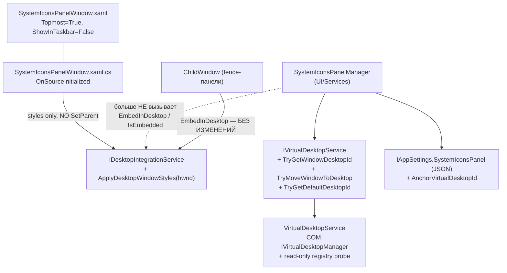

# План: пересмотр «Show on all virtual desktops» для боковой панели

**Ветка:** `polishing/ui-1` · **База:** `098fca3`
**Scope:** **L** (Services.Abstractions + Services/нативный COM + UI-менеджер + XAML + persistence + тесты + ADR)
**Пересматривает:** [ADR-016](../../adr/ADR-016-virtual-desktop-visibility.md) (механизм), [ADR-007](../../adr/ADR-007-system-icons-panel-window-type.md) (пункт «Z-order»)
**Предшественник:** [docs/PLANS/ui-polishing-1.md](ui-polishing-1.md) §6 (Блок E)

---

## 1. Контекст и первопричина (подтверждена, не перепроверять)

Чекбокс «Show on all virtual desktops» не даёт эффекта: боковая панель видна на **всех** виртуальных
столах при любом положении чекбокса.

Причина — не в логике опроса, а в подложке:

- `SystemIconsPanelWindow.OnSourceInitialized` вызывает `IDesktopIntegrationService.EmbedInDesktop`
  (`SystemIconsPanelWindow.xaml.cs:52`), который делает `SetParent(hwnd, workerW)`
  (`DesktopIntegrationService.cs:26`).
- `WorkerW` — **один общий слой рабочего стола на все виртуальные столы**, а не по слою на стол.
  Любой его child виден на каждом столе **безусловно**.
- Менеджер виртуальных столов такие окна не отслеживает: ADR-016 §E0.2 измерил
  `GetWindowDesktopId(Progman)` → `TYPE_E_ELEMENTNOTFOUND`, а `GetWindowDesktopId` для окна **после
  `SetParent`** → `S_OK` + `GUID_NULL`. `MoveWindowToDesktop` на таком окне — `S_OK`-**тихий no-op**.

Следствие: реализованный в ADR-016 механизм E-A («follow-me» через `DispatcherTimer` +
`IVirtualDesktopManager`) **не мог работать по построению** — он применялся к окну, которое API
физически не видит. Ошибка была не в коде тика, а в невыполненной проверке развилки A/B (ADR-016,
Manual verify п.1): исход «A» (панель уже везде) оказался верным, и при нём вся фича — no-op.

### Ключевое подтверждение, что редизайн сработает

> **⚠️ ИСПРАВЛЕНО ПО ИТОГАМ R0 (см. §3.2.1).** Абзац ниже — исходная формулировка плана; при
> перепроверке она **не воспроизвелась**. Верное утверждение: менеджер виртуальных столов
> отслеживает top-level окно, только если `WS_EX_TOOLWINDOW`/`WS_EX_NOACTIVATE` были применены
> **после** `Show()`. Применённые до первого показа (в `OnSourceInitialized`), любой из этих двух
> битов исключает окно из учёта навсегда. При правильном порядке редизайн работает — подтверждён
> реальный межстольный переезд окна, см. §3.2.1 / R0.5.

~~ADR-016 §E0.2 уже измерил ровно целевую конфигурацию: **top-level окно со стилями
`WS_EX_TOOLWINDOW | WS_EX_NOACTIVATE`, показанное на экране, → `GetWindowDesktopId` = `S_OK` + реальный
GUID стола.** То есть менеджер виртуальных столов **отслеживает** окно именно с теми стилями, которые
останутся у панели после снятия `SetParent`. Это не гипотеза, а уже снятое в этом проекте измерение.~~

---

## 2. Область изменений: что трогаем и что НЕ трогаем

| Компонент | Действие |
|---|---|
| `SystemIconsPanelWindow` (боковая панель) | **Перестаёт** быть child `WorkerW`; становится обычным top-level окном |
| `SystemIconsPanelManager` | Пересматривается механизм ON/OFF (см. §5) |
| `IVirtualDesktopService` / `VirtualDesktopService` | Аддитивно расширяются (см. §4.2) |
| `IDesktopIntegrationService` / `DesktopIntegrationService` | Аддитивно: публичный `ApplyDesktopWindowStyles`; удаляется `IsEmbedded` (§4.1) |
| Persistence `SystemIconsPanel` | Новое поле `AnchorVirtualDesktopId` |
| **`ChildWindow` / `WindowManager` / fence-панели** | **НЕ ТРОГАЕМ ВООБЩЕ.** Их `EmbedInDesktop`, Z-order и поведение на виртуальных столах остаются как есть. Fence-панели всегда видны на всех столах — это не баг, это следствие `WorkerW`-архитектуры (ADR-001/007), и оно вне области действия чекбокса |

**Инвариант проверки:** `git diff --name-only` не должен содержать `ChildWindow*`, `WindowManager*`,
`ChildWindowModel*`. Это отдельный пункт DoD.

---

## 3. Решение открытого вопроса: как узнать «Desktop 1»

### 3.1 Что даёт публичный API (перепроверено)

`IVirtualDesktopManager` (`shobjidl_core.h`, CLSID `AA509086-…`, IID `A5CD92FF-…`) содержит ровно три
метода: `IsWindowOnCurrentVirtualDesktop`, `GetWindowDesktopId`, `MoveWindowToDesktop`.
**Подтверждаю утверждение постановщика:** документированного способа получить список столов, их
порядок или GUID «первого/дефолтного» стола нет — все три метода оперируют уже переданным HWND.
Перечисление столов существует только в недокументированном `IVirtualDesktop*`/`IServiceProvider`
на `CLSID_ImmersiveShell`, чей IID меняется между сборками Windows — это ровно вариант **E-B**,
отклонённый в ADR-016 и запрещённый постановкой задачи.

### 3.2 Трёхуровневое разрешение якоря (принятое решение)

Чистая функция-политика (unit-тестируемая, без Win32):

```
ResolveAnchorDesktopId(persisted: Guid?, systemDefault: Guid?, panelCurrent: Guid?) -> Guid?
  1. systemDefault ≠ null      -> systemDefault   (авторитетный источник; перезаписывает persisted)
  2. persisted     ≠ null      -> persisted       (последнее известное значение)
  3. panelCurrent  ≠ null      -> panelCurrent    (эвристика первого захвата)
  4. иначе                     -> null            (ничего не делаем — НИКОГДА не гадаем)
```

**R1 — эвристика (гарантированный базовый уровень, только документированный API).**
`panelCurrent = GetWindowDesktopId(panelHwnd)` — снимается **после** `Show()` (до показа окно ещё не
отслеживается, ADR-016 §E0.2). Источник берётся именно от окна панели, а не от
`GetForegroundWindow()`: на старте по автозапуску переднего окна может не быть вовсе, либо им окажется
`Progman`, для которого `GetWindowDesktopId` = `TYPE_E_ELEMENTNOTFOUND`.
Захваченное значение персистится (§7) и переживает перезапуск.
*Слабое место:* если панель впервые создаётся, когда пользователь уже на Desktop 3, эвристика
зафиксирует Desktop 3. При автозапуске в момент логона это Desktop 1 практически всегда.

**R2 — реестровый зонд «истинный Desktop 1» (уточняющий уровень, гейт — spike R0).**
Explorer хранит порядок столов в:

```
HKCU\SOFTWARE\Microsoft\Windows\CurrentVersion\Explorer\VirtualDesktops
    VirtualDesktopIDs      REG_BINARY, N*16 байт — GUID'ы столов в порядке оболочки
    CurrentVirtualDesktop  REG_BINARY, 16 байт   (Win10; на Win11 22H2+ живое значение — в
                           ...\Explorer\SessionInfo\<SessionId>\VirtualDesktops\CurrentVirtualDesktop)
```

Это **недокументированное** место, поэтому оно применяется только **с самопроверкой против
документированного API**:

1. Прочитать `VirtualDesktopIDs`; если ключа нет / длина `0` / длина `% 16 != 0` → **null**.
2. Прочитать «текущий стол» из реестра (сначала `SessionInfo\<SessionId>\…`, затем legacy-путь);
   если нет → **null**.
3. Взять документированный ответ: `GetWindowDesktopId(GetForegroundWindow())` → `docCurrent`;
   если HRESULT ≠ `S_OK` или `GUID_NULL` → **null**.
4. **Кросс-валидация:** `regCurrent == docCurrent` **И** `VirtualDesktopIDs` содержит `docCurrent`.
   Если нет — раскладка/семантика реестра на этой сборке не та, что мы ожидаем → **null**.
5. Только теперь: `systemDefault = new Guid(VirtualDesktopIDs[0..16])`.

Чем это принципиально отличается от отклонённого E-B: **read-only**, никакого COM с плавающим IID,
никакой таблицы build→IID; неверная раскладка **обнаруживается** шагом 4 и приводит к тихому откату на
R1, а не к сбою. Байты GUID в реестре лежат в том же mixed-endian порядке, что принимает
`new Guid(byte[])`.

Результат **не кешируется** на время жизни процесса (пользователь может переупорядочить столы) —
вызовы редки (открытие панели, переключение чекбокса), на 1-секундном таймере эта функция **не
вызывается никогда**.

**R0 — обязательный spike перед кодом** (по образцу ADR-016 §E0; выполним в этой среде, т.к. это
только чтение реестра + COM + собственное off-screen окно):

| Шаг | Что проверить | Что решает |
|---|---|---|
| R0.1 | Наличие/длина `VirtualDesktopIDs`, наличие `CurrentVirtualDesktop` в обоих путях | доступность R2 |
| R0.2 | `regCurrent == GetWindowDesktopId(GetForegroundWindow())` | корректность раскладки байт |
| R0.3 | Индекс текущего стола внутри `VirtualDesktopIDs` | корректность порядка |
| R0.4 | Своё top-level окно 1×1 off-screen со стилями `TOOLWINDOW\|NOACTIVATE\|Topmost`, показанное: `GetWindowDesktopId` → реальный GUID; затем `MoveWindowToDesktop(hwnd, VirtualDesktopIDs[0])` → перепроверить `GetWindowDesktopId` | что весь редизайн вообще работает |

**Ограничения R0 (те же, что у E0):** не переключать активный стол пользователя, не отнимать фокус,
**не слать `0x052C` в `Progman`**, не создавать/не удалять виртуальные столы. Если на машине один
виртуальный стол — R0.4 проверяет только трекинг окна (переезд вырождается в no-op на тот же GUID);
это допустимый результат, R2 при этом всё равно валидируется шагами R0.1–R0.3.

**Гейт:** R2 попадает в поставку только если R0.1–R0.3 зелёные. Если нет — отгружаем R1 и фиксируем
в ADR, что «Desktop 1» — эвристика. Функционально план корректен в обоих случаях.

### 3.2.1 Результаты spike R0 — ВЫПОЛНЕН

**Среда:** Windows 11 Home SL, build **10.0.26200**, x64, session 1, 2 виртуальных стола.
Ограничения соблюдены: активный стол не переключался, фокус не отнимался (`ShowActivated=false` +
`SW_SHOWNOACTIVATE`, `GetForegroundWindow()` не менялся ни в одном прогоне), `0x052C` в `Progman` не
отправлялось, столы не создавались/не удалялись. Код spike — throwaway вне `src/`.

| Шаг | Результат | Вердикт |
|---|---|---|
| **R0.1** | `HKCU\…\Explorer\VirtualDesktops\VirtualDesktopIDs` = `REG_BINARY`, **32 байта** (`%16 == 0`, 2 стола): `{b6b25d05-…}`, `{dad5fc31-…}`. `CurrentVirtualDesktop` присутствует в **legacy**-пути (16 байт). Путь `SessionInfo\1\VirtualDesktops` существует, но содержит только `IsCurrentVDRemote:DWord` — **`CurrentVirtualDesktop` там отсутствует** | ✅ Формат подтверждён. Порядок чтения «SessionInfo → legacy» обязателен: на этой сборке работает только fallback |
| **R0.2** | `regCurrent` = `{b6b25d05-…}`; `GetWindowDesktopId(GetForegroundWindow())` → `S_OK`, `{b6b25d05-…}`. **Совпадение** | ✅ Раскладка байт совпадает с `new Guid(byte[])`, mixed-endian, без переворота |
| **R0.3** | Индекс текущего стола в `VirtualDesktopIDs` = **0** из 2; список содержит `docCurrent` | ✅ Порядок оболочки подтверждён; `VirtualDesktopIDs[0]` — валидный кандидат в «Desktop 1» |
| **R0.4** | См. ниже — **гипотеза §1 в исходной формулировке НЕ подтвердилась** | ⚠️ Плановое допущение исправлено |

**Гейт R2: ✅ ЗЕЛЁНЫЙ.** R0.1–R0.3 прошли, `TryGetDefaultDesktopId` отгружается с кросс-валидацией.

#### R0.4 / R0.5 — ключевая находка: порядок применения стилей решает всё

Утверждение §1 («ADR-016 §E0.2 уже измерил ровно целевую конфигурацию … это не гипотеза, а уже
снятое измерение») **при перепроверке не воспроизвелось** — и именно поэтому перепроверка требовалась.
Матрица измерений (каждая строка — отдельное окно, показанное через `SW_SHOWNOACTIVATE`;
результат детерминирован, прогон повторён дважды):

| Конфигурация окна | `GetWindowDesktopId` |
|---|---|
| raw `CreateWindowEx`, off-screen, `TOOLWINDOW\|NOACTIVATE\|TOPMOST` | `0x8002802B` `TYPE_E_ELEMENTNOTFOUND` — **не отслеживается** |
| raw, on-screen, `TOOLWINDOW\|NOACTIVATE\|TOPMOST` | `TYPE_E_ELEMENTNOTFOUND` — **не отслеживается** |
| raw, on-screen, без ex-стилей | `S_OK` + реальный GUID |
| WPF-окно как у панели (`WindowStyle=None`, `ShowInTaskbar=False`, `AllowsTransparency=True`, `Topmost=True`), стили в `SourceInitialized` — **текущее продакшн-размещение** | `S_OK` + **`GUID_NULL`** — **не отслеживается** |
| то же WPF-окно, **только `NOACTIVATE`** в `SourceInitialized` | `S_OK` + `GUID_NULL` — **не отслеживается** |
| то же WPF-окно, **только `TOOLWINDOW`** в `SourceInitialized` | `S_OK` + `GUID_NULL` — **не отслеживается** |
| то же WPF-окно, `TOOLWINDOW\|NOACTIVATE`, `Topmost=false` | `S_OK` + `GUID_NULL` — **не отслеживается** (т.е. `Topmost` ни при чём) |
| то же WPF-окно **без** этих стилей | `S_OK` + реальный GUID — **отслеживается** |

Вывод: **любой из битов `WS_EX_TOOLWINDOW` / `WS_EX_NOACTIVATE`, присутствующий в момент первого
показа окна, навсегда исключает окно из учёта менеджера виртуальных столов.** `MoveWindowToDesktop`
на таком окне — `S_OK` + тихий no-op, ровно как для `WorkerW`-child. То есть замена
`EmbedInDesktop` → `ApplyDesktopWindowStyles` **внутри `OnSourceInitialized`** (как предписано §4.3)
воспроизвела бы исходный баг в новой форме: панель снова была бы невидима для API.

**R0.5 — рабочая конфигурация (проверена, детерминирована):**

| Момент применения `TOOLWINDOW\|NOACTIVATE` | Стили выставлены | Окно отслеживается |
|---|---|---|
| `OnSourceInitialized` (до `Show()`) — текущий продакшн | ✅ | ❌ |
| **сразу после `Show()`, тот же виток UI-потока, без прокачки очереди** | ✅ | ✅ |
| `Loaded` | ✅ | ✅ |
| `Dispatcher.BeginInvoke(DispatcherPriority.Loaded)` после `Show()` | ✅ | ✅ |

**Полная проверка переезда** на окне, стилизованном сразу после `Show()`:

```
after Show(), before styles       exStyle=0x00080008  S_OK {b6b25d05-…}  tracked=True
after TOOLWINDOW|NOACTIVATE       exStyle=0x08080088  S_OK {b6b25d05-…}  tracked=True
t+1.5s (устойчивость трекинга)    exStyle=0x08080088  S_OK {b6b25d05-…}  tracked=True
MoveWindowToDesktop({dad5fc31-…}) hr=S_OK -> GetWindowDesktopId={dad5fc31-…}, IsOnCurrent=0
                                  => РЕАЛЬНЫЙ МЕЖСТОЛЬНЫЙ ПЕРЕЕЗД ПОДТВЕРЖДЁН
MoveWindowToDesktop(назад)        -> {b6b25d05-…} восстановлено
focus preserved throughout: True
```

Это **сильнее**, чем требовал план: подтверждён не только трекинг, но и фактический переезд окна на
*другой* стол (`IsOnCurrent=0`) — то есть механизм ADR-016 (poll + `MoveWindowToDesktop`) на
top-level окне действительно работает, а не возвращает `S_OK`-no-op.

**Обязательные следствия для W2/W3 (правка §4.3, см. ниже):**
1. `ApplyDesktopWindowStyles(hwnd)` вызывать **строго после `Show()`**, не из `OnSourceInitialized`.
2. Окну нужен `ShowActivated="False"` — иначе между `Show()` и установкой `NOACTIVATE` окно отнимет
   фокус (в spike с `ShowActivated=false` фокус не терялся ни разу).
3. Существует окно длиной в одну инструкцию UI-потока, когда окно показано без `TOOLWINDOW`.
   Прокачка очереди сообщений в этот момент **не требуется** (вариант «сразу после `Show()`, без
   прокачки» зелёный), поэтому окно не успевает отрисоваться в панели задач/Alt+Tab.
   `ShowInTaskbar="False"` WPF реализует через скрытое owner-окно, а не через `TOOLWINDOW`, так что
   из панели задач окно исключено с самого начала.
4. `EnforceAnchorDesktopOnce` / `PollVirtualDesktopOnce` вызывать после того, как стили применены,
   т.к. до `Show()` `TryGetWindowDesktopId` законно вернёт `null`.

Контракт зафиксирован в XML-doc `IDesktopIntegrationService.ApplyDesktopWindowStyles` — не остался
устным допущением.

### 3.3 Самоизлечение при удалении якорного стола

Если пользователь удалил стол, чей GUID сохранён как якорь, `MoveWindowToDesktop` с мёртвым GUID либо
вернёт ошибку, либо будет no-op. Политика — **однократная**, не в цикле: если после попытки переезда
`GetWindowDesktopId(panelHwnd) != anchor`, а якорь пришёл из `persisted`/эвристики (не из R2), — якорь
**перезахватывается** от текущего стола панели и персистится. Никаких повторных попыток в этом же
проходе; следующая попытка — при следующем открытии панели или переключении чекбокса.

---

## 4. Целевая архитектура



### 4.1 `IDesktopIntegrationService`

**Добавить:**

```csharp
/// <summary>
/// Applies the desktop-window extended styles (WS_EX_TOOLWINDOW | WS_EX_NOACTIVATE) WITHOUT
/// re-parenting the window into the WorkerW desktop layer.
/// </summary>
void ApplyDesktopWindowStyles(IntPtr hwnd);
```

Реализация: существующий приватный `ApplyDesktopWindowStyles` становится публичным членом;
`EmbedInDesktop` вызывает его первой строкой — то есть **поведение `EmbedInDesktop` не меняется ни на
байт** (важно: `ChildWindow` не трогаем). Существующие тесты
`EmbedInDesktop_AppliesToolWindowStyles_WhenWorkerWNotFound` /
`EmbedInDesktop_AppliesStylesAndReparents_WhenWorkerWFound` /
`EmbedInDesktop_PreservesExistingExtendedStyleBits` должны остаться зелёными **без правок**.

**Удалить:** `bool IsEmbedded(IntPtr hwnd)` (интерфейс + реализация + 5 тестов в
`DesktopIntegrationServiceTests`). Единственный продакшн-потребитель — снимаемый блок re-embed в
`SystemIconsPanelManager.PollVirtualDesktopOnce:362`. Оставлять документированный публичный член,
описывающий политику, которой больше нет, — прямой code-smell.
`INativeApi.GetParent` / `GetWindowClassName` **оставить**: `INativeApi` — широкий Win32-фасад, где
тонкие обёртки нормальны, а правка этого файла — самая чувствительная в проекте.
*Допустимая альтернатива, если ревьюер возразит:* оставить `IsEmbedded` с переписанным XML-doc
(«диагностический предикат, продакшн-потребителей нет»); тогда — обязателен тест-guard, что панель
его не вызывает.

### 4.2 `IVirtualDesktopService` (аддитивно, 3 новых члена)

```csharp
/// Desktop id of a window, or null when the shell does not track it / any failure.
Guid? TryGetWindowDesktopId(IntPtr hwnd);

/// Moves a window to a specific virtual desktop. true == "the call was accepted",
/// NOT "the window visibly moved" (see ADR-016 §E0.2 on the S_OK no-op).
bool TryMoveWindowToDesktop(IntPtr hwnd, Guid desktopId);

/// Best-effort GUID of the FIRST virtual desktop in shell order ("Desktop 1"), or null when it
/// cannot be established trustworthily. Never call from a poll timer.
Guid? TryGetDefaultDesktopId();
```

Существующие `IsSupported` / `IsWindowOnCurrentDesktop` / `TryMoveWindowToCurrentDesktop` — **без
изменений сигнатур и семантики**. `TryMoveWindowToCurrentDesktop` внутри рефакторится в
`TryMoveWindowToDesktop(hwnd, currentId)`, чтобы не дублировать COM-вызов.

Инварианты сохраняются: STA-контракт (`AssertSta`), `_gate` вокруг COM-вызова, тихая деградация,
**ни одно исключение не покидает сервис**, ни один `DllImport` не объявлен в обход `INativeApi`.
Реестровый зонд R2 живёт внутри `VirtualDesktopService` в явно отбитом регионе
`// ── Undocumented, read-only registry probe (see ADR-019 §R2) ──` — граница абстракции здесь
по-прежнему `IVirtualDesktopService`, ровно по аргументу ADR-016 про COM-активацию. `Microsoft.Win32.
Registry` уже используется в проекте (`AutostartService.cs`), новых зависимостей нет.

### 4.3 `SystemIconsPanelWindow`

- **XAML:** `Topmost="True"` **и `ShowActivated="False"`** (второе — обязательное следствие R0.5:
  стили теперь ставятся после `Show()`, и без `ShowActivated="False"` окно на этот миг отняло бы
  фокус). Остальное (`WindowStyle=None`, `ShowInTaskbar=False`, `AllowsTransparency=True`,
  `SizeToContent=Width`, `WindowStartupLocation=Manual`) — без изменений.
- **Code-behind:** вызов `_desktopIntegration.EmbedInDesktop(hwnd)` из `OnSourceInitialized`
  **удаляется целиком**. Комментарий и XML-doc класса переписать: окно больше не встраивается в слой
  рабочего стола.

> **🔴 ОБЯЗАТЕЛЬНО, по итогам R0.5 (§3.2.1) — план здесь исправлен.** `ApplyDesktopWindowStyles`
> **нельзя** вызывать из `OnSourceInitialized` вместо `EmbedInDesktop`: `WS_EX_TOOLWINDOW` или
> `WS_EX_NOACTIVATE`, присутствующие в момент первого показа окна, навсегда исключают его из учёта
> менеджера виртуальных столов (`GetWindowDesktopId` → `S_OK` + `GUID_NULL`, `MoveWindowToDesktop` →
> тихий no-op). Это воспроизвело бы исходный баг в новой форме.
>
> Правильное место — **сразу после `_window.Show()`**, в том же витке UI-потока
> (`SystemIconsPanelManager.OpenPanel`), до `PollVirtualDesktopOnce`/`EnforceAnchorDesktopOnce`:
>
> ```csharp
> _window.Show();
> _desktopIntegration.ApplyDesktopWindowStyles(new WindowInteropHelper(_window).Handle);
> // только теперь окно и стилизовано, и отслеживается менеджером столов
> ```
>
> Прокачка очереди сообщений между `Show()` и установкой стилей не нужна (проверено). Вариант
> «в `Loaded`» тоже рабочий, но оставляет окно нестилизованным на несколько витков — не использовать.
> Отсюда следствие для §4.4: зависимость `IDesktopIntegrationService` в `SystemIconsPanelManager`
> **остаётся** (вызов переехал из code-behind в менеджер), удалять её из ctor и `DiConfig` не нужно.

**Почему `Topmost`, а не просто «обычное top-level окно».** Со снятым `SetParent` окно остаётся
`WS_EX_NOACTIVATE`: клик по нему **никогда** не активирует и не поднимает его в Z-order. Без
`Topmost` панель, однажды перекрытая любым приложением, становится **недостижимой навсегда** — нет
пользовательского жеста, который вернёт её наверх. Это не вопрос вкуса, а функциональный дефект.
`Topmost=True` даёт ровно то поведение, которое постановщик принял («поверх других приложений»), и не
требует никакой ручной логики удержания Z-order.
*Принятый минус:* панель перекрывает полноэкранные приложения/игры/видео. Авто-скрытие при
fullscreen — **вне области** этого плана (кандидат в ROADMAP отдельным пунктом).

### 4.4 `SystemIconsPanelManager`

Убрать:
- блок re-embed в `PollVirtualDesktopOnce` (`IsEmbedded` → `EmbedInDesktop`, строки 356–365).
  **Критично:** без снятия он бы вызывал `EmbedInDesktop` (синхронный `SendMessage 0x052C` +
  `EnumWindows`) **на каждом тике**, т.к. `IsEmbedded` у top-level окна всегда `false` — это мгновенно
  вернуло бы панель в `WorkerW` и воспроизвело исходный баг;
- `_desktopIntegration.EmbedInDesktop(hwnd)` в `OnMonitorsChanged` (строка 404) — стили окна не
  теряются при смене конфигурации мониторов, остаётся только `PositionWindow`;
- зависимость от `IDesktopIntegrationService` в конструкторе, **если** после этих правок она стала
  неиспользуемой (проверить: `ApplyDesktopWindowStyles` вызывается из code-behind окна, не из
  менеджера) → тогда убрать параметр из ctor и из `DiConfig.cs:39-45`, поправить `BuildSut` в тестах.

Добавить:
- `internal static Guid? ResolveAnchorDesktopId(Guid? persisted, Guid? systemDefault, Guid? panelCurrent)`
  — чистая политика из §3.2, **полностью покрывается таблицей истинности в тестах**;
- `internal void EnforceAnchorDesktopOnce(IntPtr hwnd)` — шов для тестов на моках, тело:
  resolve → сравнить с текущим столом панели → при расхождении `TryMoveWindowToDesktop` → проверить
  результат → при промахе однократно перезахватить якорь (§3.3) → при изменении якоря записать в
  `Model` и `Save()`. Всё в `try/catch` с тихой деградацией — исполняется на UI-потоке;
- вызовы `EnforceAnchorDesktopOnce` **строго после `_window.Show()`** (до показа окно ещё не
  отслеживается менеджером столов).

Сохранить:
- `ShouldPollVirtualDesktop(panelEnabled, showOnAllVirtualDesktops, hasWindow, virtualDesktopsSupported)`
  — сигнатура и семантика без изменений (таймер только для ON);
- `DispatcherTimer` 1 с и `PollVirtualDesktopOnce` — теперь применяются к **реально отслеживаемому**
  окну, т.е. впервые работают;
- **circuit breaker `MaxIneffectiveMoves = 3` + `VirtualDesktopFeatureIneffective` — оставить как
  safety net.** После редизайна он, скорее всего, не сработает никогда, но стоит ~15 уже покрытых
  тестами строк и защищает от «долбить Explorer раз в секунду вечно» на сборке, где API поведёт себя
  иначе. Удаление дало бы нулевую выгоду и минус в устойчивости. XML-doc обновить: теперь это
  **аварийный** предохранитель, а не ожидаемый режим.

Мелочь-улучшение: при `OpenPanel` в состоянии ON вызвать `PollVirtualDesktopOnce` **сразу** после
`Show()`, не дожидаясь первого тика (убирает секунду «неправильности» на старте).

### 4.5 Позиционирование (`PositionWindow`) — перепроверено

Асимметрия из ADR-016 («у child-окна WPF-сеттер `Window.Left` — в клиентских координатах родителя,
геттер — из `GetWindowRect`») была **специфична именно для `WorkerW`-child**. У обычного top-level
окна `Left`/`Top` — экранные координаты в DIP'ах, симметрично. `MonitorInfo.Bounds`/`WorkArea` по
контракту `IMonitorService` **уже в DIP'ах** (`IMonitorService.cs:6-8`), поэтому текущий код
`PositionWindow` остаётся **без изменений** и становится корректнее:

- раньше `(0,0)` означало левый верхний угол `WorkerW`, т.е. **виртуального экрана**;
- теперь `(0,0)` — экранные координаты, т.е. реально левый верхний угол **основного** монитора.

На однодисплейной конфигурации и на конфигурации, где основной монитор — самый левый, разницы нет
(поэтому баг не проявлялся). На конфигурации, где основной монитор правее вторичного (вторичный имеет
отрицательные X), старый код клал панель на **чужой** монитор — редизайн это **чинит** побочно.
Пункт manual verify обязателен, автотестом не покрывается.

---

## 5. Поведенческая матрица

| Состояние | Что делает менеджер |
|---|---|
| Панель выключена (`IsEnabled=false`) | Окна нет; таймер остановлен; якорь не трогается |
| **ON** (`ShowOnAllVirtualDesktops=true`) | Таймер 1 с: `IsWindowOnCurrentDesktop` → при `false` `TryMoveWindowToCurrentDesktop` → проверка эффекта → circuit breaker. Якорь **не применяется** |
| **OFF** (`ShowOnAllVirtualDesktops=false`) | Таймера нет. **Однократный** `EnforceAnchorDesktopOnce` в точках: (1) после `Show()` в `OpenPanel`; (2) при переключении чекбокса в OFF; (3) в `OnMonitorsChanged` |
| ON → OFF | `StopVirtualDesktopTimer()` + `EnforceAnchorDesktopOnce` (панель возвращается на Desktop 1) |
| OFF → ON | `ResetVirtualDesktopCircuitBreaker()` + `UpdateVirtualDesktopTimer()` + немедленный `PollVirtualDesktopOnce` |
| `IsSupported == false` | Обе ветки — no-op; панель работает штатно; настройка сохраняется, но эффекта не даёт |

**Почему OFF без постоянного опроса.** У обычного top-level окна нет механизма, который сам уводит
его на другой стол; единственный сценарий дрейфа — пользователь удалил якорный стол, и Windows
перенесла окно на соседний. Это редкое событие, оно самоизлечивается при следующем открытии панели или
переключении чекбокса. Круглосуточный COM-вызов раз в секунду ради него — неоправданная цена.

**Ожидаемое, но неочевидное поведение (зафиксировать в тултипе и manual verify):** если при OFF
пользователь включает панель, находясь на Desktop 3, панель **сразу уедет** на Desktop 1 и исчезнет из
поля зрения. Это буквально то, что задано требованием «Desktop 1, всегда».

---

## 6. Разбивка работ и конвейер

| # | Работа | Агент | Файлы |
|---|---|---|---|
| **R0** | Диагностический spike §3.2 (реестр + COM + off-screen окно). Не коммитить в `src/`; протокол измерений — в ADR-019 | `win32-interop-specialist` | throwaway |
| **W1** | `IDesktopIntegrationService.ApplyDesktopWindowStyles` (+ удаление `IsEmbedded`); 3 новых члена `IVirtualDesktopService` + реализация, включая R2-зонд с кросс-валидацией | `win32-interop-specialist` | `Services.Abstractions/IDesktopIntegrationService.cs`, `IVirtualDesktopService.cs`, `Services/Tools/DesktopIntegrationService.cs`, `Services/Tools/VirtualDesktopService.cs` |
| **W2** | `Topmost="True"`; замена `EmbedInDesktop` → `ApplyDesktopWindowStyles` в code-behind; текст тултипа чекбокса (см. §6.1) | `wpf-ui-builder` | `UI/Views/SystemIconsPanelWindow.xaml(.cs)`, `UI/Views/MainWindow.xaml` |
| **W3** | Переработка менеджера (§4.4), поле якоря в `SystemIconsPanelModel` и `PanelDto` (§7), XML-doc в `ISystemIconsPanelManager` и `MainWindowViewModel`, при необходимости — правка `DiConfig` | `dotnet-services-engineer` | `UI/Services/SystemIconsPanelManager.cs`, `UI/Services/ISystemIconsPanelManager.cs`, `UI/Models/SystemIconsPanelModel.cs`, `UI/ViewModels/MainWindowViewModel.cs`, `UI/Configuration/DiConfig.cs` |
| **W4** | Тесты (§8) | `tdd-test-engineer` | `tests/…/SystemIconsPanelManagerTests.cs`, `DesktopIntegrationServiceTests.cs` |
| **W5** | ADR-019, супersede-пометка в ADR-016, правка «Z-order» в ADR-007, `adr/README.md`, ROADMAP, `docs/PLANS/ui-polishing-1.md` §6 | `architecture-documenter` | `adr/**`, `docs/**` |

**Порядок:** `R0 → W1 → (W2 ∥ W3) → W4 → (code-quality-reviewer ∥ fences-ux-parity-reviewer) → W5`.
W2 и W3 независимы после того, как W1 зафиксировал контракты (пересечение — только сигнатура
`ApplyDesktopWindowStyles`), их можно вести параллельно.

`SystemIconsPanelManager` физически лежит в сборке `DesktopOrganizer.UI`, но это класс сервисной формы
(персистентность, таймер, политика) без XAML — поэтому W3 адресован `dotnet-services-engineer`,
а не `wpf-ui-builder`.

### 6.1 Текст в UI

Чекбокс «Show on all virtual desktops» и его `IsEnabled="{Binding SystemIconsPanelEnabled}"` —
**без изменений**. Меняется только `ToolTip`, потому что изменилась семантика выключенного состояния:

> `Keep the panel visible when you switch Windows virtual desktops (Task View). When off, the panel
> stays on your first virtual desktop.`

---

## 7. Persistence

`SystemIconsPanelManager.PanelDto`:

```csharp
/// <summary>
/// GUID of the virtual desktop the panel is pinned to while "show on all virtual desktops" is off.
/// Stored as a string, not a Guid: Load() wraps the whole deserialisation in one catch, so a corrupt
/// value typed as Guid? would discard EVERY panel setting. As a string it degrades to "no anchor".
/// Absent in older settings files -> null -> captured on first use.
/// </summary>
public string? AnchorVirtualDesktopId { get; set; }
```

- `Load()`: `Guid.TryParse(dto.AnchorVirtualDesktopId, out var g)` → `Model.AnchorVirtualDesktopId = g`,
  иначе `null`. **Не** внутри общего `catch`-поведения — распарсить отдельно.
- `Save()`: `Model.AnchorVirtualDesktopId?.ToString()`; `JsonIgnoreCondition.WhenWritingNull` уже
  сконфигурирован (`SystemIconsPanelManager.cs:20`), поэтому `null` просто не пишется в файл.
- `SystemIconsPanelModel.AnchorVirtualDesktopId` (`Guid?`, INPC, как остальные поля). В UI **не
  биндится** — это служебное состояние менеджера; отметить это в XML-doc.
- Обратная совместимость: ключ отсутствует в старых файлах → `null` → якорь захватывается при первом
  применении. Миграция не нужна, по построению.
- `Save()` вызывается **только при изменении** якоря, не на каждый вызов `EnforceAnchorDesktopOnce`.

---

## 8. Тесты (только то, что проверяемо без реального окна) — ✅ ВЫПОЛНЕНО (W4)

**`DesktopIntegrationServiceTests`:**
1. ✅ `ApplyDesktopWindowStyles` выставляет `WS_EX_TOOLWINDOW | WS_EX_NOACTIVATE`, сохраняя прочие биты
   (`ApplyDesktopWindowStyles_SetsToolWindowAndNoActivate_PreservingOtherBits`).
2. ✅ **Регрессия-гард:** `ApplyDesktopWindowStyles` **не** вызывает `SetParent`, `SendMessage`,
   `FindWindow`, `EnumWindows` (`Times.Never` на моке `INativeApi`) — то есть Explorer не трогается
   (`ApplyDesktopWindowStyles_NeverTouchesExplorerOrWorkerW`).
3. ✅ Три существующих теста `EmbedInDesktop_*` остаются **без правок** (доказательство, что ветка
   fence-панелей не тронута) — подтверждено, файл не тронут в этих тестах.
4. ✅ 5 тестов `IsEmbedded_*` в файле уже отсутствуют — член и тесты были сняты ранее (W1/W3), доп.
   действий не потребовалось.

**`SystemIconsPanelManagerTests`:**
5. ✅ `ResolveAnchorDesktopId` — полная таблица истинности (`Theory`, 8 комбинаций
   null/не-null × приоритеты), включая «systemDefault перебивает persisted»
   (`ResolveAnchorDesktopId_TruthTable`).
6. ✅ `EnforceAnchorDesktopOnce`: панель уже на якоре → `TryMoveWindowToDesktop` **не** вызывается,
   счётчик сброшен (M2) (`EnforceAnchorDesktopOnce_AlreadyOnAnchor_DoesNotMove_AndResetsIneffectiveCounter`).
7. ✅ `EnforceAnchorDesktopOnce`: панель не на якоре → ровно один `TryMoveWindowToDesktop(hwnd, anchor)`
   (`EnforceAnchorDesktopOnce_NotOnAnchor_SuccessfulMove_MovesOnceAndResetsCounter`).
8. ✅ `EnforceAnchorDesktopOnce`: якорь отсутствует и не разрешается (все три источника `null`) → **ни
   одного** вызова перемещения (инвариант «никогда не гадаем») (`EnforceAnchorDesktopOnce_WhenAllSourcesNull_NeverMoves`).
9. ✅ `EnforceAnchorDesktopOnce`: переезд не дал эффекта → якорь перезахвачен от текущего стола панели
   (self-heal, M3, порог `SelfHealMinConsecutiveFailures`), `Model.AnchorVirtualDesktopId` обновлён,
   `IAppSettings.Save()` вызван **один раз**
   (`EnforceAnchorDesktopOnce_SelfHeal_AfterTwoConsecutiveFailures_RecapturesAnchorAndSavesOnce`).
10. ✅ `EnforceAnchorDesktopOnce` при `hwnd == IntPtr.Zero` → полный no-op
    (`EnforceAnchorDesktopOnce_WithZeroHandle_TouchesNothing`).
11. ✅ `EnforceAnchorDesktopOnce`: якорь не изменился → `IAppSettings.Save()` **не** вызывается
    (`EnforceAnchorDesktopOnce_WhenAnchorUnchanged_DoesNotCallSave`).
12. ✅ `PollVirtualDesktopOnce` — существующие тесты circuit breaker'а уже переписаны (без re-embed
    ожиданий) в предыдущей сессии; подтверждено при чтении файла — правок в W4 не потребовалось.
13. ✅ **Регрессия-гард на первопричину:** ни один путь менеджера не вызывает `EmbedInDesktop` —
    покрыто уже существующими `PollVirtualDesktopOnce_*` тестами плюс новым
    `EnforceAnchorDesktopOnce_NeverCallsEmbedInDesktop`.
14. ✅ Persistence: round-trip якоря (`SaveThenLoad_RoundTripsAnchorVirtualDesktopId`), отсутствующий
    ключ → `null` (`Load_WithoutAnchorKey_LeavesAnchorNull`), мусорная строка → `null` **и остальные
    поля панели (`IsEnabled`, `IconSize`, `Items`) прочитаны корректно**
    (`Load_WithGarbageAnchorValue_AnchorIsNull_ButOtherSettingsLoadNormally`), а также `Save()` не
    пишет ключ якоря, если он `null` (`Save_DoesNotWriteAnchorKey_WhenAnchorIsNull`).
15. ✅ `ShouldPollVirtualDesktop` — существующая таблица истинности без изменений.

Плюс сверх плана: `EnforceAnchorDesktopOnce_WhenUnsupported_ReturnsImmediately` (M5: `IsSupported ==
false` → немедленный выход, реестр/COM не трогаются), `EnforceAnchorDesktopOnce_NeverRaisesVirtualDesktopFeatureIneffective_EvenAfterManyFailures`
(M1 regression), `EnforceAnchorDesktopOnce_WhenServiceThrows_DoesNotPropagate` (тихая деградация, по
аналогии с `PollVirtualDesktopOnce_WhenServiceThrows_DoesNotPropagate`).

**`VirtualDesktopService`** автотестами не покрывается (живой COM + реестр) — только R0-протокол и
manual verify. Это уже принятая в проекте позиция (ADR-016).

---

## 9. Риски

| # | Риск | Уровень | Митигация |
|---|---|---|---|
| **V-R1** | `Topmost` перекрывает полноэкранные приложения/игры/видео | средний, **принят** | Осознанный trade-off постановщика. Авто-скрытие при fullscreen — отдельный пункт ROADMAP |
| **V-R2** | R2-зонд опирается на недокументированную раскладку реестра | низкий | Кросс-валидация против документированного API (§3.2, шаг 4) → при несовпадении тихий откат на R1. Read-only, нет таблицы IID, нет COM |
| **V-R3** | Эвристика R1 захватит не тот стол (первый запуск на Desktop 3) | низкий-средний | R2 при доступности перебивает; при автозапуске в логон практически всегда Desktop 1; самоизлечение §3.3 |
| **V-R4** | Якорный стол удалён — GUID мёртв | низкий | Однократный перезахват §3.3, без цикла |
| **V-R5** | **Нативный.** Win+D / Show Desktop / Aero Peek / Aero Shake могут теперь скрывать панель (как child `WorkerW` она была иммунна) | средний, **непроверяемо автотестами** | Manual verify п.8. Митигации в плане нет — если поведение окажется неприемлемым, это отдельный тикет |
| **V-R6** | **Нативный.** Панель может появиться в Task View / превью столов | низкий | `WS_EX_TOOLWINDOW` обычно исключает окно из Task View. Manual verify п.9 |
| **V-R7** | Смена семантики координат `Left/Top` при multi-monitor | низкий | Ожидается **улучшение** (§4.5); manual verify п.10 на конфигурации с отрицательными X |
| **V-R8** | Панель теперь всегда поверх fence-панелей (раньше — сиблинги в одном слое) | низкий | Ожидаемо; anti-overlap ADR-017 про боковую панель никогда и не знал. Manual verify п.11 |
| **V-R9** | Fence-панели по-прежнему видны на всех столах — пользователь может счесть это несогласованностью | низкий | Явное решение постановщика; зафиксировать как **non-goal** в ADR-019 |
| **V-R10** | `MoveWindowToDesktop` требует, чтобы окно принадлежало вызывающему процессу | нет | Окно наше; условие выполнено by construction |
| **V-R11** | Забыть снять блок re-embed → мгновенный возврат бага + `SendMessage` в Explorer раз в секунду | **высокий, если пропустить** | Тест-гард №13 (`Times.Never`) делает регресс невозможным незаметно |

---

## 10. Definition of Done

1. `SystemIconsPanelWindow` **не** вызывает `EmbedInDesktop` ни на одном пути; вместо него —
   `ApplyDesktopWindowStyles`. Подтверждено тестом-гардом №13 и `grep`.
2. `git diff --name-only` не содержит `ChildWindow*`, `WindowManager*`, `ChildWindowModel*`;
   три теста `EmbedInDesktop_*` зелёные без правок.
3. `SystemIconsPanelWindow` — `Topmost="True"`, `ShowInTaskbar="False"`, стили
   `WS_EX_TOOLWINDOW | WS_EX_NOACTIVATE` сохранены.
4. Блок re-embed удалён из `PollVirtualDesktopOnce`; `EmbedInDesktop` удалён из `OnMonitorsChanged`;
   `IsEmbedded` удалён из интерфейса/реализации/тестов (или сохранён с явным обоснованием + гардом).
5. `IVirtualDesktopService` расширен тремя членами; STA-контракт, `_gate`, тихая деградация и правило
   «никаких `DllImport` в обход `INativeApi`» соблюдены; **ни одно исключение не покидает сервис**.
6. ✅ **(W4)** `ResolveAnchorDesktopId` — чистая функция, покрыта таблицей истинности (8 кейсов);
   поведение «все источники null → ничего не двигаем» покрыто отдельным тестом.
7. ✅ **(W4)** Поле `AnchorVirtualDesktopId` персистится аддитивно; старый JSON читается без ошибок и
   без миграции; мусорное значение якоря **не** обнуляет остальные настройки панели (тест
   `Load_WithGarbageAnchorValue_AnchorIsNull_ButOtherSettingsLoadNormally`).
8. Протокол spike R0 (R0.1–R0.4, фактические значения) записан в ADR-019; принято и зафиксировано
   решение по гейту R2 (ship / not ship).
9. ✅ **(W4)** `dotnet build` и `dotnet test` зелёные (804/804, было 780 до W4); StyleCop/
   `linters/linter.ruleset` без новых нарушений; предупреждений build — 15, идентично baseline
   (ни одного нового).
10. ADR-019 создан; ADR-016 помечен `Superseded by ADR-019` с разделом-ревизией о первопричине;
    пункт «Z-order» в ADR-007 уточнён для `SystemIconsPanel`; `adr/README.md`, `docs/ROADMAP.md` и
    `docs/PLANS/ui-polishing-1.md` §6 обновлены.
11. Список manual verify (§11) занесён в ADR-019 и ROADMAP как **не выполненный** в этой сессии.

---

## 11. Manual verify (Win10 / Win11) — **не выполняется в этой среде**

Требуется интерактивная сессия с ≥3 виртуальными столами.

1. **ON, переключение стола.** Чекбокс включён, Win+Ctrl+→ → панель появляется на новом столе
   **в течение ~1 с**. Задержка ожидаема (poll 1 с), не дефект.
2. **ON, несколько переключений подряд.** Панель не дублируется, не мерцает, не «застревает»;
   `VirtualDesktopFeatureIneffective` не взводится (circuit breaker не срабатывает).
3. **OFF, панель остаётся на Desktop 1.** Уйти на Desktop 3, поработать 5 минут, вернуться —
   панель на Desktop 1 и **отсутствует** на Desktop 2/3.
4. **OFF, включение панели с Desktop 3.** Панель немедленно уезжает на Desktop 1 и пропадает из
   поля зрения. **Это ожидаемое поведение по требованию**, а не баг.
5. **Точность «Desktop 1».** Проверить оба сценария: (a) первый запуск с Desktop 1; (b) удалить
   `AnchorVirtualDesktopId` из файла настроек, запустить панель, находясь на Desktop 3 → при
   работающем R2 панель всё равно уедет на Desktop 1; при откате на R1 — останется на Desktop 3
   (задокументированная слабость эвристики).
6. **Удаление якорного стола.** Удалить Desktop 1 в Task View → перезапустить/переключить чекбокс →
   якорь перезахвачен, приложение не зависает, `Explorer` не долбится.
7. **Z-order.** Панель поверх обычных окон (`Topmost`) — **ожидаемое новое поведение**. Клик по
   панели **не** отнимает фокус у активного приложения (`WS_EX_NOACTIVATE`).
8. **Win+D / Show Desktop / Aero Peek / Aero Shake** — зафиксировать фактическое поведение панели
   (V-R5): скрывается / остаётся.
9. **Alt+Tab и Task View** — панели нет ни в Alt+Tab, ни в панели задач, ни в превью столов Task View.
10. **Multi-monitor.** Конфигурация, где основной монитор **правее** вторичного (вторичный с
    отрицательным X): панель у левого края **основного** монитора. Отключить/подключить монитор →
    `MonitorsChanged` → панель перепозиционируется корректно и **не** возвращается в `WorkerW`.
11. **Fence-панели.** Перетащить fence под боковую панель: fence остаётся в слое рабочего стола,
    боковая панель — поверх. Поведение fence-панелей на виртуальных столах **не изменилось**.
12. **Клик по пустому фону панели** (её собственный padding, ниже последнего элемента) **не
    проваливается** к иконкам рабочего стола: фон `#55000000` непрозрачен для hit-test, а окно больше
    не child `WorkerW`. Снятие выделения внутри панели при этом продолжает работать (ui-polishing-1
    §5.5).
13. **Drag-and-drop файла с рабочего стола в Корзину на панели** работает (OLE drop у top-level окна
    должен быть надёжнее, чем у `WorkerW`-child — проверить, что не хуже).
14. **ПКМ по иконке** → нативное shell-меню открывается в правильной позиции (координаты
    `Left/Top` теперь экранные — проверить на DPI ≠ 100 %).
15. **`IsSupported == false`** (гипотетическая сборка без менеджера столов): панель работает, обе
    ветки — no-op, приложение не падает.

---

## 12. Судьба ADR

**Новый `adr/ADR-019-sidebar-top-level-virtual-desktop.md`, статус `Accepted`.** Не дополнение
ADR-016, а **supersede**: меняется сам механизм интеграции окна (`SetParent` в `WorkerW` → top-level
+ `Topmost`), то есть решение, зафиксированное ещё в ADR-007 («Z-order: переиспользование
`EmbedInDesktop`»). Решение ADR-016 (poll + `MoveWindowToDesktop`) выживает, но его **подложка**
заменена — это новое архитектурное решение, отменяющее старое.

Содержание ADR-019: первопричина (`WorkerW` — один слой на все столы), протокол R0, три уровня
разрешения якоря с обоснованием R2 и его кросс-валидации, решение по `Topmost` с аргументом
`NOACTIVATE`, явные **non-goals** (fence-панели; истинное закрепление через недокументированный
COM — по-прежнему отклонено; авто-скрытие при fullscreen), последствия и manual verify.

**ADR-016** → статус `Superseded by ADR-019` + короткий раздел «Ревизия»: измерения E0.2 остаются
валидными и ценными (именно они доказывают работоспособность нового решения), но вывод «исход A
безопасен для обоих сценариев» был неверен — при исходе A настройка была **no-op в обе стороны**, а
развилка A/B так и не была проверена визуально. Это урок про обязательность manual-verify-гейта.

**ADR-007** → в разделе «Решение», пункт «Z-order» добавить примечание: для `SystemIconsPanel` это
решение отменено ADR-019; для fence-панелей действует без изменений.

Плюс `adr/README.md`, `docs/ROADMAP.md` (раздел «Полировочный батч polishing/ui-1») и
`docs/PLANS/ui-polishing-1.md` §6 (пометить Блок E как переработанный со ссылкой на этот план).

---

## 13. Решения, требующие подтверждения (не блокируют старт)

Ни одно из них не является `CLARIFICATION_NEEDED`: план функционально корректен при любом ответе.

- **R2 (реестровый зонд).** Формально это чтение недокументированного места. По риск-профилю оно
  принципиально отличается от запрещённого E-B (read-only, нет плавающего IID, ошибка
  **детектируется** кросс-валидацией и приводит к откату на R1). Если решение — не использовать вовсе,
  достаточно **не реализовывать W1-часть `TryGetDefaultDesktopId`**: метод возвращает `null`, работает
  R1, всё остальное в плане не меняется, единственное последствие — слабость эвристики из §3.2/V-R3.
- **`IsEmbedded`.** Удалить (рекомендация) или оставить как диагностический предикат без
  потребителей — см. §4.1.

---

## 14. Статус выполнения

### R0 — ✅ ВЫПОЛНЕН

Протокол и фактические значения — §3.2.1. Гейт R2 **зелёный** (R0.1–R0.3 пройдены), R2 отгружается.
Главная находка (R0.4/R0.5) исправила плановое допущение §1 и предписание §4.3 — оба места в плане
поправлены прямо по тексту.

### W1 — ✅ ВЫПОЛНЕН

**Файлы:**
`src/DesktopOrganizer.Services.Abstractions/IDesktopIntegrationService.cs`,
`src/DesktopOrganizer.Services.Abstractions/IVirtualDesktopService.cs`,
`src/DesktopOrganizer.Services/Tools/DesktopIntegrationService.cs`,
`src/DesktopOrganizer.Services/Tools/VirtualDesktopService.cs`.

**Финальные сигнатуры:**

```csharp
// IDesktopIntegrationService
void ApplyDesktopWindowStyles(IntPtr hwnd);   // + ordering-контракт R0.5 в XML-doc

// IVirtualDesktopService
Guid? TryGetWindowDesktopId(IntPtr hwnd);
bool  TryMoveWindowToDesktop(IntPtr hwnd, Guid desktopId);
Guid? TryGetDefaultDesktopId();
```

- `ApplyDesktopWindowStyles` — бывший приватный метод, поднятый в публичный член; `EmbedInDesktop`
  вызывает его первой строкой, дублирования нет, поведение `EmbedInDesktop` не изменилось ни на байт
  (три теста `EmbedInDesktop_*` зелёные без правок). Метод **не вызывает** `SetParent`,
  `SendMessage`, `FindWindow`, `EnumWindows` — Explorer не трогается, V-R11 не провоцируется.
- `TryGetWindowDesktopId` нормализует **оба** «не отслеживается» ответа (`TYPE_E_ELEMENTNOTFOUND`
  и `S_OK` + `GUID_NULL`) в `null`.
- `TryMoveWindowToCurrentDesktop` отрефакторен в композицию
  `TryGetCurrentDesktopId()` + `TryMoveWindowToDesktop(...)`; COM-вызовы не дублируются, сигнатура и
  семантика прежние. `_gate` берётся дважды вместо одного раза — `Monitor` реентрантен, а гонка с
  `Dispose` деградирует в `false`; отмечено комментарием в коде.
- R2-зонд — в отбитом регионе `// ── Undocumented, read-only registry probe (see ADR-019 §R2) ──`,
  read-only, порядок `SessionInfo\<SessionId>` → legacy, кросс-валидация из §3.2 (шаг 4) на месте,
  результат не кешируется, из таймера не вызывается.
- Инварианты соблюдены: `AssertSta()` в каждом публичном члене, `_gate` вокруг COM, тихая
  деградация, **ни одно исключение не покидает сервис**, ни одного `[DllImport]` в обход
  `INativeApi` не добавлено (`GetForegroundWindow` — через `INativeApi`, реестр — через
  `Microsoft.Win32.Registry`, уже используемый в `AutostartService`).

**`dotnet build`** — succeeded, 0 errors, 15 warnings = **точно baseline** (ни одного нового, ни
одного в затронутых файлах). **`dotnet test`** — **790/790 passed**, идентично baseline до правок.

**Отложено (не заблокировано):** `IsEmbedded` **не удалён** — DoD §10.4 требует удаления, но на момент
W1 у него ещё есть живой продакшн-вызов (`SystemIconsPanelManager.PollVirtualDesktopOnce:362`),
удаление сейчас уронило бы сборку. XML-doc члена дополнен пометкой «scheduled for removal, do not add
new callers» с объяснением ловушки V-R11. **Удалить в рамках W3** одновременно со снятием блока
re-embed, вместе с 5 тестами `IsEmbedded_*` (W4).

### W4 — ✅ ВЫПОЛНЕН

**Файлы:**
`tests/DesktopOrganizer.Tests/Unit/Services/DesktopIntegrationServiceTests.cs`,
`tests/DesktopOrganizer.Tests/Unit/Services/SystemIconsPanelManagerTests.cs`.

При старте W4 обнаружилось, что W2/W3 уже привели production-код (`SystemIconsPanelManager.cs`,
`DesktopIntegrationService.cs`) в состояние, полностью соответствующее §4: `ApplyDesktopWindowStyles`
уже публичный, `IsEmbedded` уже удалён (и тестов на него уже не было), `ResolveAnchorDesktopId` /
`EnforceAnchorDesktopOnce` уже реализованы с M1/M2/M3/M5-фиксами. Работа W4 свелась строго к добавлению
недостающих тестов (не к их переписыванию) — production-код не тронут.

**Добавлено 24 теста** (780 → 804, все зелёные):

- `DesktopIntegrationServiceTests` (+2): `ApplyDesktopWindowStyles` выставляет
  `WS_EX_TOOLWINDOW | WS_EX_NOACTIVATE` с сохранением прочих бит; regression-гард — `Times.Never` на
  `SetParent`/`SendMessage`/`FindWindow`/`FindWindowEx`/`EnumWindows` (доказывает, что
  `ApplyDesktopWindowStyles` — строгое подмножество `EmbedInDesktop`, без parenting-части).
- `SystemIconsPanelManagerTests` (+22):
  - `ResolveAnchorDesktopId_TruthTable` — `Theory` с 8 кейсами (все null; каждый источник — единственный
    не-null; попарные комбинации; все три не-null) — 8 тестов.
  - `EnforceAnchorDesktopOnce` — 10 тестов: zero-handle no-op, `IsSupported == false` немедленный выход
    (M5), «уже на якоре» + сброс счётчика (M2-regression), успешный переезд, «все источники null» без
    единого вызова перемещения, self-heal после 2 подряд отказов с перезахватом и одним `Save()` (M3),
    «якорь не изменился → `Save()` не вызывается», `VirtualDesktopFeatureIneffective` никогда не
    взводится даже после 10 подряд неудач (M1-regression), нет вызовов `EmbedInDesktop` (V-R11-guard),
    исключение из сервиса не пробрасывается.
  - Persistence (+4): round-trip якоря через `Save()`/`Load()`, отсутствующий ключ → `null`, мусорная
    GUID-строка → `null` при корректной загрузке остальных полей панели, `Save()` не пишет ключ якоря
    при `null`.

**`dotnet build`** — succeeded, 0 errors, 15 warnings = baseline (ни одного нового, никаких StyleCop
`SA*`). **`dotnet test`** — **804/804 passed**.

Не тронуто (по требованию задачи): `SystemIconsPanelManager.cs`, `DesktopIntegrationService.cs`,
`ChildWindow*`, `WindowManager*`, `ChildWindowModel*` — подтверждено, эти файлы отсутствуют в diff
этой сессии.

### Ещё не выполнено

W5 — см. §6 (ADR-019, ADR-016 supersede-пометка, ADR-007 «Z-order», `adr/README.md`, ROADMAP,
`docs/PLANS/ui-polishing-1.md` §6). Manual verify (§11) в этой среде не выполнялся; к списку §11
добавить: **проверить, что панель по-прежнему отсутствует в Alt+Tab** — стили теперь ставятся после
`Show()`, и хотя `ShowInTaskbar="False"` реализован WPF через owner-окно (а не `TOOLWINDOW`), это
единственный момент, где новая последовательность теоретически видна пользователю.
