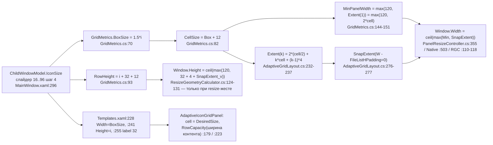

# Workspace Grid — P00 Baseline (аудит фактической геометрии)

**Этап:** P00 пакета [`docs/fix-prompts/`](../fix-prompts/README.md) · **Ветка:** `bugfix/workspace-grid` (от `rc/0.4.0` @ `dde28df`) · **Дата:** 2026-09-22
**Статус:** аудит завершён; реализация **не менялась** (добавлен только characterization-тест `AdaptiveGridLayoutBaselineTests`, пиннящий текущее legacy-поведение).

Документ собран из четырёх параллельных срезов аудита: **A** — writers геометрии и системы координат,
**B** — математика icon layout / panel sizing и репродукция непропорциональных панелей, **C** — icon
loading pipeline (с экспериментом на реальной Windows 11), **D** — ADR-конфликты, инвентарь тестов и
процедура baseline-скриншотов. Везде разделены **ИЗМЕРЕНО/ВЫЧИСЛЕНО** (доказано кодом, тестом или
экспериментом) и **ВИЗУАЛЬНОЕ ПРЕДПОЛОЖЕНИЕ** (не проверено на экране).

## Сводка ключевых находок

| # | Находка | Доказательство | Статус | Этап-адресат |
|---|---|---|---|---|
| F-1 | Snap позиции (`GridSnap.SnapAxis`) квантует **абсолютные** `Left/Top` к глобальному (0,0) виртуального десктопа, не к origin монитора/work area; по умолчанию `GridSize=1` (фактически snap выключен) | `GridSnap.cs:23`, `PanelDragMoveBehavior.cs:283,453,459` | ИЗМЕРЕНО (код) | 02, 03 |
| F-2 | Ширина панели зависит от `IconSize` в трёх местах (только `Grid && SnapResizeToIconGrid`): переснап при каждом старте, при смене `IconSize`/`ViewMode`, в constraints каждого resize-жеста; высота при смене `IconSize` не переснапается | `ChildWindow.xaml.cs:300,873-877`, `ResizeConstraintsFactory.cs:42-52` | ИЗМЕРЕНО (код) | 02, 04 |
| F-3 | **Потеря колонки.** Snap-ширина считается как `Extent(k)` при `GridMetrics.FileListHPadding = 0`, но `PanelChrome` отдаёт контенту колонку `*` рядом с фиксированной колонкой `Width="8"` → `AdaptiveIconGridPanel` получает `W−8`, `RowCapacity(W−8) = k−1`, освободившееся место уходит в stretch-gap (IconSize 48, k=3 → 2 колонки с зазором ≈80 DIP) | `Panels.xaml:93-94,218`, `GridMetrics.cs:63`, `AdaptiveGridLayout.cs:132-141` | ВЫЧИСЛЕНО (формулы; перепроверено оркестратором); визуально не подтверждено | 02, 04, 05 |
| F-4 | Высота полностью отвязана от контента: при старте переснапается только ширина; идентичный однорядный контент даёт ~2.93× разброс высот | `ChildWindow.xaml.cs:283-305`; репро B-3 | ИЗМЕРЕНО (код + реальный state) | 04, 06 |
| F-5 | Stretch-gap полного ряда (ADR-018) делает шаг между иконками зависимым от ширины панели; orphan-row 9+1 | `AdaptiveGridLayout.RowGap` `:198-204`; репро B-1/B-2 | ИЗМЕРЕНО (тест `AdaptiveGridLayoutBaselineTests`) | 01, 05 |
| F-6 | `MonitorDeviceId` не обновляется при drag на другой монитор → на рестарте и на любом `WM_SETTINGCHANGE` панель переносится обратно | см. часть A, writer W5 и §«Как определяются монитор и work area» | ИЗМЕРЕНО (код) | 03 |
| F-7 | Lasso-создание панели пишет физические px как DIP (`App.xaml.cs:387-388`) → на 125–150% позиция/размер умножены на масштаб; новая lasso-панель может быть уже одной колонки | `App.xaml.cs:383-394`; репро B-4 | ИЗМЕРЕНО (код) | 03, 04 |
| F-8 | DPI-манифеста нет → процесс, вероятно, System-DPI-aware, не PerMonitorV2; DPI читается из трёх разных API; семантика `Left/Top` после `SetParent(WorkerW)` при мониторе с отрицательными координатами не определена | часть A §«Системы координат» | ИЗМЕРЕНО (отсутствие манифеста) / ПРЕДПОЛОЖЕНИЕ (поведение WorkerW) — **замерить до этапа 03** | 01, 03 |
| F-9 | **Пропавшие значки:** 20 из 26 элементов в реальном state указывают на несуществующие исходные пути (ярлыки давно перенесены в `PanelItems`; для 19 из 20 в `.manifest.json` есть связь со старым путём); для несуществующего пути `IconProvider` отдаёт placeholder, который **полностью прозрачен** (0/256 непрозрачных пикселей) из-за `using var` DrawingContext, закрываемого после рендера (`IconFactory.cs:36/39`). Видимые значки ровно у 6 существующих элементов | эксперимент с реальным `IconProvider` на Win11 + агрегаты state | ИЗМЕРЕНО (эксперимент); соответствие скрину 1:1 — ВИЗУАЛЬНО не сверено | 08 |
| F-10 | Ошибки загрузки иконок пишутся в `Console.Error` (в GUI-приложении теряются), в JSONL-логах записей об иконках нет; иконка не перечитывается, если файл появился позже; синхронная загрузка ≈2.8 мс/элемент на UI-потоке (200 некешированных ≈0.56 с) | часть C | ИЗМЕРЕНО (эксперимент) | 08 |
| F-11 | Персистентный `DefaultIconSize = 32.0101…` и per-panel `iconSize` не лежат на тиках слайдера (`TickFrequency=4`, `IsSnapToTickEnabled`) — первопричина не установлена | `MainWindow.xaml:296,354` + реальный `user.config` | ИЗМЕРЕНО (данные); причина — открытый вопрос | 02/06 |
| F-12 | Единственный прямой ADR-конфликт — **ADR-018** (stretch-gap vs fixed-gap); ADR-004/011/017/022/024/026 требуют amend; ADR-015/016/021/025 совместимы. ADR-027 существует на диске, но отсутствует в индексе `adr/README.md` (пред-существующий дрейф) | часть D | ИЗМЕРЕНО (чтение ADR) | 01 |

**Сверка срезов.** Срез B не нашёл двойного счёта spacing в item template (5px margin + 1px border =
6px `ItemMargin`, совпадает с ADR-015), срез A нашёл неучтённую колонку 8 DIP хрома `PanelChrome`.
Противоречия нет: это разные уровни (item template vs panel chrome). Оркестратор перепроверил F-3 по
коду: `PART_ContentHost` в `Grid.Column="1"` (`*`), колонка 0 фиксирована `Width="8"`,
`RowCapacity` вычитает `2·edgePadding` из доступной ширины с допуском `LayoutTolerance=0.5` — при
`W = Extent(k)` доступно `W−8`, откуда `floor(k − 7.5/(cell+gap)) = k−1` для любого `cell+gap > 7.5`.

## Baseline прогона (измерено)

- `dotnet build DesktopOrganizer.sln` — **0 ошибок**, 566 предупреждений (StyleCop/analyzers).
- `dotnet test` — **Passed 1925 / Failed 0 / Skipped 0** (≈11 с).
- Новый characterization-тест `tests/DesktopOrganizer.Tests/Unit/Models/AdaptiveGridLayoutBaselineTests.cs` — 4/4 passed (см. часть B).

## Скриншоты

GUI-запуск в сессии аудита **не выполнялся** (приложение встраивается в рабочий стол пользователя
через WorkerW; смена системного DPI — системная настройка). Процедура ручной съёмки 100%/150% DPI для
0/1/2/8 items, Grid/List, collapsed, со структурой `docs/PLANS/assets/workspace-grid-00/` и шаблоном
`measurements.md` — в части D. **Manual verify (Win10/Win11).**

## DoD этапа 00

- [x] Каждый writer геометрии (21: 10 явных оконных, 2 неявных, 9 модельных) и icon loading путь включены в карту (части A, C).
- [x] Измерения отделены от визуальных предположений (маркировка во всех частях).
- [x] Реализация не менялась (`src/` без изменений; добавлен только characterization-тест).
- [x] Репродукция ≥3 непропорциональных панелей (часть B, репро 1–4, на реальном state и формулах) + F-3.
- [ ] Baseline-скриншоты 100%/150% — **manual**, процедура в части D.

## Передача на этап 01

Вопросы для ADR-028/029: (1) источник origin — work area vs monitor bounds (F-1, F-8); (2) учёт
хрома `PanelChrome` в workspace/icon метриках (F-3) — фиксировать как явную константу контракта;
(3) судьба stretch-gap как legacy policy (F-5, ADR-018); (4) обновление `MonitorDeviceId` при
межмониторном drag (F-6); (5) DPI-awareness остаётся System-aware (ADR-022 D-6) или переход на
PerMonitorV2 — отдельное решение, не в рамках пакета без замера (F-8); (6) миграция персистентных
дробных `IconSize` (F-11).

**Итог (закрыто, 2026-09-22).** Все шесть вопросов получили решение в
[ADR-028](../../adr/ADR-028-workspace-grid.md)/[ADR-029](../../adr/ADR-029-icon-layout-policy.md) и
реализованы этапами P02–P08 (см. `docs/ROADMAP.md`, раздел «Ambient Accent Visual System», и сводный
бэклог/manual-verify — `docs/REVIEWS/workspace-grid-debt.md`/`docs/REVIEWS/workspace-grid-manual-verify.md`).
Оба ADR остаются `Proposed` до релизного gate P09 (`docs/fix-prompts/09-acceptance.md`) — реализация и
тесты завершены, живой manual verify на Windows не выполнен в этой среде разработки.

## Часть A — Writers геометрии, dependency graph, системы координат

### Легенда и объём

P00, часть A (аудит, код не менялся). Ветка `bugfix/workspace-grid`. Объём: окно панели `ChildWindow` и его модель `ChildWindowModel`. `SystemIconsPanelWindow` упомянут только для контекста.

- **ИЗМЕРЕНО** — факт доказан статическим чтением кода, ссылка `file:line`. Рантайм-замеров не было: GUI в этом аудите не запускался.
- **ПРЕДПОЛОЖЕНО** — зависит от поведения Windows/WPF в рантайме или вычислено по формулам без проверки на экране. Требует manual verify на Win10/Win11.
- Все пути даны относительно `src/`. Префиксы: `UI/` = `DesktopOrganizer.UI/`, `Svc/` = `DesktopOrganizer.Services/`, `Abs/` = `DesktopOrganizer.Services.Abstractions/`.

Реальные имена свойств модели (ИЗМЕРЕНО, `UI/Models/ChildWindowModel.cs`):
- `Position : System.Drawing.Point` (:141) и `Size : System.Drawing.Size` (:146). Обе — `int`, **без INPC**.
- `MonitorDeviceId` (:136), без INPC.
- `IconSize : double` (:92, INPC, по умолчанию 48), `ViewMode` (:101, INPC), `IsRolledUp` (:162, INPC).
- Свойств `X/Y/Width/Height/Bounds` у модели **нет**. Плоские `X/Y/Width/Height : int` есть только в DTO `UI/State/Dto/PanelGeometryDto.cs:13-19`.

### Writers геометрии

Всего **21 writer**: 10 явных оконных (W1–W10), 2 неявных (W11–W12) и 9 модельных (M1–M9).

Значения по умолчанию (ИЗМЕРЕНО, `UI/Properties/Settings.Designer.cs`):
- `GridSize = 1` (:40) — позиционный snap по умолчанию **выключен** (`UI/Models/GridSnap.cs:21`).
- `GridSnapDistance = 12` (:173).
- `SnapResizeToIconGrid = True` (:149).
- `NativePanelSizing = False` (:161).
- `DefaultIconSize = 48` (:88).

#### A. Оконные writers (`Window.Left/Top/Width/Height` у `ChildWindow`)

| # | Writer (file:line) | Что пишет | Триггер | Квантизация / snap | Единицы | Origin | Отрицательные координаты | Повторная запись / рекурсия | Persist |
|---|---|---|---|---|---|---|---|---|---|
| W1 | `ChildWindow.Initialize` — `UI/Views/ChildWindow.xaml.cs:287-288` | `Left/Top ← model.Position` | `WindowManager.CreateChildWindow` (`UI/Services/WindowManager.cs:88`), который вызывается при старте (`LoadWindowsState` :282-287), из AddPanel, лассо и restore снапшота | Своей нет. До вызова `Position` уже прошёл `ResolveMonitorPlacement → ClampIntoMonitor` (WindowManager.cs:85, :392) | DIP, int | Пространство Left/Top окна; до `SetParent` = экран. См. раздел «Системы координат» | int передаётся как есть | Запись идёт до `Show()`. `OnLocationChanged` → M1 перезаписывает `Position` тем же значением. Рекурсии нет: `Position` без INPC | Сам не пишет, дальше идёт через M1 |
| W2 | `ChildWindow.Initialize` — `:290-291` | `Width/Height ← model.Size`, только если значение > 0. Иначе остаются XAML-значения 260×300 (`UI/Views/ChildWindow.xaml:24`) | то же | Своей нет. WPF-коэрсия `MinWidth=120` / `MinHeight=32` (ChildWindow.xaml:25) | DIP, int | — | — | Сразу после этого `Width` перезаписывается в W3/W4 (:300). Рядом `ExpandedHeight = Height` (:294) | через M2 |
| W3 | `PanelResizeController.SnapWidthToGrid` — `UI/Behaviors/PanelResizeController.cs:342-358` (запись на :355). Путь через Thumb | `Width` | (1) `Initialize` (ChildWindow.xaml.cs:300). (2) `OnModelPropertyChanged` на `IconSize`/`ViewMode` (:873-877) | Только при `ViewMode==Grid && SnapResizeToIconGrid`: `ceil(max(GridMetrics.MinPanelWidth(icon), AdaptiveGridLayout.SnapExtent(W - FileListHPadding(0), CellSize(icon), 4, cell*0.5)))` | DIP. `ceil` округляет до целого **DIP**, а не до device px | Только размер. Left фиксирован, двигается правый край | n/a | Высота не квантуется. Нет проверки на коллизии и выход за work area | Размер попадает в модель через M2. Сохраняет вызывающий код: `SelectedPanelSettingsViewModel.Apply` (:138-144) или `SwitchView` → `FilesChanged` (UI/ViewModels/ChildWindowViewModel.cs:886-890 → ChildWindow.xaml.cs:270). После Initialize сохранения нет до следующего save |
| W4 | `NativePanelResizeController.SnapWidthToGrid` — `UI/Behaviors/NativePanelResizeController.cs:491-506`, запись через `SetWidthDelegate` (:233) | `Width` | Те же триггеры, что у W3, но на native-пути (выбирается один раз в конструкторе, ChildWindow.xaml.cs:135-136) | Та же формула, что в W3 — это дубликат | DIP, ceil | как W3 | n/a | как W3 | как W3 |
| W5 | `PanelDragMoveBehavior.OnTitleBarMouseMove` — `UI/Behaviors/PanelDragMoveBehavior.cs:325-326` | `Left/Top` | Каждый MouseMove после пересечения системного порога drag (:231-233) | (1) `GridSnap.Snap(raw, GridSize, GridSnapDistance)` (:283). (2) Только в Edit Layout (ADR-026): `SnapGuideCalculator.Snap`, порог 8 DIP (:291-317; `UI/Models/SnapGuideCalculator.cs:76`). (3) Всегда последним: `PanelCollision.ClampAgainstObstacles` (:322-323) | DIP. Дельта курсора в px делится на `VisualTreeHelper.GetDpi(window)` (:220-223) | GridSnap: **абсолютный 0 пространства Left/Top**. Guides: края соседних панелей. Work area — только мягкий guard для guides (SnapGuideCalculator.cs:218-223) | `Math.Round(raw/grid)*grid` (GridSnap.cs:23) симметричен по знаку; на .5 банковское округление | Нет clamp в work area. `MonitorDeviceId` **не обновляется** | M1 срабатывает на каждом кадре. `SaveWindowsState` вызывается в `EndDrag` (:397) |
| W6 | `PanelDragMoveBehavior.SnapToGrid` — `:444-464` (Left на :457, Top на :463) | `Left`, `Top` — отдельно по каждой оси | (1) `EndDrag` после реального drag (:387). (2) Конец resize при `ShouldPersist`: PanelResizeController.cs:399-402 и NativePanelResizeController.cs:596-600 (делегат `snapToGrid`) | `GridSnap.SnapAxis` с тем же порогом. Ось откатывается, если `PanelCollision.CreatesNewOverlap` (:456, :462). После resize список obstacles пуст (:437-441) | DIP | глобальный 0 | как W5 | После resize за левый/верхний край сдвигает панель, не меняя `Width`. Противоположный край «уезжает» на величину до `GridSnapDistance` (при `GridSize>1`) | `Save` сразу после (:397 / PanelResizeController.cs:402 / NativePanelResizeController.cs:599) |
| W7 | `PanelResizeController.OnResizeDragDelta` — `:195-210` (запись на :207-210) | `Left/Top/Width/Height` | `Thumb.DragDelta` одного из 8 Thumb (ChildWindow.xaml:331-338, полоса 6 DIP :321-328) | `ResizeGestureSession.TryUpdate` (UI/Interaction/ResizeGestureSession.cs:161-174) → `ResizeGeometryCalculator.Apply` (UI/Interaction/ResizeGeometryCalculator.cs:77-163). Grid+snap: ширина = `ceil(max(Min, SnapExtent(W-0, CellSize, 4, cell/2)))`, высота = `ceil(max(120, 32+4+SnapExtent(H-32-4, RowHeight, 4, 0)))`. Иначе свободно. `Min` берётся из `ResizeConstraintsFactory` (UI/Behaviors/ResizeConstraintsFactory.cs:31-62) | DIP. Дельты Thumb — в DIP | Якоря `anchorRight/Bottom = StartBounds.Right/Bottom` (ResizeGestureSession.cs:139-140). Позиция краёв **не** снапается | n/a | Constraints фиксируются один раз на жест (PanelResizeController.cs:133). Обратный путь через M1/M2 без рекурсии | `EndResize`: при `ShouldPersist` → `SnapToGrid` (W6) + `Save` (:399-403) |
| W8 | `NativePanelSizingService.OnSizing` — `Svc/Tools/NativePanelSizingService.cs:373-391`: `ReadRect → ProposeBounds → WriteRect` на :385-387 | Прямоугольник окна в `lParam` сообщения `WM_SIZING`; применяет его сама ОС | `WM_SIZING` внутри модального цикла `DefWindowProc`. Hit-test делает `NativeHitTestMapper` (UI/Interaction/Native/NativeHitTestMapper.cs:37-76), рамка 6 DIP (NativePanelResizeController.cs:48) | `NativePanelResizeController.ProposeBounds` (:327-462): калибровка origin (:369-379) → px→DIP (:381) → тот же `Apply`, что в W7, через синтетическую дельту (:404-410) → DIP→px с `Math.Round` ToEven (:456; NativeSizingCoordinateMapper.cs:33-41) → обратный offset (:457-461) | На границе px, внутри DIP. Масштаб = `GetDpiForWindow/96` (Svc/Tools/NativeApi.cs:633-653) | `GetWindowRect` (экран) плюс offset пространства WM_SIZING, который калибруется на каждый жест (UI/Interaction/Native/NativeSizingOriginResolver.cs:33-34) | Знаковые `LoWord/HiWord` (NativePanelSizingService.cs:163-166). `ToPx` использует Round | То, что WPF синхронизирует Left/Top/Width/Height из HWND, утверждается только комментарием (NativePanelResizeController.cs:569-575) — **ПРЕДПОЛОЖЕНО**. Дальше M1/M2 | `WM_EXITSIZEMOVE` → `PersistAfterGesture` (:596-600) синхронно. Остальные концы жеста откладываются через Dispatcher с приоритетом Background (:562-563) |
| W9 | `RollUpBehavior.ApplyRollUp` — `UI/Behaviors/RollUpBehavior.cs:153-154`; при Completed — :148-149 | `Height` (анимация 150 ms) | `ToggleRollUp` (:87-97): двойной клик по заголовку (PanelDragMoveBehavior.cs:170-173), кнопка или пункт меню (ChildWindow.xaml.cs:475). Также `Initialize`, если `IsRolledUp` (:304) | Нет. Свёрнутая высота = `PanelMetrics.HeaderHeight = 32` (UI/Models/PanelMetrics.cs:15). Развёрнутая = `_expandedHeight`, снимок перед сворачиванием (:92) | DIP | — | — | `IsRolledUp=true` ставится **до** анимации (:94), поэтому M2 при сворачивании не пишет. При разворачивании M2 пишет промежуточные высоты. Счётчик поколений защищает от гонки (:119, :146) | `Save` (:96) |
| W10 | `WindowManager.OnMonitorsChanged` — `UI/Services/WindowManager.cs:441-469` (запись на :464-465) | `Left/Top ← model.Position` | `MonitorService.MonitorsChanged`. Поднимается на `WM_DISPLAYCHANGE` **и на любой `WM_SETTINGCHANGE`** (Svc/Tools/MonitorService.cs:72-73) | `ClampIntoMonitor` (M3) в WorkArea монитора `MonitorDeviceId`. Если монитор пропал — primary, без поиска по позиции (:449-458) | DIP int. Мониторы — px, делённые на system DPI | WorkArea монитора (экранные DIP) | int clamp | `Size` не трогается и не перемасштабируется | `SaveWindowsState` (:468) |
| W11 (неявный) | WPF: значения по умолчанию и коэрсия из XAML — `UI/Views/ChildWindow.xaml:24-26` | `Width=260`, `Height=300`, `MinWidth=120`, `MinHeight=32`, `WindowStartupLocation=Manual` | Создание окна. Также любой set ниже минимума | Коэрсия | DIP | — | — | — | — |
| W12 (неявный) | `DesktopIntegrationService.EmbedInDesktop` → `SetParent(hwnd, WorkerW)` — `Svc/Tools/DesktopIntegrationService.cs:52-65` (SetParent на :64). Вызов: `ChildWindow.OnSourceInitialized` (ChildWindow.xaml.cs:325) | Координат не пишет, но **меняет систему координат**: окно становится дочерним для WorkerW. `WS_CHILD` не ставится, ставятся только `WS_EX_TOOLWINDOW|NOACTIVATE` (:75-80) | Первый `Show()` | — | — | Пространство WorkerW (ПРЕДПОЛОЖЕНО, см. ниже) | — | — | — |

`SetWindowPos` / `MoveWindow` в native-коде (ИЗМЕРЕНО): `DesktopIntegrationService.SendToBackOfZOrder` (:96-144) вызывает `SetWindowPos` с флагами `SWP_NOMOVE|SWP_NOSIZE`, и его вызывает только `SystemIconsPanelManager.cs:343`. Для `ChildWindow` вызовов `SetWindowPos`/`MoveWindow` **нет**. Геометрию native-кода меняет только W8 (`WriteRect`).

> **Исправление 2026-10-09 (ADR-audit, [ADR-049](../../adr/ADR-049-desktop-band-top-level-fence-panels.md)):** утверждение «для `ChildWindow` вызовов `SetWindowPos` нет» **больше неверно** (а `SendToBackOfZOrder` ещё и вызывается не только из `SystemIconsPanelManager`: ранее — также из shell-restart recovery панели). Теперь `DesktopIntegrationService.KeepInDesktopBand` (для top-level панелей, режим T) вызывает `SetWindowPos` с `SWP_NOMOVE|SWP_NOSIZE|SWP_NOACTIVATE|SWP_NOOWNERZORDER` и `hWndInsertAfter` из «полосы рабочего стола», а фильтр `WM_WINDOWPOSCHANGING` (`ChildWindow.ZOrder.cs`) переписывает Z-order-половину `WINDOWPOS`. Эти вызовы **не меняют геометрию** (`SWP_NOMOVE|SWP_NOSIZE`; кадры перемещения/ресайза фильтр пропускает по `SWP_NOZORDER`), поэтому таблица writer’ов геометрии выше остаётся полной.

#### B. Модельные writers (`ChildWindowModel.Position/Size/MonitorDeviceId/IsRolledUp`)

| # | Writer (file:line) | Что пишет | Триггер | Квантизация | Единицы / origin | Отрицательные | Повторная запись | Persist |
|---|---|---|---|---|---|---|---|---|
| M1 | `ChildWindow.OnLocationChanged` — `ChildWindow.xaml.cs:442-446` | `Position = ((int)Left, (int)Top)` | Любое изменение положения окна (WM_MOVE / set Left/Top) | Усечение `(int)` | DIP; пространство Left/Top | `(int)` усекает к нулю, это асимметрично: −100.7 → −100, +100.7 → 100 | Нет: свойство без INPC | Это источник для `PanelStateMapper.ToDto` (UI/State/PanelStateMapper.cs:33-42) |
| M2 | `ChildWindow.OnRenderSizeChanged` — `:456-461` | `Size = ((int)Width, (int)Height)`. Пропускается при `IsRolledUp` | Любое изменение render size | Усечение `(int)`. Читается `Width/Height`, **не** `ActualWidth/ActualHeight` | DIP | — | Нет. Если `IconSize` меняется при свёрнутой панели, W3 меняет `Width`, но M2 его не запишет (guard) | как M1 |
| M3 | `WindowManager.ClampIntoMonitor` — `WindowManager.cs:404-423` (запись на :422) | `Position` | `ResolveMonitorPlacement` (:392) внутри `CreateChildWindow` (:85); `OnMonitorsChanged` (:462) | Clamp в `WorkArea`. Выход без изменений, если панель целиком внутри (:414-416). Для размера берётся `model.Size` | DIP int; WorkArea выбранного монитора | корректно | — | Сохраняет вызывающий код |
| M4 | `WindowManager.ResolveMonitorPlacement` — `:391`; `OnMonitorsChanged` — `:456` | `MonitorDeviceId` | Создание/restore; стёртый монитор | `FindByDeviceName` → `FindMonitorAt(top-left)` (`Bounds.Contains`, MonitorService.cs:111-112) → primary | — | — | **При drag/resize на другой монитор не обновляется.** Других writer-ов нет (grep: только WindowManager.cs:391, :456 и PanelStateMapper.cs:79) | как M1 |
| M5 | `App.CreateLassoPanel` — `UI/App.xaml.cs:383-394` (запись на :387-388) | `Position = (args.X, args.Y)`, `Size = max(120, args.W/H)` | `DesktopGestureService.LassoCompleted` (UI/App.xaml.cs:322) | Snap нет. Новая панель по умолчанию в `List` (ChildWindowModel.cs:24), поэтому W3 ничего не делает | **Физические px** записываются в DIP-поля без конверсии: `MSLLHOOKSTRUCT.pt` (Svc/Tools/NativeApi.cs:407-413) → `DesktopGestureStateMachine.cs:159-163` → `DesktopLassoEventArgs` («screen pixels», Abs/Events/DesktopLassoEventArgs.cs:9-16). Цепочка ИЗМЕРЕНА. То, что `pt` физический, — ПРЕДПОЛОЖЕНО | int | Дальше `CreateChildWindow` → M3/M4 | `SaveWindowsStateNow` (:393) |
| M6 | `PanelStateMapper.FromDto` — `UI/State/PanelStateMapper.cs:77-81` | `Position/Size/MonitorDeviceId/WindowState/IsRolledUp` | Загрузка документа → `WindowManager.LoadWindowsState` (:282-287) | нет | int DIP как сохранено | — | — | — |
| M7 | `LayoutSnapshotService.Restore` — `UI/Services/LayoutSnapshotService.cs:78-116` (`Deserialize<ChildWindowModel>` на :97 → `CreateChildWindow` на :110) | Все поля модели | Restore снапшота из UI | Только M3/M4 | int DIP как было при Capture | — | Capture (:43-75): `SyncAllWindowsToModels` (:51) синхронизирует только `FilePaths` (ChildWindow.xaml.cs:310-318). Геометрия берётся из M1/M2 как есть, затем `JsonSerializer.Serialize(ChildWindowModel)` (:53-55) | `SaveWindowsStateNow` (:115) |
| M8 | `MainWindowViewModel.AddPanel` — `UI/ViewModels/MainWindowViewModel.cs:449-469` | Неявно: `Position=(0,0)`, `Size=(0,0)` | Кнопка Add panel | Нет. `Size=0` → XAML 260×300 (W11). `(0,0)` → `FindMonitorAt((0,0))` | Глобальный (0,0) | — | Все новые панели ложатся в одну точку; коллизии при создании не проверяются | Явного `Save` в `AddPanel` нет |
| M9 | `RollUpBehavior.ToggleRollUp` — `RollUpBehavior.cs:94` | `IsRolledUp` | см. W9 | — | — | — | Определяет, какой `Size` сохранится (guard в M2) и какую высоту имеет панель как obstacle (WindowManager.cs:148-150) | `Save` (:96) |

#### C. Входы, которые запускают writers (сами не writers)

**`IconSize`** запускает W3/W4. Кто его пишет:
- `SelectedPanelSettingsViewModel.cs:85-89` — слайдер 16–96, шаг 4 (`UI/Views/MainWindow.xaml:296`);
- `AddPanel` (MainWindowViewModel.cs:464);
- лассо (App.xaml.cs:406);
- `FromDto` (PanelStateMapper.cs:87).

**`ViewMode`** тоже запускает W3/W4. Кто его пишет: `ChildWindowViewModel.SwitchView` (:886-890) и `SelectedPanelSettingsViewModel.cs:92-96`.

**Глобальные настройки** (`GlobalDefaultsViewModel.cs:33-91`): `GridSize`, `GridSnapDistance`, `SnapResizeToIconGrid`. Ни один writer на их изменение **не запускается**: подписчиков нет, настройки читаются только в начале следующего жеста или на следующем триггере W3/W4. ИЗМЕРЕНО grep-ом.

#### D. Проверено — writer-ов нет (ИЗМЕРЕНО)

- **Virtual desktops.** Для `ChildWindow` writer-ов 0. Весь VD-код находится в `SystemIconsPanelManager` (:499-610). `ChildWindow` живёт в WorkerW, а это один слой на все столы (ADR-016).
- **Re-attach WorkerW после рестарта Explorer.** Кода нет: grep по `TaskbarCreated` / `RegisterWindowMessage` / re-embed даёт 0 совпадений. `EmbedInDesktop` вызывается один раз (ChildWindow.xaml.cs:325).
- **Смена DPI.** Реакция одна: `NativePanelResizeController.DpiChanged` (:471-480) только завершает жест, геометрию не пересчитывает.
- **Edit layout (ADR-026).** Влияет только на gating (`LayoutGesturePolicy`, ChildWindow.xaml.cs:148-151, :227-230, :921-933) и включает шаг `SnapGuideCalculator` внутри W5. Сам `LayoutEditModeService` геометрию не пишет.
- **`PageManagerService`** управляет только видимостью.
- **Вне объёма `ChildWindow`:** `SystemIconsPanelManager.PositionWindow` (`UI/Services/SystemIconsPanelManager.cs:674-681`) пишет `Left/Top/Height` из WorkArea primary. Это top-level окно (ADR-019).

### Dependency graph

```mermaid
flowchart TD
  subgraph SET["Настройки / VM"]
    GDVM["GlobalDefaultsViewModel<br/>GlobalDefaultsViewModel.cs:33-118"]
    AS["IAppSettings / AppSettings<br/>GridSize=1, GridSnapDistance=12,<br/>SnapResizeToIconGrid=true,<br/>NativePanelSizing=false, DefaultIconSize=48"]
    SPVM["SelectedPanelSettingsViewModel<br/>IconSize :85, ViewMode :92"]
    CWVM["ChildWindowViewModel.SwitchView :886"]
    LEM["ILayoutEditModeService + LayoutGesturePolicy<br/>(ADR-026)"]
  end

  subgraph MODEL["Модель"]
    CWM["ChildWindowModel<br/>Position/Size int DIP, MonitorDeviceId,<br/>IconSize, ViewMode, IsRolledUp"]
  end

  subgraph PURE["Чистая геометрия"]
    GS["GridSnap<br/>абсолютный 0"]
    GM["GridMetrics<br/>BoxSize/CellSize/RowHeight/MinPanelWidth<br/>FileListHPadding=0, FileListVPadding=4, MinPanelSize=120"]
    AGL["AdaptiveGridLayout<br/>Extent/SnapExtent/RowCapacity/RowGap<br/>MinGap=4, EdgeRatio 0.5 / 0"]
    PC["PanelCollision"]
    SGC["SnapGuideCalculator (8 DIP)"]
    RCF["ResizeConstraintsFactory"]
    RGS["ResizeGestureSession"]
    RGC["ResizeGeometryCalculator.Apply"]
    NMAP["NativeSizingCoordinateMapper<br/>NativeSizingOriginResolver<br/>NativeHitTestMapper"]
  end

  subgraph VIEW["View / Behaviors"]
    CW["ChildWindow.xaml.cs<br/>Initialize, OnLocationChanged,<br/>OnRenderSizeChanged, OnModelPropertyChanged"]
    CWX["ChildWindow.xaml<br/>260x300, MinW 120, MinH 32,<br/>Thumb overlay 6 DIP"]
    PCH["Panels.xaml PanelChrome<br/>колонка 8 + *, header 32"]
    TPL["Templates.xaml GridViewTemplate<br/>Margin 5 + border 1, label 32"]
    IBW["IconBoxWidthConverter"]
    AIGP["AdaptiveIconGridPanel<br/>(измеренный DesiredSize)"]
    PDMB["PanelDragMoveBehavior<br/>live drag + SnapToGrid"]
    PRC["PanelResizeController (Thumb)"]
    NPRC["NativePanelResizeController"]
    RUB["RollUpBehavior"]
    NSS["NativeSizingSwitch"]
  end

  subgraph SVC["Сервисы / native"]
    WM["WindowManager<br/>ResolveMonitorPlacement, ClampIntoMonitor,<br/>OnMonitorsChanged, CollectOtherPanelBounds"]
    MS["MonitorService<br/>px / system DPI"]
    NPSS["NativePanelSizingService<br/>WM_NCHITTEST/SIZING/..."]
    DIS["DesktopIntegrationService<br/>SetParent WorkerW"]
    NAPI["INativeApi<br/>GetMonitorInfos, GetSystemDpiScale,<br/>GetWindowRect, GetDpiForWindow,<br/>ReadRect/WriteRect, ReadMouseHookPoint"]
    DGS["DesktopGestureService<br/>лассо, px"]
    APP["App.CreateLassoPanel"]
    MWVM["MainWindowViewModel.AddPanel"]
  end

  subgraph PERS["Persistence"]
    ASS["ApplicationStateService.PersistNow"]
    PSM["PanelStateMapper + PanelGeometryDto (int)"]
    LSS["LayoutSnapshotService Capture/Restore"]
  end

  GDVM --> AS
  SPVM --> CWM
  CWVM --> CWM
  AS -->|DefaultIconSize| MWVM
  AS -->|DefaultIconSize| APP

  CW -->|NativePanelSizing| NSS
  NSS -->|выбор пути| PRC
  NSS -->|выбор пути| NPRC
  CW --> PDMB
  CW --> RUB
  CW -->|OnSourceInitialized| DIS
  CW -->|OnModelPropertyChanged IconSize/ViewMode + Initialize| PRC
  CW -->|OnModelPropertyChanged IconSize/ViewMode + Initialize| NPRC
  CW -->|M1/M2| CWM
  CWM -->|W1/W2| CW
  CWX --> CW
  PCH --> CWX

  PDMB -->|GridSize, GridSnapDistance| AS
  PDMB --> GS
  PDMB --> PC
  PDMB -->|только IsEditing| SGC
  PDMB --> LEM
  PDMB -->|obstacles| WM
  PDMB -->|снимок мониторов| MS

  PRC --> RCF
  NPRC --> RCF
  RCF -->|SnapResizeToIconGrid, ViewMode, IconSize| GM
  PRC --> RGS
  NPRC --> RGS
  RGS --> RGC
  RGC --> AGL
  PRC -->|SnapWidthToGrid| GM
  NPRC -->|SnapWidthToGrid| GM
  PRC -->|SnapWidthToGrid| AGL
  NPRC -->|SnapWidthToGrid| AGL
  GM -->|MinPanelWidth| AGL
  PRC -->|snapToGrid в конце| PDMB
  NPRC -->|snapToGrid в конце| PDMB
  NPRC --> NMAP
  NPSS -->|INativePanelSizingClient| NPRC
  NPSS --> NAPI

  TPL --> AIGP
  AIGP --> AGL
  TPL --> IBW
  IBW --> GM
  CWM -->|IconSize binding| TPL
  PCH -.->|"8 DIP не учтены в FileListHPadding=0"| GM

  RUB -->|IsRolledUp| CWM
  WM -->|IsRolledUp для высоты obstacle| CWM

  WM -->|FindByDeviceName/FindMonitorAt/Primary| MS
  MS --> NAPI
  MS -->|MonitorsChanged: WM_DISPLAYCHANGE / WM_SETTINGCHANGE| WM
  WM -->|M3/M4, W10| CWM
  WM -->|CreateChildWindow → Initialize| CW

  DGS -->|px| APP
  DGS --> NAPI
  APP -->|M5| WM
  MWVM -->|M8| WM

  ASS -->|SyncAllWindowsToModels| WM
  ASS --> PSM
  PSM -->|ToDto/FromDto| CWM
  PSM -->|LoadWindowsState| WM
  LSS -->|Serialize ChildWindowModel| CWM
  LSS -->|Restore → CreateChildWindow| WM
```



Ключевые связи (все ИЗМЕРЕНО):
- `GridMetrics` и `AdaptiveGridLayout` используют **две** независимые пары потребителей:
  - resize-snap окна: W3/W4/W7/W8 через `ResizeConstraintsFactory` и `ResizeGeometryCalculator`;
  - раскладка иконок в рантайме: `AdaptiveIconGridPanel`.

  Их согласованность держится на ручной синхронизации констант. `ResizeSnapEdgePadding` продублирован 3 раза: PanelResizeController.cs:370-371, NativePanelResizeController.cs:520-521, ResizeGeometryCalculator.cs:180-181. Формула `SnapWidthToGrid` продублирована 2 раза.
- Хром `PanelChrome` (Panels.xaml:93) в `GridMetrics` не отражён.
- `GridSnap` и `SnapGuideCalculator` используются **только** в `PanelDragMoveBehavior`. Resize-контроллеры доходят до `GridSnap` через делегат `snapToGrid` = `PanelDragMoveBehavior.SnapToGrid` (ChildWindow.xaml.cs:184, :218).

### Системы координат, мониторы, DPI

#### DPI awareness

- **ИЗМЕРЕНО:** в репозитории нет ни одного `*.manifest` (проверено через `find`). В `DesktopOrganizer.UI.csproj` нет `ApplicationManifest`. Grep по `dpiAware|PerMonitor|SetProcessDpi|DpiAwareness|HighDpi` в cs/csproj/props/manifest даёт 0 совпадений. Это совпадает с ADR-022 D-6 и ADR-004 («системный (System DPI) режим WPF»).
- **ПРЕДПОЛОЖЕНО:** процесс работает в режиме System-DPI-aware (так ведёт себя WPF без манифеста), **не PerMonitorV2**. Следствия:
  - на мониторе с DPI, отличным от системного, Windows растягивает окно как bitmap;
  - `WM_DPICHANGED` не приходит;
  - для child-окна WorkerW `WM_DPICHANGED_AFTERPARENT` может тоже не прийти (ADR-022 D-6; NativePanelSizingService.cs:425-451).

#### Источники DPI — используются три разных API (ИЗМЕРЕНО)

| Где | API | Для чего |
|---|---|---|
| `MonitorService.GetMonitors` — Svc/Tools/MonitorService.cs:88-90, `ToDipRect` :122-126 | `GetSystemDpiScale` = `GetDeviceCaps(LOGPIXELSX)` экранного DC (NativeApi.cs:524-538) | px→DIP для Bounds/WorkArea **всех** мониторов одним коэффициентом, без округления |
| `PanelDragMoveBehavior` — :220-223 | `VisualTreeHelper.GetDpi(window)` | Дельта курсора `PointToScreen` (px) → DIP |
| `NativePanelSizingService` — :330, :365 | `GetDpiForWindow/96`, fallback на system (NativeApi.cs:633-653) | px↔DIP в native resize |
| `App.GetPrimaryDpiScale` — UI/App.xaml.cs:85-89 | `Graphics.DpiX` | Только диагностика |
| Лассо — App.xaml.cs:387-388 | **Нет конверсии** | px записываются как DIP (M5) |

- **ПРЕДПОЛОЖЕНО:** для System-aware процесса эти три значения совпадают. При переходе на PMv2 они разойдутся: `MonitorService` с одним коэффициентом станет неверным для мониторов с разным DPI.
- **ПРЕДПОЛОЖЕНО:** после смены масштаба «на лету» system DPI у System-aware процесса не обновится до перелогина. При этом `OnMonitorsChanged` пересчитывает только `Position` через clamp, а `Size` не пересчитывается (W10).

#### Конверсия px↔DIP и округления (ИЗМЕРЕНО)

- **Мониторы.** Деление без округления (MonitorService.cs:125).
- **Native resize.**
  - `ToDip` точный (NativeSizingCoordinateMapper.cs:21-22).
  - `ToPx` округляет каждый край по `Math.Round` (ToEven) (:33-41).
  - Hit-test переводит рамку 6 DIP в px как `borderDip*scale` (NativeHitTestMapper.cs:51).
- **Resize-snap.** `Math.Ceiling` применяется к значению в **DIP** (ResizeGeometryCalculator.cs:111, :125; PanelResizeController.cs:355; NativePanelResizeController.cs:503). Комментарий в PanelResizeController.cs:350-354 говорит про «whole pixel», но на 125%/150% целое число DIP не даёт целого числа px: 257 DIP × 1.5 = 385.5 px. Округление до px затем делает WPF/ОС — ПРЕДПОЛОЖЕНО.
- **Persistence.** Усечение `(int)` в M1/M2. В схеме `PanelGeometryDto` поля `X/Y/Width/Height : int` (:13-19). Дробные DIP на 125%/150% (например, результат drag или свободного resize) теряют до 1 DIP за каждый цикл «запись → restart». Для отрицательных координат усечение идёт к нулю, то есть в сторону `+`.

#### Пространства координат

1. **Экранные физические px** (Win32): `GetWindowRect`, `MSLLHOOKSTRUCT.pt`, `lParam` у `WM_NCHITTEST`, `GetMonitorInfo`. INativeApi.cs:311-319 прямо пишет: «GetWindowRect … ALWAYS in screen coordinates».
2. **Экранные DIP в system scale:** `MonitorInfo.Bounds/WorkArea`. Контракт — `Abs/Interfaces/IMonitorService.cs:6-8` и `Abs/MonitorInfo.cs:8-10`, там сказано «virtual-desktop DIP coordinates», primary в (0,0).
3. **Пространство `Window.Left/Top` панели.** После `SetParent(WorkerW)` без `WS_CHILD` (W12) пространство **не определено кодом** — ПРЕДПОЛОЖЕНО, критично:
   - `docs/PLANS/sidebar-virtual-desktop-redesign.md:390-399` утверждает со ссылкой на ADR-016: сеттер `Window.Left` у child WorkerW работает в клиентских координатах родителя, а геттер читается из `GetWindowRect`. Там же: «`(0,0)` означало левый верхний угол `WorkerW`, т.е. **виртуального экрана**». В самом ADR-016 такой формулировки grep не нашёл.
   - `NativeSizingOriginResolver.cs:14-20` называет пространство `WM_SIZING` для такого окна «undocumented» и калибрует его на каждый жест.
   - Если утверждение верно, то при `SM_XVIRTUALSCREEN/SM_YVIRTUALSCREEN ≠ 0` (монитор левее или выше основного) запись W1 и чтение M1 расходятся на это смещение. Отсюда возможен дрейф на цикле Initialize → OnLocationChanged → persist. Кроме того, `ClampIntoMonitor` и `FindMonitorAt` (экранные DIP) сравнивают значения из разных пространств.
   - На одном мониторе, и когда основной монитор левый-верхний, разницы нет.
   - **Обязателен manual verify** до реализации этапа 03.
4. **Пространство `WM_SIZING`** — калибруется на каждый жест (W8).
5. **Внутренние координаты раскладки иконок** — относительно `PART_ContentHost` (`AdaptiveIconGridPanel`).

#### Origin для snap (ИЗМЕРЕНО)

- **`GridSnap`.** Делит абсолютные `Left/Top` на `GridSize` (GridSnap.cs:23; вызовы в PanelDragMoveBehavior.cs:283, :453, :459). Значит, сетка **привязана к (0,0) пространства Left/Top**: это экран primary либо, по п. 3, origin WorkerW / виртуального экрана. К origin монитора или WorkArea сетка **не** привязана.
  - Пример 1: верхний taskbar, `WorkArea.Top=48`, `GridSize=32` → линии идут на 32/64, край 48 не на сетке.
  - Пример 2: вторичный монитор с `Left=-1366`, `GridSize=32` → −1366/32 = −42.69, край не на сетке.
  - Оговорка: по умолчанию `GridSize=1` и snap выключен. Эффект появляется, только когда пользователь двигает слайдер (MainWindow.xaml:109, диапазон 1–128, без привязки к тикам).
- **Resize-snap** квантует только протяжённость (ширину/высоту). Позицию краёв он не выравнивает: якорем служит край на момент старта жеста (ResizeGestureSession.cs:139-140). Позиция снапается только в W6 в конце жеста.
- **Guides** (Edit Layout) привязаны к краям соседних панелей (SnapGuideCalculator.cs:120-145).
- **Clamp** идёт в WorkArea монитора (WindowManager.cs:406).

#### Как определяются монитор и work area (ИЗМЕРЕНО)

| Путь | Правило | Где |
|---|---|---|
| Создание, restore, лассо, AddPanel, snapshot | `MonitorDeviceId` → `FindByDeviceName`; иначе `FindMonitorAt(top-left)` через `Bounds.Contains`; иначе primary. Затем clamp в **WorkArea** | WindowManager.cs:380-393; MonitorService.cs:111-120 |
| `OnMonitorsChanged` (любой `WM_SETTINGCHANGE`/`WM_DISPLAYCHANGE`) | `MonitorDeviceId`; если монитор пропал — сразу primary, **без** поиска по позиции | WindowManager.cs:449-458 |
| Drag: guides | Монитор, чьи `Bounds` содержат текущий top-left, берётся из снимка на жест | PanelDragMoveBehavior.cs:263-265, :303-312 |
| Drag и resize: сама позиция | Монитор не определяется, `MonitorDeviceId` не меняется, clamp в work area нет | — |
| Native resize: DPI | `GetDpiForWindow` окна | NativeApi.cs:633 |

Источник данных о мониторах: `EnumDisplayMonitors` + `GetMonitorInfo` (`rcMonitor`, `rcWork`) (NativeApi.cs:491-521). Уведомления приходят через скрытое top-level окно `WS_POPUP`: message-only окно не получает broadcast (NativeApi.cs:559-566).

#### Отрицательные координаты (ИЗМЕРЕНО)

- `GridSnap` работает через `Math.Round` и симметричен по знаку. `ClampIntoMonitor` работает с отрицательными WorkArea корректно.
- Native-путь: знаковые `LoWord/HiWord` (NativePanelSizingService.cs:163-166); маппер покрыт тестами на отрицательные координаты (ADR-022 D-3).
- Асимметрия есть только в усечении `(int)` в M1/M2/M3 (к нулю).
- `FindMonitorAt` проверяет только top-left. Если панель верхним-левым углом вышла за все мониторы (такое возможно после drag, clamp в work area нет), при restore она уходит на primary.

### IconSize → panel size цепочка

#### Цепочка (ИЗМЕРЕНО)



**Где ширина или высота окна зависит от `IconSize`** (ИЗМЕРЕНО). Везде условие одно: `ViewMode==Grid && SnapResizeToIconGrid`, по умолчанию `True`.
1. `ChildWindow.Initialize` (:300) — **при каждом старте** ширина перещёлкивается на новую (W3/W4).
2. `OnModelPropertyChanged` на `IconSize` или `ViewMode` (:873-877) — меняется только ширина, высота нет.
3. Каждый resize-жест: `ResizeConstraintsFactory` (:35-52) задаёт `SnapCellWidth=CellSize`, `SnapCellHeight=RowHeight` и `MinWidth=MinPanelWidth(icon)`. Эти значения фиксируются на старте жеста.
4. **Не** зависит при создании: лассо и AddPanel создают панель в режиме `List`.
5. Высота **не** переснапается ни при смене `IconSize`, ни при старте. Сохранённая высота остаётся произвольной.

Численно, по формулам (ИЗМЕРЕНО арифметикой по коду): при `IconSize=48` получаем cell 84, row 92, Min 168. Snap-ширины: 1 кол. = 168, 2 = 256, 3 = 340, 4 = 424. Snap-высоты: 1 ряд = 128, 2 = 224, 3 = 320.

#### Расхождение хрома: snap против рантайм-раскладки

Статически ИЗМЕРЕНО, на экране не проверено. Это вероятный вклад в «непропорциональные панели»; передать агенту B для численной репродукции.

- **Ширина.** `GridMetrics.FileListHPadding = 0` (GridMetrics.cs:63), то есть snap считает, что контенту доступна вся ширина окна W. Но в шаблоне `PanelChrome` контент стоит в колонке `*` рядом с **фиксированной колонкой `Width="8"`** (UI/Resources/Styles/Panels.xaml:93-94, `PART_ContentHost` на :218). Значит, `AdaptiveIconGridPanel` получает ширину **W − 8** (и ещё меньше, когда появляется вертикальный скроллбар).
  - `RowCapacity(Extent(k) − 8)` сводится к `floor(k − 8/(cell+4) + 0.5/(cell+4))`, то есть **k − 1** для любого k ≥ 2. Окно, отснапленное под k колонок, показывает k − 1 колонку, а освободившееся место уходит в растянутый gap (`RowGap`, AdaptiveGridLayout.cs:198-205).
  - Колонку 8 ввели в Фазе 5 (коммиты `324d2e0` → `c477c59` → `d16aab6`), а `FileListHPadding` последний раз менялся в v0.2.1 (`git log -L`).

| IconSize (cell) | Snap k | W | Доступно (W−8) | Колонок в рантайме | Gap в полном ряду (min 4) |
|---|---|---|---|---|---|
| 32 (60) | 3 | 248 | 240 | 2 | 60 |
| 48 (84) | 2 | 256 | 248 | 1 (справа пусто 122 DIP, слева 42) | — |
| 48 (84) | 3 | 340 | 332 | 2 | 80 |
| 48 (84) | 4 | 424 | 416 | 3 | 40 |
| 64 (108) | 3 | 440 | 432 | 2 | 108 |
| 96 (156) | 3 | 632 | 624 | 2 | 156 |

- **Высота.** `FileListVPadding = 4` (GridMetrics.cs:24). Doc-комментарий к нему ссылается на `FileListHost.Margin="0,0,0,4"`, но в XAML сейчас `Margin="0,0,0,0"` (ChildWindow.xaml:308), и так было уже в v0.3.0. В итоге snap-высота на 4 DIP больше контента, внизу остаётся лишняя полоса.
- **Скроллбар.** Ширина вертикального скроллбара (`VerticalScrollBarVisibility="Auto"`, Templates.xaml:206) в snap не учитывается. Когда колонок k − 1 вместо k, рядов нужно больше, скроллбар появляется раньше, ширина сокращается ещё на ~17 DIP, и колонок может стать k − 2 (ПРЕДПОЛОЖЕНО).
- **Padding в шаблоне ListBox.** Возможен дополнительный `Padding="1"`, зашитый в стандартный шаблон `ListBox` (Aero2) и не отключаемый через `ListBox.Padding="0"` (Templates.xaml:204) — ПРЕДПОЛОЖЕНО, проверить в Live Visual Tree.
- **Размер ячейки согласован.** DesiredSize контейнера = BoxSize + 2·5 (Margin, Templates.xaml:227) + 2·1 (`SelectionBorder`, Panels.xaml:351-357) = CellSize, так что cell совпадает (ИЗМЕРЕНО).

### Риски/наблюдения для этапов 02–04

1. **[03] Snap привязан к глобальному (0,0).** `GridSnap` не знает про монитор и WorkArea (GridSnap.cs:19-32; PanelDragMoveBehavior.cs:283, :453, :459). DoD этапа 03 («origin конкретного монитора») требует нового API. Потребуется снимок мониторов на жест: `_dragMonitors` уже есть (PanelDragMoveBehavior.cs:60, :263-265).
2. **[03] Устаревший `MonitorDeviceId` возвращает панель на старый монитор.** `MonitorDeviceId` пишется только при создании/restore и при пропаже монитора (M4). Если перетащить панель на DISPLAY2, при следующем:
   - (a) старте — `ResolveMonitorPlacement` → `ClampIntoMonitor` в DISPLAY1;
   - (b) **любом `WM_SETTINGCHANGE`** (смена темы, обоев, work area — MonitorService.cs:72-73) — `OnMonitorsChanged` (WindowManager.cs:462-465)

   панель перенесётся к краю WorkArea DISPLAY1. Доказано статически (`WindowManager.ClampIntoMonitor`, WindowManager.cs:414-422); manual verify. Это напрямую ломает DoD этапа 03 («restore не переносит панель на другой монитор», «стабильна после рестарта»).
3. **[03] Пространство `Left/Top` после `SetParent(WorkerW)` не установлено** (см. «Пространства координат», п. 3). Реализация snap по origin монитора без замера даст сдвиг на `SM_X/YVIRTUALSCREEN`. Сначала нужна характеризация на Win10/Win11: записать и прочитать `Left` при мониторе с отрицательным X.
4. **[03] Лассо: px записываются как DIP** (M5). На 125%/150% панель получает позицию и размер ×1.25/×1.5. Кодовый путь ИЗМЕРЕН, физичность `pt` — ПРЕДПОЛОЖЕНО.
5. **[03] Нет clamp в work area при drag и при создании.** `AddPanel` кладёт все панели в (0,0), без учёта коллизий (M8). Панель, вытащенную за экран, вернёт только рестарт или `WM_SETTINGCHANGE`. `FindMonitorAt` смотрит только на top-left.
6. **[02/03/04] Схема int и усечение к нулю** (M1/M2, PanelGeometryDto.cs:13-19). Идемпотентность `Snap(Snap(x))` (DoD 02) нужно проверять вместе с округлением при persist. Миграция: при переходе на double или spans потребуется версия схемы (v4 → v5).
7. **[02/04] `IconSize` связан с шириной окна в трёх точках** (Initialize :300, OnModelPropertyChanged :873-877, ResizeConstraintsFactory :42-43/:50-52), плюс перещёлкивание при каждом старте. Это прямо противоречит DoD 02/04 («icon size не входит в зависимости window sizing»). Перещёлкивание при старте — источник «jump on first launch» (DoD 03).
8. **[04] Хром не описан в одной политике.** Учтены и расходятся с реальностью:
   - `TitleBarHeight` 32 — PanelMetrics.cs:15; учтён.
   - `FileListHPadding` 0 вместо 8 — Panels.xaml:93.
   - `FileListVPadding` 4 вместо 0 — ChildWindow.xaml:308.
   - `MinHeight`: 120 в constraints (ResizeConstraintsFactory.cs:56) против 32 в XAML (ChildWindow.xaml:25).
   - Высота одного ряда иконок при 48 (128) не равна минимуму 120.

   DoD этапа 04 требует «min height for 1 icon row» и отдельной collapsed-высоты. `ChildWindow.TitleBarHeight` уже равен `PanelMetrics.HeaderHeight` (ChildWindow.xaml.cs:91).
9. **[04] `SnapToGrid` в конце resize сдвигает якорный край** (W6). При `GridSize>1` после resize за левый/верхний край противоположный край уезжает до `GridSnapDistance`. Нарушается DoD 04 («resize … сохраняет противоположный край»).
10. **[04] Дубли логики.** `SnapWidthToGrid` есть в двух контроллерах. `ResizeSnapEdgePadding` продублирован трижды (PanelResizeController.cs:370-371, NativePanelResizeController.cs:520-521, ResizeGeometryCalculator.cs:180-181). Смена `MinGap`/`EdgePaddingRatio` в XAML молча рассинхронизирует snap (AdaptiveIconGridPanel.cs:41-49). Всё это надо свести в одну `WorkspaceLayoutPolicy`.
11. **[04] Native-путь опирается на `Window.Width/Height`.** `model.Size` берётся из `Width/Height` (M2), а не из `Actual*`. Корректность после native-цикла держится на неподтверждённом утверждении, что WPF синхронизирует DP из HWND (NativePanelResizeController.cs:569-575) — ПРЕДПОЛОЖЕНО, manual verify. Иначе после native resize сохранится устаревший размер.
12. **[04] `ceil` в DIP ≠ целые px** на 125%/150% (см. «Конверсия px↔DIP»). Для rounding idempotency (DoD 02) округлять надо в device px целевого монитора.
13. **[04] Roll-up.** Пока панель свёрнута, смена `IconSize` меняет `Width`, но M2 её не сохраняет (guard `IsRolledUp`). `ExpandedHeight` живёт только в `RollUpBehavior` (:27, :92) и не сохраняется; при старте берётся из `model.Size.Height` (:294). В обработчиках `RollUpBehavior` снапа нет — для DoD 04 («collapsed header не становится размером полноценной ячейки») это хорошо, но свёрнутая высота 32 не проходит через политику.
14. **[03] Смена глобальных настроек не перераскладывает панели** (раздел C). Это совместимо с требованием «миграция только явной операцией», но в UI (MainWindow.xaml:109-120) выглядит как мгновенная настройка.
15. **[02/03] Три источника DPI и допущение System-aware** (см. таблицу). При переходе на PMv2 сломается одномасштабный `MonitorService.ToDipRect`, а drag и native разойдутся. Нужна единая DPI-политика на уровне монитора.
16. **[03/04] WorkerW.** Нет re-embed после рестарта Explorer (раздел D). Судьба child-окон при уничтожении WorkerW — ПРЕДПОЛОЖЕНО, скорее всего они разрушаются. Этап 04 требует тестов «Restore/WorkerW fallback». Fallback-ветка, когда WorkerW не найден и окно остаётся top-level (DesktopIntegrationService.cs:61-62), меняет систему координат `Left/Top` на экранную. Геометрия должна работать в обоих вариантах.
17. **Рекурсии Bounds сейчас нет.** `Position/Size` не поднимают INPC (ChildWindowModel.cs:141, :146), а `OnModelPropertyChanged` реагирует только на `IconSize`/`ViewMode`. Для этапа 04: если ввести INPC-свойство `Bounds` и синхронизировать его в обе стороны (`OnRenderSizeChanged` → Bounds → `Width`), появится риск цикла. Нужен guard или единая точка записи.
18. **Virtual desktops.** У `ChildWindow` writer-ов нет (раздел D). Требование этапа 03 «подключить к виртуальным рабочим столам» для `ChildWindow` сводится к отсутствию регрессии: панель в WorkerW видна на всех столах (ADR-016).

## Часть B — Математика icon layout / panel sizing, репродукция


Ветка `bugfix/workspace-grid`. Область: `GridMetrics`, `AdaptiveGridLayout`, `AdaptiveIconGridPanel`,
`Templates.xaml` (item template), resize/snap-код (`PanelResizeController`, `ResizeGeometryCalculator`,
`ResizeConstraintsFactory`), дефолты настроек, реальные bounds панелей из локального
`application-state.json`/`user.config` этой машины. **Изменений в `src/` не вносилось.** Единственная
правка — новый characterization-тест (см. раздел «Characterization tests + лог»).

---

### Формулы icon layout (текущие)

Все — ИЗМЕРЕНО (прочитано из кода byte-for-byte), файл:строка указаны.

#### Аналитическая геометрия ячейки (`GridMetrics.cs`)

```
BoxSize(iconSize)  = iconSize * 1.5                                   // L70
CellSize(iconSize) = BoxSize(iconSize) + ItemMargin * 2                // L82,  ItemMargin=6 (L49)
RowHeight(iconSize)= iconSize + LabelHeight + ItemMargin * 2            // L93,  LabelHeight=32 (L14)
MinPanelSize       = 120                                                // L109 (жёсткий WPF-флор, он же
                                                                         // XAML-литерал ChildWindow.xaml:25
                                                                         // и App.xaml.cs)
MinPanelWidth(iconSize) =
    Math.Max(MinPanelSize,
             AdaptiveGridLayout.Extent(1, CellSize(iconSize),
                                        DefaultMinGap,
                                        EdgePadding(CellSize(iconSize), DefaultEdgePaddingRatio))
             + FileListHPadding)                                       // L144-151, FileListHPadding=0 (L63)
```

`ItemMargin=6` физически расщеплён на «5px `Margin` элемента StackPanel в `GridViewTemplate`
(`Templates.xaml:227`) + 1px `SelectionBorder.BorderThickness` (`Panels.xaml:351-357`, `Margin="0"`, без
компенсирующего отрицательного margin — см. ADR-015 Решение 2)» — подтверждено чтением обоих файлов,
текущий код совпадает с описанием ADR-015 один в один.

#### Адаптивная раскладка ряда/столбца (`AdaptiveGridLayout.cs`)

```
EdgePadding(cell, ratio)      = cell * ratio                                          // L112
RowCapacity(avail,cell,pmin,m)= max(1, floor((avail - 2m + pmin)/(cell+pmin) + 0.5/(cell+pmin)))
                                                                                        // L132-142
                                // LayoutTolerance = 0.5 px (L104)
RowCount(n, k)                = ceil(n / k), 0 при n=0                                // L154-160
ItemsInRow(n,k,row)           = k для не-последнего ряда; остаток для последнего        // L171-178
RowGap(itemsInRow,k,avail,cell,pmin,m):
    itemsInRow<=1 или itemsInRow<k  => pmin                                            // "неполный ряд"
    иначе (itemsInRow==k>1)         => max(pmin, (avail-2m-cell*itemsInRow)/(itemsInRow-1))
                                                                                        // L198-205, "полный
                                                                                        // ряд — растяжка"
Offset(i,cell,gap,m)          = m + i*(cell+gap)                                       // L218-219
Extent(count,cell,gap,m)      = 2m + count*cell + (count-1)*gap, 0 при count<=0         // L232-237
CountForExtent(extent,...)    = round_away_from_zero((extent+gap-2m)/(cell+gap)), >=1   // L256-264
SnapExtent(extent,...)        = Extent(CountForExtent(extent,...), ...)                // L276-277
```

Константы: `DefaultMinGap = 4` (L47, `pmin`/`pmin_v`, общая для обеих осей),
`DefaultEdgePaddingRatio = 0.5` (L75, ГОРИЗОНТАЛЬ, `m = cell*0.5`),
`DefaultVerticalEdgePaddingRatio = 0` (L91, ВЕРТИКАЛЬ, `m_v = 0`) — **разные** значения для двух осей,
это намеренно (комментарий на L78-90: изначально общий ratio 0.5 давал спурией scrollbar на одиночном
ряду, т.к. `Extent(1,...)` с `m_v=rowHeight*0.5` удваивал бы высоту одного ряда).

#### `AdaptiveIconGridPanel.MeasureOverride`/`ArrangeOverride` (`AdaptiveIconGridPanel.cs`)

- Measure (`L146-187`): измеряет всех детей с `infinite` size, берёт `cell = max(child.Width)`,
  `rowHeight = max(child.Height)` (т.е. **cell размер выводится из фактического `DesiredSize`
  контента**, а не из отдельного DP `IconSize` — сознательно, комментарий L117-120). При конечной
  ширине контейнера — `RowCapacity(availableSize.Width, cell, MinGap, m)`; при бесконечной — fallback
  «один ряд на все элементы» (L171-176, ветка для нестандартного хоста, в проекте не задействована —
  `GridViewTemplate` всегда даёт конечную ширину через `HorizontalScrollBarVisibility="Disabled"`).
- Arrange (`L202-246`): **пересчитывает `RowCapacity` заново из `finalSize.Width`**, а не переиспользует
  значение из Measure (комментарий L190-195: ширина viewport'а между Measure и Arrange может отличаться
  из-за появления/исчезновения вертикального скроллбара — ADR-018 M-2, ниже). Для каждого ряда:
  `gap = RowGap(...)` (горизонталь, может растягиваться), `y = Offset(row, rowHeight, MinGap, m_v)`
  (вертикаль — **всегда `MinGap`, никогда не растягивается**, отдельный аргумент от горизонтального
  `gap`). `ArrangeOverride` возвращает `Height = max(finalSize.Height, Extent(rowCount, rowHeight, MinGap, m_v))`.

#### Resize/snap-код — единственный писатель `Window.Width/Height` в Grid-режиме

`ResizeGeometryCalculator.Apply` (`ResizeGeometryCalculator.cs:77-163`, используется живым drag-ом через
`ResizeGestureSession`/`PanelResizeController`) и `PanelResizeController.SnapWidthToGrid`
(`PanelResizeController.cs:342-358`, вызывается на `Initialize`/смене `IconSize`/`ViewMode` —
`ChildWindow.xaml.cs:300`, `873-877`) — **оба** гонят один и тот же `AdaptiveGridLayout.SnapExtent`, но
с двумя НЕЗАВИСИМЫМИ, вручную продублированными копиями `ResizeSnapEdgePadding`
(`ResizeGeometryCalculator.cs:180-181` и `PanelResizeController.cs:370-371`, обе с явным doc-комментарием
«no reachable panel reference, this is an intentional duplication — keep both in sync by hand»). Формула
итоговой `Window.Width`:

```
contentW = max(0, raw.Width - FileListHPadding)                       // FileListHPadding=0
newWidth = ceil(max(MinPanelWidth(iconSize),
                     SnapExtent(contentW, CellSize(iconSize), DefaultMinGap,
                                EdgePadding(CellSize(iconSize), DefaultEdgePaddingRatio))
                     + FileListHPadding))
```

Высота (только при живом resize-жесте — `ResizeGeometryCalculator.Apply`, L124-132):

```
contentH = max(0, raw.Height - TitleBarHeight - FileListVPadding)     // TitleBarHeight=32, VPadding=4
newHeight= ceil(max(MinPanelSize,
                     TitleBarHeight + FileListVPadding +
                     SnapExtent(contentH, RowHeight(iconSize), DefaultMinGap,
                                EdgePadding(RowHeight(iconSize), DefaultVerticalEdgePaddingRatio))))
```

**Ключевой асимметричный факт (ИЗМЕРЕНО):** `ChildWindow.Initialize` (`ChildWindow.xaml.cs:283-305`)
после загрузки `model.Size` вызывает **только** `_resizeController.SnapWidthToGrid()` (L300) — ширина
пере-снапается на каждой загрузке приложения. **Эквивалентного `SnapHeightToGrid()` не существует** —
высота панели пересчитывается по формуле выше **только внутри активного drag-жеста resize**
(`ResizeGeometryCalculator.Apply`, вызывается из `Resize_DragDelta`/`NativePanelResizeController`).
Персистентная высота, once written, никогда не подгоняется автоматически к текущему `RowHeight(IconSize)`
до следующего ручного resize-а этой же панели. Это системная причина большинства репродукций ниже.

#### Список/Grid — не путать (по заданию явно нельзя смешивать сетки)

- **List-режим** (`ListViewTemplate`, `Templates.xaml:144-187`) не использует ни `GridMetrics.CellSize`,
  ни `AdaptiveGridLayout` вообще — обычный `ListBox`/`VirtualizingStackPanel` по умолчанию, `Image`
  16×16 фиксированный, `StackPanel Margin="2"` — свободная построчная раскладка, ширина/высота окна
  **не квантуются** (`ResizeConstraintsFactory.cs:46-49`: List-режим — `snapCellWidth=snapCellHeight=0`
  безусловно). Минимум ширины в List — плоская `GridMetrics.MinPanelSize` (120), не зависит от
  `IconSize` (`ResizeConstraintsFactory.cs:50-52`).
- **Desktop position grid** (`IAppSettings.GridSize`, снаппинг `Left/Top` при drag'е панели —
  ADR-011/ADR-015) — отдельная, полностью не связанная концепция; в этом документе не рассматривается
  (тема writers-карты, не моя зона).

---

### Дефолты

ИЗМЕРЕНО (`src/DesktopOrganizer.UI/Properties/Settings.settings`, MainWindow.xaml):

| Настройка | Дефолт из `Settings.settings` | Реальное значение на этой машине (`user.config`) |
|---|---|---|
| `DefaultIconSize` | `48` | **`32.010182570303485`** (см. ниже, «наблюдения») |
| `GridSize` (panel-position snap) | `1` | `48` |
| `SnapResizeToIconGrid` | `True` | `True` |
| `NativePanelSizing` | `False` (legacy Thumb-путь активен) | не проверялось |

Слайдеры `SelectedPanelIconSize`/`DefaultIconSize` в `MainWindow.xaml:296,354`:
`Minimum="16" Maximum="96" TickFrequency="4" IsSnapToTickEnabled="True"` — легитимный тик-грид:
`{16,20,24,...,96}`.

При `IconSize=48` (settings-дефолт): `BoxSize=72`, `CellSize=84`, `RowHeight=92`,
`m=CellSize*0.5=42`, `m_v=0`, `MinPanelWidth=Max(120, Extent(1,84,4,42))=Max(120,168)=168`.

---

### Baseline измерения (вычисленные) 100%/150%

Все значения ниже — ВЫЧИСЛЕНО (прямое применение формул выше, arithmetic проверена написанным и
запущенным тестом, см. последний раздел). DIP = WPF device-independent pixels (то, во что пишутся
`Window.Width/Height`, `Margin`, `FontSize`); физические px = DIP × DPI-scale.

#### IconSize = 48 (settings-дефолт), Grid-режим, DPI 100% (scale=1.0)

| Величина | DIP (=физ.px при 100%) |
|---|---|
| `BoxSize` | 72 |
| `CellSize` (x) | 84 |
| `RowHeight` (x_v) | 92 |
| `m` (гориз. edge padding) | 42 |
| `m_v` (верт. edge padding) | 0 |
| `MinPanelWidth` | 168 |

Width(k колонок) = `Extent(k,84,4,42) = 80 + 88k`:
`k=1→168, k=2→256, k=3→344, k=4→432, k=8→784`.

Height(R рядов) = `TitleBarHeight(32) + VPadding(4) + Extent(R,92,4,0) = 36 + 92R + 4(R-1) = 32+96R`:
`R=1→128, R=2→224, R=3→320, R=4→416`.

Позиция 1-й иконки внутри content-origin (Offset для `column=0,row=0`, неполный ряд, `gap=MinGap=4`):
`x0 = Offset(0,84,4,42) = 42`, `y0 = Offset(0,92,4,0) = 0`.
Позиция 2-й иконки того же ряда (неполный, `gap=4`): `x1 = 42 + 84 + 4 = 130`.
Если ряд ПОЛНЫЙ и растянут (`gap=stretched`), `x1` сдвигается на `84+gap_stretched` — величина
зависит от фактической ширины окна, см. репродукции ниже.

Фактические bounds картинки внутри слота (`Templates.xaml:241-249`): `Grid Height=IconSize=48`
(top-aligned), `Image Width=IconSize=48`, `MaxHeight=48`, `Stretch=Uniform`,
`VerticalAlignment=Top`,`HorizontalAlignment=Center` — квадратный источник заполняет весь `48×48` слот;
неквадратный letterbox-ится сверху (высота `<=48`), пустое место уходит вниз к подписи, которая сидит на
фиксированном `Y` (label `Height=32`) независимо от формы иконки/её отсутствия (`Icon==null` не меняет
высоту — Grid-обёртка фиксирует высоту слота).

#### DPI 150% (scale=1.5), тот же IconSize=48

`CellSize=84`, `RowHeight=92` в DIP не меняются (DIP — величина, не зависящая от DPI по определению WPF).
Физические px = DIP×1.5: `CellSize→126px`, `RowHeight→138px`, `m→63px`, `Width(k=2)=256→384px`,
`Height(R=1)=128→192px` — **все целые**, потому что 84, 92, 42, 128 и производные от них при
`IconSize=48` делятся на 1.5/1.25/1.75/2.0 без остатка в диапазоне обычных DPI-шагов (100/125/150/175/
200%) — то есть **при чистом дефолтном `IconSize=48` DPI-масштабирование не вносит дробного округления
физических пикселей вообще**. `AdaptiveIconGridPanel`'s `UseLayoutRounding="True"` (`Templates.xaml:214`)
в этом случае — no-op (уже целые значения).

#### DPI 150%, IconSize ФРАКЦИОННЫЙ (реальный кейс, см. «Двойной счёт» ниже) — где `LayoutTolerance` реально работает

Пример: `IconSize=31.630540508481275` (реальное персистентное значение с этой машины).
`CellSize=59.4458107627219` DIP → физ.px при 150% = `89.16871614...` → WPF `UseLayoutRounding` округляет
до **целого физического пикселя** ближайшего к этому значению внутри `AdaptiveIconGridPanel`'s
собственного arrange (`89px`), что в обратном пересчёte в DIP даёт эффективный `CellSize≈59.333` DIP —
расхождение **≈0.11 DIP** от «истинных» 59.4458. Это ровно тот класс недостачи, который
`AdaptiveGridLayout.LayoutTolerance=0.5` (`AdaptiveGridLayout.cs:94-104`) существует, чтобы гасить в
`RowCapacity`, не теряя целую колонку (M-1, ADR-018). **ВИЗУАЛЬНОЕ ПРЕДПОЛОЖЕНИЕ** (не проверено на
реальном экране): при более экстремальных сочетаниях дробного `IconSize` и нестандартного DPI (напр.
125%/175%) накопленная недостача по всем колонкам полного ряда теоретически может подойти ближе к
границе `0.5` допуска, чем в этом примере — не подтверждено расчётом на предельных значениях в этой
безголовой сессии.

#### List-режим / collapsed / пустая панель — измерено формулами, без своей адаптивной сетки

- Пустая панель (`0` items): `AdaptiveIconGridPanel.MeasureOverride` возвращает `Size(0,0)` (`L152`);
  `RowCount=0` → `Extent(0,...)=0` (`AdaptiveGridLayout.cs:234`, ветка `count<=0`). Итоговая высота окна
  зависит только от `MinPanelSize=120` floor (нет содержимого, которое подняло бы её выше).
- Collapsed/roll-up: `RollUpBehavior` схлопывает `ContentRow` (`ChildWindow.xaml:58`) до `0`; сумма
  `HeaderRowHeight(32)+0 = 32 = PanelMetrics.HeaderHeight = ChildWindow.xaml:25`'s `MinHeight="32"`
  литерал — согласовано и подтверждено чтением обоих файлов, расхождений не найдено.
- List-режим: нет ни `CellSize`, ни `RowHeight`, ни `AdaptiveGridLayout` — построчная раскладка обычного
  `ListBox`/`StackPanel`, `Image 16×16`, `Margin=2` — минимум ширины/высоты не зависит от `IconSize`
  (см. таблицу выше).

---

### Репродукция непропорциональных панелей

Ниже — **4** независимые репродукции (требуется ≥3), первые три — из реальных персистентных данных этой
машины (`%LOCALAPPDATA%\DesktopOrganizer\State\application-state.json`, прочитан ТОЛЬКО на чтение;
`user.config` под `%LOCALAPPDATA%\DesktopOrganizer.UI\...\1.0.0.0\user.config`), четвёртая — из чистого
чтения кода (нет привязки к сохранённому width). Числа/имена панелей из реального стейта включены как
разрешено заданием («реальную репродукцию несоразмерности»); полные пути файлов пользователя не
раскрываются.

#### Репро 1 — «orphan row»: 9+1 вместо сбалансированных рядов

Реальная панель **"tools"** (Glass): `IconSize=31.512447285700045`, `Width=625`, 10 items, Grid-режим.
`CellSize≈59.269`, `m≈29.634`, `RowCapacity(625,...)=9` (ИЗМЕРЕНО повторным вычислением + тестом —
см. ниже). `RowCount(10,9)=2`, `ItemsInRow(row0)=9` (ПОЛНЫЙ, растягивается), `ItemsInRow(row1)=1`
(единственная иконка одна на весь второй ряд). Визуально — 9 иконок в верхнем ряду плотно, и одна
одинокая иконка во втором ряду, а не сбалансированные 5+5 — артефакт «жадного» `RowCapacity`,
рассчитываемого от доступной ширины, а не от общего числа элементов (тот же класс поведения, что у
Windows Explorer/`WrapPanel`, не уникальный баг этого проекта, но противоречащий интуитивному
Fences-паритету «сетка выглядит осмысленно при любом количестве иконок»).

#### Репро 2 — тот же «намеренный» набор (IconSize~32, Grid, немного иконок) даёт разное число колонок

Реальные панели **"work"** (`IconSize=32`, `Width=504`, 4 items) и **"soft 2"**
(`IconSize=31.630540508481275`, `Width=437`, 5 items) — обе внешне «пара-тройка иконок дефолтного
размера». `RowCapacity(504, CellSize(32)=60, 4, 30) = 7`; `RowCapacity(437, CellSize(31.6305)≈59.446,
4, ≈29.723) = 6`. Разные `RowCapacity` (7 vs 6) при почти одинаковом `IconSize` (различие 0.37 DIP) и
разных, но не кратных друг другу ширинах — панели с идентичным «намерением пользователя» («немного
иконок дефолтного размера») получают разный шаг сетки и разное число колонок просто из истории их
resize/lasso, не из осознанного выбора.

#### Репро 3 — Height полностью отвязан от контента: 3× разброс при идентичном контенте

Четыре реальные Grid-панели, все — один ряд иконок ~32px (`work`, `soft 2`, `dev`, `personal`).
Аналитически требуемая высота окна (`TitleBarHeight(32)+VPadding(4)+Extent(1,RowHeight(iconSize),4,0)`)
у всех четырёх ПОЧТИ ИДЕНТИЧНА: `work≈112`, `soft 2≈111.63`, `dev≈111.63`, `personal≈111.63` (различие
<1px). Реальные ПЕРСИСТЕНТНЫЕ высоты: `work=120`, `soft 2=120`, `dev=120`, `personal=351`. Разброс
`351/120 ≈ 2.93×` при функционально одинаковом контенте — потому что (см. «Ключевой асимметричный
факт» выше) высота никогда не пере-снапается автоматически при загрузке, только при живом
resize-жесте; `personal`, судя по размеру, была нарисована lasso-жестом (`App.xaml.cs:383-394`, `Size =
Math.Max(MinPanelSize, args.Width/Height)` — **произвольный** прямоугольник, никак не квантованный под
`AdaptiveGridLayout`) и с тех пор не пере-resize-илась.

#### Репро 4 — новая lasso-панель может быть УЖЕ одной колонки в момент создания

Из кода (`App.xaml.cs:383-394`): `model.Size = new Size(Max(MinPanelSize, args.Width), Max(MinPanelSize,
args.Height))` — ширина/высота нового lasso-панели равна ТОЧНО тому прямоугольнику, который нарисовал
пользователь мышью (флор только на `MinPanelSize=120`, не на `MinPanelWidth(iconSize)`). Если
`IconSize=96` (верх слайдера, `MinPanelWidth(96)=Max(120, Extent(1,156,4,78))=Max(120,312)=312`), а
пользователь нарисовал lasso `150×150`, — панель создаётся с `Width=150` (флор `120` не сработал, т.к.
`150>120`), что **меньше** `MinPanelWidth(96)=312` — одна колонка `96px`-иконок физически не
помещается (`156px` ячейка в `150px` окне). Это НЕ ловится никаким кодом до первого срабатывания
`SnapWidthToGrid()`/ручного resize (оно случается лишь при следующем `Initialize` того же процесса —
т.е. при следующем запуске приложения — либо при смене `IconSize`/`ViewMode` в рантайме); в промежутке
пользователь может увидеть визуально обрезанную/непомещающуюся иконку в свежесозданной панели. Это
ВЫЧИСЛЕНО из формул (не наблюдалось в реальном стейте — на машине нет lasso-панели с большим `IconSize`
и маленьким lasso-прямоугольником), но напрямую следует из процитированного кода.

---

### Двойной счёт spacing / наблюдения

- **Двойного счёта отступов НЕ найдено** там, где ожидалось искать (`ItemMargin` vs `SelectionBorder`,
  `FileListHost.Margin` vs `GridMetrics.FileListHPadding/VPadding`, `ListBox` default `Padding=1` vs
  `GridMetrics`) — текущий код (`Templates.xaml:144-270`, `Panels.xaml:337-387`) **точно совпадает** с
  тем, что описывает ADR-015/ADR-018: `Padding="0"` явно перекрывает WPF-дефолтный `ListBox.Padding=1`
  на обоих `ListBox` (`ListViewTemplate`/`GridViewTemplate`), с явным doc-комментарием, почему это важно
  (`Templates.xaml:146-157,190-193`). `SelectionBorder.Margin="0"` без компенсации, компенсация — в
  content-margin (`5px`) — подтверждено чтением, не только по ADR-тексту. Никаких новых расхождений
  между декларируемой и фактической геометрией item-шаблона не обнаружено.

- **Найдено вне заданного списка компонентов, но напрямую относится к «двойному счёту» через
  IconSize**: реальный `user.config` этой машины содержит `DefaultIconSize = 32.010182570303485`, а
  реальный `application-state.json` содержит panel-level `iconSize` вида `31.512447285700045`,
  `31.630540508481275` (повторяется идентично для ТРЁХ разных панелей — `soft 2`, `personal`, `dev` —
  подозрительно точное совпадение до 15 значащих цифр, похоже на единый результат одной и той же
  трансформации, а не на независимые пользовательские выборы), `32.46265068861598` и т.п. в старом
  layout-снапшоте. **Ни одно из этих значений не лежит на тик-сетке `{16,20,24,...,96}`**, которую
  `MainWindow.xaml:296,354` (`TickFrequency="4" IsSnapToTickEnabled="True"`) должна гарантировать —
  именно тот класс входа, который ADR-018's MAJOR-баг M-1-фикс (`IsSnapToTickEnabled` добавлен) должен
  был устранить. Это означает **на живом продакшен-билде этой ветки** тик-снап либо не покрывает все
  пути записи `IconSize` (программные присваивания вне прямого drag'а слайдера мышью коэрсятся WPF
  `Slider.CoerceValueCallback` не всегда — WPF-механизм точно не проверялся в этой безголовой сессии,
  ПОМЕЧЕНО как открытый вопрос, не установленный факт), либо это legacy-значения, персистентные с версий
  ДО фикса M-1 и никогда не пере-коэрсированные при загрузке (ничего в `Initialize`/`SnapWidthToGrid` не
  трогает сам `model.IconSize`, только `Window.Width`, — ИЗМЕРЕНО чтением `ChildWindow.xaml.cs:283-305`).
  Практическое следствие для «непропорциональности»: `AdaptiveGridLayout`/`GridMetrics` работают строго
  корректно с ЛЮБЫМ `double IconSize`, включая дробный — сами формулы не «ломаются» — но сравнение двух
  панелей с визуально «одинаковым» `IconSize` (для пользователя оба выглядят «32px по дефолту») на деле
  сравнивает 31.51 vs 31.63 vs 32.01 vs 32.46 — микро-разными числами, которые проходят через `*1.5`,
  `RowCapacity`'s floor и `SnapExtent`'s `round-away-from-zero` и иногда попадают по разные стороны
  целочисленной границы (Репро 2 выше — прямое следствие именно этого).

- **Наблюдение, не дефект**: `ResizeSnapEdgePadding`/`ResizeSnapVerticalEdgePadding` продублированы как
  ДВЕ независимые копии одной формулы (`ResizeGeometryCalculator.cs:180-181,195-196` и
  `PanelResizeController.cs:370-371`) — уже задокументировано в коде как намеренный компромисс
  («no reachable panel reference»), не новая находка, но стоит зафиксировать как риск для будущих правок
  (если один из трёх edge-padding constants когда-либо разъедется — `AdaptiveIconGridPanel`'s собственные
  DP по умолчанию, `ResizeGeometryCalculator`'s копия, `PanelResizeController`'s копия — три места должны
  обновляться синхронно, уже сегодня, не только в теории).

---

### Characterization tests + лог

Файл: `tests/DesktopOrganizer.Tests/Unit/Models/AdaptiveGridLayoutBaselineTests.cs` (новый, единственное
изменение файловой системы репозитория этим агентом; **не закоммичен** — оставлено оркестратору).
4 теста, пиннящие ТЕКУЩЕЕ поведение `GridMetrics`/`AdaptiveGridLayout` на реальных числах выше:

1. `Baseline_OrphanRow_TenItemsAtRealIconSize_SplitsNineAndOne` — Репро 1 (9+1 split).
2. `Baseline_SameIntentDifferentIconSize_ProducesDifferentRowCapacity` — Репро 2 (7 vs 6 колонок).
3. `Baseline_HeightDecoupledFromContent_AcrossFourRealSingleRowPanels` — Репро 3 (2.93× разброс высоты).
4. `Baseline_PersistedDefaultIconSize_IsNotOnATick` — находка про фракционный `DefaultIconSize` в
   реальном `user.config`.

Команда и результат (первый прогон нашёл арифметическую ошибку в черновике теста №3 — expected height
128 вместо верных 112 из-за спутанного `IconSize` 48↔32 — исправлено, второй прогон зелёный):

```
dotnet test tests/DesktopOrganizer.Tests/DesktopOrganizer.Tests.csproj --filter "FullyQualifiedName~AdaptiveGridLayoutBaselineTests"
...
Passed!  - Failed: 0, Passed: 4, Skipped: 0, Total: 4, Duration: 19 ms - DesktopOrganizer.Tests.dll (net8.0)
```

Только сборочные StyleCop-warnings (SA1512 и т.п.) в НЕсвязанных существующих файлах — не влияют на
итог, не новые.

---

### Сводка ИЗМЕРЕНО vs ВЫЧИСЛЕНО vs ВИЗУАЛЬНОЕ ПРЕДПОЛОЖЕНИЕ

- **ИЗМЕРЕНО**: все формулы раздела 1, дефолты раздела 2, реальные bounds/iconSize из
  `application-state.json`/`user.config`, соответствие `Templates.xaml`/`Panels.xaml` тексту ADR-015/018,
  результат прогона теста.
- **ВЫЧИСЛЕНО**: все конкретные числа в разделах «Baseline измерения» и «Репродукция» (прямое применение
  измеренных формул к измеренным входным данным) — арифметика перепроверена написанным и запущенным
  xUnit-тестом, не только вручную.
- **ВИЗУАЛЬНОЕ ПРЕДПОЛОЖЕНИЕ** (явно помечено inline выше, 2 места): поведение `LayoutTolerance` на
  предельных DPI×fractional-IconSize комбинациях за пределами протестированного примера; точный WPF-
  механизм (`Slider.CoerceValueCallback`) — почему тик-снап не покрыл реальный `DefaultIconSize`.

## Часть C — Icon loading pipeline


Ветка `bugfix/workspace-grid` (HEAD `56ef566`), Windows 11 Home 10.0.26200, .NET SDK 8.0.425 (net8.0-windows).
Этап только аудита: `src/` и `tests/` репозитория не изменялись. Эксперимент выполнялся в изолированной копии
`git archive HEAD` в scratchpad (`scratchpad/icon-exp/`), репозиторий не затрагивался.
`git status` в репо после работы: только пред-существующие `installer/DesktopOrganizer.iss`, два `*.zip` и
`tests/.../AdaptiveGridLayoutBaselineTests.cs`. Этот untracked-файл создал параллельный geometry-агент, не я.

**TL;DR.** Симптом «подпись есть, значка нет» вызывают **два подтверждённых фактора, которые действуют вместе**:

1. **Данные.** У **20 из 26** элементов панелей в сохранённом state `filePaths` указывают на **несуществующие пути**. Это
   старые места на рабочем столе (User Desktop ×8, Public Desktop ×12) для ярлыков, которые давно перемещены в
   managed storage (`PanelItems`). У 19 из 20 в `.manifest.json` есть запись original→managed, и managed-копия
   существует и даёт нормальную иконку.
2. **Код.** Для несуществующего пути `IconProvider` возвращает placeholder. Placeholder **полностью прозрачный**
   (0/256 непрозрачных пикселей): `IconFactory.CreatePlaceHolder` вызывает `RenderTargetBitmap.Render()` до закрытия
   `DrawingContext` (`using var`). Вместо «серого квадрата» получается пустой слот. Подпись остаётся видна,
   приглушённая `Opacity=0.45` по триггеру `Exists=False`.

Видны значки ровно у 6 существующих элементов: tools 0/10, dev 0/3, soft2 1/5, work 2/4, personal 1/2. Совпадение с
конкретным скриншотом нужно сверить вручную (см. открытые вопросы).

---

### Icon pipeline map

Путь: сохранённый путь → `FileItem.Icon` → `Image.Source`. Загрузка **синхронная** и выполняется на UI-потоке.
Lazy/async-загрузки, отмены, retry, отдельного STA-воркера и виртуализации в Grid-режиме нет.

#### 1. Источник путей (state → ViewModel)
| Точка | file:line | Что происходит |
|---|---|---|
| Legacy-импорт state | `src/DesktopOrganizer.UI/State/LegacySettingsImporter.cs:45` | читает `ChildWindowsState` из `Properties.Settings.Default`, т.е. из **per-exe-path** `user.config` |
| Решение об импорте | `src/DesktopOrganizer.Services/Storage/JsonApplicationStateStore.cs:311-329` | JSON нет → `TryImportLegacy()` → `StateLoadStatus.ImportedFromLegacy` |
| Маппинг DTO→модель | `src/DesktopOrganizer.UI/State/PanelStateMapper.cs:92` | `FilePaths` копируются как есть: без валидации и без remap через manifest |
| Restore снапшота | `src/DesktopOrganizer.UI/Services/LayoutSnapshotService.cs:78-110` | `FilePaths` из JSON снапшота тоже берутся как есть |
| Загрузка панели | `src/DesktopOrganizer.UI/Views/ChildWindow.xaml.cs:296` → `ChildWindowViewModel.cs:514-534` (`LoadFromModel`) | `ReplaceAll(GetSourceFiles(model))` |
| Portal или список | `src/DesktopOrganizer.UI/ViewModels/ChildWindowViewModel.cs:715-729` (`GetSourceFiles`) | portal → `Directory.GetFileSystemEntries`, иначе `model.FilePaths` |
| Drag&drop | `ChildWindowViewModel.cs:465-487` (`AddDroppedFiles`) | `MoveIn`/`MoveInDirectory` → managed-путь (или исходный как fallback) → `AddFiles` |
| Folder Portal события | `ChildWindowViewModel.cs:637-663` (`OnFolderChanged`) | `Dispatcher.Invoke` → `AddFiles`/`RemoveFileByPath`/`ReplaceAll` на UI-потоке |
| Обратная синхронизация | `src/DesktopOrganizer.UI/Views/ChildWindow.xaml.cs:317` | `_model.FilePaths = AllItems.Select(f => f.Path)`: битые пути **пере-сохраняются** |

#### 2. Создание элемента и получение иконки (ViewModel)
| Точка | file:line | Что происходит |
|---|---|---|
| `ReplaceAll` | `src/DesktopOrganizer.UI/ViewModels/BaseViewModel.cs:105-111` | Clear + `AddFilesCore` + `OnSourceChanged` |
| `AddFilesCore` | `BaseViewModel.cs:290-309`, вызов `GetIcon` на **:303** | битые пути сохраняются («render greyed out», :296-297); иконка берётся **один раз, синхронно** |
| Переименование | `BaseViewModel.cs:339` | `item.Relocate(newPath, GetIcon(newPath))` — единственный путь, где иконка перечитывается |
| Модель | `src/DesktopOrganizer.Core/Models/FileItem.cs:36-43` (ctor), `:56` (`Icon { get; private set; }`) | Icon задаётся в ctor. INPC для `Icon` поднимается только в `Relocate` (`:150-165`) |
| Liveness | `FileItem.cs:129-133` (`Refresh`) | обновляет `Exists`/`IsDirectory`, **Icon не трогает** |
| Таймер liveness | `ChildWindowViewModel.cs:24` (3000 мс), `:334`, `:672-689` (`RefreshExistence`) | вызывает только `item.Refresh()`, иконку не перечитывает |

#### 3. Services: провайдер, кеш, native
| Точка | file:line | Что происходит |
|---|---|---|
| Контракт | `src/DesktopOrganizer.Services.Abstractions/Interfaces/IIconProvider.cs:15` | `ImageSource GetIcon(string)`: синхронно, без размера, без CancellationToken, без async |
| DI | `src/DesktopOrganizer.Services/Configuration/DiConfig.cs:59-60, 74` | `IconHandler`, `IconFactory`, `IconProvider` — singleton |
| Флаги | `src/DesktopOrganizer.Services/Providers/IconProvider.cs:19` | `SHGFI_ICON \| SHGFI_SHELLICONSIZE \| SHGFI_USEFILEATTRIBUTES`, атрибут `NORMAL` или `DIRECTORY` (`:20-21`, `:149`) |
| Missing-путь | `IconProvider.cs:78-82` | `!File.Exists && !Directory.Exists` → `PlaceholderIcon` (**не кешируется**, shell не вызывается) |
| Placeholder | `IconProvider.cs:43, 73` | лениво, `_iconFactory.CreateBitmap()` |
| Freshness | `IconProvider.cs:28-29, 84-86, 104-105, 116-129` | `LastWriteTimeUtc` только для `.exe .dll .ico .lnk .cur .url`; ошибка → `Console.Error` + `default` |
| Кеш hit | `IconProvider.cs:88-91, 187-208` | LRU (`Dictionary` + `LinkedList` под `lock`), ключ = путь, `OrdinalIgnoreCase` |
| Кеш store | `IconProvider.cs:216-235`; ёмкость `:17` (1024) | вытеснение LRU |
| Извлечение | `IconProvider.cs:144-159` (`TryRetrieveIcon`) | исключение → `Console.Error` → `null` → placeholder (`:93`) |
| Bitmap + DestroyIcon | `IconProvider.cs:168-180` | `CreateBitmap(hIcon)`, `finally DestroyIconHandle` |
| Handler | `src/DesktopOrganizer.Services/Tools/IconHandler.cs:10-19, 22-26` | `SHGetFileInfo`; при нулевом handle → `Console.Error` |
| P/Invoke | `src/DesktopOrganizer.Services/Tools/NativeApi.cs:9-10, 13-14`; `:713-718` | `SHGetFileInfoW` (LibraryImport, UTF-16), `DestroyIcon` |
| Struct | `src/DesktopOrganizer.Services/Models/ShellFileInfo.cs:214-241` | Unicode, 260/80 |
| Bitmap из HICON | `src/DesktopOrganizer.Services/Tools/IconFactory.cs:22-31` | `Imaging.CreateBitmapSourceFromHIcon` + `Freeze()` (инвариант ADR-012 Реш. 3) |
| **Placeholder (дефект)** | `IconFactory.cs:15, 18-19, 33-43`, **ключевые строки :36 и :39** | `using var drawingContext = drawingVisual.RenderOpen();` → `DrawRectangle` → `bitmap.Render(drawingVisual)` **до** Dispose контекста → пустой визуал; результат кешируется в **static** `_placeholderIcon` на весь процесс |
| COM/STA | ADR-008 (контракт «shell COM только на STA») | `GetIcon` вызывается на UI-потоке WPF (STA): `LoadFromModel`, `Dispatcher.Invoke` в `OnFolderChanged`. Фоновых вызовов не найдено |
| Отдельный путь (не для обычных панелей) | `NativeApi.cs:146-191` (`GetShellIconByPidl`), `src/DesktopOrganizer.Services/Tools/SystemShellService.cs:18, 38` | системные иконки для `SystemIconsPanelWindow`; к панелям dev/tools/soft2/work не относится |

#### 4. View (XAML)
| Точка | file:line | Что происходит |
|---|---|---|
| Хост | `src/DesktopOrganizer.UI/Views/ChildWindow.xaml:296-298` | `ContentControl Content={Binding FileItems} ContentTemplate={Binding CurrentViewTemplate}` |
| Opacity битых | `src/DesktopOrganizer.UI/Resources/Templates.xaml:59-68` (`FileItemRootStyle`) | `Exists=False` → `Opacity=0.45` на всём StackPanel (иконка + подпись) |
| List | `Templates.xaml:159-186`, Image **:172** | `Image Source={Binding Icon} Width=16 Height=16`; ListBox с дефолтным VirtualizingStackPanel |
| Grid | `Templates.xaml:201-277`; panel **:214** `AdaptiveIconGridPanel` (не виртуализирует); слот **:241**; Image **:242-248** | Grid Height=IconSize; Image Width=IconSize, MaxHeight=IconSize, Stretch=Uniform, HighQuality. Конвертера или Visibility на Image нет |
| Output процесса | `src/DesktopOrganizer.UI/DesktopOrganizer.UI.csproj:4` | `WinExe`: все `Console.Error.WriteLine` из pipeline уходят в никуда (молчаливые ошибки) |

---

### Гипотезы и evidence

| # | Гипотеза | Evidence | Статус | Как проверить / перепроверить |
|---|---|---|---|---|
| H1 | **Placeholder прозрачный**: fallback «рисуется», но пустой | `IconFactory.cs:36` (`using var`) + `:39` (`Render` до Dispose). Эксперимент: `opaquePx=0/256`. Контроль с тем же рисунком, но с закрытым контекстом перед `Render`: `256/256` | **ПОДТВЕРЖДЕНО** | unit-тест на пиксели placeholder'а (alpha>0). Текущий `IconFactoryTests.CreateBitmap_ReturnsCachedPlaceholder` проверяет только NotNull/Same, а `IconProviderTests` мокают фабрику, поэтому дефект не ловился |
| H2 | **Отсутствие source: пути в state битые** | 20/26 путей не существуют. 19/20 есть в `.manifest.json` как original, managed-копия существует и даёт иконку (opaquePx 715–1024). У 20-го (Public Desktop) записи в manifest нет | **ПОДТВЕРЖДЕНО** (данные) | повторить агрегацию из раздела «Данные…»; после фикса проверить remap |
| H2a | Происхождение битых путей: legacy-импорт из «чужого» per-exe `user.config` | JSON state = 5 панелей с теми же file counts, что `ChildWindowsState` в `user.config` с хешем `muxdnk…` (там 20/20 устаревших путей и 0 managed-аналогов). В `user.config` с хешем `2yq24…` (другой путь exe) есть 18 managed-аналогов и 0 устаревших. Лог: `StateLegacyImported` 21.09 21:52:10, `migrationsApplied=3`, затем `SessionStarted panelCount=5` | **ВЕРОЯТНО** (корреляция подтверждена; какой exe ↔ какой хеш — не проверено) | сопоставить хеши `*_Url_<hash>` с путями exe (dev bin и `Programs\DesktopOrganizer`); воспроизвести на чистом профиле: dev-сборка перемещает ярлыки → установленная сборка впервые импортирует свой `user.config` |
| H2b | Альтернативный источник: restore старого снапшота | Снапшот от 28.06.2026 содержит все 20 устаревших путей. `LayoutSnapshotService.cs:78-110` не делает remap | **ВОЗМОЖНО, не проверено** (в логах restore не виден, но ADR-027 не пишет restore-события) | сценарий: снапшот до drag-in → drag-in → restore → пути битые |
| H3 | Иконка не перечитывается, когда файл появился или изменился | `FileItem.Refresh` (`FileItem.cs:129-133`) не трогает `Icon`. `RefreshExistence` (`ChildWindowViewModel.cs:672-689`) вызывает только `Refresh`. INPC для `Icon` есть только в `Relocate`. `IconProvider` не кеширует placeholder (`:78-82`), поэтому повторный `GetIcon` помог бы, но его никто не вызывает | **ПОДТВЕРЖДЕНО кодом** (runtime не проверялось) | тест: `FileItem` на несуществующий путь → создать файл → `Refresh()` → `Exists=true`, `Icon` остаётся placeholder'ом. После появления файла элемент станет непрозрачным, но **без иконки** |
| H4 | Exception проглатывается | `IconProvider.cs:124-128, 153-156`, `IconHandler.cs:13-16, 24-25`: только `Console.Error`, а процесс `WinExe`. В JSONL-логах (ADR-027) 698 записей, **ни одной** про иконки: pipeline туда не пишет | **ПОДТВЕРЖДЕНО как пробел диагностики**; **ОПРОВЕРГНУТО как причина** для 20 элементов: они уходят в placeholder на `:78-82` ещё до shell-вызова, исключений там нет | добавить диагностическое событие (без путей: расширение + reason enum) |
| H5 | Кеш отдаёт null или не-frozen bitmap из другого потока | Все результаты эксперимента `frozen=True`. Повторный вызов даёт тот же инстанс (ключ регистронезависим). Новый провайдер даёт те же пиксели. Вызовы идут только на UI STA | **ОПРОВЕРГНУТО** | — |
| H6 | `SHGFI_USEFILEATTRIBUTES` даёт generic или пустые иконки для `.exe`/`.lnk` | На Win11 26200 хеши prod (с UFA) и контроля (без UFA) **совпадают** для всех существующих путей. notepad, explorer и regedit дают разные иконки, `.lnk` показывают иконку цели | **ОПРОВЕРГНУТО на Win11** | **manual verify на Win10**: документация говорит, что с UFA файл не читается; поведение ОС может отличаться |
| H7 | Opacity или Visibility скрывают иконку | Visibility и конвертеров на `Image` нет. Opacity 0.45 (`Templates.xaml:64-65`) только приглушает. Непрозрачный 16px placeholder растянулся бы на слот IconSize (Stretch=Uniform) и был бы виден | **ОПРОВЕРГНУТО как причина исчезновения**; вносит вклад: подписи битых элементов тусклые | — |
| H8 | Lazy/async load не доходит до UI; загрузка до attach | Lazy/async нет вообще: `GetIcon` синхронно в `AddFilesCore`, Icon задаётся в ctor до биндинга | **ОПРОВЕРГНУТО** (неприменимо) | — |
| H9 | Размер иконки / IconSize change не перезагружает | Всегда 32×32 px (`SHGFI_SHELLICONSIZE`, large), IconSize только масштабирует `Image` (у всех 5 панелей Grid, IconSize ≈31.5–32). Для исчезновения это не важно | **ОПРОВЕРГНУТО как причина**; риск качества: при IconSize>32 или 150% DPI апскейл 32px, картинка мылится | визуально при IconSize 48/64 и 150% DPI |
| H10 | Виртуализация (single-item / контейнеры не реализованы) | Все 5 панелей в Grid-режиме, `AdaptiveIconGridPanel` не виртуализирует. List-режим (VirtualizingStackPanel) в state не используется | **ОПРОВЕРГНУТО** для текущего state; List-режим **не проверен** | manual: 1 элемент в List-режиме, скролл 200+ |
| H11 | `.url`-строка (не путь) или URL-элементы | `"https://example.com/"` → `File.Exists=false` → прозрачный placeholder. `.url`-файл даёт нормальную иконку | **ПОДТВЕРЖДЕНО** (ветка поведения); в текущем state URL-элементов нет | — |
| H12 | `.lnk` с отсутствующей целью | Даёт системную fallback-иконку ОС (opaquePx=820), не placeholder | **ПОДТВЕРЖДЕНО**, что работает (OS fallback) | — |

---

### Эксперименты на Windows (команды + вывод)

#### Изоляция
```bash
# копия HEAD в scratchpad: репозиторий и obj/bin других агентов не затрагиваются
git archive HEAD src tests Directory.Build.props Directory.Packages.props global.json linters DesktopOrganizer.sln \
  | tar -x -C "<scratchpad>/icon-exp"
```
Тестовые входы созданы в `scratchpad/icon-exp/samples` (PowerShell, WScript.Shell): `notepad-ok.lnk` (→ notepad.exe),
`regedit-ok.lnk`, `broken-target.lnk` (цель отсутствует), `example.url` (`[InternetShortcut] URL=https://example.com/`),
пустая папка `plain-folder`.

Запуск (сборка и тест прошли, `Passed: 1`):
```bash
cd "<scratchpad>/icon-exp"
dotnet test tests/DesktopOrganizer.Tests/DesktopOrganizer.Tests.csproj --filter "FullyQualifiedName~IconExperimentP00"
# Passed!  - Failed: 0, Passed: 1, Skipped: 0, Total: 1, Duration: 3 s
```

#### Код эксперимента (`scratchpad/icon-exp/tests/DesktopOrganizer.Tests/IconExperimentP00.cs`, только в копии)
Вызывает **реальные** `NativeApi` → `IconHandler` → `IconFactory` → `IconProvider` на явном STA-потоке и сравнивает
результат с контрольным `SHGetFileInfoW` **без** `SHGFI_USEFILEATTRIBUTES`.
```csharp
#pragma warning disable
using System.IO; using System.Runtime.InteropServices; using System.Security.Cryptography;
using System.Text; using System.Text.Json; using System.Windows; using System.Windows.Media.Imaging;
using Xunit.Abstractions;
namespace DesktopOrganizer.Tests;

public class IconExperimentP00(ITestOutputHelper output)
{
    [Fact] public void Run()
    {   // STA как у UI-потока WPF (SHGetFileInfo требует инициализированного COM)
        string? text = null; Exception? error = null;
        var t = new Thread(() => { try { text = Body(); } catch (Exception ex) { error = ex; } });
        t.SetApartmentState(ApartmentState.STA); t.Start(); t.Join();
        if (text is not null) { File.WriteAllText(OutFile, text); output.WriteLine(text); }
        if (error is not null) throw error;
    }

    static string Body()
    {
        var native = new NativeApi(); var handler = new IconHandler(native);
        var factory = new IconFactory(); var provider = new IconProvider(handler, factory);
        var placeholder = factory.CreateBitmap();
        // 1) placeholder: prod vs тот же рисунок, но DrawingContext закрыт ДО Render
        Describe(placeholder); Describe(RenderPlaceholderCorrectOrder());
        // 2) cases: notepad/explorer/regedit.exe, C:\Windows, пустая папка, .lnk→notepad/regedit,
        //    .lnk с битой целью, .url, несуществующие .lnk/.exe, URL-строка, 3 .lnk из Start Menu.
        //    Для каждого: prod = provider.GetIcon(path) (PLACEHOLDER, если ReferenceEquals(img, placeholder)),
        //    control = SHGetFileInfoW(path, 0, SHGFI_ICON|SHGFI_LARGEICON) без USEFILEATTRIBUTES.
        // 3) кеш: повторный вызов с другим регистром; новый IconProvider; статичность placeholder'а.
        // 4) тайминг: 200 некешированных System32\*.exe через prod GetIcon.
        // 5) реальные элементы из %LOCALAPPDATA%\DesktopOrganizer\State\application-state.json:
        //    prod-результат + (для missing) результат по managed-пути из PanelItems\.manifest.json
        //    (reverse lookup original→managed). В вывод идут ТОЛЬКО агрегаты: панель, расширение, exists, kind, opaquePx.
        ...
    }

    static RenderTargetBitmap RenderPlaceholderCorrectOrder()
    {
        var dv = new DrawingVisual();
        using (var dc = dv.RenderOpen()) { dc.DrawRectangle(Brushes.Gray, new Pen(Brushes.Black, 1), new Rect(0, 0, 16, 16)); }
        var bmp = new RenderTargetBitmap(16, 16, 96, 96, PixelFormats.Pbgra32); bmp.Render(dv); bmp.Freeze(); return bmp;
    }
    // Describe(): тип, PixelWidth×PixelHeight, DpiX, IsFrozen, opaquePx (alpha≠0 после FormatConvertedBitmap→Pbgra32),
    // hash = первые 8 hex SHA-256 от пикселей. ControlIcon(): SHGetFileInfoW + CreateBitmapSourceFromHIcon + DestroyIcon.
    // FindStartMenuLinks(): первые 3 .lnk из C:\ProgramData\...\Start Menu\Programs с существующей .exe-целью (разные цели).
}
```
Полный исходник (250 строк) лежит в scratchpad по пути выше и воспроизводится одной командой `dotnet test`.

#### Вывод эксперимента (полный, без изменений)
```
Thread apartment: STA
== Placeholder (IconFactory.CreateBitmap()) ==
  RenderTargetBitmap 16x16px dpi=96 frozen=True opaquePx=0/256 hash=5F70BF18
  same drawing, DrawingContext CLOSED before Render (control): RenderTargetBitmap 16x16px dpi=96 frozen=True opaquePx=256/256 hash=5E9A8295

== Production IconProvider.GetIcon (flags SHGFI_ICON|SHGFI_SHELLICONSIZE|SHGFI_USEFILEATTRIBUTES) vs control SHGetFileInfo WITHOUT USEFILEATTRIBUTES ==
  [exe notepad.exe]
     prod   : icon        InteropBitmap 32x32px dpi=96 frozen=True opaquePx=685/1024 hash=33883F3D
     no-UFA : InteropBitmap 32x32px dpi=96 frozen=True opaquePx=685/1024 hash=33883F3D
  [exe explorer.exe]
     prod   : icon        InteropBitmap 32x32px dpi=96 frozen=True opaquePx=841/1024 hash=604E86B8
     no-UFA : InteropBitmap 32x32px dpi=96 frozen=True opaquePx=841/1024 hash=604E86B8
  [exe regedit.exe]
     prod   : icon        InteropBitmap 32x32px dpi=96 frozen=True opaquePx=506/1024 hash=CA0A12A2
     no-UFA : InteropBitmap 32x32px dpi=96 frozen=True opaquePx=506/1024 hash=CA0A12A2
  [folder C:\Windows]
     prod   : icon        InteropBitmap 32x32px dpi=96 frozen=True opaquePx=568/1024 hash=55E0A99C
     no-UFA : InteropBitmap 32x32px dpi=96 frozen=True opaquePx=568/1024 hash=55E0A99C
  [folder (scratch, empty)]
     prod   : icon        InteropBitmap 32x32px dpi=96 frozen=True opaquePx=568/1024 hash=55E0A99C
     no-UFA : InteropBitmap 32x32px dpi=96 frozen=True opaquePx=568/1024 hash=55E0A99C
  [lnk -> notepad (scratch)]
     prod   : icon        InteropBitmap 32x32px dpi=96 frozen=True opaquePx=763/1024 hash=4FB7B5CF
     no-UFA : InteropBitmap 32x32px dpi=96 frozen=True opaquePx=763/1024 hash=4FB7B5CF
  [lnk -> regedit (scratch)]
     prod   : icon        InteropBitmap 32x32px dpi=96 frozen=True opaquePx=612/1024 hash=A049992A
     no-UFA : InteropBitmap 32x32px dpi=96 frozen=True opaquePx=612/1024 hash=A049992A
  [lnk -> missing target (scratch)]
     prod   : icon        InteropBitmap 32x32px dpi=96 frozen=True opaquePx=820/1024 hash=B8386DA1
     no-UFA : InteropBitmap 32x32px dpi=96 frozen=True opaquePx=820/1024 hash=B8386DA1
  [url https (scratch)]
     prod   : icon        InteropBitmap 32x32px dpi=96 frozen=True opaquePx=854/1024 hash=4D890C1F
     no-UFA : InteropBitmap 32x32px dpi=96 frozen=True opaquePx=854/1024 hash=4D890C1F
  [missing path .lnk]
     prod   : PLACEHOLDER RenderTargetBitmap 16x16px dpi=96 frozen=True opaquePx=0/256 hash=5F70BF18
     no-UFA : null (SHGetFileInfo failed)
  [missing path .exe]
     prod   : PLACEHOLDER RenderTargetBitmap 16x16px dpi=96 frozen=True opaquePx=0/256 hash=5F70BF18
     no-UFA : null (SHGetFileInfo failed)
  [URL string (not a path)]
     prod   : PLACEHOLDER RenderTargetBitmap 16x16px dpi=96 frozen=True opaquePx=0/256 hash=5F70BF18
     no-UFA : null (SHGetFileInfo failed)
  [StartMenu lnk #1 (target .exe)]
     prod   : icon        InteropBitmap 32x32px dpi=96 frozen=True opaquePx=839/1024 hash=5D37212B
     no-UFA : InteropBitmap 32x32px dpi=96 frozen=True opaquePx=839/1024 hash=5D37212B
  [StartMenu lnk #2 (target .exe)]
     prod   : icon        InteropBitmap 32x32px dpi=96 frozen=True opaquePx=891/1024 hash=60BA739E
     no-UFA : InteropBitmap 32x32px dpi=96 frozen=True opaquePx=891/1024 hash=60BA739E
  [StartMenu lnk #3 (target .exe)]
     prod   : icon        InteropBitmap 32x32px dpi=96 frozen=True opaquePx=910/1024 hash=B702A55F
     no-UFA : InteropBitmap 32x32px dpi=96 frozen=True opaquePx=910/1024 hash=B702A55F

== Cache ==
  same instance on 2nd call (case-insensitive key): True
  new provider (=cache cleared / restart): same instance as old cache? False; same pixels? True
  new IconFactory placeholder is the SAME static instance: True

== Timing: 200 uncached System32 *.exe via prod GetIcon on STA: 557 ms total (2.79 ms/item)

== Real application-state.json items (aggregated, no paths) ==
  1x  dev - solid | ext=.lnk exists=False -> PLACEHOLDER opaquePx=0 | managed-copy->icon(opaquePx=732)
  1x  dev - solid | ext=.lnk exists=False -> PLACEHOLDER opaquePx=0 | managed-copy->icon(opaquePx=771)
  1x  dev - solid | ext=.lnk exists=False -> PLACEHOLDER opaquePx=0 | managed-copy->icon(opaquePx=802)
  1x  personal - glass | ext=.lnk exists=False -> PLACEHOLDER opaquePx=0 | managed-copy->icon(opaquePx=1000)
  1x  personal - glass | ext=.lnk exists=True -> icon opaquePx=928 | -
  1x  soft 2 - admient | ext=.lnk exists=False -> PLACEHOLDER opaquePx=0 | -
  1x  soft 2 - admient | ext=.lnk exists=False -> PLACEHOLDER opaquePx=0 | managed-copy->icon(opaquePx=1006)
  1x  soft 2 - admient | ext=.lnk exists=False -> PLACEHOLDER opaquePx=0 | managed-copy->icon(opaquePx=1021)
  1x  soft 2 - admient | ext=.lnk exists=False -> PLACEHOLDER opaquePx=0 | managed-copy->icon(opaquePx=735)
  1x  soft 2 - admient | ext=.lnk exists=True -> icon opaquePx=898 | -
  1x  tools - glass | ext=.lnk exists=False -> PLACEHOLDER opaquePx=0 | managed-copy->icon(opaquePx=1015)
  3x  tools - glass | ext=.lnk exists=False -> PLACEHOLDER opaquePx=0 | managed-copy->icon(opaquePx=1024)
  1x  tools - glass | ext=.lnk exists=False -> PLACEHOLDER opaquePx=0 | managed-copy->icon(opaquePx=715)
  1x  tools - glass | ext=.lnk exists=False -> PLACEHOLDER opaquePx=0 | managed-copy->icon(opaquePx=742)
  1x  tools - glass | ext=.lnk exists=False -> PLACEHOLDER opaquePx=0 | managed-copy->icon(opaquePx=769)
  1x  tools - glass | ext=.lnk exists=False -> PLACEHOLDER opaquePx=0 | managed-copy->icon(opaquePx=820)
  1x  tools - glass | ext=.lnk exists=False -> PLACEHOLDER opaquePx=0 | managed-copy->icon(opaquePx=898)
  1x  tools - glass | ext=.lnk exists=False -> PLACEHOLDER opaquePx=0 | managed-copy->icon(opaquePx=916)
  1x  work - ambient | ext=.lnk exists=False -> PLACEHOLDER opaquePx=0 | managed-copy->icon(opaquePx=830)
  1x  work - ambient | ext=.lnk exists=False -> PLACEHOLDER opaquePx=0 | managed-copy->icon(opaquePx=884)
  1x  work - ambient | ext=.lnk exists=True -> icon opaquePx=820 | -
  1x  work - ambient | ext=<dir> exists=True -> icon opaquePx=568 | -
```

Итог по сценариям задания:
- `.exe`: реальная, специфичная для файла иконка 32×32, frozen.
- `.lnk`: иконка цели. Если цель отсутствует — системная fallback-иконка ОС. Target resolution делает сам shell.
- папка: стандартная folder-иконка.
- битый путь и URL-строка: прозрачный placeholder 16×16.
- `.url`-файл: иконка Internet Shortcut.
- «после старта» и «после очистки кеша» (новый `IconProvider`): те же пиксели, кеш на результат не влияет.

Placeholder — это `static` на весь процесс, поэтому пересоздание провайдера его не «чинит».

---

### Данные из логов/state (агрегаты)

**Где что лежит.** Пути вычислены в коде и сверены на диске: `%LOCALAPPDATA%\DesktopOrganizer\{Logs, State, PanelItems}`.
- `State\application-state.json`: schemaVersion 4, записан 21.09 22:08:40, 5 панелей, 1 снапшот (10 панелей, от 28.06.2026).
- `PanelItems\.manifest.json`: 71 запись managed→original, все 71 managed-файла существуют.
- Процесс `DesktopOrganizer.UI` (установленная сборка из `%LOCALAPPDATA%\Programs\DesktopOrganizer`) запущен
  21.09 22:10:21, т.е. после последней записи state. Значит, он показывает именно этот state.
  **Приложение я не запускал и не трогал.**

**Логи (ADR-027, JSONL).** 7 файлов, 698 записей. Из них gesture-события — 599: DragDelta 243, ResizeDelta 240,
Drag/Resize Started/Completed 90, SizeMove 6. Остальные 99: StateSaved 64, CaptureGot/Lost 36 и т.д. Совпадения
«icon» относятся только к полю `iconSize`. **Ошибок загрузки иконок в логах нет и быть не может**: icon pipeline
пишет только в `Console.Error` процесса `WinExe` (некуда), а схема ADR-027 icon-событий не содержит.
Ключевые события: `StateLegacyImported {migrationsApplied:3}` и `StateLoaded {status:ImportedFromLegacy}`
21.09 21:52:10, затем `SessionStarted {panelCount:5, dpiScale:1, monitorCount:1}`.

**Элементы панелей (26 шт.)**

| Панель (view/IconSize) | Всего | Существуют | Не существуют | Типы |
|---|---|---|---|---|
| tools (Grid, 31.5) | 10 | 0 | 10 | все `.lnk` |
| soft 2 (Grid, 31.6) | 5 | 1 (`.lnk`, managed, цель — shell/advertised) | 4 | `.lnk` |
| work (Grid, 32) | 4 | 2 (`.lnk` managed, цель отсутствует; папка managed) | 2 | `.lnk` + `<dir>` |
| personal (Grid, 31.6) | 2 | 1 (`.lnk` managed, цель `.exe` ок) | 1 | `.lnk` |
| dev (Grid, 31.6) | 3 | 0 | 3 | `.lnk` |
| **Итого** | **26** | **6** (все в PanelItems) | **20** | 25 `.lnk`, 1 папка; `.exe`/`.url`/URL-строк нет |

Несуществующие 20 путей:
- Расположение: Public Desktop 12, User Desktop 8. Родительские папки существуют, файлов в них нет (на Public
  Desktop сейчас 0 `.lnk`).
- 19 из 20 есть в manifest как *original*. Их managed-копии существуют, у всех 19 цель ярлыка валидна, и все 19 дают
  реальную иконку (эксперимент, колонка `managed-copy->icon`).
- 1 из 20 (Public Desktop) в manifest отсутствует. Файл с тем же именем в PanelItems есть, но связи нет.

Сверка с per-exe `user.config` (`%LOCALAPPDATA%\DesktopOrganizer.UI\DesktopOrganizer.UI_Url_<hash>\1.0.0.0\`):

| hash | изменён | устаревшие original-пути (из 20) | их managed-аналоги |
|---|---|---|---|
| `muxdnk…` | 21.09 22:02 | **20/20** | 0 |
| `2yq24…` | 22.09 08:42 | 0 | 18 |
| `xjgzt…` (старый) | 09.08.2025 | 5 | 0 |

Панели JSON state совпадают с `ChildWindowsState` из `muxdnk…`: те же 5 заголовков (позже переименованы с
суффиксами «- glass/- ambient/- solid») и те же количества файлов (10/5/4/2/3). Снапшот от 28.06 тоже содержит все 20
устаревших путей.

---

### Предварительный вывод и открытые вопросы для этапа 08

#### Предварительный вывод (что проверено, а что нет)
- **Проверено экспериментом.** Для каждого элемента без иконки в текущем state `IconProvider` возвращает placeholder,
  а placeholder на 100% прозрачен. Для каждого существующего элемента возвращается реальная непрозрачная иконка.
  Совпадение 20/20 и 6/6.
- **Проверено данными.** 20 путей битые, потому что указывают на исходные места ярлыков, перемещённых в managed
  storage. Managed-копии есть и рендерятся.
- **Не проверено визуально.** Что на скриншоте без иконок именно эти элементы, а с иконками — 0/10 (tools),
  0/3 (dev), 1/5 (soft 2), 2/4 (work). Приложение не запускалось, скриншот мне недоступен.
- **Вероятно, но не доказано.** Битые пути попали в state через первый legacy-импорт в установленной сборке:
  per-exe `user.config` другой сборки хранил пути до перемещения. Общий `PanelItems` и общий JSON state при
  раздельных `user.config` — вот среда, где это возможно.

Альтернатива — restore снапшота 28.06. Не исключена.

#### Открытые вопросы и предложения для этапа 08 (решения — за планировщиком)
1. **Placeholder** (`IconFactory.cs:33-43`): минимальный фикс — закрыть `DrawingContext` до `Render` (блочный `using`).
   Лучше — документированный OS fallback: `SHGetStockIconInfo(SIID_DOCNOASSOC/…)` или generic-иконка по расширению
   через `SHGFI_USEFILEATTRIBUTES` для несуществующего пути (для `.lnk`/`.exe` это работает без файла; **проверить**).
   Размер fallback'а должен совпадать со слотом (32px, а не 16px). Нужен тест на пиксели (`alpha>0`) и тест «missing
   path → non-transparent».
2. **Битые пути / remap.** При загрузке, legacy-импорте и restore снапшота: если путь не существует, а
   `IPanelItemStorageService`/manifest знает managed-копию для этого *original*, делать remap и сохранять. Вопросы:
   автоматически или с уведомлением? Как это соотносится с ADR-010/ADR-024 (миграция, инвариант «битые пути не
   валят загрузку»)? Это зона persistence-агента, в этом этапе я ничего не менял. Отдельно — 1 путь без записи в
   manifest.
3. **Перечитывание иконки.** `FileItem.Icon` без уведомления, `Refresh()`/`RefreshExistence` иконку не обновляют.
   Нужен INPC-setter и повторный `GetIcon` при смене `Exists` false→true (и, возможно, при `LastWriteTime`
   `.lnk`/`.exe`). Иначе после восстановления файла элемент станет непрозрачным, но останется без иконки.
4. **Диагностика без телеметрии.** Все ошибки pipeline уходят в `Console.Error` процесса `WinExe`. Предложение:
   событие `IDiagnosticsLog` (категория `icon`, payload по privacy-инварианту ADR-027: только extension/enum
   reason/bool, без путей), добавить в схему `diagnostics-log-events.md`.
5. **Отзывчивость при 200+ элементах.** Сейчас 2.79 мс на элемент синхронно на UI-потоке (200 некешированных `.exe`
   ≈ 0.56 с блокировки при загрузке панели; `.lnk` из сетевых или отключённых томов — потенциально намного дольше).
   Async/lazy-загрузка требует STA-контекста для `SHGetFileInfo` (COM). Выделенный STA-воркер в ADR-008 был отклонён
   (альтернатива A) — понадобится поправка ADR или отдельный ADR. Решение — после профилирования (как требует 08).
6. **Качество при DPI/IconSize.** Всегда 32px (`SHGFI_SHELLICONSIZE`, large) → апскейл при IconSize>32 или 150% DPI.
   Рассмотреть `IShellItemImageFactory`/`SHGetImageList(SHIL_EXTRALARGE/JUMBO)`. К исчезновению иконок отношения не
   имеет.
7. **Win10.** Совпадение результатов с `SHGFI_USEFILEATTRIBUTES` и без него проверено только на Win11 26200.
   Manual verify на Win10.
8. **List-режим и виртуализация** в текущем state не проверены: все панели в Grid. Manual: 1 элемент и 200+ элементов
   в List-режиме, скролл и возврат.
9. **Среда пользователя.** Две сборки (dev-bin и установленная) пишут в общий `%LOCALAPPDATA%\DesktopOrganizer`
   (State/PanelItems), но у каждой свой `user.config`. Legacy-импорт одноразовый и берёт `user.config` той сборки,
   которая первой стартовала без JSON. Стоит зафиксировать это в документации к фиксу и в ручном чек-листе.

#### Manual verify (Win10/Win11) — для этапа 08/09
- Сверить скриншот: без иконок ровно 10 в tools, 3 в dev, 4 в soft 2, 2 в work, 1 в personal.
- После фикса placeholder'а битые элементы показывают видимый fallback той же высоты слота, подписи не прыгают.
- После remap элементы tools/dev/soft2/work показывают реальные иконки ярлыков.
- Удалить managed-файл в Explorer → элемент тускнеет с fallback. Вернуть файл → появляется реальная иконка (п.3).
- Win10: `.exe`/`.lnk`/папка/`.url` с флагами прода дают специфичные иконки (п.7).

## Часть D — ADR-конфликты, инвентарь тестов, процедура скриншотов


Контекст: ветка `bugfix/workspace-grid`, аудит для пакета `docs/fix-prompts/` (workspace grid + Ambient
Accent). Только чтение — `src/`, `tests/`, `adr/` не менялись.

### ADR-конфликты

Легенда конфликта: 🔴 прямой конфликт (нужен явный amend/supersede) · 🟡 нужно согласование/расширение
(amend, но не отмена решения) · 🟢 совместимо (просто ссылка/наследование инварианта).

| ADR | Текущая принятая семантика (кратко) | Конфликт с целями пакета | Что нужно в ADR-028/029 |
|---|---|---|---|
| **ADR-004** Phase5 Pages/Snapshots/Multi-Monitor | Позиция панели — единые WPF DIP-координаты в **System DPI** (не PerMonitorV2); монитор идентифицируется `DeviceName` + fallback по пересечению координат; снапшоты — JSON round-trip `List<ChildWindowModel>`, max 10, «лишние» панели при restore скрываются, не удаляются | 🟡 «Origin per monitor» — новая координатная система поверх сегодняшней глобальной DIP-позиции; System-DPI ограничение (не PerMonitorV2) уже задокументировано как открытое ограничение — новый ADR обязан явно принять то же ограничение, а не тихо предполагать точный per-monitor DPI | Amend: описать origin-per-monitor как доп. слой трансформации координат поверх `DeviceName`-идентификации монитора (не замена); явно наследовать ограничение «System DPI, не PerMonitorV2»; снапшоты (max 10, hide-not-delete) должны молча принять новые аддитивные поля геометрии |
| **ADR-011** Manual drag + magnetic grid snap | Разделение «далеко от сетки — свободно» / «в пределах `GridSnapDistance` (px, default 12) — магнит»; `GridSize<=1` выключает снап; drop использует тот же порог, что live-драг; логика — чистый `GridSnap` без WPF/P-Invoke | 🟡 `GridAligned`-режим пакета подразумевает **обязательное** попадание на сетку (не порог‑магнит, а жёсткая точка), что для панелей — другая UX-модель, чем «магнит»; `LegacyFreeform` обязан остаться побайтово ADR-011 | Amend: явно развести «`GridSize` — позиционный снап, порог-магнит (ADR-011, не трогается в `LegacyFreeform`)» и «шаг сетки workspace-grid (юнит `U`), обязательный в `GridAligned`» — не путать два похожих механизма (тот же класс путаницы, что ADR-015 уже разрешал для `GridSize` vs `GridMetrics`) |
| **ADR-015** Panel icon grid geometry | Явно зафиксировано: `GridSize` (позиция окна) и `GridMetrics`/раскладка иконок — **две разные, несводимые системы**; принцип «chrome выделения всегда внутри arrange-бокса ячейки»; edge-rule «половина gutter'а по краям»; `FileListHPadding=0` | 🟢 Совместимо и полезно — это ADR уже формализовал именно тот прецедент «раздельных систем координат», который пакет просит расширить до **трёх** систем (physical/workspace/icon). Formulas `BoxSize=1.5×IconSize`, `CellSize` остаются входом в ADR-018, не отменяются | Наследовать явно: ADR-029 обязан процитировать «chrome-внутри-ячейки» и edge-rule как переживающие инварианты; уточнить, что uniform-grid (WrapPanel) как алгоритм раскладки уже заменён ADR-018, а не этим ADR |
| **ADR-016** Virtual desktop visibility | Superseded by ADR-019 (Follow-me на топ-левел sidebar-окне); fence-панели (`ChildWindow`) не затронуты вообще | 🟢 Нет конфликта — другая подсистема (видимость на виртуальных столах `SystemIconsPanel`, не геометрия панелей рабочего стола) | Не требуется — упомянуть в контексте ADR-028 только если workspace grid когда-нибудь затронет `SystemIconsPanel` (сегодня не затрагивает) |
| **ADR-017** Panel anti-overlap on drag | «Твёрдая стена» (AABB, раздельные оси, swept-тест) — **только живой драг**, не resize/restore; конвейер строго `raw → GridSnap → ClampAgainstObstacles` (клампинг после снапа, не пере-снап после клампа); правило R1 — пред-существующие пересечения не чинятся; **anti-overlap при resize явно вынесен в backlog** (план §9.1) как нерешённый конфликт «шаг сетки vs плотное прилегание» | 🟡 Пакет просит панели-как-spans с ресайзом по сетке — это ровно тот отложенный ADR-017 backlog-пункт («resize anti-overlap», конфликт grid-step vs flush-adjacency), теперь становится обязательным к решению, а не опциональным | Amend ADR-017: закрыть явно оставленный открытым пункт «resize anti-overlap» — определить приоритет (workspace-grid-step вместо «шаг сетки iconGrid vs твёрдая стена»); сохранить неизменным порядок «snap → collision» и правило R1 |
| **ADR-018** Adaptive icon grid layout (Fences parity) | Полный ряд **растягивает** внутренние зазоры (края фикс. `m=x/2`, не растягиваются); неполный ряд — фикс. `pmin=4` (после update 0→4), left-align; **вертикальные зазоры никогда не растягиваются**; `MinPanelWidth(iconSize)=Max(120, 2×CellSize(iconSize))` (Grid-режим); `LayoutTolerance=0.5`+`Math.Ceiling` защищают от потери колонки (M-1); `AwayFromZero` округление в `CountForExtent`; M-2 (скачок колонок на пороге скроллбара) принят как есть | 🔴 **Прямой, уже явно предвиденный конфликт** (README/CRITIC_REVIEW пакета сами это называют). «Fixed-gap icon grid» пакета — буквальная противоположность «full-row stretch-gap» этого ADR | ADR-029 обязан **явно amend/supersede** правило full-row-stretch (не тихая правка кода): (1) зафиксировать fixed-gap как новую политику (возможно за отдельным флагом или явной заменой с описанием UX-компромисса, как и требует `01-architecture.md`); (2) вертикаль уже fixed-gap — затрагивается только горизонтальная половина правила, meньший объём слома, чем кажется; (3) заново провалидировать M-2 (переход на fixed-gap меняет форму зависимости «число колонок от ширины», порог скроллбара может сдвинуться иначе); (4) `MinPanelWidth` формула не зависит от gap при `k=1` — безопасна, но пере-тестировать; (5) снап-точки `Extent(k)` для `k≥2` **снова** сдвинутся (это уже второй раз после 0→4 update) — нужна явная миграционная заметка, чтобы не быть принятым за баг; (6) сохранить `LayoutTolerance`/`Math.Ceiling`/`AwayFromZero` инварианты неизменными независимо от gap-политики |
| **ADR-021** Interaction state & gesture lifecycle | UI-only `PanelInteractionState`; `ResizeGestureSession` idempotent Begin/Update/End; `ShouldPersist=AppliedDeltaCount>0` кроме `Failed`; **осознанное отступление** — `ResizeConstraints` вычисляются один раз на весь жест (не перечитываются на каждой дельте); `ResizeGeometryCalculator.Apply` спроектирован WPF-независимым специально для переиспользования нативным путём (Phase 2) | 🟢 Совместимо структурно, но накладывает обязательство: любая новая quantization-политика (spans/presets) должна встраиваться **в существующий** `ResizeGeometryCalculator`/`ResizeConstraints`, а не создавать параллельную реализацию | Не amend, а явная ссылка-инвариант в ADR-028: «один calculator на все пути»; если spans/presets потребуют менять constraints **посреди** жеста — это уже отменяет принятое отступление ADR-021 и требует отдельного пересмотра |
| **ADR-022** Native panel sizing (флаг `NativePanelSizing`, default `False`) | `WM_SIZING`-путь и legacy `Thumb`-путь обязаны давать **bit-for-bit** идентичный результат (`NativeResizeEquivalenceTests`, T-EQ-01..08); одна точка конвертации px↔DIP (`NativeSizingCoordinateMapper`); DPI-awareness приложения **не меняется** в этой фазе (System DPI, источник истины для смены DPI/монитора — `IMonitorService.MonitorsChanged`, не `WM_DPICHANGED` — окно child `WorkerW`) | 🟡 Любое изменение snap/quantization математики (фикс-gap, spans) обязано обновиться **в обоих** путях одновременно, иначе ломает golden-equivalence инвариант; per-monitor origin работает поверх System-DPI ограничения, унаследованного и от ADR-004 | Amend-ссылка, не отмена: ADR-028/029 обязаны явно требовать пере-baseline `NativeResizeEquivalenceTests` при смене quantization-политики; PerMonitorV2 по-прежнему вне скоупа — origin-per-monitor решать в System-DPI координатах |
| **ADR-024** Versioned JSON persistence | `JsonObject`-only миграции; 7-ступенчатая read-ladder (rung 7 — новая схема **никогда** не мигрируется вниз/не перезаписывается); write-barrier (`ConsumersReady`); `CurrentSchemaVersion` меняется только когда версия фиксирует **реальный** дефект, не синтетически; на момент ADR-024 `CurrentSchemaVersion=3`, к ADR-026 уже `=4` (после Ambient Accent v3→v4) | 🟢 Совместимо по конструкции — именно то, что нужно для «миграции без скачка»: новая геометрия (spans, grid-aligned флаг, origin) — аддитивные поля в уже существующей секции `panels[].geometry` (v3 группировка). Требует **новой** версии v4→v5, не расширения задним числом | Amend: явно объявить v4→v5 миграцию с golden-фикстурами/`SchemaContractTests`, следуя D-9 («версия = реальный фикс») и D-7 rung-7 (forward-compat guard); `LayoutSnapshotService` (ADR-004) тоже должен принять новые поля аддитивно |
| **ADR-025** Ambient Accent visual language | Единый источник правды внешнего вида — `ChildWindowModel` (INPC); прецедент lossy-миграции v3→v4 (явно задокументированный, обоснованный trade-off, не тихий) | 🟢 Не про геометрию, но задаёт **прецедент формата документирования** лоссивной миграции, которому должна следовать миграция геометрии (если она тоже окажется лоссивной, напр. для legacy 1-колоночных панелей) | Нет amend; сослаться как на образец стиля документирования trade-off, подтвердить инвариант «единый источник правды» распространяется и на геометрию |
| **ADR-026** Edit Layout Mode | `LayoutInteractionMode` (Normal/EditLayout) — **транзиентный**, не персистится; `IsLayoutLocked`/`NormalModeLayoutGestures` — персистятся в `user.config` (не в JSON-документе, сознательно); `IsLayoutLocked` блокирует move/resize/вход в Edit Layout, но **не** roll-up/rename/выделение/drop/**внутреннюю `SnapWidthToGrid()`-ренормализацию**; snap-guides строго между `GridSnap` и `PanelCollision.ClampAgainstObstacles` (порядок конвейера фиксирован) | 🟡 Нужно решить: должны ли move/resize по workspace-grid (spans, presets) подчиняться **той же** таблице Normal/EditLayout-гейтинга, или это отдельная политика? Не решено пакетом явно | Amend-уточнение: явно распространить существующую таблицу `IsLayoutLocked`/`NormalModeLayoutGestures` на новые grid-операции (не заводить вторую машину состояний); любая авто-ренормализация под новую сетку (смена preset/IconSize) обязана получить тот же carve-out «не блокируется Lock», что и `SnapWidthToGrid()` сегодня; сохранить фиксированный порядок snap-guide-конвейера |

#### Что это значит для ADR-028/ADR-029 в сумме

- **ADR-028 (Workspace Grid and Panel Geometry)** — по сути amend-хаб для ADR-004 (origin per monitor
  поверх System-DPI/`DeviceName`), ADR-011 (развести `GridSize`-магнит от workspace-grid-шага), ADR-017
  (закрыть открытый backlog «resize anti-overlap»), ADR-022 (сохранить bit-for-bit equivalence при смене
  quantization), ADR-024 (v4→v5 миграция), ADR-026 (распространить Lock/EditLayout-гейтинг на новые
  жесты). Ни один из них не требует **Superseded** — везде укладывается в «amend/расширение».
- **ADR-029 (Icon Layout Policy)** — единственное место с реальным 🔴 прямым конфликтом: full-row
  stretch-gap ADR-018 → fixed-gap. Это единственный кандидат на явный status-shift существующего
  решения (ADR-018 сам не помечается Superseded целиком — только конкретное «Решение по растяжению
  зазоров full-row» в нём; ADR-018 в остальном — MinPanelWidth-формула, LayoutTolerance/M-1-фикс,
  AwayFromZero-округление, вертикаль-never-stretch — переживает без изменений).
- Ни один из просмотренных ADR не в статусе `Proposed` кроме ADR-027 (не по теме этого пакета — см. ниже).

### Свободные номера ADR и индекс

- Файлы на диске идут `ADR-001`…`ADR-026` последовательно, плюс **`ADR-027-diagnostics-logging.md`**
  (Status: `Proposed`, JSONL diagnostics logging для gesture lifecycle, ссылается на ADR-021).
- **Обнаружен дрейф документации, не связанный с этим пакетом:** `adr/README.md` — индекс — обрывается
  на ADR-026; строки для **ADR-027 в индексе нет вообще** (проверено `grep "ADR-027" adr/README.md` — 0
  совпадений). Это существующий, до-пакетный дрейф (ADR-027 создан, но не проиндексирован) — не в зоне
  ответственности этого промпта (только чтение), но должен быть зафиксирован для
  `architecture-documenter`/следующего цикла как отдельная микро-задача «добавить строку ADR-027 (Proposed)
  в индекс».
- **Следующие свободные номера для пакета: `ADR-028` и `ADR-029`**, как и предполагает
  `01-architecture.md`. Оба должны создаваться как файлы `adr/ADR-028-workspace-grid.md` и
  `adr/ADR-029-icon-layout-policy.md` (или эквивалентные slug'и) — первый порядковый номер, идущий сразу
  после уже существующего (но не проиндексированного) ADR-027.
- Формат индекса (`adr/README.md`) — одна Markdown-таблица `| ADR | Название | Статус |`, отсортированная
  по номеру, с длинным описанием во второй колонке (не просто заголовок — фактически сжатый конспект
  решений/находок этого ADR, судя по существующим строкам ADR-001..026). Обеим новым записям нужно
  следовать этому же формату (не просто «Accepted», а содержательное резюме что решено/что за trade-off).
- **Статус на момент создания:** по правилу CLAUDE.md/архитектурного агента («решение спорное/временное →
  `Proposed`, не `Accepted`») — ADR-028/029 должны стартовать как `Proposed` минимум до тех пор, пока
  fixed-gap-политика (ADR-029) не подтверждена ручной Windows-проверкой (сама ADR-018 M-2/визуальные пункты
  уже требуют ручной проверки, которая в этой среде не выполнялась) — переход в `Accepted` только после
  реализации + `fences-ux-parity-reviewer`/manual verify, по аналогии с тем, как проходили ADR-018/021/022.

### Инвентарь тестов

Все файлы — `tests/DesktopOrganizer.Tests/Unit/...`. Число — прямой подсчёт атрибутов `[Fact]`/`[Theory]`
(строк-атрибутов, не runtime-кейсов `[Theory]`/`[InlineData]`, которые дают больше фактических прогонов).

#### Геометрия сетки/иконок

| Файл | Класс(ы) под тестом | Атрибутов `[Fact]`+`[Theory]` | Что пиннит |
|---|---|---|---|
| `Unit/Models/GridSnapTests.cs` | `GridSnap` | 17 | Пороговый магнит по осям, `GridSize<=1` выключает снап (ADR-011) |
| `Unit/Models/GridMetricsTests.cs` | `GridMetrics` | 14 | `CellSize`/`BoxSize`/`ItemMargin`/`FileListHPadding`, `MinPanelSize=120`, `MinPanelWidth` никогда не ниже пола (ADR-015/018) |
| `Unit/Models/AdaptiveGridLayoutTests.cs` | `AdaptiveGridLayout` | 49 | `RowCapacity`/`Extent`/`Offset`/`CountForExtent`/`SnapExtent`, `LayoutTolerance=0.5`, `Math.Ceiling`-снап, `AwayFromZero`-округление (ADR-018, самый крупный файл в этой зоне — прямой эпицентр риска fixed-gap) |
| `Unit/Models/PanelCollisionTests.cs` | `PanelCollision` | 27 | `Overlaps` с eps-порогом, `ClampAgainstObstacles` раздельные оси + swept-тест, `CreatesNewOverlap`, правило R1 (ADR-017) |
| `Unit/Models/SnapGuideCalculatorTests.cs` | `SnapGuideCalculator` | 21 | Магнит к соседним панелям, cross-monitor guides, disabled-guard при `Rect.Empty` workArea (ADR-026 M-2) |
| `Unit/Views/ChildWindowReorderGeometryTests.cs` | геометрия drag-reorder внутри панели | 8 | Индекс вставки/геометрия согласована с `AdaptiveGridLayout` (ADR-018 п.7 Manual verify) |

**Замечание о пробеле покрытия:** выделенного unit-теста для `AdaptiveIconGridPanel` (сам WPF `Panel`,
`MeasureOverride`/`ArrangeOverride`) **не найдено** — покрыта только его чистая математика
(`AdaptiveGridLayoutTests`). Сама раскладка внутри реального `MeasureOverride`/`ArrangeOverride` остаётся
manual-verify-зоной (согласуется с тем, что ADR-018 сам это явно признаёт — «Manual verify» раздел, 24
пункта).

#### Resize/interaction lifecycle (legacy + native)

| Файл | Класс(ы) | Атрибутов | Что пиннит |
|---|---|---|---|
| `Unit/Interaction/ResizeGeometryCalculatorTests.cs` | `ResizeGeometryCalculator` | 14 | Чистая математика `Apply(rect, edge, raw, anchors, constraints)` (ADR-021) |
| `Unit/Interaction/ResizeGeometryCharacterizationTests.cs` | pre-refactor characterization | 12 | Бит-в-бит baseline поведения до рефакторинга Phase 1 (ADR-021 C2-контракт) |
| `Unit/Interaction/ResizeGestureSessionTests.cs` | `ResizeGestureSession` | 16 | Begin/Update/End идемпотентность, `ShouldPersist`-правило, `ResizeEndReason` (ADR-021) |
| `Unit/Interaction/PanelInteractionTrackerTests.cs` | `PanelInteractionTracker` | 11 | Матрица переходов Idle/Hover/Editing/Dragging/Resizing, T-TRK-08 (Hover/Editing без producer'ов в Phase 1) |
| `Unit/Behaviors/NativePanelResizeControllerTests.cs` | `NativePanelResizeController` | 16 | Политика нативного пути, сессия/калькулятор (ADR-022) |
| `Unit/Behaviors/ResizeAffordanceGateTests.cs` | gate видимости resize-аффорданса | 12 | Гейтинг resize-грипов (вероятно завязано на Edit Layout/Lock, ADR-026) |
| `Unit/Behaviors/NativeSizingAffordanceTests.cs` | native-аффорданс | 5 | То же для нативного пути |
| `Unit/Interaction/Native/ResizeGeometryCalculatorApplyEquivalenceTests.cs` | `NativeResizeEquivalenceTests` | 2 (Theory с множеством кейсов через данные — T-EQ-01..08 по факту) | Golden bit-for-bit эквивалентность legacy `Accumulate+Apply` vs native single-`Apply` (ADR-022 D-4) — **ключевой тест, который любая правка quantization обязана сохранить зелёным** |
| `Unit/Interaction/Native/NativeSizingCoordinateMapperTests.cs` | `NativeSizingCoordinateMapper` | 7 | px↔DIP на масштабах 1.0/1.25/1.5/2.0 + отрицательные координаты монитора (ADR-022 D-3) |
| `Unit/Interaction/Native/NativeSizingEdgeMapTests.cs` | `NativeSizingEdgeMap` | 5 | Маппинг `NativeSizingEdge` ↔ `UI.ResizeEdge` |
| `Unit/Interaction/Native/NativeSizingOriginResolverTests.cs` | `NativeSizingOriginResolver` | 3 | Симметрия origin-offset (регресс на найденный CRITICAL-баг ADR-022 D-4) |
| `Unit/Interaction/Native/NativeSizingSwitchTests.cs` | `NativeSizingSwitch` | 10 | Приоритет `env > CLI > setting` для флага `NativePanelSizing` (ADR-022 Rollout) |
| `Unit/Services/NativePanelSizingServiceTests.cs` | `NativePanelSizingService` | 21 | Декодирование `WM_SIZING`/`WM_NCHITTEST`/`WM_ENTERSIZEMOVE`/... (ADR-022) |
| `Unit/RollUp/RollUpTests.cs` | roll-up поведение (`RollUpBehavior`) | 8 | H3-регрессия (animation `FillBehavior.HoldEnd` держал `Height`) — косвенно относится к resize-высоте после roll-up |

Отдельного файла на `ResizeConstraintsFactory` не найдено (`src/DesktopOrganizer.UI/Behaviors/
ResizeConstraintsFactory.cs` существует) — вероятно, покрыт косвенно через
`NativePanelResizeControllerTests`/`ResizeAffordanceGateTests`; отдельная задача другого агента (не
дублирую) уточняет карту resize-контроллеров детальнее.

#### Persistence / snapshots / monitors

| Файл | Класс(ы) | Атрибутов | Что пиннит |
|---|---|---|---|
| `Unit/Storage/JsonApplicationStateStoreTests.cs` | `JsonApplicationStateStore` | 32 | Write-protocol (5 стадий), 7-ступенчатая recovery ladder, quarantine (ADR-024 D-6/D-7) — крупнейший файл этой зоны |
| `Unit/State/ApplicationStateServiceTests.cs` | `ApplicationStateService` | 19 | Write-barrier (`ConsumersReady`), `SaveScheduler`-делегация (ADR-024 D-11/D-12) |
| `Unit/State/PanelStateMapperTests.cs` | `PanelStateMapper` | 6 | `ChildWindowModel` ↔ DTO round-trip, включая геометрию (ADR-024, все 17 полей) |
| `Unit/Storage/GoldenMigrationTests.cs` | golden-фикстуры v1→v2→v3→v4 | 4 | Байт-в-байт схема после полной цепочки миграций (ADR-024 D-9) |
| `Unit/Storage/Migrations/V1ToV2MigrationTests.cs` | `V1ToV2Migration` | 12 | Строки→объекты снапшотов, numeric→string enum (ADR-024 D-9) |
| `Unit/Storage/Migrations/V2ToV3MigrationTests.cs` | `V2ToV3Migration` | 8 | Группировка `geometry`/`appearance`/`content` (ADR-024 D-9) |
| `Unit/Storage/Migrations/V3ToV4MigrationTests.cs` | `V3ToV4Migration` | 12 | Lossy `accentColor`-миграция (ADR-025 D-5) — **прямой прецедент для будущей v4→v5** |
| `Unit/Storage/StateMigrationRunnerTests.cs` | `StateMigrationRunner`/цепочка | 11 | Оркестрация цепочки миграций, rung-7 forward-compat |
| `Unit/Services/LayoutSnapshotServiceTests.cs` | `LayoutSnapshotService` | 9 | Capture/restore round-trip, max 10 снапшотов, hide-not-delete лишних панелей (ADR-004) |
| `Unit/Services/MonitorServiceTests.cs` | `MonitorService` | 6 | Enumerate/`MonitorsChanged` |
| `Unit/Services/MonitorServiceNativeApiTests.cs` | `MonitorService` + native API | 23 | `DeviceName`-резолюция, work area, DPI-запрос (ADR-004 Решение 3, ADR-022 D-6) |

#### Icon loading/cache и chrome

| Файл | Класс(ы) | Атрибутов | Что пиннит |
|---|---|---|---|
| `Unit/Services/IconProviderTests.cs` | `IconProvider` | 9 | Загрузка/кеш иконок |
| `Unit/Services/IconHandlerTests.cs` | `IconHandler` | 3 | — |
| `Unit/Tools/IconFactoryTests.cs` | `IconFactory` | 3 | — |
| `Unit/Controls/PanelChromeMetadataTests.cs` | `PanelChrome` (attached DP metadata) | 14 | Метаданные chrome-свойств |
| `Unit/Theming/PanelThemeMetadataTests.cs` | `PanelTheme` (attached DP, вкл. `IsLayoutEditingProperty`) | 18 | Наследуемые attached-DP (ADR-025/026) |

Заметно **мало** тестов именно на `IconProvider`/`IconHandler`/`IconFactory` (9+3+3=15) относительно
заявленной в скрине проблемы «несколько ярлыков теряют изображения» — это подтверждает наблюдение
промпта `00-audit.md`, что первопричина (source/lazy-load/fallback/cache/opacity) сейчас требует отдельной
диагностики другим агентом (не дублирую его зону).

### Baseline прогона

Измерено оркестратором перед разбивкой на параллельные подзадачи (не переизмерялось в этой сессии):

```
dotnet build  → 0 ошибок, 566 предупреждений
dotnet test   → Passed: 1925, Failed: 0, Skipped: 0
```

Все файлы из инвентаря выше входят в эти 1925 тестов; отдельного точечного перезапуска только
геометрических/persistence-тестов в этой сессии не делалось (не требовалось для чисто читающего аудита).

### Процедура baseline-скриншотов (manual, Windows)

Эта сессия не имеет доступа к живому Windows GUI — ниже точная процедура **для будущего ручного
исполнителя**, не выполненные в этой сессии измерения.

#### Матрица сценариев

| Ось | Значения |
|---|---|
| DPI | 100%, 150% |
| Содержимое панели | 0 items (пустая), 1 item, 2 items, 8 items |
| Режим панели | Grid, List |
| Состояние | развёрнута, свёрнута (roll-up) |

Итого 2 (DPI) × 4 (items, где применимо; «пустая»/«1»/«2» — по одному представителю, «8» — для
проверки полного+неполного ряда) × 2 (Grid/List) × 2 (развёрнута/свёрнута) — не все комбинации
осмысленны (roll-up не зависит от items/view mode так же сильно), приоритет — покрыть минимум
**1/2/8 items + пустая, Grid, 100% и 150%, развёрнута**, затем добить List и roll-up точечно.

#### Шаги (Windows 10/11, реальная сессия)

1. Установить масштаб экрана 100% (`Параметры → Система → Экран → Масштаб`), перелогиниться/перезапустить
   explorer, если Windows требует.
2. Запустить `DesktopOrganizer.exe` (Debug-сборка из `dotnet build`), создать тестовые панели:
   - `panel-empty` — 0 файлов, Grid-режим.
   - `panel-1` — 1 файл (короткое имя, чтобы не проверять line-wrap подписи отдельно).
   - `panel-2` — 2 файла.
   - `panel-8` — 8 файлов (минимум 1 с валидной иконкой, минимум 1 с заведомо битым путём — переименовать/
     удалить файл после добавления в панель, чтобы воспроизвести `Icon == null`/`Opacity 0.45` ветку).
   - Дубликат каждой в `ViewMode = List`.
3. Для каждой панели — снять скриншот **дважды**: развёрнутая, затем после клика по roll-up-кнопке
   (свёрнутая, только заголовок).
4. Инструмент измерения **фактических bounds окна**: `Spy++` (входит в Visual Studio, `Tools → Spy++`) —
   найти окно по классу/заголовку, `Window Properties → Size/Position` даёt Left/Top/Width/Height в
   физических пикселях экрана; либо `Accessibility Insights for Windows` (бесплатный, MS Store) —
   `Live Inspect`, свойство `BoundingRectangle` элемента-окна и элемента `Image`/иконки внутри.
5. Для **фактических bounds изображения иконки внутри ячейки** (не просто bounds окна) — в
   Accessibility Insights выбрать сам `Image`-элемент через `Live Inspect`, записать его
   `BoundingRectangle`; сравнить с ожидаемым top-align слотом `IconSlotHeight = IconSize` (ADR-015
   Решение 3) — любое отклонение (letterbox сверху, а не снизу) — регрессия.
6. Для **gutters/зазоров** — не пытаться измерять линейкой по скриншоту на глаз: взять два соседних
   `Image`/`Border`(SelectionBorder)-элемента через Accessibility Insights, вычесть их
   `BoundingRectangle.Left`/`Right` — даёт точный зазор в физических пикселях; поделить на DPI-scale,
   чтобы получить DIP (100% → ÷1.0, 150% → ÷1.5).
7. Для **контраста текста подписи** — снять точный RGB текста и фона через `Accessibility Insights →
   Color Contrast` (встроенный анализатор) **или** `PowerToys Color Picker`; посчитать соотношение
   контраста (WCAG-формула) — фиксировать число, не «на глаз читаемо/нет».
8. Повторить шаги 1–7 при масштабе экрана **150%**.
9. Для мультимонитор-специфичных пунктов (не входит в этот минимум, но координируется с ADR-004/017
   таблицей выше) — при наличии второго монитора повторить `panel-2` на втором мониторе с отрицательными
   координатами (монитор слева от primary), если конфигурация это допускает.

#### Куда сохранять

Предлагаемая структура (создать при выполнении, не создана в этой сессии):

```
docs/PLANS/assets/workspace-grid-00/
  100pct/
    panel-empty-grid-expanded.png
    panel-1-grid-expanded.png
    panel-2-grid-expanded.png
    panel-8-grid-expanded.png
    panel-8-grid-expanded-broken-icon.png   (крупный план на элемент с Icon==null)
    panel-2-list-expanded.png
    panel-8-list-expanded.png
    panel-2-grid-collapsed.png              (roll-up)
    panel-8-grid-collapsed.png
  150pct/
    <тот же набор имён>
  measurements.md                            (таблица измерений, шаблон ниже)
```

Имя файла = `panel-<items>-<viewmode>-<state>[-<примечание>].png`, без пробелов, только
`[a-z0-9-]`, чтобы имена были стабильны для будущего diff между «до»/«после» батча.

#### Шаблон таблицы измерений (`measurements.md`)

```markdown
| Сценарий | DPI | Window Left,Top,W,H (px) | Icon slot bounds (первая ячейка, px) | Gutter H (px, DIP) | Gutter V (px, DIP) | Label contrast ratio | Заметки |
|---|---|---|---|---|---|---|---|
| panel-empty-grid-expanded | 100% | | | — | — | — | |
| panel-1-grid-expanded | 100% | | | — | — | | |
| panel-2-grid-expanded | 100% | | | | | | |
| panel-8-grid-expanded | 100% | | | | | | сравнить полный vs неполный ряд отдельными строками |
| panel-8-grid-expanded (неполный ряд) | 100% | | | | | | |
| panel-8-grid-expanded (битая иконка) | 100% | | (пустой слот) | — | — | | Opacity 0.45 ожидается |
| ... | 150% | | | | | | повторить весь блок |
```

Колонки «Gutter H/V (DIP)» заполняются как `px_измеренный / dpi_scale` (шаг 6 выше) — это то число,
которое напрямую сравнивается с ADR-018 ожиданием (~16px DIP после `DefaultMinGap 0→4`) и с любым
будущим fixed-gap значением из ADR-029.
